<p align="center">
  
</p>

<div align="center">

Universidad Peruana de Ciencias Aplicadas

Carrera de Ingeniería de Software

**1ASI0728**

**Arquitecturas De Software Emergentes**

NRC

**9077**


**Informe del Trabajo Final**


Docente: 

**Jara Palacios, Marino Humberto**

Equipo:

**NaturaTech**

Proyecto: 

**PlantSync**

<br>

Integrantes

<table style="border-collapse: collapse; border: none; margin-left: auto; margin-right: auto;">
  <thead>
    <tr>
      <th style="border: none; padding: 6px; text-align: center;">Código</th>
      <th style="border: none; padding: 6px; text-align: center;">Apellidos y Nombres</th>
    </tr>
  </thead>
  <tbody>
    <tr>
      <td style="border: none; padding: 4px; font-weight: bold;">U202219481</td>
      <td style="border: none; padding: 4px;">Alaya Cabrera, Rodrigo</td>
    </tr>
    <tr>
      <td style="border: none; padding: 4px; font-weight: bold;">U202313172</td>
      <td style="border: none; padding: 4px;">Coca Lavado, Carlos Andrés</td>
    </tr>
    <tr>
      <td style="border: none; padding: 4px; font-weight: bold;">U20221G068</td>
      <td style="border: none; padding: 4px;">Almerco Rojas, Jocelyn Damaly</td>
    </tr>
    <tr>
      <td style="border: none; padding: 4px; font-weight: bold;">U202113432</td>
      <td style="border: none; padding: 4px;">La Madrid Lozano, Ivan Jeanpierre</td>
    </tr>
    <tr>
      <td style="border: none; padding: 4px; font-weight: bold;">U202310636</td>
      <td style="border: none; padding: 4px;">Zuñiga Murillo, Diego Sebastian</td>
    </tr>
  </tbody>
</table>

<br>
  
**Fecha de publicación:** septiembre de 2026

**Período 202620**

</div>
<div style="break-after: page;"></div>


# **Registro de Versiones**

| **Versión** | **Fecha** | **Autor(es)** | **Descripción de modificación** |
|-------------|------------|----------------|---------------------------------|
| 0.1 | 12/09/2026 | Rodrigo Alaya Cabrera | Definición inicial del Solution Profile |
| 0.1 | 12/09/2026 | Carlos Coca Lavado | Analisis de Competidores y Diseño de las entrevistas |
| 0.2 | 13/09/2026 | - | Desarrollo del Solution Profile y planteamiento del problema |
| 0.3 | 14/09/2026 | - | Desarrollo de needfinding, user personas y user task matrix |
| 0.4 | 15/09/2026 |Rodrigo Alaya Cabrera| Desarrollo de entrevistas y análisis del problema |
| 0.5 | 16/09/2026 | - | Desarrollo de Impact Mapping y análisis de competidores |
| 0.6 | 16/09/2026 | Carlos Coca Lavado | Desarrollo de Profile and Preferences Management Context y definición de épicas iniciales |
| 0.7 | 16/09/2026 | - | Desarrollo del Event Storming colaborativo y definición de bounded contexts |
| 0.8 | 16/09/2026 | Carlos Coca Lavado | Definición de segmentos objetivos y Startup Profile |
| 0.9 | 16/09/2026 | - | Desarrollo de diagramas C4 y avance en diseño de base de datos |
| 0.10 | 16/09/2026 | - | Desarrollo de Lean UX Hypothesis y Technical Stories |
| 0.11 | 16/09/2026 | - | Redacción y mejora de épicas y User Stories |
| 0.12 | 17/09/2026 | Rodrigo Alaya Cabrera | Desarrollo de antecedentes, problemática y entrevistas a empresas mineras |
| 0.13 | 19/09/2026 |- | Integración final del informe, ajustes de historias de usuario y validación de entregables |
| 0.14 | 20/09/2026 | - | Desarrollo de Style Guidelines, Information Architecture y sistemas de navegación y búsqueda |
| 0.15 | 24/09/2026 | Rodrigo Alaya Cabrera | Diseño de wireframes, mockups y user flows para Landing Page, Web App, Mobile App e IoT |
| 0.16 | 2/10/2026 | - | Desarrollo de prototipos de aplicaciones e integración del diseño UI/UX de la solución |
| 0.17 — TB2 | 12/11/2026 | Equipo NaturaTech: Rodrigo Alaya Cabrera; Carlos Andrés Coca Lavado; Jocelyn Damaly Almerco Rojas; Ivan Jeanpierre La Madrid Lozano; Diego Sebastian Zuñiga Murillo. Atribución individual de revisión por confirmar | Actualización documental para semana 12: UX, flujos y prototipos; capítulo VII, SCM, Sprint 1, protocolo y fichas guía de validación, pauta de videos, Student Outcome, conclusiones, bibliografía y anexos. Distingue evidencia real de pendientes de entrega |
<div style="break-after: page;"></div>

## Project Report Collaboration Insights

**TB2 — semanas 8 a 12.** El corte de revisión del 12/11/2026 conserva el trabajo previo y agrega trazabilidad con la implementación actual. El historial del informe contiene ramas `main`, `develop` y `feature/*`, además del merge `a60165a` del 12/11. Esto acredita integración mediante Git, pero no una adopción completa de GitFlow ni Conventional Commits en todos los repositorios: también existen mensajes de carga manual y merges. La política para nuevos cambios se describe en 7.1.2 y los commits reales en 7.2.1.3. Las imágenes siguientes corresponden al hito previo; queda pendiente agregar un corte de analíticos de semanas 8–12 para no presentar estadísticas anteriores como evidencia nueva.

Link del repositorio: https://github.com/1ASI0728-2620-9077-NaturaTech/NaturaTech-report.git

+ TP1:

  Este insight muestra la distribución de los commits realizados por cada integrante del equipo durante el sprint. La evidencia permite visualizar el nivel de participación de los colaboradores y demuestra el uso de control de versiones, así como el trabajo colaborativo y continuo en el desarrollo del proyecto.

<p align="center">
  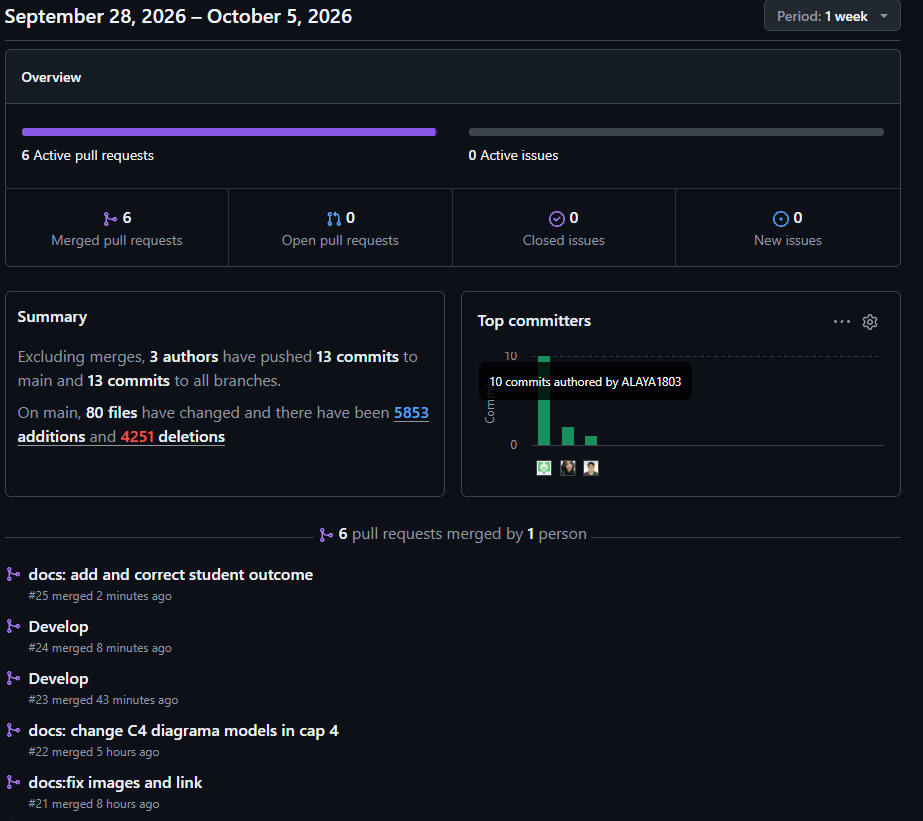
</p>

<p align="center">
  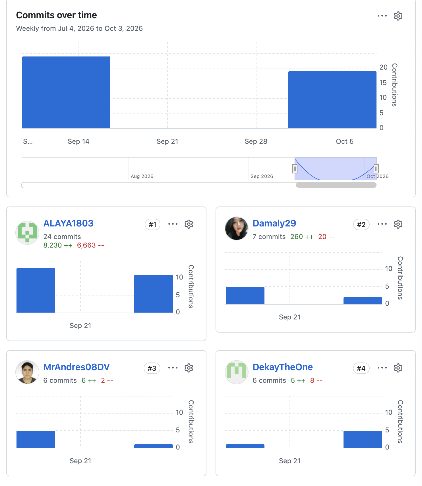
</p>

<div style="break-after: page;"></div>

# Tabla de Contenidos

- [Student Outcome](#student-outcome)
- [Capítulo 1: Introducción](#capítulo-1-introducción)
  - [1.1. Startup Profile](#11-startup-profile)
    - [1.1.1. Descripción de la startup](#111-descripción-de-la-startup)
    - [1.1.2. Perfiles de integrantes del equipo](#112-perfiles-de-integrantes-del-equipo)
  - [1.2. Solution Profile](#12-solution-profile)
    - [1.2.1. Antecedentes y problemática](#121-antecedentes-y-problemática)
    - [1.2.2. Lean UX Process](#122-lean-ux-process)
      - [1.2.2.1. Lean UX Problem Statements](#1221-lean-ux-problem-statements)
      - [1.2.2.2. Lean UX Assumptions](#1222-lean-ux-assumptions)
      - [1.2.2.3. Lean UX Hypothesis Statements](#1223-lean-ux-hypothesis-statements)
      - [1.2.2.4. Lean UX Canvas](#1224-lean-ux-canvas)
  - [1.3. Segmentos objetivo](#13-segmentos-objetivo)
- [Capítulo II: Requirements Elicitation & Analysis](#capítulo-ii-requirements-elicitation--analysis)
  - [2.1. Competidores](#21-competidores)
    - [2.1.1. Análisis competitivo](#211-análisis-competitivo)
    - [2.1.2. Estrategias y tácticas frente a competidores](#212-estrategias-y-tácticas-frente-a-competidores)
  - [2.2. Entrevistas](#22-entrevistas)
    - [2.2.1. Diseño de entrevistas](#221-diseño-de-entrevistas)
    - [2.2.2. Registro de entrevistas](#222-registro-de-entrevistas)
    - [2.2.3. Análisis de entrevistas](#223-análisis-de-entrevistas)
  - [2.3. Competidores](#23-competidores)
    - [2.3.1. User Personas](#231-user-personas)
      - [User Persona: Interesados en comenzar a cuidar plantas](#user-persona-interesados-en-comenzar-a-cuidar-plantas)
      - [User Persona: Personas con experiencia en el cuidado de plantas](#user-persona-personas-con-experiencia-en-el-cuidado-de-plantas)
    - [2.3.2. User Task Matrix](#232-user-task-matrix)
    - [2.3.3. Empathy Mapping](#233-empathy-mapping)
    - [2.3.4. As-is Scenario Mapping](#234-as-is-scenario-mapping)
  - [2.5. Ubiquitous Language](#25-ubiquitous-language)
- [Capítulo III: Requirements Specification](#capítulo-iii-requirements-specification)
  - [3.1. User Stories](#31-user-stories)
  - [3.2. Impact Mapping](#32-impact-mapping)
  - [3.3. Product Backlog](#33-product-backlog)
- [Capítulo IV: Strategic-Level Software Design](#capítulo-iv-strategic-level-software-design)
  - [4.1. Strategic-Level Attribute-Driven Design](#41-strategic-level-attribute-driven-design)
    - [4.1.1. Design Purpose](#411-design-purpose)
    - [4.1.2. Attribute-Driven Design Inputs](#412-attribute-driven-design-inputs)
      - [4.1.2.1. Primary Functionality (Primary User Stories)](#4121-primary-functionality-primary-user-stories)
      - [4.1.2.2. Quality Attribute Scenarios](#4122-quality-attribute-scenarios)
      - [4.1.2.3. Constraints](#4123-constraints)
    - [4.1.3. Architectural Drivers Backlog](#413-architectural-drivers-backlog)
    - [4.1.4. Architectural Design Decisions](#414-architectural-design-decisions)
    - [4.1.5. Quality Attribute Scenario Refinements](#415-quality-attribute-scenario-refinements)
  - [4.2. Strategic-Level Domain-Driven Design](#42-strategic-level-domain-driven-design)
    - [4.2.1. EventStorming](#421-eventstorming)
    - [4.2.2. Candidate Context Discovery](#422-candidate-context-discovery)
    - [4.2.3. Domain Message Flows Modeling](#423-domain-message-flows-modeling)
    - [4.2.4. Bounded Context Canvases](#424-bounded-context-canvases)
    - [4.2.5. Context Mapping](#425-context-mapping)
  - [4.3. Software Architecture](#43-software-architecture)
    - [4.3.1. Software Architecture System Landscape Diagram](#431-software-architecture-system-landscape-diagram)
    - [4.3.2. Software Architecture Context Level Diagrams](#432-software-architecture-context-level-diagrams)
    - [4.3.3. Software Architecture Container Level Diagrams](#433-software-architecture-container-level-diagrams)
    - [4.3.4. Software Architecture Deployment Diagrams](#434-software-architecture-deployment-diagrams)
- [Capítulo V: Tactical-Level Domain-Driven Design](#capítulo-v-tactical-level-domain-driven-design)
  - [5.1. Bounded Context: IAM](#51-bounded-context-iam)
    - [5.1.1. Domain Layer](#511-domain-layer)
    - [5.1.2. Interface Layer](#512-interface-layer)
    - [5.1.3. Application Layer](#513-application-layer)
    - [5.1.4. Infrastructure Layer](#514-infrastructure-layer)
    - [5.1.5. Bounded Context Software Architecture Component Level Diagrams](#515-bounded-context-software-architecture-component-level-diagrams)
    - [5.1.6. Bounded Context Software Architecture Code Level Diagrams](#516-bounded-context-software-architecture-code-level-diagrams)
      - [5.1.6.1. Bounded Context Domain Layer Class Diagrams](#5161-bounded-context-domain-layer-class-diagrams)
      - [5.1.6.2. Bounded Context Database Design Diagram](#5162-bounded-context-database-design-diagram)
  - [5.2. Bounded Context: Profiles](#52-bounded-context-profiles)
    - [5.2.1. Domain Layer](#521-domain-layer)
    - [5.2.2. Interface Layer](#522-interface-layer)
    - [5.2.3. Application Layer](#523-application-layer)
    - [5.2.4. Infrastructure Layer](#524-infrastructure-layer)
    - [5.2.5. Bounded Context Software Architecture Component Level Diagrams](#525-bounded-context-software-architecture-component-level-diagrams)
    - [5.2.6. Bounded Context Software Architecture Code Level Diagrams](#526-bounded-context-software-architecture-code-level-diagrams)
      - [5.2.6.1. Bounded Context Domain Layer Class Diagrams](#5261-bounded-context-domain-layer-class-diagrams)
      - [5.2.6.2. Bounded Context Database Design Diagram](#5262-bounded-context-database-design-diagram)
  - [5.3. Bounded Context: PlantProfiles](#53-bounded-context-plantprofiles)
    - [5.3.1. Domain Layer](#531-domain-layer)
    - [5.3.2. Interface Layer](#532-interface-layer)
    - [5.3.3. Application Layer](#533-application-layer)
    - [5.3.4. Infrastructure Layer](#534-infrastructure-layer)
    - [5.3.5. Bounded Context Software Architecture Component Level Diagrams](#535-bounded-context-software-architecture-component-level-diagrams)
    - [5.3.6. Bounded Context Software Architecture Code Level Diagrams](#536-bounded-context-software-architecture-code-level-diagrams)
      - [5.3.6.1. Bounded Context Domain Layer Class Diagrams](#5361-bounded-context-domain-layer-class-diagrams)
      - [5.3.6.2. Bounded Context Database Design Diagram](#5362-bounded-context-database-design-diagram)
  - [5.4. Bounded Context: IoT Management](#54-bounded-context-iot-management)
    - [5.4.1. Domain Layer](#541-domain-layer)
    - [5.4.2. Interface Layer](#542-interface-layer)
    - [5.4.3. Application Layer](#543-application-layer)
    - [5.4.4. Infrastructure Layer](#544-infrastructure-layer)
    - [5.4.5. Bounded Context Software Architecture Component Level Diagrams](#545-bounded-context-software-architecture-component-level-diagrams)
    - [5.4.6. Bounded Context Software Architecture Code Level Diagrams](#546-bounded-context-software-architecture-code-level-diagrams)
      - [5.4.6.1. Bounded Context Domain Layer Class Diagrams](#5461-bounded-context-domain-layer-class-diagrams)
      - [5.4.6.2. Bounded Context Database Design Diagram](#5462-bounded-context-database-design-diagram)
  - [5.5. Bounded Context: CareScheduling](#55-bounded-context-carescheduling)
    - [5.5.1. Domain Layer](#551-domain-layer)
    - [5.5.2. Interface Layer](#552-interface-layer)
    - [5.5.3. Application Layer](#553-application-layer)
    - [5.5.4. Infrastructure Layer](#554-infrastructure-layer)
    - [5.5.5. Bounded Context Software Architecture Component Level Diagrams](#555-bounded-context-software-architecture-component-level-diagrams)
    - [5.5.6. Bounded Context Software Architecture Code Level Diagrams](#556-bounded-context-software-architecture-code-level-diagrams)
      - [5.5.6.1. Bounded Context Domain Layer Class Diagrams](#5561-bounded-context-domain-layer-class-diagrams)
      - [5.5.6.2. Bounded Context Database Design Diagram](#5562-bounded-context-database-design-diagram)
  - [5.6. Bounded Context: Inteligencia Botánica y Análisis Externo](#56-bounded-context-inteligencia-botánica-y-análisis-externo)
    - [5.6.1. Domain Layer](#561-domain-layer)
    - [5.6.2. Interface Layer](#562-interface-layer)
    - [5.6.3. Application Layer](#563-application-layer)
    - [5.6.4. Infrastructure Layer](#564-infrastructure-layer)
    - [5.6.5. Bounded Context Software Architecture Component Level Diagrams](#565-bounded-context-software-architecture-component-level-diagrams)
    - [5.6.6. Bounded Context Software Architecture Code Level Diagrams](#566-bounded-context-software-architecture-code-level-diagrams)
      - [5.6.6.1. Bounded Context Domain Layer Class Diagrams](#5661-bounded-context-domain-layer-class-diagrams)
      - [5.6.6.2. Bounded Context Database Design Diagram](#5662-bounded-context-database-design-diagram)
  - [5.7. Bounded Context: PlantGuidance](#57-bounded-context-plantguidance)
    - [5.7.1. Domain Layer](#571-domain-layer)
    - [5.7.2. Interface Layer](#572-interface-layer)
    - [5.7.3. Application Layer](#573-application-layer)
    - [5.7.4. Infrastructure Layer](#574-infrastructure-layer)
    - [5.7.5. Bounded Context Software Architecture Component Level Diagrams](#575-bounded-context-software-architecture-component-level-diagrams)
    - [5.7.6. Bounded Context Software Architecture Code Level Diagrams](#576-bounded-context-software-architecture-code-level-diagrams)
      - [5.7.6.1. Bounded Context Domain Layer Class Diagrams](#5761-bounded-context-domain-layer-class-diagrams)
      - [5.7.6.2. Bounded Context Database Design Diagram](#5762-bounded-context-database-design-diagram)
  - [5.8. Bounded Context: EcoRewards y Web3](#58-bounded-context-ecorewards-y-web3)
    - [5.8.1. Domain Layer](#581-domain-layer)
    - [5.8.2. Interface Layer](#582-interface-layer)
    - [5.8.3. Application Layer](#583-application-layer)
    - [5.8.4. Infrastructure Layer](#584-infrastructure-layer)
    - [5.8.5. Bounded Context Software Architecture Component Level Diagrams](#585-bounded-context-software-architecture-component-level-diagrams)
    - [5.8.6. Bounded Context Software Architecture Code Level Diagrams](#586-bounded-context-software-architecture-code-level-diagrams)
      - [5.8.6.1. Bounded Context Domain Layer Class Diagrams](#5861-bounded-context-domain-layer-class-diagrams)
      - [5.8.6.2. Bounded Context Database Design Diagram](#5862-bounded-context-database-design-diagram)
    - [5.8.7. Flujo de elegibilidad y emisión](#587-flujo-de-elegibilidad-y-emisión)
- [Capítulo VI: Solution UI/UX Design](#capítulo-vi-solution-uiux-design)
  - [6.1. Style Guidelines](#61-style-guidelines)
    - [6.1.1. General Style Guidelines](#611-general-style-guidelines)
    - [6.1.2. Web, Mobile and IoT Style Guidelines](#612-web-mobile-and-iot-style-guidelines)
  - [6.2. Information Architecture](#62-information-architecture)
    - [6.2.1. Organization Systems](#621-organization-systems)
    - [6.2.2. Labeling Systems](#622-labeling-systems)
    - [6.2.3. SEO Tags and Meta Tags](#623-seo-tags-and-meta-tags)
    - [6.2.4. Searching Systems](#624-searching-systems)
    - [6.2.5. Navigation Systems](#625-navigation-systems)
  - [6.3. Landing Page UI Design](#63-landing-page-ui-design)
    - [6.3.1. Landing Page Wireframe](#631-landing-page-wireframe)
    - [6.3.2. Landing Page Mock-up](#632-landing-page-mock-up)
  - [6.4. Applications UX/UI Design](#64-applications-uxui-design)
    - [6.4.1. Applications Wireframes](#641-applications-wireframes)
      - [6.4.1.1. Web Applications Wireframes](#6411-web-applications-wireframes)
      - [6.4.1.2. Mobile Applications Wireframes](#6412-mobile-applications-wireframes)
    - [6.4.2. Applications Wireflow Diagrams](#642-applications-wireflow-diagrams)
      - [6.4.2.1. Web Applications Wireflow Diagrams](#6421-web-applications-wireflow-diagrams)
      - [6.4.2.2. Mobile Applications Wireflow Diagrams](#6422-mobile-applications-wireflow-diagrams)
    - [6.4.3. Applications Mock-ups](#643-applications-mock-ups)
    - [6.4.4. Applications User Flow Diagrams](#644-applications-user-flow-diagrams)
  - [6.5. Applications Prototyping](#65-applications-prototyping)
  - [6.6. IoT Device Design](#66-iot-device-design)
    - [6.6.1. Criterios de Diseño Físico e Introducción](#661-criterios-de-diseño-físico-e-introducción)
    - [6.6.2. Relación con la Arquitectura de Información y Guía de Estilos](#662-relación-con-la-arquitectura-de-información-y-guía-de-estilos)
    - [6.6.3. Diseño de Circuito (Hardware Architecture)](#663-diseño-de-circuito-hardware-architecture)
    - [6.6.4. Flujos de Interacción del Prototipo](#664-flujos-de-interacción-del-prototipo)
- [Capítulo VII: Product Implementation, Validation & Deployment](#capítulo-vii-product-implementation-validation--deployment)
  - [7.1. Software Configuration Management](#71-software-configuration-management)
    - [7.1.1. Software Development Environment Configuration](#711-software-development-environment-configuration)
    - [7.1.2. Source Code Management](#712-source-code-management)
    - [7.1.3. Source Code Style Guide & Conventions](#713-source-code-style-guide--conventions)
    - [7.1.4. Software Deployment Configuration](#714-software-deployment-configuration)
  - [7.2. Solution Implementation](#72-solution-implementation)
    - [7.2.1. Sprint 1](#721-sprint-1)
      - [7.2.1.1. Sprint Planning 1](#7211-sprint-planning-1)
      - [7.2.1.2. Sprint Backlog 1](#7212-sprint-backlog-1)
      - [7.2.1.3. Development Evidence for Sprint Review](#7213-development-evidence-for-sprint-review)
      - [7.2.1.4. Testing Suite Evidence for Sprint Review](#7214-testing-suite-evidence-for-sprint-review)
      - [7.2.1.5. Execution Evidence for Sprint Review](#7215-execution-evidence-for-sprint-review)
      - [7.2.1.6. Services Documentation Evidence for Sprint Review](#7216-services-documentation-evidence-for-sprint-review)
      - [7.2.1.7. Software Deployment Evidence for Sprint Review](#7217-software-deployment-evidence-for-sprint-review)
      - [7.2.1.8. Team Collaboration Insights during Sprint](#7218-team-collaboration-insights-during-sprint)
  - [7.3. Validation Interviews](#73-validation-interviews)
    - [7.3.1. Diseño de Entrevistas](#731-diseño-de-entrevistas)
    - [7.3.2. Registro de Entrevistas](#732-registro-de-entrevistas)
      - [7.3.2.1. Ficha guía V-N01 — primera planta](#7321-ficha-guía-v-n01--primera-planta)
      - [7.3.2.2. Ficha guía V-N02 — organización del primer cuidado](#7322-ficha-guía-v-n02--organización-del-primer-cuidado)
      - [7.3.2.3. Ficha guía V-N03 — orientación y fotografía](#7323-ficha-guía-v-n03--orientación-y-fotografía)
      - [7.3.2.4. Ficha guía V-E01 — colección e historial](#7324-ficha-guía-v-e01--colección-e-historial)
      - [7.3.2.5. Ficha guía V-E02 — dispositivo y control](#7325-ficha-guía-v-e02--dispositivo-y-control)
      - [7.3.2.6. Ficha guía V-E03 — seguimiento y recompensa](#7326-ficha-guía-v-e03--seguimiento-y-recompensa)
    - [7.3.3. Evaluaciones según heurísticas](#733-evaluaciones-según-heurísticas)
  - [7.4. Video About-the-Product](#74-video-about-the-product)
- [Conclusiones](#conclusiones)
- [Conclusiones y recomendaciones TB2](#conclusiones-y-recomendaciones-tb2)
- [Video About-the-Team](#video-about-the-team)
- [Bibliografía](#bibliografía)
- [Anexos](#anexos)
- [Anexo A: Evidencia de Videos de Exposiciones — TB2](#anexo-a-evidencia-de-videos-de-exposiciones--tb2)
- [Anexo B: Trazabilidad y criterio de cierre TB2](#anexo-b-trazabilidad-y-criterio-de-cierre-tb2)
- [Anexo C: Procedencia de evidencia técnica](#anexo-c-procedencia-de-evidencia-técnica)

<div style="break-after: page;"></div>

## Student Outcome

El curso contribuye al cumplimiento del Student Outcome ABET:

**ABET – EAC-Student Outcome 3**

**Criterio:** *Capacidad de comunicarse efectivamente con un rango de audiencias*. En el siguiente cuadro se describe las acciones realizadas y enunciados de conclusiones por parte del grupo, que permiten sustentar el haber alcanzado el logro del ABET – EAC-Student Outcome 3.

**Complemento TB2.** Se mantienen las declaraciones de hitos anteriores en el cuadro histórico. El siguiente cuadro agrega el estado verificable para cada integrante; las actividades orales no se dan por realizadas antes de disponer de la grabación.

| Criterio específico | Acciones realizadas / evidencia TB2 | Conclusiones |
|---|---|---|
| Comunicación oral — Rodrigo Alaya Cabrera | Exposición TB2 por registrar; guion de arquitectura, integración y resultados preparado en este documento. Añadir enlace y timing de su intervención real | El logro oral TB2 queda pendiente de evidencia; el guion no equivale a una exposición |
| Comunicación oral — Carlos Andrés Coca Lavado | Exposición TB2 por registrar; completar aporte explicado, audiencia y timing | Evaluar claridad y adaptación del lenguaje en la grabación |
| Comunicación oral — Jocelyn Damaly Almerco Rojas | Exposición TB2 por registrar; completar aporte explicado, audiencia y timing | Evaluar claridad y sustento de decisiones en la grabación |
| Comunicación oral — Ivan Jeanpierre La Madrid Lozano | Exposición TB2 por registrar; completar aporte explicado, audiencia y timing | Evaluar comunicación objetiva y respuesta a preguntas |
| Comunicación oral — Diego Sebastian Zuñiga Murillo | Exposición TB2 por registrar; completar aporte explicado, audiencia y timing | Evaluar comunicación de resultados y limitaciones |
| Comunicación escrita — Rodrigo Alaya Cabrera | Historial de commits de integración y README de frontend/backend; merge `a60165a` del informe | Existe trazabilidad escrita entre artefactos técnicos y explicación; confirmar revisión final del informe TB2 |
| Comunicación escrita — Carlos Andrés Coca Lavado | Aportes previos conservados; falta vincular un artefacto o revisión individual TB2 | No atribuir autoría nueva sin evidencia |
| Comunicación escrita — Jocelyn Damaly Almerco Rojas | Aportes previos conservados; falta vincular un artefacto o revisión individual TB2 | Completar evidencia individual antes de cerrar el resultado |
| Comunicación escrita — Ivan Jeanpierre La Madrid Lozano | Falta registrar artefacto, commit o revisión individual TB2 | Completar trazabilidad de su comunicación escrita |
| Comunicación escrita — Diego Sebastian Zuñiga Murillo | Falta registrar artefacto, commit o revisión individual TB2 | Completar trazabilidad de su comunicación escrita |

**Conclusión grupal TB2:** el informe articula necesidades, diseño, implementación y limitaciones para lectores técnicos y no técnicos. Esta mejora documental no acredita por sí sola participación individual ni logro oral de todos los miembros; ambos se cerrarán con las evidencias del Anexo A y las revisiones atribuidas.


<div align="center">

<table>
    <thead>
        <tr>
            <th>Criterio específico</th>
            <th>Acciones realizadas</th>
            <th>Conclusiones</th>
        </tr>
    </thead>
    <tbody>
        <tr>
            <td>Comunica oralmente sus ideas y/o resultados con objetividad a público de diferentes especialidades y niveles jerarquicos, en el marco del desarrollo de un proyecto en ingeniería.</td>
            <td>
                <b>AV1:</b><br><br>
                <b>Rodrigo Alaya Cabrera:</b> Conduje entrevistas con usuarios potenciales durante la fase de Needfinding, adaptando mi lenguaje para evitar tecnicismos y lograr extraer información objetiva sobre sus necesidades reales en el cuidado de plantas. Además, expuse mis ideas en las reuniones de equipo para definir el Startup Profile y el Lean UX.<br><br>
                <b>Jocelyn Damaly Almerco Rojas:</b> Participé en las reuniones del equipo, realicé entrevistas y analicé sus resultados para identificar necesidades de los usuarios. También propuse la idea de incorporar una cámara que ayude a reconocer posibles enfermedades en las plantas.<br><br>
                <b>Coca Lavado, Carlos Andrés:</b> Contribuí en la reunión para la definición de la linea evolutiva del proyecto y los segmentos objetivos que se evaluaran<br><br>
                <b>TB1:</b><br><br>
                <b>Rodrigo Alaya Cabrera:</b> Sustenté oralmente las decisiones de diseño a nivel estratégico (Domain-Driven Design) y la arquitectura de software del sistema IoT. Expliqué la interacción entre los sensores, la IA y la aplicación de manera clara, adaptando el nivel de profundidad técnica para asegurar la comprensión tanto de desarrolladores como de evaluadores.<br><br>
                <b>Jocelyn Damaly Almerco Rojas:</b> Participé en las reuniones de revisión del proyecto y compartí la propuesta de usar la cámara del dispositivo móvil para analizar las plantas y detectar posibles enfermedades, explicando cómo esta capacidad podría apoyar a los usuarios.<br><br>
                <b>Coca Lavado, Carlos Andrés:</b> Contribuí activamente en las reuniones de revisión del proyecto, Realize las el analisis de la arquitecutra de la solución. Definición de segmentos objetivos y Startup Profile<br><br>
                <b>AV2:</b><br><br>
                <b>- :</b><br><br>
                <b>TB2:</b><br><br>
                <b>- :</b><br><br>
            </td>
            <td>
                <b>AV1:</b> La comunicación oral adaptativa durante las entrevistas tempranas fue fundamental para identificar con precisión los "pain points" de los usuarios, lo que permitió validar nuestras hipótesis iniciales de negocio sin sesgar las respuestas.<br><br>
                <b>TB1:</b> Exponer de manera estructurada los diagramas arquitectónicos y modelos de dominio garantizó que los lineamientos técnicos del proyecto PlantSync fueran comprendidos por todas las partes interesadas, demostrando dominio del tema y claridad expositiva.<br><br>
                <b>AV2:</b><br><br>
                <b>TB2:</b><br><br>
            </td>
        </tr>
        <tr>
            <td>Comunica en forma escrita ideas y/o resultados con objetividad a público de diferentes especialidades y niveles jerarquicos, en el marco del desarrollo de un proyecto en ingeniería de Software </td>
            <td>
                <b>AV1:</b><br><br>
                <b>Rodrigo Alaya Cabrera:</b> Redacté de forma estructurada los artefactos del Lean UX Process, perfiles de usuario (User Personas) y el registro analítico de entrevistas, asegurando que la información plasmada sea objetiva y fácilmente digerible para cualquier stakeholder del negocio o miembro del equipo.<br><br>
                 <b>Jocelyn Damaly Almerco Rojas:</b> Organicé y analicé la información obtenida en las entrevistas de AV1, identificando hallazgos sobre las necesidades de los usuarios y comunicándolos de forma clara para apoyar el análisis del proyecto.<br><br>
                 <b>Coca Lavado, Carlos Andrés:</b> Desarrolle correctamente las entrevistas en las que participe para la recopilación de datos brindados por nuestros usuarios<br><br>
                <b>TB1:</b><br><br>
                <b>Rodrigo Alaya Cabrera:</b> Elaboré y documenté la especificación de diseño táctico (Bounded Contexts), así como los diagramas a nivel de código y base de datos en el reporte oficial. Utilicé un lenguaje técnico estandarizado, formatos de tablas y notación UML/C4 para asegurar una lectura fluida y profesional.<br><br>
                <b>Jocelyn Damaly Almerco Rojas:</b> Contribuí con la propuesta de incorporar análisis de imágenes para identificar posibles enfermedades en las plantas, comunicando su propósito y valor para el usuario como parte de las ideas consideradas para la solución PlantSync.<br><br>
                <b>Coca Lavado, Carlos Andrés:</b> Participé en el apartado de mejorar nuestra solución movil/web para integrarla a las nuevas tecnologias emergentes y a su vez entregarle una nueva experiencia optima al usuario<br><br>
                <b>AV2:</b><br><br>
                <b>- :</b><br><br>
                <b>TB2:</b><br><br>
                <b>- :</b><br><br>
            </td>
            <td>
                <b>AV1:</b> Plasmar por escrito los hallazgos del análisis de requerimientos de manera ordenada facilitó la alineación de todo el equipo respecto a los objetivos del producto y características de los segmentos objetivo.<br><br>
                <b>TB1:</b> La correcta y exhaustiva documentación de la arquitectura de software proporcionó una guía técnica sólida y sin ambigüedades, lo cual es esencial para que desarrolladores y diseñadores puedan implementar el sistema de manera coordinada.<br><br>
                <b>AV2:</b><br><br>
                <b>TB2:</b><br><br>
            </td>
        </tr>
    </tbody>
</table>

</div>
<div style="break-after: page;"></div>


# Capítulo 1: Introducción
## 1.1. Startup Profile
### 1.1.1. Descripción de la startup
Nuestra startup, NatureTech, se establece con la misión de ofrecer soluciones tecnológicas para el mantenimiento de plantas en hogares, aprovechando al máximo las tecnologías IoT para promover un cambio positivo en el medio ambiente.

Nuestro producto, PlantSync, es un servicio digital accesible desde aplicaciones web y móvil que facilita a los usuarios el seguimiento y cuidado de sus plantas. Proporciona información en tiempo real sobre las condiciones ambientales, recomendaciones personalizadas de riego y fertilización, alertas automáticas, guías de cuidado e identificación de plantas mediante fotografías. Nuestro compromiso es fomentar la responsabilidad ambiental mientras contribuimos a la sostenibilidad.

**Misión**:  
Nuestra misión es facilitar el cuidado de plantas en el hogar mediante soluciones tecnológicas accesibles e inteligentes. Nos comprometemos a proporcionar herramientas personalizadas que permitan a nuestros usuarios mantener sus plantas saludables mientras fortalecen su conexión con el medio ambiente.

**Visión**:  
En un período de cinco años, NatureTech alcanzará la posición de vanguardia en el mercado de soluciones tecnológicas para el cuidado de plantas en el hogar. PlantSync se consolidará como la aplicación de referencia para entusiastas de la jardinería hogareña en América Latina, quienes buscan mantener sus plantas saludables y vibrantes. Nos destacaremos por la excelencia, la asequibilidad y la originalidad de nuestras soluciones.

**Valores**:  
Promovemos la ecología como prioridad, la innovación tecnológica como motor de cambio y la eficiencia operativa como resultado. Nos comprometemos con la confiabilidad de nuestros sistemas, la prevención de contaminacion y la protección de la vida en cualquier entorno y medio.

### 1.1.2. Perfiles de integrantes del equipo

|  Nombres y Apellidos |    Codigo   | Descripción | Foto | 
|----------------------|-------------|-------------|------|
| Jocelyn Damaly  Almerco Rojas | u20221G068  | Soy estudiante de Ingeniería de Software, con conocimientos en lenguajes como C++, SQL, HTML, CSS y JavaScript. Durante mi formación académica he fortalecido mis habilidades en análisis lógico, documentación técnica y diseño estructurado de software, además de adquirir conocimientos básicos en frameworks como Angular y Vue.js para el desarrollo frontend. Me interesa seguir desarrollando mis competencias en programación y participar en proyectos que me permitan aplicar buenas prácticas de desarrollo y mejorar la calidad de las soluciones tecnológicas. Me considero una persona responsable y comprometida con el aprendizaje continuo. |    |
| - |  -  | - | |
| Rodrigo Alaya Cabrera |  U202219481  | Soy una persona responsable, comprometida con mis objetivos y con gran disposición para aprender continuamente. Me adapto con facilidad al trabajo en equipo, aportando ideas y soluciones. Valoro mucho la eficiencia, la ética profesional y la mejora constante. Me esfuerzo por entregar siempre resultados de calidad, gestionando mis tareas con orden y enfoque. |    |
| Carlos Andrés Coca Lavado  | U202313172  | Mi Nombre es Carlos Andrés Coca, tengo 20 años, actualmente me encuentro cursando el octavo ciclo de la carrera de Ingeniería de Software. Cuento con conocimientos en C++, Python y HTML. y desde muy joven me ha interesado el desarrollo Web. Teniendo en cuenta el gran impacto que presentan a día de hoy las novedosas soluciones presentadas. |   |
<div style="break-after: page;"></div>

## 1.2. Solution Profile

### 1.2.1. Antecedentes y problemática

La relación entre los seres humanos y las plantas ha evolucionado de una mera dependencia de subsistencia a una conexión profunda de bienestar psicológico y salud social. En la actualidad, tener plantas en el hogar no es solo una decisión estética; responde a una necesidad de reducir el cortisol y el estrés urbano, actuando como un mecanismo de autorregulación emocional. Diversas fuentes psicológicas destacan que el "fanatismo" por las plantas surge del instinto de cuidado y la gratificación de ver un ser vivo prosperar bajo nuestra responsabilidad. No obstante, existe una contradicción fundamental: mientras que el 80% de la biomasa terrestre es vegetal, la mayoría de los ciudadanos urbanos carecen de la alfabetización biológica para mantener este plexo vivo en sus hogares.

La horticultura terapéutica demuestra que el acto de cultivar mejora la salud física y mental, reduciendo la depresión y la ansiedad. Sin embargo, la entrada de estos "cuidados verdes" en el hogar se ve amenazada por la falta de tiempo, la incapacidad de diagnosticar enfermedades a simple vista y la pérdida de motivación a largo plazo. Para cuidar a los humanos, las plantas primero deben ser cuidadas, y es aquí donde surge la problemática: el usuario moderno se enfrenta a una fragmentación de cuidados y a una sobrecarga cognitiva al intentar buscar soluciones genéricas en internet cuando su planta enferma.

Esta desconexión genera una brecha de éxito. Existe una necesidad imperativa de herramientas disruptivas que funcionen como mediadoras de cuidados, permitiendo que la tecnología IoT, combinada con la Inteligencia Artificial (Computer Vision y Agentes Autónomos) y la gamificación descentralizada (Web3), actúe como un puente para que el usuario pueda entender, delegar y ser recompensado por el cuidado de su micro-ecosistema doméstico de forma remota y precisa.

<h4>WHO (Quién)</h4>

+ **Afectados directos:** Entusiastas del cuidado de plantas, divididos en novatos (quienes sufren mayor frustración emocional por no saber identificar visualmente las enfermedades de sus plantas) y experimentados (quienes buscan automatización precisa y delegación de tareas); ambos dependen de su intuición o de cronogramas manuales que a menudo fallan por falta de datos objetivos y tiempo.

+ **Beneficiarios indirectos:** El ecosistema doméstico y la salud mental del usuario, dado que las plantas actúan como mediadoras de bienestar y agentes de "salutogénesis".

<h4>WHAT (Qué)</h4>

+ **El problema:** Una alta tasa de mortalidad botánica debido a la incapacidad humana para interpretar las señales bióticas en tiempo real, sumado a la falta de constancia en el mantenimiento a largo plazo.

+ **El objeto técnico:** Un ecosistema integrado por nodos IoT, algoritmos de Inteligencia Artificial (Visión Computacional para diagnóstico visual y un LLM para la toma de decisiones autónoma) y Smart Contracts desplegados en redes Blockchain de prueba.

+ **El servicio:** Una plataforma multiplataforma que ofrece monitoreo de telemetría, diagnóstico de enfermedades por fotografía (Computer Vision), un Agente Virtual que ejecuta acciones físicas a distancia (Action-oriented AI), y un sistema de gamificación que premia la constancia con medallas digitales (Eco-Tokens en Web3).

<h4>WHERE (Dónde)</h4>

+ **Espacio físico:** Hogares urbanos, departamentos con iluminación natural inconsistente y oficinas donde el microclima no siempre es apto para la vida vegetal.

+ **Entorno digital:** La interacción ocurre en la capa física, en la nube (procesamiento de datos y APIs de Inteligencia Artificial), en redes descentralizadas (Testnets Web3) y en las interfaces de usuario (Mobile y Web).

<h4>WHEN (Cuándo)</h4>

+ **Temporalidad del problema:** El riesgo de daño es continuo, intensificándose durante jornadas laborales extensas. La confusión visual surge en el momento en que la planta empieza a cambiar de coloración o a marchitarse.

+ **Ciclo de vida:** Desde la adquisición de la planta hasta su mantenimiento a largo plazo (fase de delegación al Agente Autónomo y recolección de recompensas Web3).

+ **Momento de la alerta:** Inmediato al detectar anomalías en la telemetría IoT o tras el análisis fotográfico realizado por el usuario.

<h4>WHY (Por qué)</h4>

+ **Justificación:** Existe una "separación de sociedad y naturaleza" que ha dejado a los humanos sin la capacidad de entender las necesidades de las plantas visual o ambientalmente.

+ **Causa raíz:** La falta de herramientas accesibles que transformen datos y fotos en diagnósticos exactos, la incapacidad de ejecutar acciones automáticas a distancia de forma conversacional, y la falta de un incentivo tangible (gamificación) que fomente el hábito del cuidado constante.

+ **Motivación psicológica:** El fracaso botánico genera percepción de incapacidad. Inversamente, recibir un Eco-Token digital tras salvar una planta genera un refuerzo positivo de dopamina que consolida el hábito.

<h4>HOW (Cómo)</h4>

+ **Diferencia entre estado óptimo y problema:** En el estado de problema, existe una "asimetría de información": el usuario percibe la planta como "sana" visualmente o no sabe cómo interpretar una mancha, buscando respuestas erróneas en la web. En el estado óptimo, la brecha se cierra: el usuario simplemente toma una foto, la Visión Computacional diagnostica la enfermedad con precisión, y el Agente Autónomo de IA toma el control de los actuadores IoT (riego, luz UV) para corregir el entorno, todo mientras el usuario acumula Smart Contracts (Eco-Tokens) por sus buenos resultados.

+ **Patrón de aparición:** El problema no es aleatorio; sigue patrones cíclicos. Estos se dividen en:
  + **Patrones circadianos:** Déficits de luz en horarios específicos del día debido a la rotación solar y sombras urbanas (edificios).
  + **Patrones estacionales:** Variaciones en la intensidad lumínica según la época del año.
  + **Patrones de actividad humana:** La falta de cuidado coincide con las jornadas laborales de 8 a 10 horas o periodos de viaje, momentos en los que el usuario se desconecta físicamente de la planta.

<h4>HOW MUCH (Cuánto)</h4>

+ **Frecuencia y Gravedad de los Problemas:**
  + **Mortalidad:** Aproximadamente el 35% de las plantas mueren en hogares por cuidados inadecuados.
  + **Impacto diario:** Se detectan de 3 a 5 fluctuaciones críticas de luz al día que requieren intervención automática o manual.
+ **Implicación económica:**
  + Tomando como referencia a esta tienda online [https://www.teslaelectronic.com.pe/tarjetas-arduino/](https://www.teslaelectronic.com.pe/tarjetas-arduino/), el desglose de costos de IoT es el siguiente, tomando como costo máximo **S/.237**: 
  
  | Componente | Costo unitario | Descripción |
  |---|---|---|
  |Arduino UNO R4 WiFi|S/.129|Placa arduino|
  |Sensor de Humedad de Suelo Capacitivo v2.0|S/.15|Mide la humedad en la tierra que detecta el sensor|
  |Módulo detector de radiación UVB con ML8511|S/.68|Mide la luz ultravioleta que llega al sensor|
  |Módulo sensor de luz BH1750|S/.15|Mide la luz que llega al sensor|
  |Sensor DHT11 Temperatura y Humedad KY-015|S/.10|Mide la temperatura y humedad del ambiente|
  
  +  Tomando como referencia a esta plataforma de reclutamiento [https://jobicy.com/salaries/pe/software-developer#salary-section](https://jobicy.com/salaries/pe/software-developer#salary-section), y tomando en cuenta el equipo de 7 desarrolladores junior, el desglose de desarrollo sería el siguiente, tomando como costo máximo :
  
  |Herramienta|Costo unitario mensual|Descripción|
  |-|-|-|
  |Capital humano | 8750$ | 15000$ (salario anual junior estimado) ÷ 12 meses * 7 integrantes
  | AWS App Runner (Backend) | 15$| Despliegue del RESTful API (Spring Boot/ASP.NET Core).
  | Vercel Pro (Frontend) | 20$ | Hosting de alta disponibilidad para la Web Application (Angular/Vue).|
  | Figma Profesional | 20$ | Licencias para el diseño de Wireframes, Mock-ups y Prototipos.
  | UXPressia Pro | 36$ | Elaboración de User Personas, Journey Maps e Impact Maps.
  | Lucid Suite Individual| 18$ | Diagramas C4 Model, UML y Database Design. | 
  | Jira Standard | 7.91$ | Gestión de Product Backlog y Sprints.|
  

### 1.2.2. Lean UX Process

#### 1.2.2.1. Lean UX Problem Statements

Nuestra plataforma integral de cuidado botánico fue diseñada para lograr que los usuarios mantengan la salud de sus plantas de forma óptima, eliminando la carga cognitiva del cuidado mediante tecnologías disruptivas. Hemos observado que los servicios actuales del mercado no interpretan efectivamente las señales bióticas, carecen de diagnósticos visuales precisos y no fomentan la constancia a largo plazo, causando una tasa de mortalidad del 35% y alta frustración. ¿Cómo podríamos mejorar nuestra plataforma para que nuestros clientes tengan más éxito basándonos en la reducción del 50% de la pérdida de plantas domésticas y el aumento significativo de la interacción diaria de los usuarios?

**Aspectos Específicos:**
+ **Domain:** Smart Gardening integrando IoT, Inteligencia Artificial Activa y Tecnologías Descentralizadas (Web3).
+ **Customer Segments:** Entusiastas novatos y cuidadores experimentados de plantas domésticas.
+ **Pain Points:** Incertidumbre al diagnosticar visualmente enfermedades botánicas, falta de tiempo para actuar físicamente sobre la planta y desmotivación con el paso de las semanas.
+ **Gap:** Inexistencia de soluciones que unifiquen sensores/actuadores (IoT) con diagnósticos fotográficos (Computer Vision), delegación autónoma de tareas (AI Agents) y sistemas de retención gamificados (Web3).
+ **Visión/Strategy:** Ecosistema multicomponente que democratice el cuidado botánico de precisión trasladando la carga de decisiones de la mente humana a un agente de inteligencia artificial con capacidades de actuación física.
+ **Initial Segment:** Entusiastas novatos con el hobby del cuidado de plantas y agendas apretadas.

#### 1.2.2.2. Lean UX Assumptions

<h5>Business Assumptions</h5>

1. **Creemos que nuestros clientes tienen la necesidad de:** Mantener sus plantas saludables sin requerir conocimientos botánicos avanzados ni invertir tiempo excesivo en diagnósticos manuales.
2. **Estas necesidades pueden resolverse con:** Una plataforma que integre sensores ambientales, diagnósticos fotográficos con Inteligencia Artificial, y un Agente Autónomo que accione sistemas de luz o riego, complementado con recompensas gamificadas en Web3.
3. **Nuestro clientes iniciales son (o serán):** Entusiastas novatos que han sufrido la muerte de sus plantas por no saber qué enfermedad tenían.
4. **El valor número uno que un cliente quiere obtener de nuestro servicio es:** La supervivencia garantizada de sus plantas. Beneficios adicionales: Diagnóstico exacto sin esfuerzo mediante la cámara, automatización de tareas vía chat y colección de medallas digitales exclusivas (Eco-Tokens).
5. **Obtendremos la mayoría de nuestros clientes a través de:** La Landing Page del proyecto y marketing de contenidos destacando el uso de IA aplicada a la ecología hogareña.
6. **Ganaremos dinero mediante:** La venta de los nodos hardware IoT y suscripciones premium para interacciones ilimitadas con el Agente de Inteligencia Artificial.
7. **Nuestra competencia principal en el mercado será:** Aplicaciones genéricas de recordatorios de riego e identificadores básicos de plantas. Les ganaremos debido a: La integración total entre diagnóstico visual, ejecución autónoma en el hogar y gamificación criptográfica.
8. **El mayor riesgo de nuestro producto es:** Que los usuarios no confíen en delegar acciones físicas a una IA en su hogar. Resolveremos esto a través de: Un historial transparente y notificaciones push preventivas antes de que la IA tome una decisión.
9. **Otras supocisiones:** Que los usuarios cuentan con conectividad WiFi estable en el lugar donde ubican sus plantas.

<h5>User Assumptions</h5>

1. **¿Quién es el usuario?:** Personas urbanas con poco tiempo libre que sufren ansiedad al ver deteriorarse sus plantas por falta de conocimiento empírico.
2. **¿Dónde encaja nuestro producto en su trabajo o vida?:** Integrándose como un jardinero virtual autónomo en su bolsillo y en su hogar.
3. **¿Qué problemas resuelve nuestro producto?:** La confusión ante los síntomas visuales de enfermedades botánicas, el olvido de cuidados básicos y la falta de estímulo para crear el hábito del cuidado.
4. **¿Cuándo y cómo se utiliza nuestro producto?:** Diariamente a través del chat de la app móvil para conversar con el Agente IA, tomar fotos para diagnósticos instantáneos, y visualizar su colección de Eco-Tokens.
5. **¿Qué características (features) son importantes?:** Diagnóstico preciso por cámara (Computer Vision), el Chatbot Activo (AI Agent) para ejecutar riego/luz remotamente, y el Dashboard de recompensas Web3.
6. **¿Cómo debería verse y comportarse nuestro producto?:** Debe ser intuitivo, educativo y con un tono entusiasta que refuerce el éxito del usuario en su hobby.

#### 1.2.2.3. Lean UX Hypothesis Statements


<h4>Hypothesis Statement 01</h4>

Creemos que los expertos y principiantes cuidadores de plantas necesitan una plataforma con monitoreo automatizado mediante sensores IoT y Edge Computing que les permita conocer el estado real de sus plantas, midiendo factores como la humedad del suelo y la temperatura ambiental, sin depender exclusivamente de la observación visual. Sabremos que hemos tenido éxito cuando la tasa de adopción activa, comprendida por los usuarios que registran al menos una planta, vinculan un nodo IoT y mantienen la telemetría funcionando por más de 14 días consecutivos, se encuentre alrededor del 70% del total de usuarios registrados en la plataforma.


<h4>Hypothesis Statement 02</h4>

Creemos que complementar los datos de los sensores con diagnósticos instantáneos mediante Visión Computacional a partir de fotografías tomadas por el usuario ayudará a identificar enfermedades con mayor precisión que las guías tradicionales. Sabremos que esto es cierto cuando al menos el 70% de los usuarios con sensores instalados utilice la funcionalidad de análisis de imágenes y reporte una mejora visible en la salud de sus plantas tras aplicar las recomendaciones durante 2 semanas.

<h4>Hypothesis Statement 03</h4>
Creemos que la visualización en tiempo real de la telemetría sumada a la capacidad de delegar acciones físicas, como la activación de luces o riego, a un Agente Autónomo de Inteligencia Artificial será de gran ayuda para que los usuarios con poco tiempo mantengan rutinas de cuidado efectivas. Sabremos que esto es cierto cuando al menos el 40% de los usuarios interactúe con el asistente inteligente para automatizar tareas al menos 3 veces por semana.


<h4>Hypothesis Statement 04</h4>
Creemos que la implementación de un sistema de recompensas basado en Web3 y Smart Contracts, donde se otorgan medallas digitales denominadas Eco-Tokens por mantener la salud óptima de las plantas, será el mayor incentivo para la constancia de los principiantes. Sabremos que esto es cierto cuando los usuarios que acumulan recompensas en la blockchain demuestren una tasa de interacción con la plataforma un 30% superior a los usuarios que únicamente se guían por alertas estáticas del sistema.

#### 1.2.2.4. Lean UX Canvas


<p align="center">
    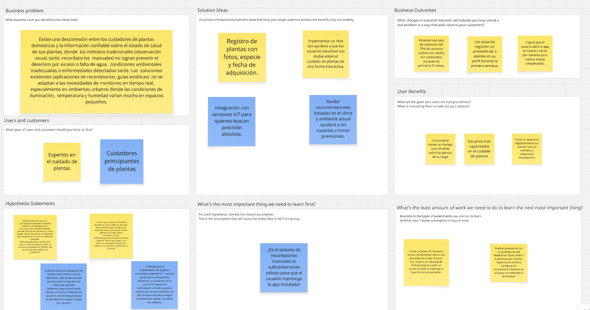
</p>

[Enlace al tablero en Miro](https://miro.com/app/board/uXjVHfgR13k=/?share_link_id=679214059458)


<div style="page-break-before: always;"></div>

## 1.3. Segmentos objetivo

Según Revista Economía (2020), los peruanos realizaron más de cincuenta y un mil búsquedas en línea relacionadas con áreas verdes entre los meses de enero y octubre. De estas consultas, un sesenta y seis por ciento correspondía al mantenimiento y mejora de jardines en el hogar. Además, el sesenta y cuatro por ciento de las personas que realizaron estas búsquedas tenían entre treinta y cuatro y cincuenta años. Esta tendencia nos indica de manera clara que existen segmentos con poder adquisitivo dispuestos a adoptar soluciones tecnológicas para facilitar el cuidado de sus espacios naturales domésticos.

<h3>Principiantes cuidadores de plantas</h3>

Personas interesadas en iniciarse en el cuidado de plantas que buscan evitar el fracaso inicial mediante tecnología sencilla.

<h5>Características demográficas:</h5>

  - Edad: De 18 a 45 años.

  - Ubicación: Residentes de zonas urbanas, específicamente departamentos, con espacio limitado y poco conocimiento botánico.

  - Nivel socioeconómico: Medio. Valoran soluciones que les ahorren tiempo y dinero al evitar que sus plantas mueran.

  - Nivel educativo: Con conocimientos de tecnología e interacción ágil con aplicaciones móviles.

<h3>Expertos cuidadores de plantas</h3>

Personas con amplia experiencia y colecciones botánicas que buscan optimizar el crecimiento de sus ejemplares mediante datos precisos.

<h4>Características demográficas:</h4>

- Edad: De 25 a 55 años.

- Ubicación: Residentes de áreas urbanas y suburbanas con espacios dedicados, tales como terrazas o jardines interiores.

- Nivel socioeconómico: Medio a alto. Dispuestos a invertir en hardware, como nodos IoT, para proteger plantas de alto valor o especies exóticas.

- Nivel educativo: Perfil tecnológico avanzado. Se sienten cómodos analizando gráficas de telemetría y comparando datos históricos.

<div style="page-break-before: always;"></div>

# Capítulo II: Requirements Elicitation & Analysis

## 2.1. Competidores

En la presente sección se analizaron a los principales competidores que representan el liderazgo actual en software de cuidado botánico e integración básica de hardware. El análisis permite identificar la brecha tecnológica que NaturaTech cubrirá mediante la implementación de tecnologías emergentes (Visión Computacional, Agentes Autónomos de IA integrados con IoT, y Smart Contracts sobre Web3), estableciendo una propuesta de valor única en el mercado y cumpliendo con los requerimientos de una arquitectura moderna y distribuida[cite: 3].

### 2.1.1. Análisis competitivo

<table>
  <tr>
    <th colspan="5">Competitive Analysis Landscape</th>
  </tr>
  <tr>
    <td colspan="2" align="center"><b>¿Por qué llevar a cabo este análisis?</b></td>
    <td colspan="3">El objetivo es identificar las limitaciones de las aplicaciones actuales y comparar nuestra capacidad disruptiva (Agente de IA que ejecuta acciones físicas y recompensas Web3) frente a soluciones pasivas, asegurando una experiencia superior y un modelo de retención innovador.</td>
  </tr>
  <tr>
    <th colspan="2">Nombre</th>
    <th>NaturaTech</th>
    <th>Xiaomi Flower Care</th>
    <th>Planta App</th>
    <th>Vera: Plant Care Made Easy</th>
  </tr>
  <tr>
    <td colspan="2" align="center"><b>Logo</b></td>
    <td align="center">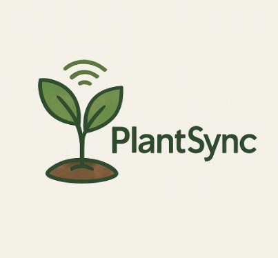</td>
    <td align="center"></td>
    <td align="center">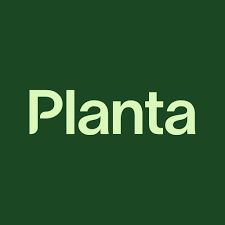</td>
    <td align="center"></td>
  </tr>
  <tr>
    <td rowspan="2"><b>Perfil</b></td>
    <td><b>Overview</b></td>
    <td>Ecosistema que combina Agentes Autónomos de IA con IoT para ejecutar acciones físicas, diagnósticos por visión computacional consumiendo servicios de terceros y un sistema de gamificación descentralizado (Web3)[cite: 3].</td>
    <td>Sensor físico que mide humedad, fertilidad, luz y temperatura, vinculado a una app pasiva.</td>
    <td>App móvil de suscripción con guías, identificación y planes de cuidado manuales.</td>
    <td>App de inventario botánico con recordatorios de riego y seguimiento fotográfico.</td>
  </tr>
  <tr>
    <td><b>Ventaja competitiva ¿Qué valor ofrece a los clientes?</b></td>
    <td>El Agente IA diagnostica por foto y actúa físicamente en el entorno, premiando el éxito del usuario con Eco-Tokens y NFTs mediante Smart Contracts.</td>
    <td>Precisión de datos de hardware a bajo costo de adquisición.</td>
    <td>Algoritmo de recomendación basado en clima local y gran base de datos.</td>
    <td>Interfaz intuitiva enfocada en el registro visual y emocional.</td>
  </tr>
  <tr>
    <td rowspan="2"><b>Perfil de Marketing</b></td>
    <td><b>Mercado objetivo</b></td>
    <td>Hobbistas y principiantes atraídos por la automatización delegada a la IA y motivados por la "Gamificación Verde" y coleccionables digitales.</td>
    <td>Entusiastas de la tecnología y usuarios del ecosistema Smart Home de Xiaomi.</td>
    <td>Usuarios de smartphones que buscan soluciones de software sin hardware extra.</td>
    <td>Cuidadores jóvenes que priorizan la estética y el seguimiento en redes.</td>
  </tr>
  <tr>
    <td><b>Estrategias de Marketing</b></td>
    <td>Enfoque en "Care-to-Earn" (cuida para ganar recompensas Web3) y demostraciones de la IA actuando en el mundo físico.</td>
    <td>Distribución masiva global y SEO basado en "Smart Garden".</td>
    <td>Publicidad agresiva en TikTok/Instagram con modelo freemium.</td>
    <td>Marketing de comunidad en foros de entusiastas.</td>
  </tr>
  <tr>
    <td rowspan="3"><b>Perfil de Producto</b></td>
    <td><b>Productos &amp; Servicios</b></td>
    <td>App Móvil, Nodos IoT, Agente Autónomo IA (LLM integrado), Diagnóstico visual (API externa) y Billetera de Eco-Tokens (Web3)[cite: 3].</td>
    <td>Sensor físico y app móvil de lectura.</td>
    <td>App móvil con escáner e IA de reconocimiento interno.</td>
    <td>App móvil gratuita de recordatorios.</td>
  </tr>
  <tr>
    <td><b>Precios y Costos</b></td>
    <td>Kits modulares IoT + Suscripción para tokens ilimitados y comandos físicos del Agente IA.</td>
    <td>Pago único por dispositivo ($15-$25 USD).</td>
    <td>Descarga gratuita; suscripción Premium para funciones completas.</td>
    <td>Gratuito (Modelo basado en recolección de datos o futuras funciones premium).</td>
  </tr>
  <tr>
    <td><b>Canales de distribución (Web y/o Móvil)</b></td>
    <td>Venta directa vía Web, DApp integrada y App Store / Play Store.</td>
    <td>Distribuidores de electrónica, tiendas oficiales Xiaomi y e-commerce.</td>
    <td>App Store y Google Play Store.</td>
    <td>App Store y Google Play Store.</td>
  </tr>
  <tr>
    <td rowspan="4"><b>Análisis SWOT</b></td>
    <td><b>Fortalezas</b></td>
    <td>La IA no solo aconseja, actúa. Fuerte retención de usuarios gracias a la acuñación de NFTs y Eco-Tokens basados en telemetría real desplegados sobre Web3[cite: 3].</td>
    <td>Hardware confiable y gran autonomía de batería.</td>
    <td>Marca líder y excelente interfaz de usuario.</td>
    <td>Simplicidad de uso y alta retención emocional.</td>
  </tr>
  <tr>
    <td><b>Debilidades</b></td>
    <td>Costos de consumo de APIs externas de IA (visión/LLM) y fricción inicial para usuarios no familiarizados con billeteras Web3.</td>
    <td>App limitada solo a la lectura; el usuario debe intervenir manualmente.</td>
    <td>Inexactitud al no contar con sensores físicos en tiempo real.</td>
    <td>Funciones muy limitadas sin cruce de datos ambientales.</td>
  </tr>
  <tr>
    <td><b>Oportunidades</b></td>
    <td>Auge de los ecosistemas Web3 y la alta demanda por Agentes de IA orientados a la acción física (IoT).</td>
    <td>Expansión hacia el riego automatizado en su ecosistema.</td>
    <td>Integración de su IA con sensores de terceros mediante APIs.</td>
    <td>Alianzas para venta de insumos in-app.</td>
  </tr>
  <tr>
    <td><b>Amenazas</b></td>
    <td>Fluctuación en los costos transaccionales (Gas) de redes Blockchain y dependencia de servicios externos de visión computacional.</td>
    <td>Obsolescencia de compatibilidad con nuevos SO móviles.</td>
    <td>Saturación del mercado de apps de recordatorios.</td>
    <td>Migración de usuarios hacia apps basadas en datos reales.</td>
  </tr>
</table>

### 2.1.2. Estrategias y tácticas frente a competidores

**Afrontando las fortalezas de nuestros competidores**

Fortalezas de la competencia:
*   **Xiaomi Flower Care:** Bajo costo de adquisición y precisión en la lectura de hardware.
*   **Planta App:** Base de datos masiva, algoritmo consolidado y fuerte reconocimiento de marca.
*   **Vera:** Simplicidad excepcional y experiencia de usuario (UX) fluida y altamente emocional.

Nuestras fortalezas (NaturaTech):
*   **Visión Computacional de Alta Precisión:** Uso de un servicio externo especializado (API de terceros) para garantizar un diagnóstico exacto de hojas amarillas, hongos o marchitez a partir de fotografías[cite: 3].
*   **Agente Autónomo de IA (Action-Oriented AI):** El LLM interpreta el contexto y envía comandos directos vía protocolos como MQTT a la capa física IoT[cite: 3]. La IA no solo brinda recomendaciones, sino que ejecuta acciones en el mundo real.
*   **Gamificación Verde (Web3):** Uso de Smart Contracts para evaluar la telemetría histórica y acuñar (mint) Eco-Tokens o medallas NFT si el usuario mantiene niveles óptimos, desplegando la solución bajo plataformas Web3[cite: 3].

Estrategias:
*   Evolucionar el concepto de "App de jardinería" hacia un modelo de "Care-to-Earn", superando la retención puramente emocional de la competencia mediante recompensas digitales tangibles en la blockchain.
*   Posicionar a NaturaTech como el único asistente virtual verdaderamente autónomo que cierra la brecha entre el consejo digital y la acción física.

Tácticas:
*   Lanzar videos demostrativos donde un usuario escribe: *"Mi planta necesita luz urgente"* y el Agente de IA activa instantáneamente la lámpara IoT de forma autónoma, contrastando esto con las notificaciones pasivas de la competencia.
*   Promocionar galerías de NFTs exclusivos que los usuarios solo pueden desbloquear logrando rachas de 30 días de cuidados óptimos validados por los sensores.

**Afrontando las debilidades de nuestros competidores**

Debilidades clave de la competencia:
*   **Xiaomi:** Falta de actuadores; es un sistema de solo lectura que exige la intervención humana obligatoria.
*   **Planta/Vera:** Carencia total de datos reales del entorno y limitación a recordatorios estáticos.

Nuestras debilidades:
*   Barrera de adopción tecnológica al introducir Web3 (billeteras/tokens) a usuarios tradicionales, sumado a los costos operativos recurrentes de consumir APIs de terceros (LLMs y Visión Computacional).

Estrategias:
*   Abstraer por completo la complejidad de blockchain ("Invisible Web3") para que el usuario obtenga sus recompensas sin fricciones técnicas.
*   Optimizar la estructura de costos ofreciendo un modelo freemium controlado para el consumo de IA.

Tácticas:
*   Crear billeteras digitales automáticas en segundo plano al momento del registro, permitiendo que el usuario coleccione sus medallas NFT sin necesidad de gestionar llaves privadas inicialmente.
*   Limitar el número de diagnósticos por análisis de imagen en la capa gratuita y habilitar el Agente Autónomo (Action-Oriented AI) como característica de los planes premium o mediante el canje de "Eco-Tokens".

**Afrontando las oportunidades de nuestros competidores**

Oportunidades clave por competidor:
*   **Xiaomi Flower Care:** Posibilidad de integrar su hardware con su ecosistema de Smart Home.
*   **Planta App:** Capacidad de abrir su algoritmo vía API para integrarse con hardware de terceros.
*   **Vera:** Potencial para establecer canales de venta B2B (viveros, tiendas).

Nuestras oportunidades (NaturaTech):
*   Liderar el nicho emergente de Agentes de IA Físicos, combinando Server Side, Cloud e IoT bajo una arquitectura multicomponente[cite: 3].
*   Crear la primera economía circular botánica donde los tokens obtenidos por un buen cuidado tengan utilidad real.

Estrategias:
*   Desarrollar alianzas estratégicas con viveros y tiendas ecológicas para que los "Eco-Tokens" acuñados por los Smart Contracts sirvan como moneda de cambio o descuento en el mundo físico.

Tácticas:
*   Desplegar los Smart Contracts en redes Testnet (como Polygon o Ethereum) para asegurar transacciones fluidas y preparar el terreno para integraciones B2B con tiendas de plantas[cite: 3].
*   Habilitar un *marketplace* in-app donde la gamificación Web3 se traduzca en semillas, fertilizantes o actualizaciones para el hardware IoT.

**Afrontando las amenazas de nuestros competidores**

Amenazas clave por competidor:
*   **Xiaomi Flower Care:** Obsolescencia de software con nuevos SO móviles.
*   **Planta App:** Saturación del mercado con clones que ofrecen escaneo fotográfico gratuito.
*   **Vera:** Migración masiva de su base de usuarios hacia plataformas conectadas.

Nuestras amenazas:
*   Fallos de latencia o disponibilidad en las APIs externas de Visión Computacional o en el LLM, afectando la autonomía del Agente.
*   Fluctuación en los costos de gas de las redes blockchain y posible escepticismo inicial del público hacia las tecnologías Web3.

Estrategias:
*   Desvincular el éxito del producto de la especulación financiera, enfocando el componente Web3 estrictamente como un motor de "Gamificación Verde" y prueba de logro inmutable.
*   Diseñar una arquitectura resiliente y asíncrona entre el backend y los servicios de terceros para evitar bloqueos en el flujo del usuario.

Tácticas:
*   Implementar mecanismos de *fallback* e hilos asíncronos en la comunicación MQTT hacia los nodos IoT en caso de que el LLM sufra retrasos de red.
*   Educar al usuario mediante la interfaz sobre cómo sus medallas NFT representan un historial verificado de su habilidad botánica, fomentando la competencia sana y el status dentro de la comunidad de NaturaTech.

<div style="page-break-before: always;"></div>

### 2.2. Entrevistas

### 2.2.1. Diseño de entrevistas

Se diseñaron dos sets de preguntas orientados a recolectar datos demográficos, comportamentales y de validación directa de las tecnologías emergentes que componen el núcleo de NaturaTech: Visión Computacional, Agentes Autónomos de IA integrados con IoT, y Gamificación Verde basada en Web3.

**Entrevista para personas con experiencia como hobbista:**

1.- ¿Cuánto tiempo llevas cuidando plantas en tu hogar y qué motivó ese interés inicial?

2.- ¿Qué dificultades principales enfrentas al momento de diagnosticar a tiempo problemas complejos como plagas, hongos o deficiencias nutricionales?

3.- ¿Llevas algún registro de tus cuidados? ¿Cómo te aseguras de mantener las condiciones óptimas todos los días ante cambios de clima?

4.- ¿Qué opinas sobre utilizar una función de Inteligencia Artificial que identifique la especie exacta y diagnostique enfermedades con solo subir una foto de tu planta?

5.- ¿Qué tan útil te resultaría interactuar con un asistente virtual inteligente (vía chat) al que no solo le pidas consejos, sino que le puedas ordenar ejecutar acciones físicas en tu hogar (ej. "enciende la luz UV de mi suculenta")?

6.- ¿Confiarías en un sistema autónomo donde la IA analice el entorno y active actuadores (riego, luz) por su cuenta para corregir problemas antes de que la planta sufra daños irreversibles?

7.- ¿Estarías interesado en un sistema de "gamificación verde" que evalúe el historial de tu telemetría y te premie con recompensas descentralizadas (como Eco-Tokens o medallas NFT) si mantienes tu planta en niveles óptimos ininterrumpidos durante 30 días?

8.- ¿Sientes que recibir este tipo de incentivos digitales le agregaría valor, competitividad o un sentido de logro a tu experiencia como hobbista?

9.- ¿Qué otras funcionalidades avanzadas te gustaría encontrar en un ecosistema de jardinería que integre IA e Internet de las Cosas (IoT)?

10.- ¿Estarías dispuesto a pagar una suscripción para tener acceso a diagnósticos ilimitados por visión computacional y control automatizado de tu jardín?

11.- ¿Cómo te sentirías delegando parte de la toma de decisiones al software para mantener condiciones adecuadas sin tener que intervenir constantemente?

12.- En general, ¿crees que la integración de diagnósticos por IA, control físico autónomo y recompensas Web3 resolvería los cuellos de botella actuales en el cuidado de tus plantas?

<div style="break-after: page;"></div>

**Entrevista para personas con poca experiencia en el cuidado de plantas:**

1.- ¿Has tenido alguna vez una planta en casa? De ser así, ¿cómo fue esa experiencia y cuánto tiempo sobrevivió?

2.- ¿Qué problemas, miedos o frustraciones te impiden mantener tus plantas vivas actualmente?

3.- ¿Te resulta frustrante no saber qué le pasa a tu planta? ¿Te ayudaría una app donde solo tomas una fotografía y la Inteligencia Artificial te dice exactamente qué enfermedad tiene y cómo curarla?

4.- Si pudieras escribirle a un chat: "Mi planta se está secando, ayúdala", y el asistente virtual automáticamente activara un sistema de riego en tu casa, ¿lo usarías?

5.- ¿Qué tan cómodo/a te sentirías si una Inteligencia Artificial monitorea tu planta 24/7 y toma decisiones físicas por ti, como encender luces o regarla cuando lo necesite, sin que tengas que pedírselo?

6.- Sabiendo que a veces es difícil ser constante, ¿te motivaría un sistema de recompensas (gamificación) que te regale medallas digitales exclusivas (NFTs) o "Eco-Tokens" por lograr el objetivo de mantener viva y sana tu planta durante un mes?

7.- ¿Crees que recibir estos premios digitales haría que el cuidado de las plantas se sienta más como un juego entretenido y menos como una obligación o una tarea pesada?

8.- ¿Utilizas actualmente alguna aplicación, blog o comunidad en línea para orientarte? ¿Qué aspectos te agradan o te confunden de esas plataformas?

9.- ¿Te interesaría usar una aplicación que te envíe notificaciones preventivas y te permita ejecutar acciones de cuidado a distancia con un solo botón desde tu celular?

10.- ¿Estarías dispuesto/a a adquirir un kit básico de hardware inteligente (sensor y actuador de riego) si eso garantiza casi al 100% que tus plantas no mueran?

11.- ¿Pagarías una suscripción por tener a este "agente virtual inteligente" cuidando tus plantas de forma autónoma?

12.- ¿Consideras que delegar el cuidado a la tecnología disruptiva es la solución definitiva para perder el miedo a tener plantas en casa por falta de tiempo o conocimiento?

<div style="break-after: page;"></div>

### 2.2.2. Registro de entrevistas
Se han realizado las entrevistas de acuerdo al diseño de preguntas. Se puede visualizar el video de las entrevistas en el siguiente enlace: 

**[Hacer clic aquí para ver el video de las entrevistas](https://upcedupe-my.sharepoint.com/:v:/g/personal/u202219481_upc_edu_pe/IQB9oQbZhBX7RoBPiVA2usHiAaafYcwj3awpWjlGIKXH0w0?nav=eyJyZWZlcnJhbEluZm8iOnsicmVmZXJyYWxBcHAiOiJPbmVEcml2ZUZvckJ1c2luZXNzIiwicmVmZXJyYWxBcHBQbGF0Zm9ybSI6IldlYiIsInJlZmVycmFsTW9kZSI6InZpZXciLCJyZWZlcnJhbFZpZXciOiJNeUZpbGVzTGlua0NvcHkifX0&e=UsbHgV)**


<h4>Principiantes cuidadores de plantas:</h4>

<table cellpadding="8" cellspacing="0">
  <tbody>
    <tr>
      <td>Entrevista 1</td>
      <td></td>
    </tr>
    <tr>
      <td>Nombre Entrevistado</td>
      <td>Marcelo Barrientos Quispe</td>
    </tr>
    <tr>
      <td>Edad</td>
      <td>20</td>
    </tr>
    <tr>
      <td>Distrito</td>
      <td>San Isidro</td>
    </tr>
    <tr>
      <td>Ocupacion</td>
      <td>Estudiante Ingenieria de Software</td>
    </tr>
    <tr>
      <td>Duración Entrevista</td>
      <td>5:03</td>
    </tr>
    <tr>
      <td>Minuto de Inicio</td>
      <td>0:08</td>
    </tr>
        <tr>
      <td><strong>Resumen:</strong></td>
      <td>Marcelo Barrientos, estudiante de Ingenieria de software de 20 años, nos cuenta su experiencia al momento de cuidar sus plantas, se guia por foros y comunidades externas, nos mostro su postura a favor de que contar con una aplicación que le brinde los conocimientos necesarios, seria ideal para subsanar sus dudas</td>
    </tr>
  </tbody>
</table>

<br>

<table cellpadding="8" cellspacing="0">
  <tbody>
    <tr>
      <td>Entrevista 2</td>
      <td></td>
    </tr>
    <tr>
      <td>Nombre Entrevistado</td>
      <td>Marcelo Barretos Gonzales</td>
    </tr>
    <tr>
      <td>Edad</td>
      <td>21</td>
    </tr>
    <tr>
      <td>Distrito</td>
      <td>Lima</td>
    </tr>
    <tr>
      <td>Ocupacion</td>
      <td>Estudiante</td>
    </tr>
    <tr>
      <td>Duración Entrevista</td>
      <td>09:52 </td>
    </tr>
    <tr>
      <td>Minuto de Inicio</td>
      <td>5:16</td>
    </tr>
        <tr>
      <td><strong>Resumen:</strong></td>
      <td>Marcelo Barrientos, el cual se le pregunta acerca de que tan beneficioso seria para el una aplicación tecnológica relacionada con la agricultura o el cultivo, posiblemente enfocada en el análisis de imágenes (fotos) para diagnosticar problemas en plantas, recomendar soluciones y facilitar el control automático mediante sensores y retroalimentación.</td>
    </tr>
  </tbody>
</table>

<br>

<table cellpadding="8" cellspacing="0">
  <tbody>
    <tr>
      <td>Entrevista 3</td>
      <td></td>
    </tr>
    <tr>
      <td>Nombre Entrevistado</td>
      <td>Marcia Melgarejo Gomez</td>
    </tr>
    <tr>
      <td>Edad</td>
      <td>21</td>
    </tr>
    <tr>
      <td>Distrito</td>
      <td>San Miguel</td>
    </tr>
    <tr>
      <td>Ocupacion</td>
      <td>Estudiante</td>
    </tr>
    <tr>
      <td>Duración Entrevista</td>
      <td>7:01</td>
    </tr>
    <tr>
      <td>Minuto de Inicio</td>
      <td>15:08</td>
    </tr>
        <tr>
      <td><strong>Resumen:</strong></td>
      <td>Marcia Melgarejo Gómez (21), estudiante con problemas de falta de tiempo y olvidos para cuidar plantas. Su principal dificultad es no saber identificar las causas cuando se marchitan y la información confusa en internet. Considera muy útil una IA con reconocimiento fotográfico de enfermedades, control de riego remoto y automatización con supervisión. Le motiva la gamificación con tokens para crear el hábito y estaría dispuesta a comprar hardware accesible y pagar una suscripción económica si el sistema funciona.</td>
    </tr>
  </tbody>
</table>


<br>


<h4>Expertos cuidadores de plantas:</h4>
 
<table cellpadding="8" cellspacing="0">
  <tbody>
    <tr>
      <td>Entrevista 4</td>
      <td></td>
    </tr>
    <tr>
      <td>Nombre Entrevistado</td>
      <td>Henry Diaz Gutierrez</td>
    </tr>
    <tr>
      <td>Edad</td>
      <td>26 años</td>
    </tr>
    <tr>
      <td>Distrito</td>
      <td>Chorrillos</td>
    </tr>
    <tr>
      <td>Ocupacion</td>
      <td>Estudiante universitario</td>
    </tr>
    <tr>
      <td>Duración Entrevista</td>
      <td>05:10</td>
    </tr>
    <tr>
      <td>Minuto de Inicio</td>
      <td>22:17</td>
    </tr>
        <tr>
      <td><strong>Resumen:</strong></td>
      <td>Henry Díaz Gutiérrez (26), estudiante universitario de Chorrillos, cuida plantas desde hace cinco años. Su principal dificultad es identificar enfermedades o deficiencias y recordar algunos cuidados. Le interesa una aplicación con IA para diagnosticar problemas mediante fotos y controlar riego o iluminación con IoT. Confiaría en la automatización si recibe avisos previos y pagaría una suscripción económica si realmente le resulta útil.</td>
    </tr>
  </tbody>
</table>

<br>

<table cellpadding="8" cellspacing="0">
  <tbody>
    <tr>
      <td>Entrevista 5</td>
      <td></td>
    </tr>
    <tr>
      <td>Nombre Entrevistado</td>
      <td>Marllely Arias Segil</td>
    </tr>
    <tr>
      <td>Edad</td>
      <td>23 años</td>
    </tr>
    <tr>
      <td>Distrito</td>
      <td>Chorrillos</td>
    </tr>
    <tr>
      <td>Ocupacion</td>
      <td>Estudiante universitario</td>
    </tr>
    <tr>
      <td>Duración Entrevista</td>
      <td>04:26</td>
    </tr>
    <tr>
      <td>Minuto de Inicio</td>
      <td>27:28</td>
    </tr>
        <tr>
      <td><strong>Resumen:</strong></td>
      <td>Marllely Arias (23), estudiante universitaria, cuida plantas desde hace tres años. Su mayor dificultad es reconocer la causa de los problemas y no lleva un registro fijo de cuidados. Considera útil la IA para identificar plantas y detectar enfermedades, además del control remoto de riego e iluminación. Usaría funciones automáticas con supervisión y pagaría si el precio es accesible.</td>
    </tr>
  </tbody>
</table>

<br>

<table cellpadding="8" cellspacing="0">
  <tbody>
    <tr>
      <td>Entrevista 6</td>
      <td></td>
    </tr>
    <tr>
      <td>Nombre Entrevistado</td>
      <td>Genaro Ledesma</td>
    </tr>
    <tr>
      <td>Edad</td>
      <td>23 </td>
    </tr>
    <tr>
      <td>Distrito</td>
      <td>Lima Cercado</td>
    </tr>
    <tr>
      <td>Ocupacion</td>
      <td>Estudiante</td>
    </tr>
    <tr>
      <td>Duración Entrevista</td>
      <td>06:41</td>
    </tr>
    <tr>
      <td>Minuto de Inicio</td>
      <td>31:56</td>
    </tr>
        <tr>
      <td><strong>Resumen:</strong></td>
      <td>Genaro Ledesma (23), estudiante de ingeniería Civil en la UNMSM, con 7 años de experiencia, vive en Lima y busca profesionalizar el cuidado de sus plantas mediante tecnología. Aunque domina la inspección visual, enfrenta retos con las plagas, el clima inestable y el seguimiento de la fertilización. Le interesa integrar detección de hongos por IA y sistemas IoT para automatizar la humedad y luz, estando dispuesto a pagar por diagnósticos de alta precisión y contacto con especialistas para llevar su hobby al siguiente nivel.</td>
    </tr>
  </tbody>
</table>

<br>

<div style="break-after: page;"></div>

### 2.2.3. Análisis de entrevistas


**Segmento 1: Principiantes cuidadores de plantas**

Los entrevistados Marcelo Barrientos Quispe, Marcelo Barrientos y Marcia Melgarejo Gómez presentan poca experiencia en el cuidado de plantas y recurren principalmente a información externa para resolver sus dudas. Entre las principales dificultades identificadas se encuentran la falta de conocimientos específicos, la dificultad para reconocer qué problema presenta una planta y, en algunos casos, la falta de tiempo o los olvidos relacionados con el cuidado diario. Esta situación puede generar inseguridad al momento de decidir cuándo regar, cómo tratar una enfermedad o qué acción realizar cuando una planta comienza a deteriorarse.

Los entrevistados muestran interés por herramientas tecnológicas que simplifiquen estas tareas. Destacan principalmente el uso de inteligencia artificial para identificar plantas o diagnosticar problemas mediante fotografías, así como la posibilidad de recibir recomendaciones claras sin tener que buscar información en distintas fuentes. También existe interés en funciones relacionadas con sensores, automatización del riego y control remoto. En algunos casos, la gamificación mediante recompensas digitales podría ayudar a crear mayor constancia y convertir el cuidado de las plantas en una actividad más entretenida.

| **Característica** | **Frecuencia (n/3)** | **Porcentaje** | **Entrevistas relacionadas** |
| --- | :---: | :---: | --- |
| Necesidad de orientación para el cuidado de plantas | 3/3 | **100%** | 1(Marcelo Barrientos Quispe), 2(Marcelo Barrientos), 3(Marcia Melgarejo) |
| Interés en soluciones digitales para facilitar el cuidado | 3/3 | **100%** | 1, 2, 3 |
| Interés en diagnóstico o reconocimiento mediante imágenes e IA | 2/3 | 67% | 2, 3 |
| Interés en automatización mediante sensores o control de riego | 2/3 | 67% | 2, 3 |
| Uso o consulta de fuentes externas para resolver dudas | 2/3 | 67% | 1, 3 |
| Problemas relacionados con falta de tiempo u olvidos | 1/3 | 33% | 3 |
| Interés en gamificación o recompensas digitales | 1/3 | 33% | 3 |
| Disposición a adquirir hardware o pagar por el servicio | 1/3 | 33% | 3 |

**Segmento 2: Expertos cuidadores de plantas**

Los entrevistados Henry Díaz Gutiérrez, Marllely Arias Segil y Dione Ostos Guillén cuentan con mayor experiencia en el cuidado de plantas y poseen conocimientos adquiridos mediante la práctica. Sin embargo, todavía enfrentan dificultades para identificar correctamente enfermedades, plagas, hongos o deficiencias, debido a que distintos problemas pueden presentar síntomas similares. Además, algunos realizan el seguimiento de sus plantas de manera manual, mediante observación directa de las hojas, la humedad del suelo o recordando cuándo realizaron determinadas actividades.

En este segmento existe un interés considerable por utilizar inteligencia artificial como apoyo para reconocer especies, diagnosticar enfermedades mediante fotografías y recibir recomendaciones más precisas. También valoran funciones relacionadas con el clima, alertas de riego, fertilización y automatización mediante IoT. Aunque existe disposición a delegar algunas tareas al sistema, Henry y Marllely prefieren mantener cierto nivel de supervisión antes de permitir que la aplicación tome decisiones completamente autónomas. Asimismo, los tres entrevistados muestran disposición a pagar si la solución ofrece beneficios reales y mantiene un precio accesible.

| **Característica** | **Frecuencia (n/3)** | **Porcentaje** | **Entrevistas relacionadas** |
| --- | :---: | :---: | --- |
| Interés en identificación o diagnóstico mediante IA y fotografías | 3/3 | **100%** | 4(Henry), 5(Marllely), 6(Dione) |
| Interés en recomendaciones relacionadas con clima y cuidado | 3/3 | **100%** | 4, 5, 6 |
| Interés en automatización del cuidado mediante tecnología o IoT | 3/3 | **100%** | 4, 5, 6 |
| Disposición a pagar si la solución proporciona beneficios reales | 3/3 | **100%** | 4, 5, 6 |
| Seguimiento manual o poco estructurado del cuidado | 2/3 | 67% | 4, 5 |
| Dificultad para identificar la causa exacta de problemas en las plantas | 2/3 | 67% | 4, 5 |
| Preferencia por supervisar las decisiones automáticas del sistema | 2/3 | 67% | 4, 5 |
| Interés en gamificación, medallas o Eco-Tokens | 2/3 | 67% | 4, 5 |

Ambos segmentos muestran interés en utilizar tecnología para facilitar el cuidado de plantas, especialmente mediante inteligencia artificial, reconocimiento mediante fotografías y automatización. Sin embargo, sus necesidades presentan algunas diferencias. Los principiantes requieren principalmente orientación, simplicidad y apoyo para saber qué hacer ante un problema, mientras que los usuarios con mayor experiencia buscan herramientas que complementen sus conocimientos, automaticen tareas repetitivas y les proporcionen información más precisa.

Por ello, NaturaTech podría priorizar un núcleo funcional compuesto por reconocimiento de plantas mediante fotografías, diagnóstico asistido por inteligencia artificial, recomendaciones personalizadas, alertas de cuidado y monitoreo mediante sensores IoT. Posteriormente, podrían incorporarse funciones complementarias como automatización avanzada, control remoto, historial de cuidados y gamificación mediante Eco-Tokens o medallas digitales. De esta manera, la solución podría atender tanto a usuarios principiantes que necesitan acompañamiento como a usuarios experimentados que buscan mayor eficiencia y control en el cuidado de sus plantas.

## 2.3. Competidores

Después de realizar las entrevistas y detectar los problemas, necesidades y expectativas del público objetivo, se procede a construir los User Persona y otros elementos relacionados con la experiencia del usuario antes de interactuar con la solución propuesta.

### 2.3.1. User Personas

Para desarrollar estos artefactos se consideraron factores como edad, ocupación, ubicación, intereses y frustraciones de los entrevistados. Estos perfiles reflejan usuarios reales que desean incorporar plantas en su rutina diaria, pero requieren orientación clara y soluciones acordes a su estilo de vida. A continuación, se presentan los User Persona definidos.

#### User Persona: Interesados en comenzar a cuidar plantas
<p align="center">
  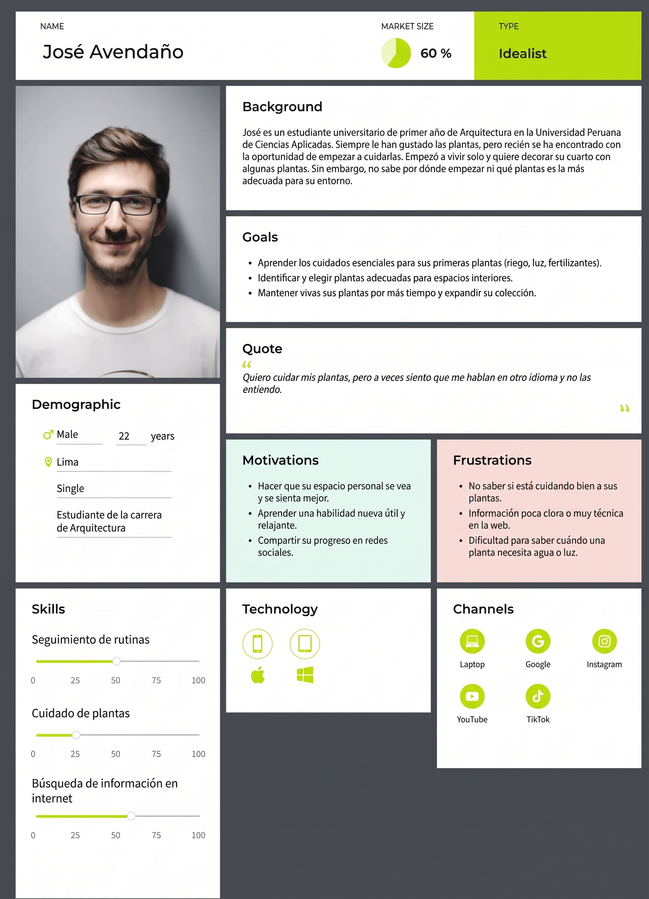
</p>

#### User Persona: Personas con experiencia en el cuidado de plantas
<p align="center">
  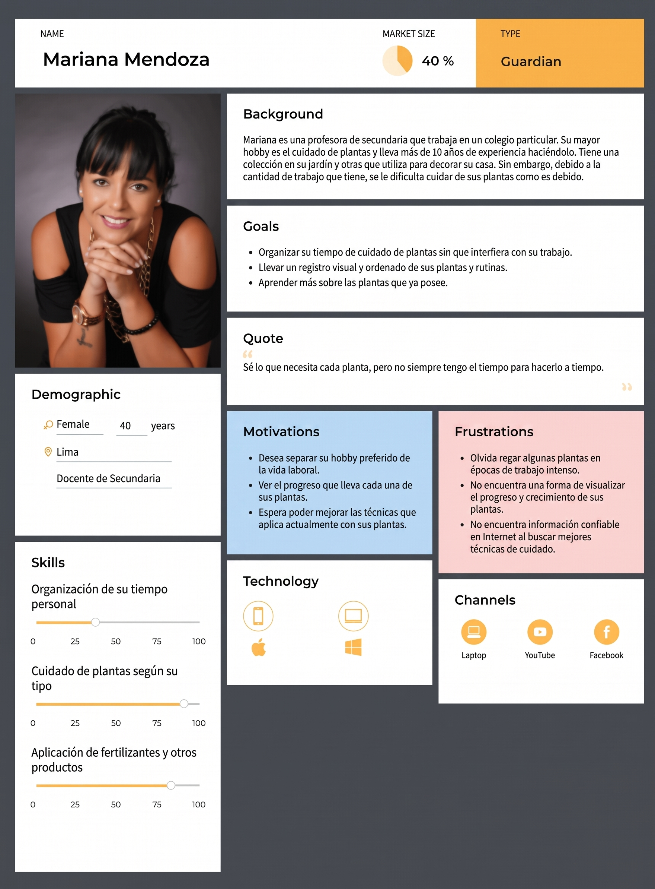
</p>

### 2.3.2. User Task Matrix

En esta sección se construye la User Task Matrix considerando los dos segmentos definidos y vinculados a los User Persona. Se analizan perfiles como estudiantes universitarios que buscan adquirir experiencia y gerentes interesados en incorporar talento joven para sus proyectos.

<table border="1" cellpadding="8" cellspacing="0" style="border-collapse: collapse; text-align: center; width: 100%;">
  <thead>
    <tr>
      <th rowspan="2">Tarea</th>
      <th colspan="2">Experto</th>
      <th colspan="2">Persona sin experiencia</th>
    </tr>
    <tr>
      <th>Frecuencia</th>
      <th>Importancia</th>
      <th>Frecuencia</th>
      <th>Importancia</th>
    </tr>
  </thead>
  <tbody>
    <tr>
      <td>Adquirir nuevas plantas</td>
      <td>Sometimes</td>
      <td>Medium</td>
      <td>Rarely</td>
      <td>Low</td>
    </tr>
    <tr>
      <td>Ajustar los cuidados de acuerdo al clima</td>
      <td>Sometimes</td>
      <td>Medium</td>
      <td>Never</td>
      <td>Low</td>
    </tr>
    <tr>
      <td>Registrar todas las actividades de cuidado</td>
      <td>Sometimes</td>
      <td>High</td>
      <td>Never</td>
      <td>Low</td>
    </tr>
    <tr>
      <td>Evaluar el estado de salud de sus plantas</td>
      <td>Often</td>
      <td>High</td>
      <td>Rarely</td>
      <td>Medium</td>
    </tr>
    <tr>
      <td>Comprar los insumos para el cuidado</td>
      <td>Sometimes</td>
      <td>Medium</td>
      <td>Rarely</td>
      <td>Low</td>
    </tr>
    <tr>
      <td>Consultar guías o videos sobre plantas</td>
      <td>Rarely</td>
      <td>Medium</td>
      <td>Often</td>
      <td>High</td>
    </tr>
    <tr>
      <td>Decorar su habitación con plantas</td>
      <td>Rarely</td>
      <td>Low</td>
      <td>Medium</td>
      <td>High</td>
    </tr>
    <tr>
      <td>Preguntar por consejos a sus conocidos</td>
      <td>Rarely</td>
      <td>Low</td>
      <td>Sometimes</td>
      <td>Medium</td>
    </tr>
    <tr>
      <td>Buscar soluciones digitales de apoyo</td>
      <td>Sometimes</td>
      <td>Medium</td>
      <td>Sometimes</td>
      <td>High</td>
    </tr>
    <tr>
      <td>Tomar fotos para seguimiento del crecimiento</td>
      <td>Sometimes</td>
      <td>Low</td>
      <td>Sometimes</td>
      <td>Medium</td>
    </tr>
  </tbody>
</table>

A partir de esta matriz se pueden extraer las siguientes conclusiones sobre las actividades de los User Persona:

- Para el usuario con experiencia, las tareas más relevantes son evaluar la salud de sus plantas y llevar un registro de los cuidados. En contraste, el usuario principiante se enfoca más en aprender y en encontrar herramientas digitales de apoyo.

- Ambos perfiles coinciden en su interés por documentar el crecimiento mediante fotografías y en la búsqueda de soluciones tecnológicas que faciliten el cuidado.

- Las diferencias se evidencian en el nivel de experiencia: el usuario experto dedica más tiempo a monitorear y mantener un plan estructurado, mientras que el principiante prioriza el aprendizaje y valora más el aspecto estético de las plantas.

### 2.3.3. Empathy Mapping

<h4>Segmento 1 — Principiante cuidador de plantas</h4>

A continuación se presenta el mapa de empatía correspondiente al segmento de principiantes, representado por Alejandro Flores, joven de 20 años de Chorrillos, Lima, quien se inició en el cuidado de plantas en 2025 sin conocimientos previos ni herramientas de apoyo.
<p align="center">
  
</p>

<h4>Segmento 2 — Experto cuidador de plantas</h4>
A continuación se presenta el mapa de empatía correspondiente al segmento de expertos, representado por Leonor Gonzales, cuidadora de 60 años de San Miguel, Lima, con más de 6 años de experiencia en jardinería doméstica y una amplia colección de plantas que gestiona sin ningún sistema de registro formal.
<p align="center">
  
</p>
<div style="page-break-before: always;"></div>


#### 2.3.4. As-is Scenario Mapping

Segmento 1: José Avedaño


Segmento 2: Mariana Mendoza


## 2.5. Ubiquitous Language

En esta sección se define el glosario de términos y conceptos utilizados en el dominio del negocio de NaturaTech. Para mantener una comunicación clara y sin ambigüedades entre los stakeholders y el equipo de desarrollo, los términos principales se definen en inglés (con su equivalente en español) y excluyen jerga técnica de ingeniería de software, enfocándose puramente en el ecosistema botánico, la automatización y la gamificación verde[cite: 3].

<table>
  <thead>
    <tr>
      <th>Término (Inglés / Español)</th>
      <th>Tipo</th>
      <th>Definición en el dominio de NaturaTech</th>
      <th>Ejemplo de uso</th>
    </tr>
  </thead>
  <tbody>
    <tr>
      <td><strong>Plant Profile (Perfil de Planta)</strong></td>
      <td>Dominio</td>
      <td>Representación digital de una planta física en el sistema, que contiene su información biológica, especie y el hardware asociado a ella.</td>
      <td>"El <em>Plant Profile</em> de la Monstera está vinculado al nodo de la sala."</td>
    </tr>
    <tr>
      <td><strong>Sensor Node (Nodo Sensor)</strong></td>
      <td>Sistema</td>
      <td>Dispositivo físico instalado en el entorno de la planta que captura datos ambientales en tiempo real (humedad, temperatura, luz).</td>
      <td>"El <em>Sensor Node</em> detectó una caída crítica de humedad en el sustrato."</td>
    </tr>
    <tr>
      <td><strong>Autonomous Actuator (Actuador Autónomo)</strong></td>
      <td>Sistema</td>
      <td>Componente de hardware (ej. bomba de riego, lámpara UV) con permisos para ejecutar acciones correctivas en el mundo físico basándose en decisiones inteligentes.</td>
      <td>"El <em>Autonomous Actuator</em> inició el riego por goteo durante 5 minutos."</td>
    </tr>
    <tr>
      <td><strong>Visual Diagnosis (Diagnóstico Visual)</strong></td>
      <td>Evento / Dominio</td>
      <td>Proceso de análisis de una fotografía botánica para identificar la especie exacta y detectar automáticamente enfermedades, hongos o marchitez.</td>
      <td>"El <em>Visual Diagnosis</em> confirmó que las hojas amarillas son por exceso de riego."</td>
    </tr>
    <tr>
      <td><strong>Autonomous Agent (Agente Autónomo)</strong></td>
      <td>Actor (Sistema)</td>
      <td>Asistente virtual inteligente capaz de interpretar comandos en lenguaje natural y tomar decisiones proactivas para accionar mecanismos físicos sin intervención manual.</td>
      <td>"El usuario pidió luz, y el <em>Autonomous Agent</em> encendió la lámpara UV."</td>
    </tr>
    <tr>
      <td><strong>Telemetry (Telemetría)</strong></td>
      <td>Dominio</td>
      <td>Flujo continuo de datos ambientales capturados por el nodo sensor, que sirve como historial de salud y base para las recompensas.</td>
      <td>"Revisando la <em>Telemetry</em>, la planta mantuvo niveles óptimos por 30 días."</td>
    </tr>
    <tr>
      <td><strong>Eco-Token (Eco-Token)</strong></td>
      <td>Dominio / Recompensa</td>
      <td>Recompensa digital y descentralizada otorgada al usuario por mantener la telemetría de su planta en niveles óptimos de forma ininterrumpida.</td>
      <td>"El usuario ganó 50 <em>Eco-Tokens</em> por un mes de cuidado perfecto."</td>
    </tr>
    <tr>
      <td><strong>Achievement Badge (Medalla de Logro / NFT)</strong></td>
      <td>Dominio / Recompensa</td>
      <td>Certificado digital único y de propiedad del usuario que valida un hito importante en la supervivencia o cuidado de especies exóticas.</td>
      <td>"Se acuñó un <em>Achievement Badge</em> en la billetera del usuario por revivir su orquídea."</td>
    </tr>
    <tr>
      <td><strong>Threshold Policy (Política de Umbral)</strong></td>
      <td>Política</td>
      <td>Regla agronómica que establece los límites saludables de un entorno; si se vulnera, dispara la intervención inmediata del Agente Autónomo.</td>
      <td>"La <em>Threshold Policy</em> indica que si la luz baja de 200 lux, se debe activar la lámpara."</td>
    </tr>
    <tr>
      <td><strong>Care Log (Historial de Cuidados)</strong></td>
      <td>Dominio</td>
      <td>Registro cronológico e inmutable de todas las acciones realizadas sobre una planta, ya sean manuales del usuario o automatizadas por el agente.</td>
      <td>"El <em>Care Log</em> muestra que el actuador regó la planta el martes pasado."</td>
    </tr>
  </tbody>
</table>

<div style="page-break-before: always;"></div>


# Capítulo III: Requirements Specification

## 3.1. User Stories

<table border="1">
  <tbody>
    <tr>
      <td><strong>Epic / Story ID</strong></td>
      <td><strong>Título</strong></td>
      <td><strong>Descripción</strong></td>
      <td><strong>Criterios de Aceptación</strong></td>
      <td><strong>Relación con Epic</strong></td>
    </tr>
    <tr>
      <td>EP01</td>
      <td>Presencia Digital y Conversión</td>
      <td>
        <strong>Como</strong> visitante o cliente potencial, <strong>quiero</strong> explorar una página de aterrizaje informativa y confiable, <strong>para</strong> entender los beneficios del sistema y registrarme fácilmente en la plataforma.
      </td>
      <td>No corresponde</td>
      <td>No corresponde</td>
    </tr>
    <tr>
      <td>EP02</td>
      <td>Gestión de Identidad y Perfil de Usuario</td>
      <td>
        <strong>Como</strong> usuario de la plataforma, <strong>quiero</strong> gestionar mi identidad, seguridad y personalizar la interfaz, <strong>para</strong> tener una experiencia de uso cómoda y visualizar mis estadísticas personales.
      </td>
      <td>No corresponde</td>
      <td>No corresponde</td>
    </tr>
    <tr>
      <td>EP03</td>
      <td>Gestión del Inventario Botánico</td>
      <td>
        <strong>Como</strong> cuidador de plantas, <strong>quiero</strong> registrar, editar y documentar visualmente el ciclo de vida de mis plantas, <strong>para</strong> mantener un inventario botánico digital organizado.
      </td>
      <td>No corresponde</td>
      <td>No corresponde</td>
    </tr>
    <tr>
      <td>EP04</td>
      <td>Integración IoT y Monitoreo de Variables</td>
      <td>
        <strong>Como</strong> usuario con hardware IoT, <strong>quiero</strong> vincular mis sensores y actuadores a la aplicación, <strong>para</strong> monitorear las métricas ambientales y automatizar el entorno físico de mis plantas.
      </td>
      <td>No corresponde</td>
      <td>No corresponde</td>
    </tr>
    <tr>
      <td>EP05</td>
      <td>Planificación y Registro de Cuidados</td>
      <td>
        <strong>Como</strong> usuario, <strong>quiero</strong> programar recordatorios automáticos y registrar el historial de mis acciones manuales, <strong>para</strong> planificar adecuadamente los cuidados y no olvidar ninguna tarea.
      </td>
      <td>No corresponde</td>
      <td>No corresponde</td>
    </tr>
    <tr>
      <td>EP06</td>
      <td>Inteligencia Botánica y Análisis Externo</td>
      <td>
        <strong>Como</strong> usuario, <strong>quiero</strong> recibir asesoría de un asistente inteligente y consultar datos climáticos locales, <strong>para</strong> obtener recomendaciones expertas y personalizadas según cada especie.
      </td>
      <td>No corresponde</td>
      <td>No corresponde</td>
    </tr>
    <tr>
        <tr>
      <td>EP07</td>
      <td>Gamificación y Recompensas Web3</td>
      <td>
        <strong>Como</strong> usuario constante, <strong>quiero</strong> ser recompensado mediante tecnología blockchain descentralizada, <strong>para</strong> mantener la motivación a largo plazo en el cuidado de mis plantas.
      </td>
      <td>No corresponde</td>
      <td>No corresponde</td>
    </tr>
    <tr>
      <td>US01</td>
      <td>Visualización de beneficios botánicos en el Landing Page</td>
      <td>
        <strong>Como</strong> visitante, <strong>quiero</strong> visualizar una sección informativa sobre los beneficios psicológicos del cuidado de plantas, <strong>para</strong> motivarme a adquirir la solución.
      </td>
      <td>
        <strong>Escenario 1: Acceso a información de bienestar.</strong><br>
        <strong>Dado que</strong> el visitante se encuentra en la página de inicio, <strong>cuando</strong> navega hacia la sección de beneficios, <strong>entonces</strong> el sistema muestra los datos de salud mental y reducción de estrés vinculados a la horticultura.
      </td>
      <td>EP01</td>
    </tr>
    <tr>
      <td>US02</td>
      <td>Vinculación de dispositivo IoT con la cuenta</td>
      <td>
        <strong>Como</strong> usuario, <strong>quiero</strong> vincular mi dispositivo físico con mi cuenta en la aplicación móvil, <strong>para</strong> visualizar los datos capturados de forma privada y exclusiva.
      </td>
      <td>
        <strong>Escenario 1: Asociación exitosa de hardware.</strong><br>
        <strong>Dado que</strong> el usuario ha iniciado sesión en la aplicación, <strong>cuando</strong> ingresa el identificador único de su kit IoT, <strong>entonces</strong> el sistema vincula el dispositivo a su perfil y confirma la conexión.
      </td>
      <td>EP04</td>
    </tr>
    <tr>
      <td>US03</td>
      <td>Metricas de Sensor de Gas (Calidad de aire)</td>
      <td>
        <strong>Como</strong> usuario, <strong>quiero</strong> quiero poder ver las metricas del sensor de gas del dispositivo IoT, <strong>para</strong> estar informado de la calidad del aire y cuidar mejor mi planta.
      </td>
      <td>
        <strong>Escenario 1: Ver metrica de sensor de gas</strong><br>
        <strong>Dado que</strong> miro el dashboard de mi planta, <strong>cuando</strong> verifico el sensor de gas, <strong>entonces</strong> debo poder ver la data de ese sensor
      </td>
      <td>EP04</td>
    </tr>
    <tr>
      <td>US04</td>
      <td>Redirección a plataformas desde el Landing Page</td>
      <td>
        <strong>Como</strong> visitante, <strong>quiero</strong> encontrar enlaces directos a la aplicación web y a las tiendas de descarga móvil, <strong>para</strong> acceder a las herramientas de gestión botánica.
      </td>
      <td>
        <strong>Escenario 1: Uso de Call-to-Action (CTA).</strong><br>
        <strong>Dado que</strong> el visitante se encuentra en el Landing Page, <strong>cuando</strong> selecciona el botón de "Acceder a la plataforma" o "Descargar App", <strong>entonces</strong> el sistema le redirige al punto de acceso correspondiente.
      </td>
      <td>EP01</td>
    </tr>
    <tr>
      <td>US05</td>
      <td>Sistema de Alarma por Extremos</td>
      <td>
        <strong>Como</strong> Usuario, <strong>quiero</strong> que el dispositivo emita una alerta sonora (Buzzer), <strong>para</strong> reaccionar a tiempo si la temperatura sale del rango (10°C - 35°C) o la humedad supera el 50%, <strong>para</strong> asegurar la persistencia de la información.
      </td>
      <td>
        <strong>Escenario 1: Activación de alarma.</strong><br>
        <strong>Dado que</strong> el buzzer está habilitado, <strong>cuando</strong> la temperatura cae a 9°C, <strong>entonces</strong> el componente físico emite un sonido de alerta de forma inmediata.
      </td>
      <td>EP04</td>
    </tr>
    <tr>
      <td>US06</td>
      <td>Registro de nueva planta y asignación de especie</td>
      <td>
        <strong>Como</strong> usuario, <strong>quiero</strong> registrar una nueva planta seleccionando su especie específica (ej. Portulacaria afra), <strong>para</strong> que el sistema asigne automáticamente los umbrales ideales de temperatura, humedad y luz al dispositivo IoT.
      </td>
      <td>
        <strong>Escenario 1: Carga de umbrales automáticos.</strong><br>
        <strong>Dado que</strong> el usuario registra una nueva planta, <strong>cuando</strong> selecciona la especie "Portulacaria afra", <strong>entonces</strong> el sistema configura sus límites biológicos (ej. 10°C - 35°C) y la muestra en el dashboard.<br><br>
        <strong>Escenario 2: Registro de planta desde mobile.</strong><br>
        <strong>Dado que</strong> el usuario se encuentra en la vista de registro de planta de la aplicación móvil, <strong>cuando</strong> completa los campos de nombre, especie, descripción, fecha de adquisición (máximo el día actual), nivel de humedad (alta/riego cada 2 días, media/riego cada 4 días, baja/riego cada 7 días), foto mediante URL y umbrales de alerta IoT (temperatura, humedad, luz mínima), <strong>entonces</strong> el sistema guarda la planta con todos los parámetros y la muestra en el listado de plantas.
      </td>
      <td>EP03</td>
    </tr>
    <tr>
      <td>US07</td>
      <td>Visualización del historial de cuidados</td>
      <td>
        <strong>Como</strong> usuario, <strong>quiero</strong> consultar el historial de acciones realizadas sobre cada una de mis plantas, <strong>para</strong> identificar patrones y mejorar mis rutinas de cuidado.
      </td>
      <td>
        <strong>Escenario 1: Acceso al historial.</strong><br>
        <strong>Dado que</strong> el usuario se encuentra en el detalle de una planta, <strong>cuando</strong> selecciona la opción "Ver historial", <strong>entonces</strong> el sistema muestra una lista cronológica de las acciones registradas.<br><br>
        <strong>Escenario 2: Historial vacío.</strong><br>
        <strong>Dado que</strong> el usuario accede al historial de una planta recién registrada, <strong>cuando</strong> no existe ninguna acción previa, <strong>entonces</strong> el sistema muestra un mensaje indicando que aún no hay cuidados registrados.
      </td>
      <td>EP05</td>
    </tr>
    <tr>
      <td>US08</td>
      <td>Monitoreo de Humedad de Tierra</td>
      <td>
        <strong>Como</strong> usuario, <strong>quiero</strong> ver el porcentaje de humedad del suelo, <strong>para</strong> saber si la tierra está seca.
      </td>
      <td>
        <strong>Escenario 1: Visualización de humedad.</strong><br>
        <strong>Dado que</strong> el sensor de humedad envía datos, <strong>cuando</strong> el usuario abre la app, <strong>entonces</strong> visualiza el porcentaje real de agua en el sustrato.
      </td>
      <td>EP04</td>
    </tr>
    <tr>
      <td>US09</td>
      <td>Registro manual de cuidados complementarios</td>
      <td>
        <strong>Como</strong> usuario, <strong>quiero</strong> registrar manualmente acciones que el sistema IoT no realiza (como poda, cambio de sustrato o fertilización), <strong>para</strong> mantener un inventario botánico digital 100% completo.
      </td>
      <td>
        <strong>Escenario 1: Adición de cuidado físico.</strong><br>
        <strong>Dado que</strong> el usuario realizó una tarea de mantenimiento, <strong>cuando</strong> selecciona "Registrar cuidado", elige "Fertilización" y confirma, <strong>entonces</strong> el sistema lo agrega a la línea de tiempo cronológica de la planta.
      </td>
      <td>EP05</td>
    </tr>
    <tr>
      <td>US10</td>
      <td>Integración de API de IA</td>
      <td>
        <strong>Como</strong> Developer, <strong>quiero</strong> conectar un LLM al frontend, <strong>para</strong> procesar consultas botánicas de forma ágil.
      </td>
      <td>
        <strong>Escenario 1: Generación de respuesta en el cliente.</strong><br>
        <strong>Dado que</strong> el usuario envía un mensaje, <strong>cuando</strong> el frontend procesa la solicitud directamente con la API de IA, <strong>entonces</strong> la interfaz renderiza una respuesta coherente basada en conocimiento botánico.
      </td>
      <td>EP06</td>
    </tr>
    <tr>
      <td>US11</td>
      <td>Subir fotos de una planta</td>
      <td>
        <strong>Como</strong> usuario, <strong>quiero</strong> subir una imagen de una planta a lo largo del tiempo, <strong>para</strong> saber qué planta es.
      </td>
      <td>
        <strong>Escenario 1: Foto añadida desde web.</strong><br>
        <strong>Dado que</strong> el usuario selecciona una foto desde su dispositivo, <strong>cuando</strong> se procesa el archivo, <strong>entonces</strong> el sistema la carga y muestra la imagen de la planta.<br><br>
        <strong>Escenario 2: Foto mediante URL desde mobile.</strong><br>
        <strong>Dado que</strong> el usuario se encuentra en la vista de registro o edición de planta en la aplicación móvil, <strong>cuando</strong> ingresa una URL de imagen válida, <strong>entonces</strong> el sistema muestra la vista previa y guarda la referencia de la imagen.
      </td>
      <td>EP03</td>
    </tr>
    <tr>
      <td>US12</td>
      <td>Eliminación de planta</td>
      <td>
        <strong>Como</strong> usuario, <strong>quiero</strong> eliminar una planta de mi lista, <strong>para</strong> quitar aquellas que ya no tengo o que se han perdido.
      </td>
      <td>
        <strong>Escenario 1: Eliminación confirmada.</strong><br>
        <strong>Dado que</strong> el usuario solicitó eliminar la planta, <strong>cuando</strong> confirma la acción, <strong>entonces</strong> el sistema elimina la planta y muestra: "Planta eliminada correctamente".<br><br>
        <strong>Escenario 2: Cancelación de eliminación.</strong><br>
        <strong>Dado que</strong> el usuario es consultado sobre la eliminación, <strong>cuando</strong> cancela la acción, <strong>entonces</strong> el sistema no realiza cambios.
      </td>
      <td>EP03</td>
    </tr>
    <tr>
      <td>US13</td>
      <td>Inicio sesión de usuario</td>
      <td>
        <strong>Como</strong> usuario registrado, <strong>quiero</strong> iniciar sesión con mi correo y contraseña, <strong>para</strong> acceder a mi cuenta y mis plantas monitoreadas.
      </td>
      <td>
        <strong>Escenario 1: Inicio de sesión exitoso.</strong><br>
        <strong>Dado que</strong> el usuario ingresó credenciales correctas, <strong>cuando</strong> presiona "Iniciar sesión", <strong>entonces</strong> el sistema lo redirige a su panel principal.<br><br>
        <strong>Escenario 2: Credenciales incorrectas.</strong><br>
        <strong>Dado que</strong> el usuario ingresó mal sus datos, <strong>cuando</strong> presiona "Iniciar sesión", <strong>entonces</strong> el sistema muestra: "Correo o contraseña incorrectos".<br><br>
        <strong>Escenario 3: Campos vacíos.</strong><br>
        <strong>Dado que</strong> el usuario dejó campos vacíos, <strong>cuando</strong> intenta iniciar sesión, <strong>entonces</strong> el sistema muestra: "Por favor, completa todos los campos".
      </td>
      <td>EP02</td>
    </tr>
    <tr>
      <td>US14</td>
      <td>Registrarse en la app</td>
      <td>
        <strong>Como</strong> usuario, <strong>quiero</strong> registrarme en la app, <strong>para</strong> crear mi cuenta y acceder a sus funcionalidades.
      </td>
      <td>
        <strong>Escenario 1: Registro exitoso.</strong><br>
        <strong>Dado que</strong> el usuario se encuentra en la pantalla de registro, <strong>cuando</strong> completa los datos requeridos y pulsa "Registrarse", <strong>entonces</strong> el sistema debe crear una cuenta nueva y mostrarle la pantalla principal.
      </td>
      <td>EP02</td>
    </tr>
    <tr>
      <td>US15</td>
      <td>Edición de datos personales</td>
      <td>
        <strong>Como</strong> usuario registrado, <strong>quiero</strong> poder actualizar mis datos personales, <strong>para</strong> mantener mi perfil al día con mi información actual.
      </td>
      <td>
        <strong>Escenario 1: Visualización de datos.</strong><br>
        <strong>Dado que</strong> el usuario ha iniciado sesión, <strong>cuando</strong> accede a la sección de perfil, <strong>entonces</strong> el sistema debe mostrar los datos actuales en campos editables.<br><br>
        <strong>Escenario 2: Actualización exitosa desde web.</strong><br>
        <strong>Dado que</strong> el usuario ha editado su información en la web, <strong>cuando</strong> hace clic en "Guardar cambios", <strong>entonces</strong> el sistema valida los campos y actualiza la base de datos.<br><br>
        <strong>Escenario 3: Edición de nombre desde mobile.</strong><br>
        <strong>Dado que</strong> el usuario se encuentra en la vista de edición de perfil de la aplicación móvil, <strong>cuando</strong> modifica únicamente el nombre y presiona guardar, <strong>entonces</strong> el sistema actualiza el nombre en la base de datos y muestra la confirmación.
      </td>
      <td>EP02</td>
    </tr>
    <tr>
      <td>US16</td>
      <td>Edición de datos de planta</td>
      <td>
        <strong>Como</strong> usuario que cuida plantas, <strong>quiero</strong> editar la información de una planta registrada, <strong>para</strong> actualizar datos como su nombre, tipo o imagen.
      </td>
      <td>
        <strong>Escenario 1: Edición exitosa.</strong><br>
        <strong>Dado que</strong> el usuario accedió a los datos de la planta, <strong>cuando</strong> cambió los datos y guardó, <strong>entonces</strong> el sistema muestra: "Datos de la planta actualizados correctamente".
      </td>
      <td>EP03</td>
    </tr>
    <tr>
      <td>US17</td>
      <td>Modo oscuro en la interfaz</td>
      <td>
        <strong>Como</strong> usuario, <strong>quiero</strong> activar el modo oscuro, <strong>para</strong> usar la aplicación en ambientes con poca luz.
      </td>
      <td>
        <strong>Escenario 1: Tema aplicado.</strong><br>
        <strong>Dado que</strong> la opción está disponible en configuración, <strong>cuando</strong> el usuario activa el modo oscuro, <strong>entonces</strong> el sistema cambia la interfaz a colores oscuros inmediatamente.
      </td>
      <td>EP02</td>
    </tr>
    <tr>
      <td>US18</td>
      <td>Comparar planes de suscripción</td>
      <td>
        <strong>Como</strong> visitante de la landing page, <strong>quiero</strong> comparar fácilmente los planes de suscripción, <strong>para</strong> elegir el que mejor se ajuste a mis necesidades.
      </td>
      <td>
        <strong>Escenario 1: Comparación de planes.</strong><br>
        <strong>Dado que</strong> el visitante se encuentra en la landing page, <strong>cuando</strong> se desplaza hasta la sección de planes, <strong>entonces</strong> debe visualizar claramente los distintos planes de suscripción con sus características.
      </td>
      <td>EP01</td>
    </tr>
    <tr>
      <td>US19</td>
      <td>Cambio de correo electrónico asociado</td>
      <td>
        <strong>Como</strong> usuario, <strong>quiero</strong> cambiar el correo electrónico asociado a mi cuenta, <strong>para</strong> asegurar que las notificaciones lleguen a la dirección correcta.
      </td>
      <td>
        <strong>Escenario 1: Cambio exitoso.</strong><br>
        <strong>Dado que</strong> el usuario ha ingresado un nuevo correo válido, <strong>cuando</strong> hace clic en "Guardar cambios", <strong>entonces</strong> el sistema verifica el formato y actualiza el correo en la base de datos.
      </td>
      <td>EP02</td>
    </tr>
    <tr>
      <td>US20</td>
      <td>Selección de idioma</td>
      <td>
        <strong>Como</strong> usuario, <strong>quiero</strong> elegir el idioma de la página web, <strong>para</strong> usarla cómodamente.
      </td>
      <td>
        <strong>Escenario 1: Selección de idioma.</strong><br>
        <strong>Dado que</strong> se muestra un selector de idioma, <strong>cuando</strong> el usuario selecciona "Español", <strong>entonces</strong> todo el contenido visible cambia a ese idioma y se mantiene al navegar.
      </td>
      <td>EP01</td>
    </tr>
    <tr>
      <td>US21</td>
      <td>Preguntas Frecuentes - FAQ</td>
      <td>
        <strong>Como</strong> usuario, <strong>quiero</strong> visualizar una sección de dudas comunes sobre el cuidado de plantas, <strong>para</strong> entender rápido cómo me ayudará la plataforma.
      </td>
      <td>
        <strong>Escenario 1: Despliegue de respuestas.</strong><br>
        <strong>Dado que</strong> el usuario se encuentra en la sección de FAQ, <strong>cuando</strong> hace clic sobre una pregunta específica, <strong>entonces</strong> el sistema despliega el texto con la respuesta detallada de forma fluida.
      </td>
      <td>EP01</td>
    </tr>
    <tr>
      <td>US22</td>
      <td>Visualización de Testimonios de Usuarios</td>
      <td>
        <strong>Como</strong> visitante, <strong>quiero</strong> leer experiencias breves de otros usuarios, <strong>para</strong> tener mayor confianza en el producto antes de registrarme.
      </td>
      <td>
        <strong>Escenario 1: Lectura de reseñas.</strong><br>
        <strong>Dado que</strong> el visitante se desplaza por el Landing Page, <strong>cuando</strong> visualiza la sección de testimonios, <strong>entonces</strong> el sistema le muestra un carrusel o cuadrícula estática con reseñas.
      </td>
      <td>EP01</td>
    </tr>
    <tr>
      <td>US23</td>
      <td>Botones de llamado a la acción para Registro</td>
      <td>
        <strong>Como</strong> usuario, <strong>quiero</strong> encontrar botones llamativos de "Empieza ahora", <strong>para</strong> ser redirigido de inmediato al formulario de registro.
      </td>
      <td>
        <strong>Escenario 1: Redirección exitosa a la Web App.</strong><br>
        <strong>Dado que</strong> el usuario lee una sección del Landing Page, <strong>cuando</strong> hace clic en "Empieza ahora" o "Únete", <strong>entonces</strong> el sistema lo redirige a la vista de sign-up.
      </td>
      <td>EP01</td>
    </tr>
    <tr>
      <td>US24</td>
      <td>Acceso a Redes Sociales y Contacto en Footer</td>
      <td>
        <strong>Como</strong> usuario, <strong>quiero</strong> encontrar enlaces a las redes sociales del proyecto en el pie de página, <strong>para</strong> comunicarme con el equipo de soporte.
      </td>
      <td>
        <strong>Escenario 1: Redirección a redes sociales.</strong><br>
        <strong>Dado que</strong> el visitante se encuentra en el footer, <strong>cuando</strong> hace clic en uno de los íconos de redes sociales, <strong>entonces</strong> el sistema abre una nueva pestaña al perfil oficial.<br><br>
        <strong>Escenario 2: Enlace de contacto por correo.</strong><br>
        <strong>Dado que</strong> el visitante está en el footer, <strong>cuando</strong> hace clic en el correo de soporte, <strong>entonces</strong> se abre la aplicación de correo predeterminada.
      </td>
      <td>EP01</td>
    </tr>
    <tr>
      <td>US25</td>
      <td>Visualización de perfil de usuario</td>
      <td>
        <strong>Como</strong> usuario, <strong>quiero</strong> ver mi perfil, <strong>para</strong> tener una visión general de mis actividades de cuidado.
      </td>
      <td>
        <strong>Escenario 1: Perfil con datos.</strong><br>
        <strong>Dado que</strong> el usuario tiene plantas y tareas, <strong>cuando</strong> ingresa al perfil, <strong>entonces</strong> el perfil muestra estadísticas como cantidad de plantas y tareas realizadas.<br><br>
        <strong>Escenario 2: Perfil sin datos.</strong><br>
        <strong>Dado que</strong> el usuario es nuevo, <strong>cuando</strong> ingresa al perfil, <strong>entonces</strong> el sistema muestra: "Aún no has registrado plantas ni actividades".<br><br>
        <strong>Escenario 3: Perfil desde mobile.</strong><br>
        <strong>Dado que</strong> el usuario se encuentra en la vista de perfil de la aplicación móvil, <strong>cuando</strong> accede a la sección, <strong>entonces</strong> el sistema muestra el nombre, el correo registrado, el plan de suscripción actual (Basic, Premium o Pro), un toggle para activar o desactivar notificaciones y un botón para cerrar sesión.
      </td>
      <td>EP02</td>
    </tr>
    <tr>
      <td>US26</td>
      <td>Visualización de tareas con fechas</td>
      <td>
        <strong>Como</strong> usuario, <strong>quiero</strong> ver mis tareas del día por fechas, <strong>para</strong> poder organizarme mejor en el cuidado de las plantas.
      </td>
      <td>
        <strong>Escenario 1: Tareas con fechas.</strong><br>
        <strong>Dado que</strong> el usuario tiene tareas, <strong>cuando</strong> accede a Tareas, <strong>entonces</strong> el sistema muestra las tareas con sus respectivas fechas.<br><br>
        <strong>Escenario 2: No hay tareas.</strong><br>
        <strong>Dado que</strong> no hay tareas programadas, <strong>cuando</strong> ingresa, <strong>entonces</strong> el sistema no muestra tareas ni fechas.
      </td>
      <td>EP05</td>
    </tr>
    <tr>
      <td>US27</td>
      <td>Visualización de tareas de cuidado</td>
      <td>
        <strong>Como</strong> usuario con plantas registradas, <strong>quiero</strong> ver las tareas pendientes de cuidado, <strong>para</strong> saber qué debo hacer cada día.
      </td>
      <td>
        <strong>Escenario 1: Tareas del día visibles.</strong><br>
        <strong>Dado que</strong> el usuario tiene tareas programadas, <strong>cuando</strong> entra al panel principal o calendario, <strong>entonces</strong> se muestra la lista de tareas del día.<br><br>
        <strong>Escenario 2: Sin tareas pendientes.</strong><br>
        <strong>Dado que</strong> no hay tareas para hoy, <strong>cuando</strong> entra al panel, <strong>entonces</strong> se muestra: "No hay tareas para hoy".
      </td>
      <td>EP05</td>
    </tr>
    <tr>
      <td>US28</td>
      <td>Configuración de tareas</td>
      <td>
        <strong>Como</strong> usuario que cuida plantas, <strong>quiero</strong> configurar tareas para regar o fertilizar, <strong>para</strong> no olvidar sus cuidados.
      </td>
      <td>
        <strong>Escenario 1: Tarea creada.</strong><br>
        <strong>Dado que</strong> el usuario eligió la tarea, hora y frecuencia, <strong>cuando</strong> guarda la tarea, <strong>entonces</strong> el sistema confirma: "Tarea creada correctamente".<br><br>
        <strong>Escenario 2: Notificación enviada.</strong><br>
        <strong>Dado que</strong> el usuario tiene una tarea activa, <strong>cuando</strong> llega la hora de la tarea, <strong>entonces</strong> el sistema muestra una notificación de recordatorio.<br><br>
        <strong>Escenario 3: Creación de tarea desde mobile.</strong><br>
        <strong>Dado que</strong> el usuario se encuentra en la vista de nueva tarea de la aplicación móvil, <strong>cuando</strong> ingresa el nombre de la tarea, selecciona una planta de su listado, escoge una fecha y agrega notas opcionales, <strong>entonces</strong> el sistema crea la tarea y la muestra en la vista de tareas programadas.
      </td>
      <td>EP05</td>
    </tr>
    <tr>
      <td>US29</td>
      <td>Acceder a perfil de planta</td>
      <td>
        <strong>Como</strong> usuario, <strong>quiero</strong> acceder a los perfiles de las plantas que poseo, <strong>para</strong> ver su información actual.
      </td>
      <td>
        <strong>Escenario 1: Usuario accede al perfil de una planta.</strong><br>
        <strong>Dado que</strong> el usuario se encuentra en la pantalla principal donde se listan sus plantas, <strong>cuando</strong> selecciona una planta de la lista, <strong>entonces</strong> debe visualizar el perfil detallado de la planta con su información actual.
      </td>
      <td>EP03</td>
    </tr>
    <tr>
      <td>US30</td>
      <td>Vinculación con datos climáticos locales</td>
      <td>
        <strong>Como</strong> usuario, <strong>quiero</strong> que el sistema tenga en cuenta el clima local al recomendar cuidados, <strong>para</strong> evitar regar cuando ya ha llovido.
      </td>
      <td>
        <strong>Escenario 1: Clima disponible.</strong><br>
        <strong>Dado que</strong> el usuario ha autorizado su ubicación, <strong>cuando</strong> consulta las recomendaciones de cuidado, <strong>entonces</strong> el sistema informa si ha llovido y sugiere evitar el riego.<br><br>
        <strong>Escenario 2: Clima no disponible.</strong><br>
        <strong>Dado que</strong> no es posible obtener el clima, <strong>cuando</strong> consulta, <strong>entonces</strong> el sistema muestra el mensaje de error verificando la conexión.
      </td>
      <td>EP06</td>
    </tr>
    <tr>
      <td>US31</td>
      <td>Telemetría de Temperatura Ambiental</td>
      <td>
        <strong>Como</strong> usuario, <strong>quiero</strong> visualizar la temperatura ambiental de mi planta, <strong>para</strong> evitar que se queme o se congele.
      </td>
      <td>
        <strong>Escenario 1: Visualización de temperatura.</strong><br>
        <strong>Dado que</strong> el sensor de temperatura está activo, <strong>cuando</strong> el usuario revisa el perfil de la planta, <strong>entonces</strong> ve la temperatura en grados Celsius actualizada.
      </td>
      <td>EP04</td>
    </tr>
    <tr>
      <td>US32</td>
      <td>Control Manual de Riego</td>
      <td>
        <strong>Como</strong> usuario, <strong>quiero</strong> activar la bomba de agua desde mi celular, <strong>para</strong> regar mi planta a distancia.
      </td>
      <td>
        <strong>Escenario 1: Solicitud de regado exitoso.</strong><br>
        <strong>Dado que</strong> el dispositivo IoT está vinculado, <strong>cuando</strong> el usuario presiona "Regar ahora", <strong>entonces</strong> la señal llega al kit, el actuador se activa y confirma el éxito en la app.
      </td>
      <td>EP04</td>
    </tr>
    <tr>
      <td>US33</td>
      <td>Control Manual y Automático de Luz UV</td>
      <td>
        <strong>Como</strong> usuario, <strong>quiero</strong> gestionar el foco UV en modos ON, OFF o AUTO, <strong>para</strong> asegurar que mi planta reciba luz cuando el sensor LDR detecte niveles inferiores a los umbrales establecidos.
      </td>
      <td>
        <strong>Escenario 1: Activación automática por baja luz.</strong><br>
        <strong>Dado que</strong> el sistema está en modo AUTO, <strong>cuando</strong> el LDR registra luz, <strong>entonces</strong> el Relay enciende el foco UV y actualiza el estado en la interfaz.
      </td>
      <td>EP04</td>
    </tr>
    <tr>
      <td>US34</td>
      <td>Visualización y Control Físico (LCD y Botones)</td>
      <td>
        <strong>Como</strong> usuario, <strong>quiero</strong> usar botones físicos y pantallas LCD, <strong>para</strong> alternar los modos de los actuadores y ver las métricas sin necesidad de abrir la aplicación.
      </td>
      <td>
        <strong>Escenario 1: Cambio de modo mediante botón.</strong><br>
        <strong>Dado que</strong> eel usuario presiona el botón físico correspondiente al Servo, <strong>cuando</strong> el sistema registra el evento, <strong>entonces</strong> el LCD 2 actualiza el texto de estado alternando entre ON, OFF y AUTO.<br><br>
      </td>
      <td>EP04</td>
    </tr>
    <tr>
      <td>US35</td>
      <td>Consulta a Agente Autónomo Botánico</td>
      <td>
        <strong>Como</strong> usuario, <strong>quiero</strong> interactuar con el Agente Inteligente, <strong>para</strong> recibir diagnósticos personalizados y delegar acciones sobre mis plantas.
      </td>
      <td>
        <strong>Escenario 1: Asistencia mediante Chat Inteligente.</strong><br>
        <strong>Dado que</strong> el Agente está disponible, <strong>cuando</strong> el usuario hace una consulta botánica, <strong>entonces</strong> el Agente procesa el contexto mediante LLM y responde con consejos precisos.
      </td>
      <td>EP06</td>
    </tr>
    <tr>
      <td>US36</td>
      <td>Monitoreo de Luminosidad (Sensor LDR)</td>
      <td>
        <strong>Como</strong> usuario, <strong>quiero</strong> visualizar el porcentaje de luz que recibe mi planta en tiempo real, <strong>para</strong> garantizar que mantenga su color y salud óptima.
      </td>
      <td>
        <strong>Escenario 1: Recepción de datos de luz.</strong><br>
        <strong>Dado que</strong> el fotorresistor está activo, <strong>cuando</strong> ocurren cambios significativos en la iluminación, <strong>entonces</strong> el sistema mapea el valor de 0 a 100% y lo muestra en el dashboard.
      </td>
      <td>EP04</td>
    </tr>
    <tr>
      <td>US37</td>
      <td>Monitoreo climático local desde mobile</td>
      <td>
        <strong>Como</strong> usuario mobile, <strong>quiero</strong> ver la temperatura y humedad de mi zona geográfica detectada por el teléfono, <strong>para</strong> cuidar mejor mis plantas.
      </td>
      <td>
        <strong>Escenario 1: Clima disponible.</strong><br>
        <strong>Dado que</strong> el usuario ha autorizado el permiso de ubicación, <strong>cuando</strong> abre la vista plantas en la aplicación móvil, <strong>entonces</strong> el sistema muestra la temperatura ambiental y humedad de su zona geográfica actual.<br><br>
        <strong>Escenario 2: Permiso de ubicación no concedido.</strong><br>
        <strong>Dado que</strong> el usuario no ha concedido el permiso de ubicación, <strong>cuando</strong> abre la vista plantas, <strong>entonces</strong> el sistema muestra un mensaje indicando que no se puede obtener el clima local.
      </td>
      <td>EP06</td>
    </tr>
    <tr>
      <td>US38</td>
      <td>Configurar nivel de humedad en registro de planta</td>
      <td>
        <strong>Como</strong> usuario, <strong>quiero</strong> seleccionar nivel de humedad (alta/riego cada 2 días, media/riego cada 4 días, baja/riego cada 7 días) al registrar una planta desde mobile, <strong>para</strong> que el sistema calcule automáticamente la frecuencia de riego.
      </td>
      <td>
        <strong>Escenario 1: Selección exitosa de nivel.</strong><br>
        <strong>Dado que</strong> el usuario está registrando una nueva planta en la aplicación móvil, <strong>cuando</strong> selecciona un nivel de humedad (alta, media o baja), <strong>entonces</strong> el sistema asigna automáticamente la frecuencia de riego correspondiente y la guarda junto con los datos de la planta.
      </td>
      <td>EP03</td>
    </tr>
    <tr>
      <td>US39</td>
      <td>Configurar umbrales de alerta IoT al registrar planta</td>
      <td>
        <strong>Como</strong> usuario, <strong>quiero</strong> definir umbrales de temperatura, humedad y luz mínima al registrar mi planta, <strong>para</strong> recibir alertas personalizadas según las necesidades de mi especie.
      </td>
      <td>
        <strong>Escenario 1: Umbrales configurados.</strong><br>
        <strong>Dado que</strong> el usuario se encuentra en el registro de planta, <strong>cuando</strong> completa los campos de umbral de temperatura mínima, temperatura máxima, humedad mínima, humedad máxima y luz mínima, <strong>entonces</strong> el sistema guarda los umbrales y los asocia al perfil de la planta.
      </td>
      <td>EP04</td>
    </tr>
    <tr>
      <td>US40</td>
      <td>Vincular dispositivo IoT desde perfil de planta</td>
      <td>
        <strong>Como</strong> usuario, <strong>quiero</strong> acceder a la vista de vinculación IoT desde el detalle de mi planta, <strong>para</strong> conectar el hardware a la planta registrada.
      </td>
      <td>
        <strong>Escenario 1: Redirección a vinculación.</strong><br>
        <strong>Dado que</strong> el usuario ha abierto el card de una planta en la aplicación móvil, <strong>cuando</strong> presiona el botón de vincular dispositivo IoT, <strong>entonces</strong> el sistema redirige a la vista de emparejamiento IoT para asociar el hardware.
      </td>
      <td>EP04</td>
    </tr>
    <tr>
      <td>US41</td>
      <td>Marcar tarea como completada</td>
      <td>
        <strong>Como</strong> usuario, <strong>quiero</strong> marcar una tarea como completada, <strong>para</strong> llevar un registro de las actividades realizadas.
      </td>
      <td>
        <strong>Escenario 1: Tarea marcada como completada.</strong><br>
        <strong>Dado que</strong> el usuario tiene una tarea pendiente en la vista de tareas, <strong>cuando</strong> presiona el botón de completar, <strong>entonces</strong> el sistema actualiza el estado de la tarea a "completada" y la muestra visualmente como realizada.<br><br>
        <strong>Escenario 2: Tarea ya completada.</strong><br>
        <strong>Dado que</strong> la tarea ya fue marcada como completada previamente, <strong>cuando</strong> el usuario intenta marcarla nuevamente, <strong>entonces</strong> el botón de completar ya no está disponible.
      </td>
      <td>EP05</td>
    </tr>
    <tr>
      <td>US42</td>
      <td>Eliminar tarea programada</td>
      <td>
        <strong>Como</strong> usuario, <strong>quiero</strong> borrar una tarea programada, <strong>para</strong> eliminar las que ya no necesito.
      </td>
      <td>
        <strong>Escenario 1: Eliminación confirmada.</strong><br>
        <strong>Dado que</strong> el usuario solicitó eliminar una tarea, <strong>cuando</strong> confirma la acción en el modal de confirmación, <strong>entonces</strong> el sistema elimina la tarea y la remueve de la lista.<br><br>
        <strong>Escenario 2: Cancelación de eliminación.</strong><br>
        <strong>Dado que</strong> el usuario es consultado sobre la eliminación, <strong>cuando</strong> cancela la acción, <strong>entonces</strong> el sistema no realiza cambios en la lista de tareas.
      </td>
      <td>EP05</td>
    </tr>
    <tr>
      <td>US43</td>
      <td>Visualizar datos de cuenta en perfil mobile</td>
      <td>
        <strong>Como</strong> usuario mobile, <strong>quiero</strong> ver mi nombre, correo y plan de suscripción en el perfil, <strong>para</strong> conocer el estado de mi cuenta.
      </td>
      <td>
        <strong>Escenario 1: Datos visibles en perfil.</strong><br>
        <strong>Dado que</strong> el usuario ha iniciado sesión en la aplicación móvil, <strong>cuando</strong> accede a la vista de perfil, <strong>entonces</strong> el sistema muestra su nombre, correo electrónico registrado y plan de suscripción actual.
      </td>
      <td>EP02</td>
    </tr>
    <tr>
      <td>US44</td>
      <td>Cambiar plan de suscripción desde mobile</td>
      <td>
        <strong>Como</strong> usuario, <strong>quiero</strong> alternar entre Basic, Premium y Pro desde el perfil, <strong>para</strong> ajustar mi plan según mis necesidades.
      </td>
      <td>
        <strong>Escenario 1: Cambio de plan exitoso.</strong><br>
        <strong>Dado que</strong> el usuario se encuentra en la vista de perfil de la aplicación móvil, <strong>cuando</strong> selecciona un nuevo plan de suscripción (Basic, Premium o Pro), <strong>entonces</strong> el sistema actualiza el plan y muestra la confirmación del cambio.
      </td>
      <td>EP02</td>
    </tr>
    <tr>
      <td>US45</td>
      <td>Gestionar notificaciones push en mobile</td>
      <td>
        <strong>Como</strong> usuario, <strong>quiero</strong> activar o desactivar las notificaciones de la app móvil, <strong>para</strong> controlar las alertas que recibo.
      </td>
      <td>
        <strong>Escenario 1: Notificaciones activadas.</strong><br>
        <strong>Dado que</strong> el usuario accede al perfil, <strong>cuando</strong> activa el toggle de notificaciones, <strong>entonces</strong> el sistema habilita las notificaciones push para la aplicación móvil.<br><br>
        <strong>Escenario 2: Notificaciones desactivadas.</strong><br>
        <strong>Dado que</strong> el usuario accede al perfil, <strong>cuando</strong> desactiva el toggle de notificaciones, <strong>entonces</strong> el sistema deshabilita las notificaciones push para la aplicación móvil.
      </td>
      <td>EP02</td>
    </tr>
    <tr>
      <td>US46</td>
      <td>Cerrar sesión desde mobile</td>
      <td>
        <strong>Como</strong> usuario, <strong>quiero</strong> un botón para cerrar sesión desde el perfil, <strong>para</strong> salir de mi cuenta de forma segura.
      </td>
      <td>
        <strong>Escenario 1: Cierre de sesión exitoso.</strong><br>
        <strong>Dado que</strong> el usuario se encuentra en la vista de perfil de la aplicación móvil, <strong>cuando</strong> presiona el botón "Cerrar sesión", <strong>entonces</strong> el sistema cierra la sesión y redirige a la pantalla de inicio de sesión.
      </td>
      <td>EP02</td>
    </tr>
    <tr>
      <td>US47</td>
      <td>Diagnóstico mediante Visión Computacional</td>
      <td>
        <strong>Como</strong> usuario, <strong>quiero</strong> que la aplicación analice una fotografía de mi planta mediante IA, <strong>para</strong> obtener un diagnóstico automático de posibles enfermedades.
      </td>
      <td>
        <strong>Escenario 1: Diagnóstico exitoso.</strong><br>
        <strong>Dado que</strong> el usuario sube una foto de una hoja con manchas, <strong>cuando</strong> el backend procesa la imagen con la API externa de botánica, <strong>entonces</strong> el sistema muestra la patología detectada y sugiere el tratamiento.
      </td>
      <td>EP06</td>
    </tr>
    <tr>
      <td>US48</td>
      <td>Ejecución de acciones vía Agente Autónomo</td>
      <td>
        <strong>Como</strong> usuario ocupado, <strong>quiero</strong> ordenar acciones físicas a través del chat interactivo con el asistente, <strong>para</strong> que la IA actúe directamente sobre los dispositivos IoT.
      </td>
      <td>
        <strong>Escenario 1: Comando ejecutado por IA.</strong><br>
        <strong>Dado que</strong> el usuario escribe "mi planta necesita luz" en el chat, <strong>cuando</strong> el LLM interpreta la intención, <strong>entonces</strong> el Agente envía la orden de encendido al hardware IoT y responde confirmando la acción.
      </td>
      <td>EP06</td>
    </tr>
    <tr>
      <td>US49</td>
      <td>Acuñación (Minting) de Eco-Tokens en Web3</td>
      <td>
        <strong>Como</strong> usuario constante, <strong>quiero</strong> recibir un Eco-Token (NFT) automáticamente en mi billetera, <strong>para</strong> ser recompensado tras mantener la telemetría de mi planta en niveles óptimos durante 30 días.
      </td>
      <td>
        <strong>Escenario 1: Entrega de recompensa.</strong><br>
        <strong>Dado que</strong> la base de datos confirma 30 días continuos de salud óptima, <strong>cuando</strong> se cumple el plazo, <strong>entonces</strong> el sistema ejecuta el Smart Contract para crear un Eco-Token en la blockchain y notifica al usuario.
      </td>
      <td>EP07</td>
    </tr>
    <tr>
      <td>US50</td>
      <td>Visualización de Billetera Web3</td>
      <td>
        <strong>Como</strong> usuario, <strong>quiero</strong> ver mis Eco-Tokens acumulados en mi perfil o dashboard, <strong>para</strong> llevar un registro tangible y gamificado de mis logros como cuidador botánico.
      </td>
      <td>
        <strong>Escenario 1: Consulta de medallas digitales.</strong><br>
        <strong>Dado que</strong> el usuario navega a la sección de logros, <strong>cuando</strong> el sistema consulta la red blockchain, <strong>entonces</strong> la interfaz renderiza la cantidad de Eco-Tokens ganados y su respectivo arte digital.
      </td>
      <td>EP07</td>
    </tr>
  </tbody>
</table>
<div style="page-break-before: always;"></div>

## 3.2. Impact Mapping

<p align="center">
  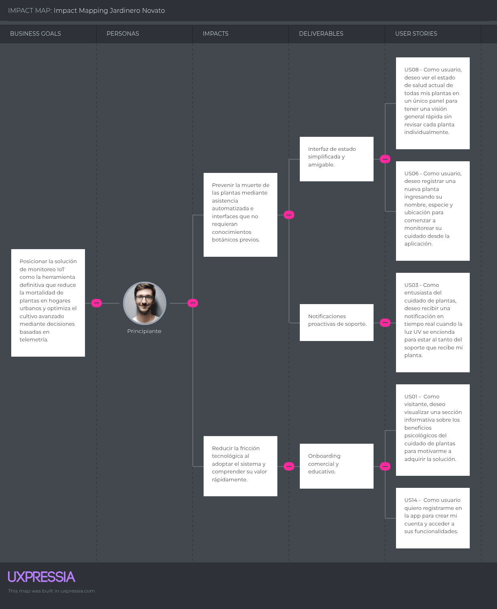
</p>

<p align="center">
  Impact Mapping 1 - Elaboración propia
</p>

<br>


<p align="center">
  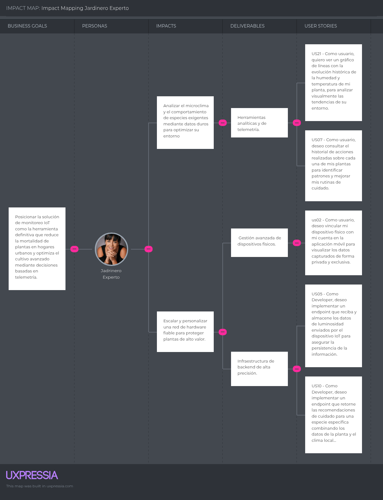
</p>

<p align="center">
  Impact Mapping 2 - Elaboración propia
</p>


<div style="page-break-before: always;"></div>

## 3.3. Product Backlog

| # Orden | User Story Id | Título | Descripción | Story Points (1 / 2 / 3 / 5 / 8) |
| :--- | :--- | :--- | :--- | :--- |
| 1 | US01 | Visualización de beneficios botánicos en el Landing Page | Como visitante, quiero visualizar una sección informativa sobre los beneficios psicológicos del cuidado de plantas para motivarme a adquirir la solución. | 2 |
| 2 | US18 | Comparar planes de suscripción | Como visitante de la landing page, quiero comparar fácilmente los planes de suscripción para elegir el que mejor se ajuste a mis necesidades. | 2 |
| 3 | US21 | Preguntas Frecuentes - FAQ | Como usuario, quiero visualizar una sección de dudas comunes sobre el cuidado de plantas, para entender rápido cómo me ayudará la plataforma. | 2 |
| 4 | US22 | Visualización de Testimonios de Usuarios | Como usuario, quiero leer experiencias breves de otros usuarios que han utilizado la aplicación, para tener mayor confianza en el producto antes de tomar la decisión de registrarme. | 2 |
| 5 | US04 | Redirección a plataformas desde el Landing Page | Como visitante, quiero encontrar enlaces directos a la aplicación web y a las tiendas de descarga móvil para acceder a las herramientas de gestión botánica. | 1 |
| 6 | US23 | Botones de llamado a la acción para Registro | Como usuario, quiero encontrar botones llamativos de "Empieza ahora" en puntos estratégicos de la página, para ser redirigido de inmediato y sin fricciones al formulario de registro. | 1 |
| 7 | US24 | Acceso a Redes Sociales y Contacto en Footer | Como usuario, quiero encontrar enlaces a las redes sociales del proyecto y medios de contacto en el pie de página, para seguir sus actualizaciones o comunicarme con el equipo de soporte. | 1 |
| 8 | US20 | Selección de idioma | Como usuario, quiero elegir el idioma de la pagina web para usarla cómodamente. | 3 |
| 9 | US14 | Registrarse en la app | Como usuario quiero registrarme en la app para crear mi cuenta y acceder a sus funcionalidades. | 5 |
| 10 | US13 | Inicio sesión de usuario | Como usuario registrado, quiero iniciar sesión con mi correo y contraseña, para acceder a mi cuenta y mis plantas monitoreadas. | 3 |
| 11 | US25 | Visualización de perfil de usuario | Como usuario, quiero ver mi perfil, para tener una visión general de mis actividades de cuidado. | 2 |
| 12 | US15 | Edición de datos personales | Como usuario registrado, quiero poder actualizar mis datos personales, para mantener mi perfil al día con mi información actual. | 3 |
| 13 | US19 | Cambio de correo electrónico asociado | Como usuario, quiero cambiar el correo electrónico asociado a mi cuenta, para asegurar que las notificaciones y comunicaciones lleguen a la dirección correcta. | 2 |
| 14 | US17 | Modo oscuro en la interfaz | Como usuario, quiero activar el modo oscuro, para usar la aplicación en ambientes con poca luz. | 3 |
| 15 | US06 | Registro de nueva planta y asignación de especie | Como usuario, quiero registrar una nueva planta seleccionando su especie específica, para que el sistema asigne automáticamente los umbrales ideales al dispositivo IoT. | 5 |
| 16 | US11 | Subir fotos de una planta | Como usuario, quiero subir una imagen de una planta a lo largo del tiempo, para saber que planta es. | 3 |
| 17 | US29 | Acceder a perfil de planta | Como usuario, quiero acceder a los perfiles de las plantas que poseo para ver su información actual. | 2 |
| 18 | US16 | Edición de datos de planta | Como usuario que cuida plantas, quiero editar la información de una planta registrada, para actualizar datos como su nombre, tipo o imagen. | 3 |
| 19 | US12 | Eliminación de planta | Como usuario, quiero eliminar una planta de mi lista, para quitar aquellas que ya no tengo o que se han perdido. | 2 |
| 20 | US28 | Configuración de tareas | Como usuario que cuida plantas, quiero configurar tareas para regar o fertilizar, para no olvidar sus cuidados. | 5 |
| 21 | US27 | Visualización de tareas de cuidado | Como usuario con plantas registradas, quiero ver las tareas pendientes de cuidado, para saber qué debo hacer cada día. | 2 |
| 22 | US26 | Visualización de tareas con fechas | Como usuario, quiero ver mis tareas del día por fechas para poder organizarme mejor en el cuidado de las mismas. | 3 |
| 23 | US09 | Registro manual de cuidados complementarios | Como usuario, quiero registrar manualmente acciones que el sistema IoT no realiza, para mantener un inventario botánico digital 100% completo. | 3 |
| 24 | US07 | Visualización del historial de cuidados | Como usuario, quiero consultar el historial de acciones realizadas sobre cada una de mis plantas para identificar patrones y mejorar mis rutinas de cuidado. | 3 |
| 25 | US34 | Visualización y Control Físico (LCD y Botones) | Como usuario frente al dispositivo, quiero usar botones físicos y pantallas LCD, para alternar los modos de los actuadores y ver las métricas sin necesidad de abrir la aplicación móvil. | 5 |
| 26 | US02 | Vinculación de dispositivo IoT con la cuenta | Como usuario, quiero vincular mi dispositivo físico con mi cuenta en la aplicación móvil para visualizar los datos capturados de forma privada y exclusiva. | 5 |
| 27 | US05 | Sistema de Alarma por Extremos (Buzzer) | Como usuario, quiero que el dispositivo emita una alerta sonora (Buzzer), para reaccionar a tiempo si la temperatura sale del rango o la humedad supera el límite. | 5 |
| 28 | US08 | Monitoreo de Humedad Ambiental | Como usuario, quiero ver el porcentaje de humedad relativa del ambiente capturado por el sensor, para saber si el entorno es demasiado seco o húmedo. | 3 |
| 29 | US31 | Telemetría de Temperatura Ambiental | Como usuario, quiero visualizar la temperatura ambiental de mi planta para evitar que se queme o se congele. | 3 |
| 30 | US32 | Control Manual de Riego | Como usuario, quiero activar la bomba de agua desde mi celular para regar mi planta a distancia. | 5 |
| 31 | US33 | Control Manual y Automático de Luz UV | Como usuario, quiero gestionar el foco UV en modos ON, OFF o AUTO, para asegurar que mi planta reciba luz cuando el sensor LDR detecte niveles bajos. | 3 |
| 32 | US03 | Metricas de Sensor de Gas (Calidad de aire) | Como usuario, quiero poder ver las metricas del sensor de gas del dispositivo IoT, para estar informado de la calidad del aire y cuidar mejor mi planta. | 5 |
| 33 | US30 | Vinculación con datos climáticos locales | Como usuario, quiero que el sistema tenga en cuenta el clima local al recomendar cuidados, para evitar regar cuando ya ha llovido. | 5 |
| 34 | US10 | Integración de API de IA en el Frontend | Como Developer, quiero conectar un modelo de lenguaje (LLM) directamente desde la interfaz del cliente, para procesar consultas botánicas de forma ágil. | 8 |
| 35 | US35 | Consulta a Agente Autónomo Botánico | Como usuario, quiero interactuar con el Agente Inteligente, para recibir diagnósticos personalizados y delegar acciones sobre mis plantas. | 5 |
| 36 | US36 | Monitoreo de Luminosidad (Sensor LDR) | Como usuario, quiero visualizar el porcentaje de luz que recibe mi planta en tiempo real, para garantizar que mantenga su color y salud óptima. | 8 |
| 37 | US37 | Monitoreo climático local desde mobile | Como usuario mobile, quiero ver la temperatura y humedad de mi zona geográfica detectada por el teléfono, para cuidar mejor mis plantas. | 5 |
| 38 | US38 | Configurar nivel de humedad en registro de planta | Como usuario, quiero seleccionar nivel de humedad al registrar una planta, para que el sistema calcule automáticamente la frecuencia de riego. | 3 |
| 39 | US39 | Configurar umbrales de alerta IoT al registrar planta | Como usuario, quiero definir umbrales de temperatura, humedad y luz mínima al registrar mi planta, para recibir alertas personalizadas según las necesidades de mi especie. | 5 |
| 40 | US40 | Vincular dispositivo IoT desde perfil de planta | Como usuario, quiero acceder a la vista de vinculación IoT desde el detalle de mi planta, para conectar el hardware a la planta registrada. | 3 |
| 41 | US41 | Marcar tarea como completada | Como usuario, quiero marcar una tarea como completada, para llevar un registro de las actividades realizadas. | 2 |
| 42 | US42 | Eliminar tarea programada | Como usuario, quiero borrar una tarea programada, para eliminar las que ya no necesito. | 2 |
| 43 | US43 | Visualizar datos de cuenta en perfil mobile | Como usuario mobile, quiero ver mi nombre, correo y plan de suscripción en el perfil, para conocer el estado de mi cuenta. | 2 |
| 44 | US44 | Cambiar plan de suscripción desde mobile | Como usuario, quiero alternar entre Basic, Premium y Pro desde el perfil, para ajustar mi plan según mis necesidades. | 3 |
| 45 | US45 | Gestionar notificaciones push en mobile | Como usuario, quiero activar o desactivar las notificaciones de la app móvil, para controlar las alertas que recibo. | 2 |
| 46 | US46 | Cerrar sesión desde mobile | Como usuario, quiero un botón para cerrar sesión desde el perfil, para salir de mi cuenta de forma segura. | 1 |
| 47 | US47 | Diagnóstico mediante Visión Computacional | Como usuario, quiero que la aplicación analice una fotografía de mi planta mediante IA, para obtener un diagnóstico automático de posibles enfermedades. | 5 |
| 48 | US48 | Ejecución de acciones vía Agente Autónomo | Como usuario ocupado, quiero ordenar acciones físicas a través del chat interactivo con el asistente, para que la IA actúe directamente sobre los dispositivos IoT. | 8 |
| 49 | US49 | Acuñación (Minting) de Eco-Tokens en Web3 | Como usuario constante, quiero recibir un Eco-Token (NFT) automáticamente en mi billetera, para ser recompensado tras mantener la telemetría en niveles óptimos durante 30 días. | 8 |
| 50 | US50 | Visualización de Billetera Web3 | Como usuario, quiero ver mis Eco-Tokens acumulados en mi perfil o dashboard, para llevar un registro tangible y gamificado de mis logros como cuidador botánico. | 3 |

<br>

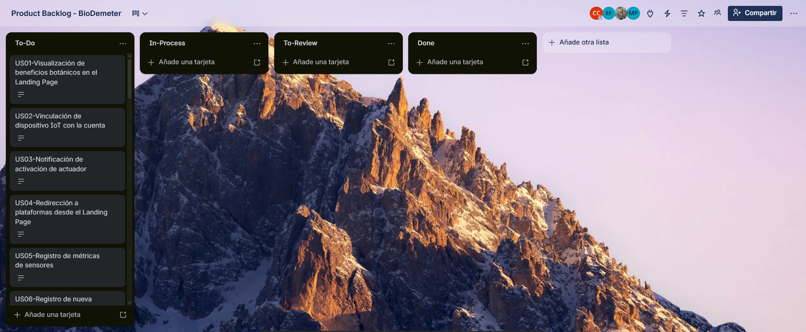

<p align="center">
  Product Backlog - Elaboración propia
</p>

<div style="page-break-before: always;"></div>


# Capítulo IV: Strategic-Level Software Design

## 4.1. Strategic-Level Attribute-Driven Design

### 4.1.1. Design Purpose

El propósito del Attribute-Driven Design (ADD) es traducir los requisitos funcionales, los atributos de calidad y las restricciones del sistema en decisiones arquitectónicas verificables. En NaturaTech, este proceso orienta el diseño hacia una solución modular, segura, observable y capaz de integrar dispositivos IoT con los servicios de gestión y orientación para el cuidado de plantas.

### 4.1.2. Attribute-Driven Design Inputs

Los insumos utilizados para el diseño arquitectónico se organizan en funcionalidad primaria, escenarios de atributos de calidad y restricciones del proyecto.

#### 4.1.2.1. Primary Functionality (Primary User Stories)

Las funcionalidades principales consideradas para el diseño son el registro e inicio de sesión de usuarios, la gestión del perfil, el registro y mantenimiento de plantas, la recepción de datos de sensores, la activación de actuadores, la programación de tareas de cuidado y la consulta de recomendaciones personalizadas mediante inteligencia artificial. Estas capacidades corresponden a las historias de usuario priorizadas en el Product Backlog del Capítulo III.

#### 4.1.2.2. Quality Attribute Scenarios

Los escenarios de calidad más relevantes son los siguientes:

+ **Seguridad:** ante una solicitud de acceso o modificación de información, el sistema debe autenticar al usuario y autorizar la operación según sus roles, evitando el acceso no permitido.
+ **Disponibilidad:** ante la pérdida temporal de comunicación con un dispositivo IoT, el sistema debe conservar el último estado válido y reanudar la sincronización cuando el dispositivo vuelva a estar disponible.
+ **Rendimiento:** ante la recepción de telemetría, el sistema debe procesar y publicar los datos sin retrasos que impidan detectar condiciones críticas de la planta.
+ **Modificabilidad:** ante la incorporación de un nuevo tipo de sensor o regla de cuidado, el cambio debe limitarse al contexto y los componentes relacionados sin afectar el resto del sistema.
+ **Interoperabilidad:** ante el intercambio de información entre bounded contexts y servicios externos, los mensajes deben mantener contratos claros y trazables.

#### 4.1.2.3. Constraints

El diseño de la solución se encuentra determinado por la implementación de una arquitectura basada en servicios y bounded contexts, así como por la integración de dispositivos Arduino y diferentes tipos de sensores. Además, contempla la conexión con servicios externos de inteligencia artificial y el almacenamiento de la información relacionada con los usuarios y las plantas. Para garantizar una adecuada organización del sistema, se mantiene una distribución clara de responsabilidades entre los distintos contextos: IAM, Profiles, PlantProfiles, IoT Management, CareScheduling y PlantGuidance.

### 4.1.3. Architectural Drivers Backlog

Los principales drivers arquitectónicos priorizados son: proteger la identidad y los datos del usuario; garantizar la comunicación confiable con los dispositivos IoT; procesar telemetría y detectar condiciones críticas; mantener límites claros entre los bounded contexts; permitir la evolución independiente de cada capacidad; y ofrecer recomendaciones oportunas a partir de la información de las plantas y sus sensores.

### 4.1.4. Architectural Design Decisions

Se decidió organizar el dominio mediante bounded contexts independientes, utilizar una arquitectura por capas dentro de cada contexto, separar las responsabilidades de dominio, aplicación, interfaces e infraestructura, y emplear contratos explícitos para la comunicación entre contextos. La integración con capacidades externas se realiza mediante fachadas o adaptadores, reduciendo el acoplamiento con proveedores y servicios de terceros. La arquitectura C4 se utiliza para representar el sistema, sus contenedores y sus relaciones.

### 4.1.5. Quality Attribute Scenario Refinements

Los escenarios iniciales se refinan asociando cada atributo con un contexto y una respuesta verificable. IAM concentra autenticación y autorización; IoT Management concentra la recepción, validación y procesamiento de telemetría; PlantProfiles mantiene la información de las plantas; CareScheduling administra las tareas programadas; y PlantGuidance consume la información necesaria para generar recomendaciones. Esta distribución permite evaluar seguridad, disponibilidad, rendimiento y modificabilidad en el límite arquitectónico donde cada decisión tiene efecto.

## 4.2. Strategic-Level Domain-Driven Design

### 4.2.1. EventStorming
Como grupo llevamos a cabo una reunión de EventStorming con la finalidad de entender el ámbito del problema y proponer un enfoque inicial al modelado general de Innospace. Esta actividad tuvo una duración aproximada de 1-2 horas, durante las cuales identificamos los eventos clave, los participantes y las normas que determinan las interacciones entre los estudiantes y las empresas.

A lo largo de la sesión, utilizamos una herramienta colaborativa para estructurar y visualizar los elementos, lo que nos permitió conversar, llegar a un acuerdo y definir los primeros contextos delimitados del sistema. El resultado es un mapa preliminar del ámbito que servirá como fundamento para el análisis y diseño más detallado en las etapas siguientes.

__Paleta de colores aplicados a los post-its utilizados:__

+ 🟧 Naranja: Domain Event (Evento que ya ocurrió, siempre en pasado. Ej: Luz Registrada).
+ 🟦 Azul: Command (Acción o intención. Ej: Registrar Luz).
+ 🟨 Amarillo Claro (pequeño): Actor (El usuario).
+ 🟪 Rosado: External System (Sensores, Actuadores, APIs externas).
+ 🟩 Verde: Read Model (Lo que el usuario ve: Dashboards, Notificaciones).
+ 🟨 Amarillo Oscuro (grande): Aggregate / System (El componente de software que procesa la lógica).
+ 🟪 Lila: Policy (Regla de negocio: "Si pasa X, entonces haz Y"). 

__Primer paso:__
<p align="center">
  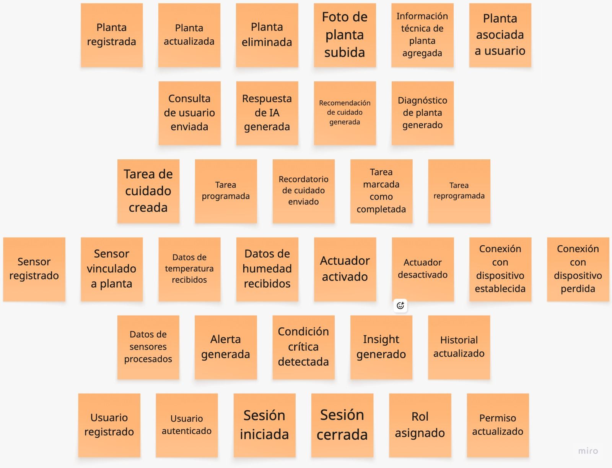
</p>
<p align="center">
  Event Storming 1 - Elaboración propia
</p>

__Segundo paso:__
<p align="center">
  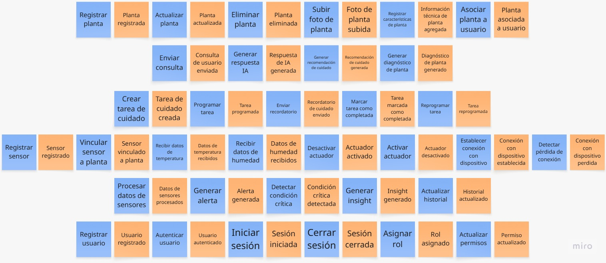
</p>
<p align="center">
  Event Storming 2 - Elaboración propia
</p>

__Tercer paso:__
<p align="center">
  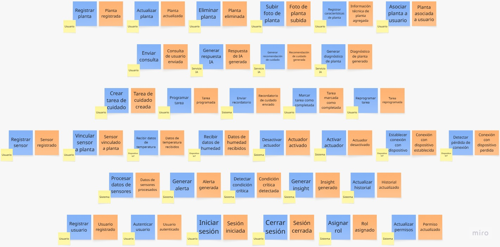
</p>
<p align="center">
  Event Storming 3 - Elaboración propia
</p>

__Cuarto paso:__
<p align="center">
  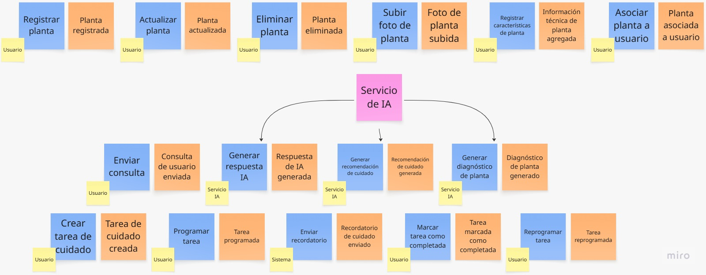
</p>
<p align="center">
  Event Storming 4.1 - Elaboración propia
</p>
<p align="center">
  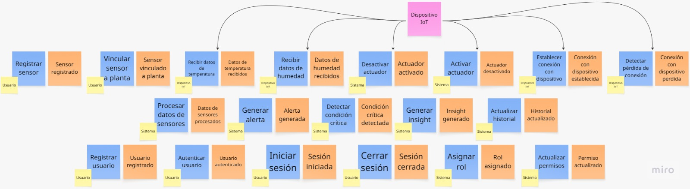
</p>
<p align="center">
  Event Storming 4.2 - Elaboración propia
</p>

__Quinto paso:__
<p align="center">
  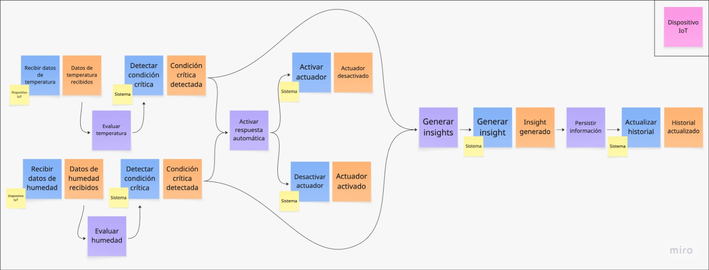
</p>
<p align="center">
  Event Storming 5.1 - Elaboración propia
</p>
<p align="center">
  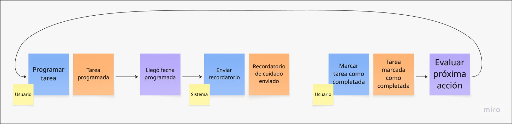
</p>
<p align="center">
  Event Storming 5.2 - Elaboración propia
</p>
<p align="center">
  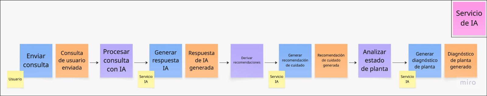
</p>
<p align="center">
  Event Storming 5.3 - Elaboración propia
</p><p align="center">
  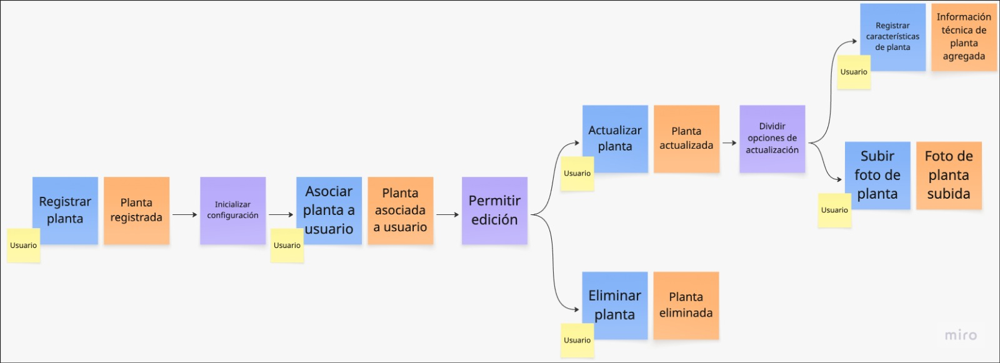
</p>
<p align="center">
  Event Storming 5.4 - Elaboración propia
</p><p align="center">
  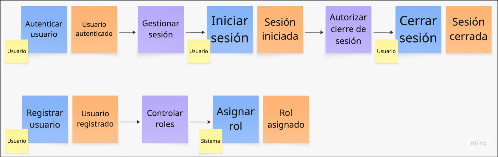
</p>
<p align="center">
  Event Storming 5.5 - Elaboración propia
</p>

__Sexto paso:__
<p align="center">
  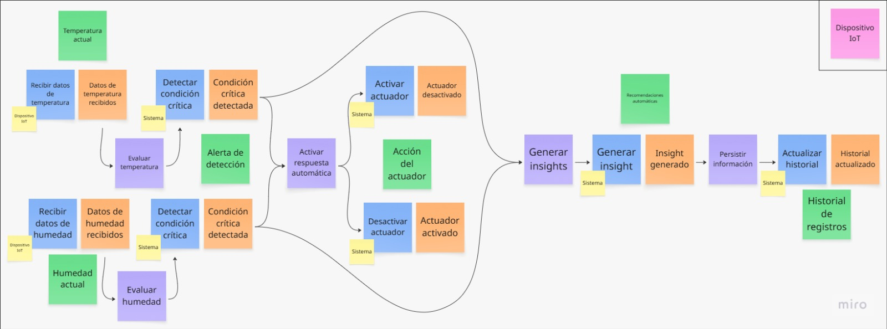
</p>
<p align="center">
  Event Storming 6.1 - Elaboración propia
</p>
<p align="center">
  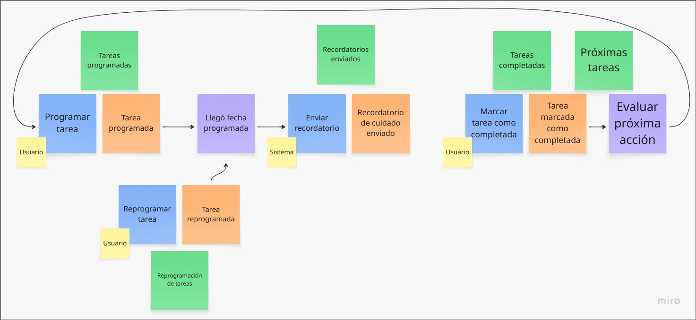
</p>
<p align="center">
  Event Storming 6.2 - Elaboración propia
</p>
<p align="center">
  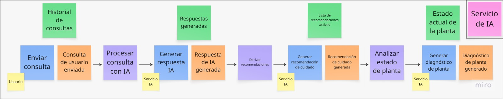
</p>
<p align="center">
  Event Storming 6.3 - Elaboración propia
</p>
<p align="center">
  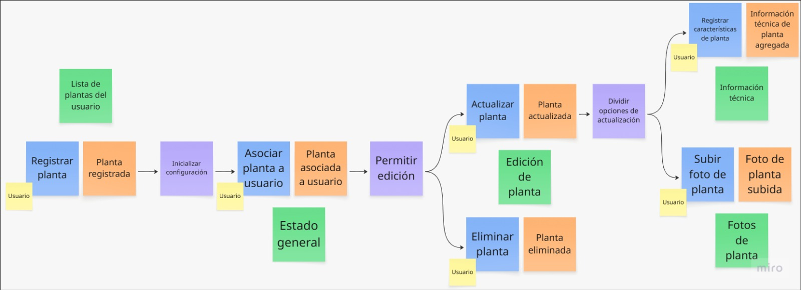
</p>
<p align="center">
  Event Storming 6.4 - Elaboración propia
</p>
<p align="center">
  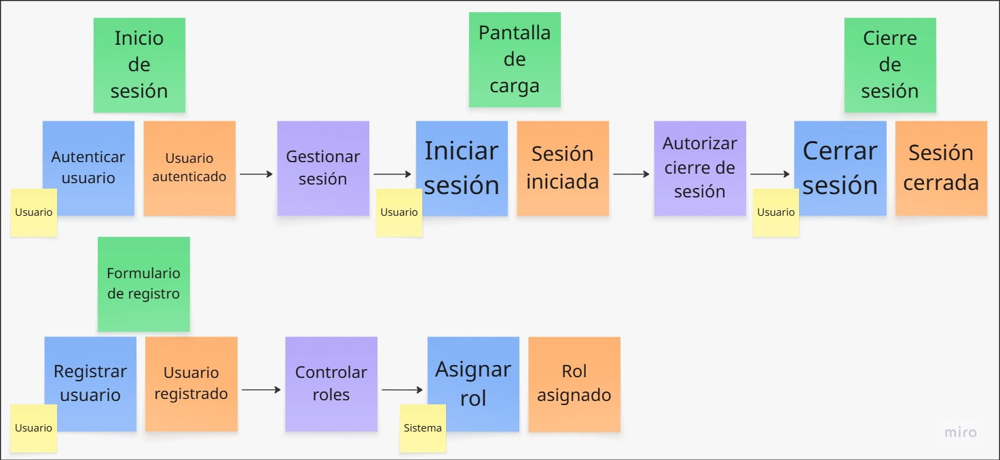
</p>
<p align="center">
  Event Storming 6.5 - Elaboración propia
</p>

__Séptimo paso:__
<p align="center">
  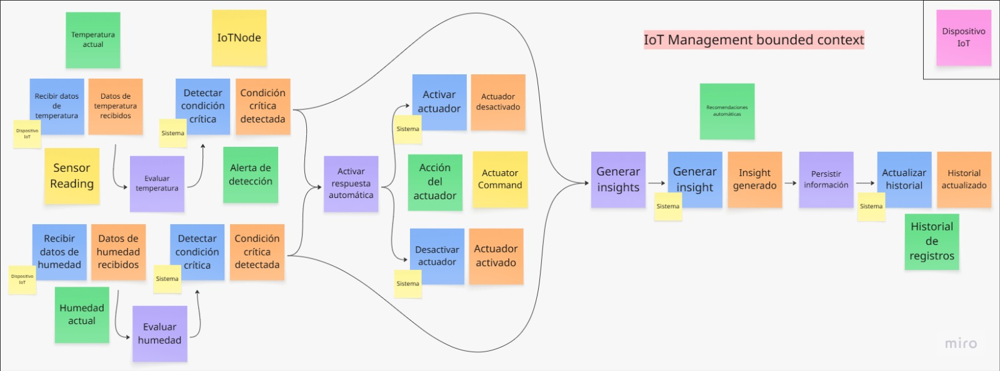
</p>
<p align="center">
  Event Storming 7.1 - Elaboración propia
</p>
<p align="center">
  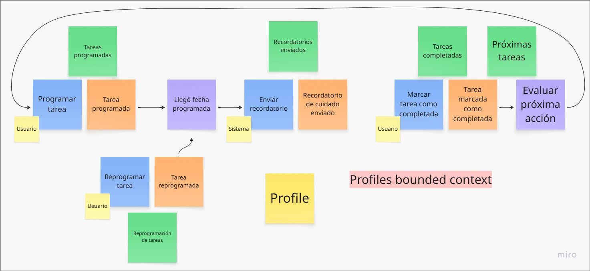
</p>
<p align="center">
  Event Storming 7.2 - Elaboración propia
</p>
<p align="center">
  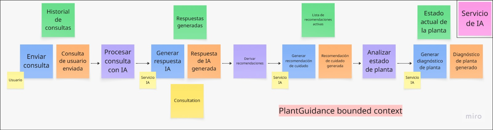
</p>
<p align="center">
  Event Storming 7.3 - Elaboración propia
</p>
<p align="center">
  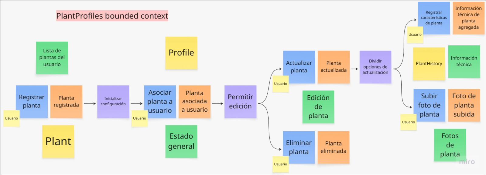
</p>
<p align="center">
  Event Storming 7.4 - Elaboración propia
</p>
<p align="center">
  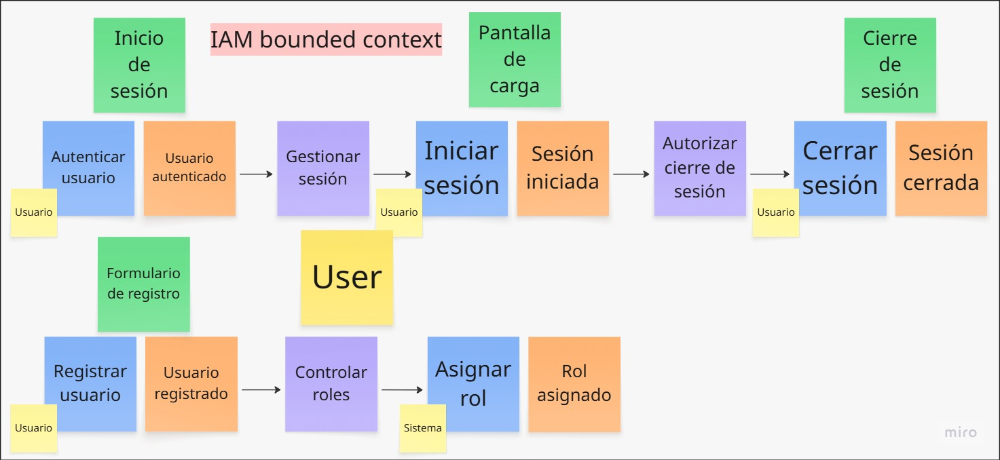
</p>
<p align="center">
  Event Storming 7.5 - Elaboración propia
</p>

### 4.2.2. Candidate Context Discovery

Después de completar la sesión de tormenta de eventos, se realizó un análisis detallado de los eventos detectados con la herramienta Miro para identificar los contextos candidatos más relevantes para el dominio. Este trabajo implicó reconocer patrones y relaciones entre eventos y crear flujos a partir de ellos. Como resultado, se organizaron una serie de eventos que correspondían a un mismo proceso dentro de la aplicación.

__IoT Management context:__
<p align="center">
  
</p>
<p align="center">
  IoT Management - Elaboración propia
</p>

__Profiles context:__
<p align="center">
  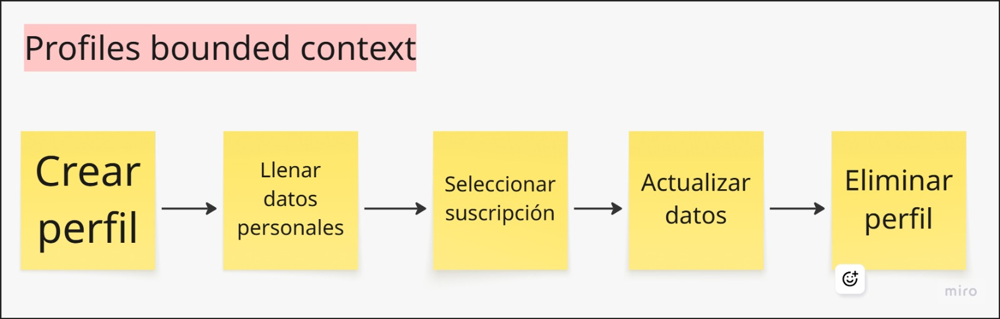
</p>
<p align="center">
  Profiles - Elaboración propia
</p>

__PlantGuidance context:__
<p align="center">
  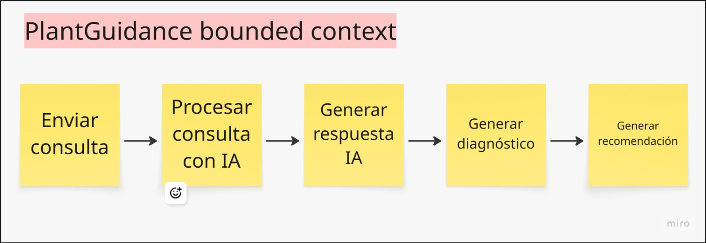
</p>
<p align="center">
  PlantGuidance - Elaboración propia
</p>

__PlantProfiles context:__
<p align="center">
  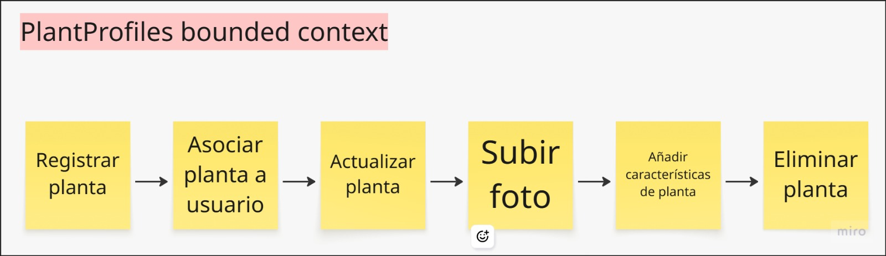
</p>
<p align="center">
  PlantProfiles - Elaboración propia
</p>

__IAM context:__
<p align="center">
  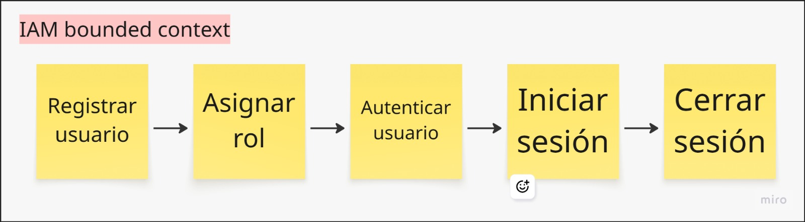
</p>
<p align="center">
  IAM - Elaboración propia
</p>

Después de identificar los flujos de eventos dentro de la aplicación, se determinaron los pivotal points (eventos que cambian el curso del sistema), los cuales representan momentos clave en la interacción del usuario con la plataforma y el comportamiento del sistema IoT:

+ El registro y autenticación de un usuario en la plataforma
+ La creación y gestión de una planta por parte del usuario
+ La recepción de datos de sensores (temperatura y humedad) desde dispositivos IoT
+ La detección de condiciones críticas en el entorno de la planta
+ La activación o desactivación automática de actuadores
+ El envío de consultas del usuario al sistema de inteligencia artificial
+ La generación de respuestas, diagnósticos y recomendaciones de cuidado

Al identificar estos pivotal points, se puede observar cómo los eventos se agrupan naturalmente en distintos contextos del dominio, permitiendo definir los siguientes bounded contexts:

+ __IAM:__ Encargado de la gestión de identidad y acceso, incluyendo el registro, autenticación y control de sesiones de los usuarios.
+ __Profiles:__ Responsable de la administración de la información personal del usuario, como datos personales, suscripción y configuración del perfil.
+ __PlantProfiles:__ Gestiona el ciclo de vida de las plantas registradas por el usuario, incluyendo su creación, actualización, asociación, eliminación y almacenamiento de información relevante como fotos y características.
+ __IoT Management:__ Maneja la interacción con los dispositivos IoT, incluyendo la conexión, recepción de datos de sensores, detección de condiciones críticas y ejecución de acciones sobre actuadores.
+ __PlantGuidance:__ Encargado de procesar las consultas del usuario mediante inteligencia artificial, generando respuestas, diagnósticos y recomendaciones para el cuidado de las plantas.

Finalmente, utilizando la herramienta Miro, se realizó la división de estos bounded contexts, representando de manera visual los flujos de eventos dentro de cada uno y facilitando la comprensión de las responsabilidades y límites de cada contexto dentro del sistema.

### 4.2.3. Domain Message Flows Modeling

En esta sección se desarrollan los Domain Message Flow Models para representar cómo fluyen los mensajes entre usuarios, sistemas externos y bounded contexts en los escenarios principales del sistema. Estos diagramas permiten visualizar la secuencia de commands, events y queries que ocurren durante cada proceso, facilitando la comprensión de las interacciones del dominio y validando que las responsabilidades de cada contexto estén correctamente definidas.

<h4>Scenario: User Registration</h4>
<p align="center">
  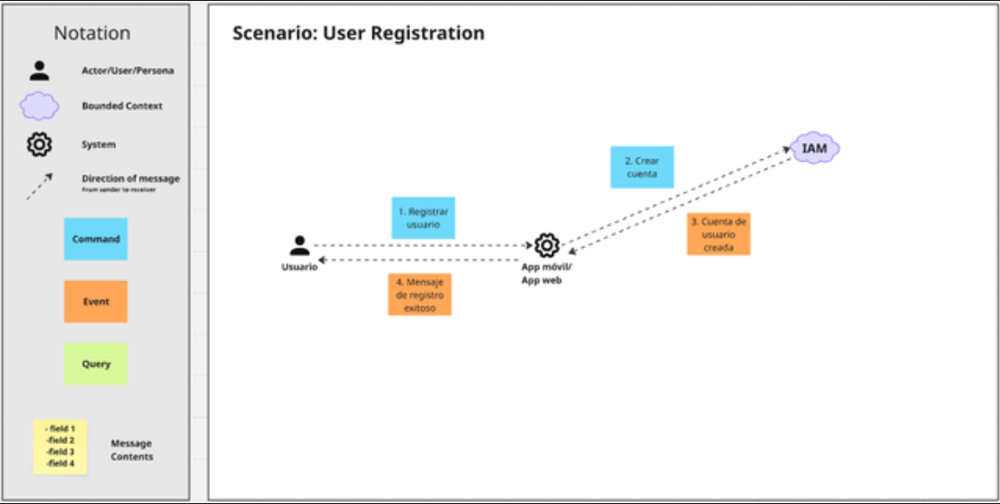
</p>

<h4>Scenario: User Login</h4>
<p align="center">
  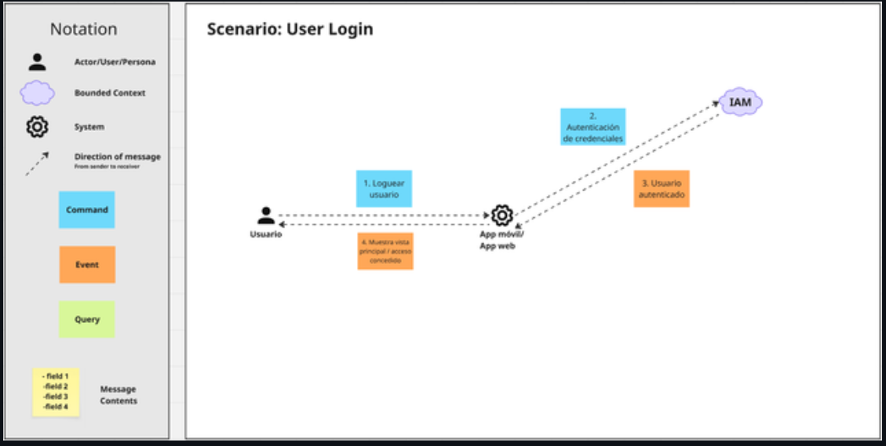
</p>

<h4>Scenario: Registering a New Plant</h4>
<p align="center">
  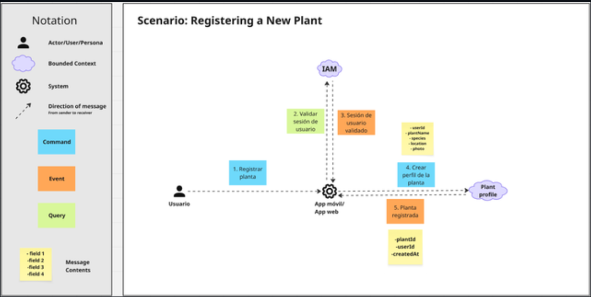
</p>

<h4>Scenario: Linking an IoT Device to a Plant</h4>
<p align="center">
  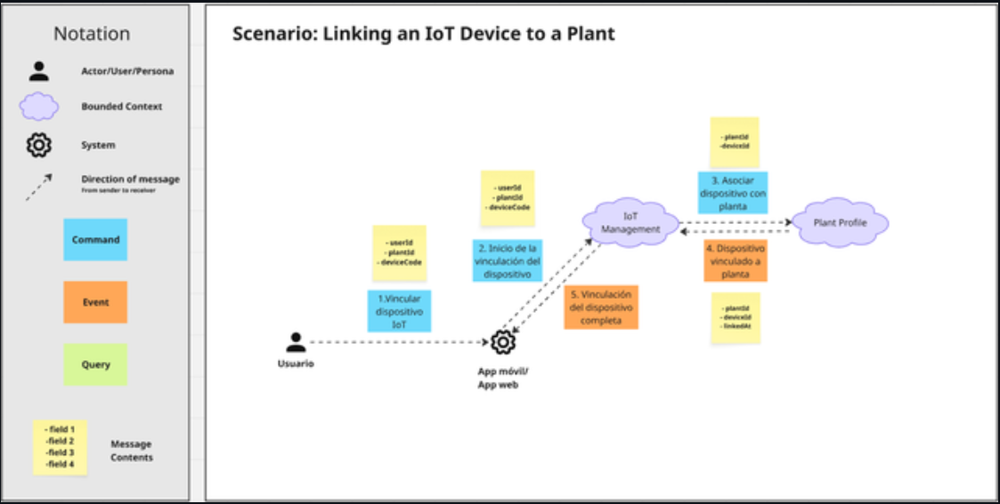
</p>

<h4>Scenario: Receiving Temperature and Humidity Sensor Data</h4>
<p align="center">
  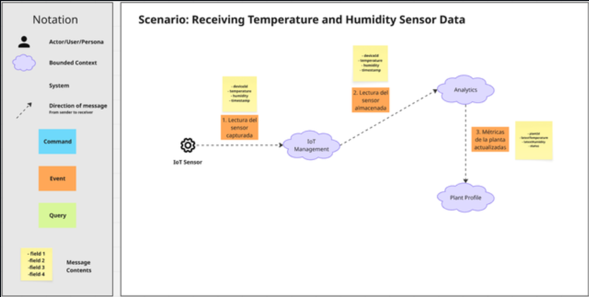
</p>

<h4>Scenario: Generating Plant Alerts From Sensor Data</h4>
<p align="center">
  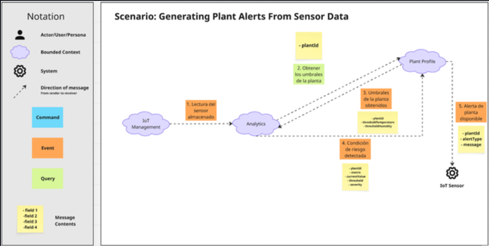
</p>

<h4>Scenario: Activating an IoT Actuator Automatically</h4>
<p align="center">
  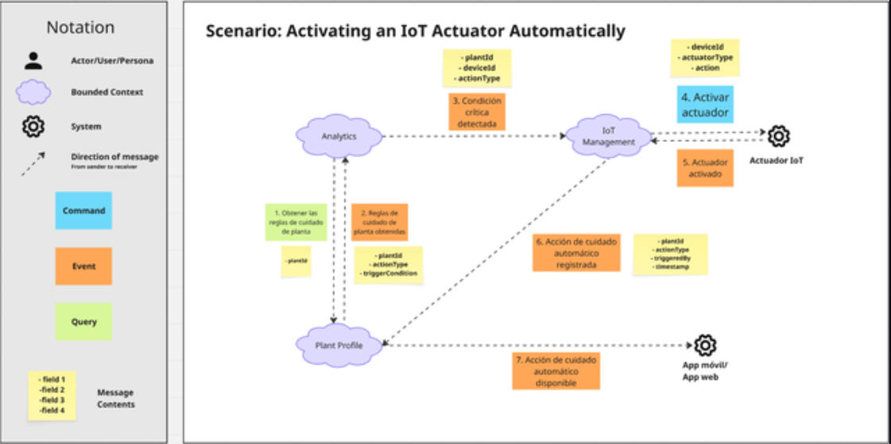
</p>

<h4>Scenario: Viewing Plant Health Status</h4>
<p align="center">
  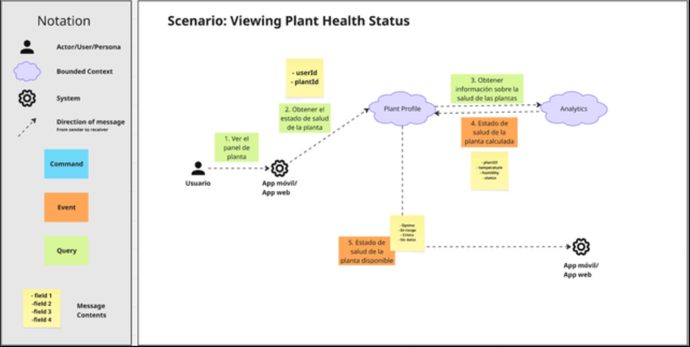
</p>

<h4>Scenario: Scheduling a Plant Care Task</h4>
<p align="center">
  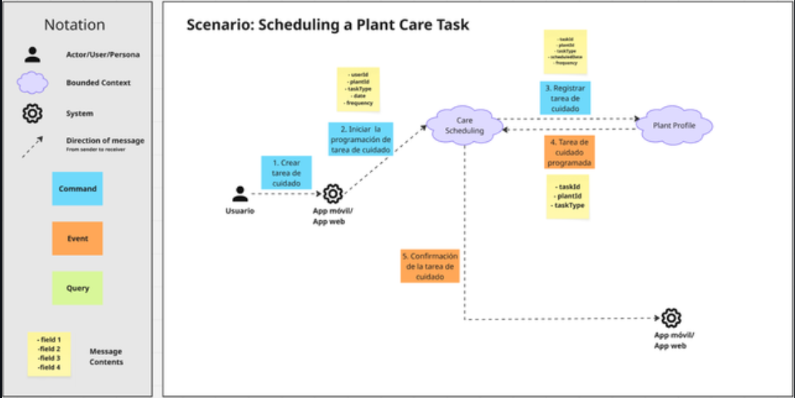
</p>

<h4>Scenario: Getting Plant Care Guidance From RootBot (bot temporal name)</h4>
<p align="center">
  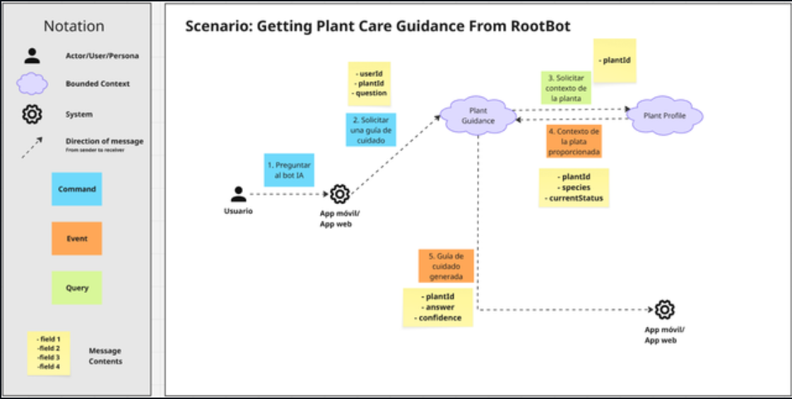
</p>

<h4>Scenario: Viewing Plant Care History</h4>
<p align="center">
  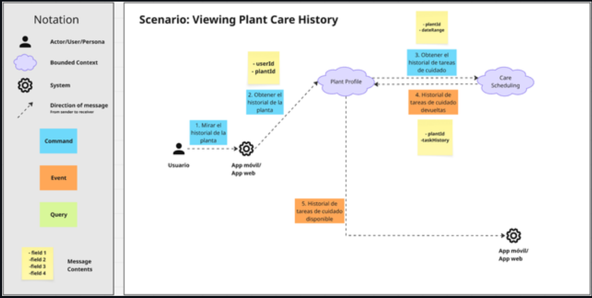
</p>

<h4>Scenario: Viewing Sensor History and Insights</h4>
<p align="center">
  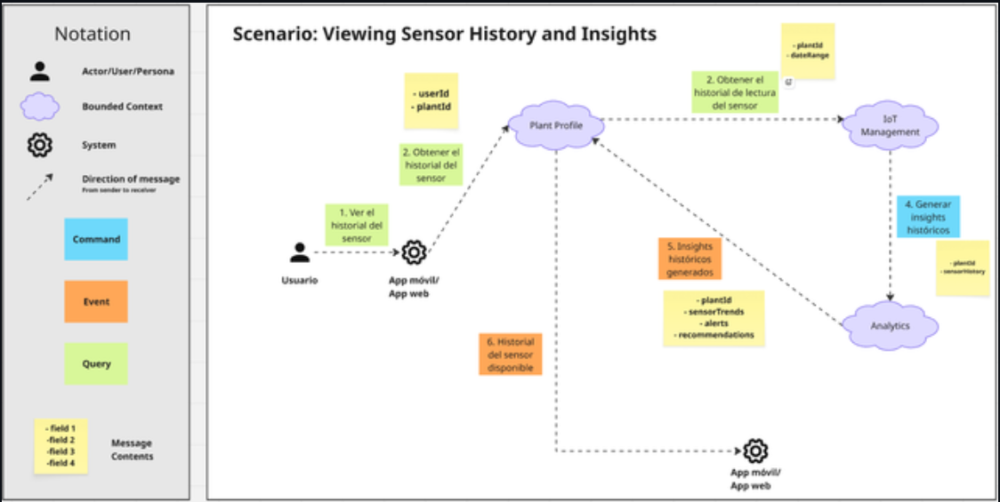
</p>

### 4.2.4. Bounded Context Canvases

En esta sección se desarrollan los Bounded Context Canvases correspondientes a los contextos identificados en la arquitectura del dominio. Cada canvas permite describir el propósito, responsabilidades, comunicaciones, lenguaje ubicuo, decisiones de negocio, supuestos, métricas y preguntas abiertas de un bounded context específico. De esta manera, se documenta con mayor detalle el rol que cumple cada contexto dentro del sistema y se facilita la validación de su diseño.

<h4>IOT Management</h4>
<p align="center">
  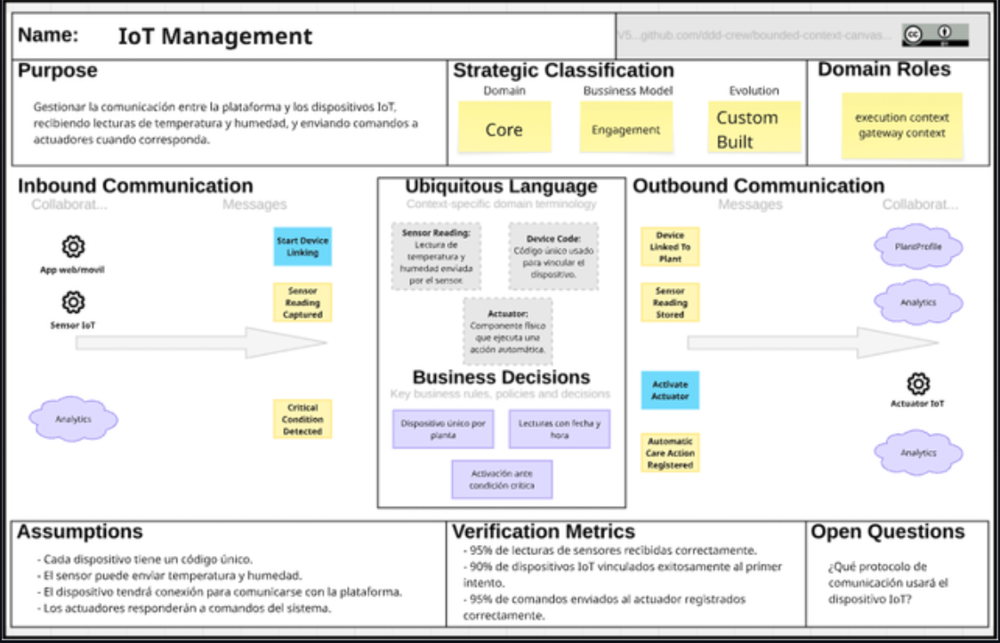
</p>

<h4>Plant Profile</h4>
<p align="center">
  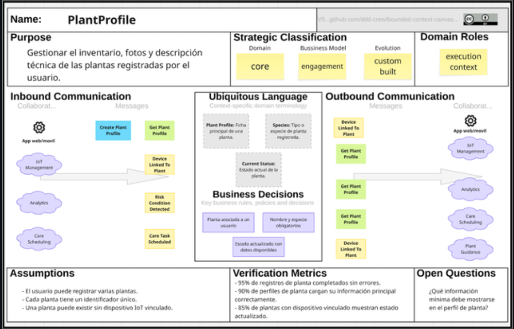
</p>

<h4>Care Scheduling</h4>
<p align="center">
  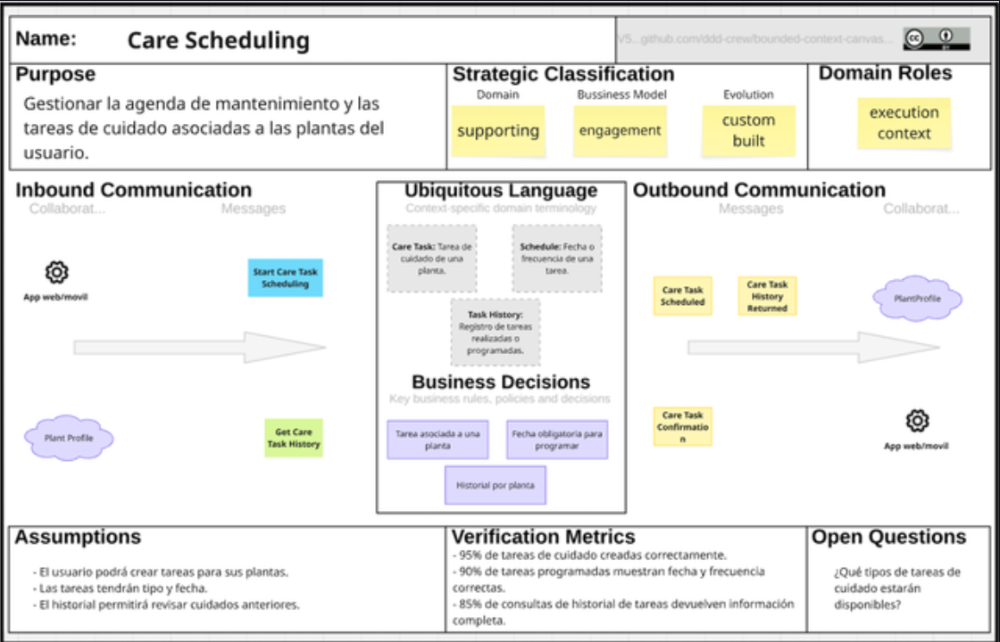
</p>

<h4>Analytics</h4>
<p align="center">
  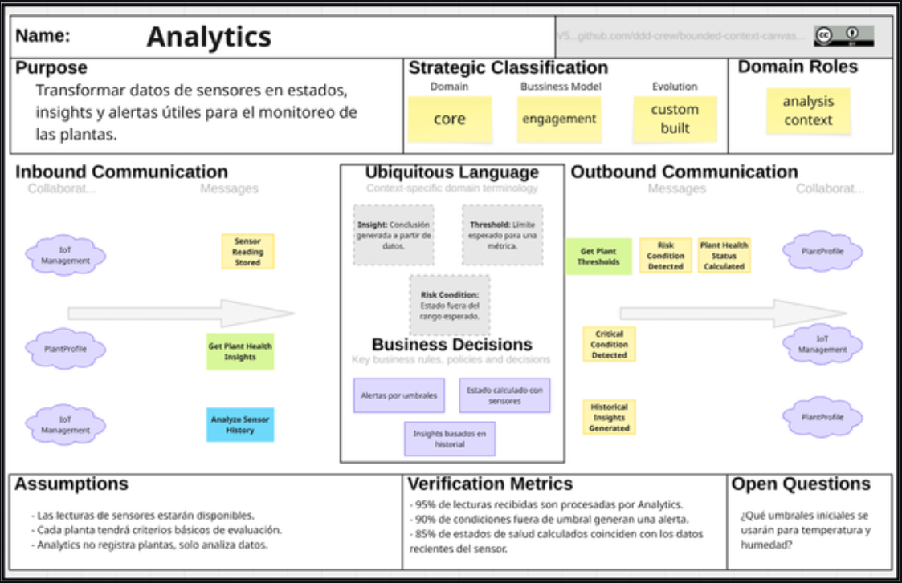
</p>

<h4>Plant Guidance</h4>
<p align="center">
  
</p>

<h4>IAM</h4>
<p align="center">
  
</p>

### 4.2.5. Context Mapping

En esta sección se desarrolló un conjunto de context maps con el propósito de representar y analizar las relaciones existentes entre los bounded contexts que conforman el sistema. Con base en la información recopilada, se estudiaron diferentes alternativas de diseño, considerando los posibles cambios en la estructura del sistema al reorganizar, agrupar, dividir o mantener aisladas determinadas capabilities. Para este análisis se tomaron en cuenta distintos patrones de Domain-Driven Design, entre ellos Customer/Supplier, Conformist, Anti-corruption Layer y Shared Kernel. La evaluación de estas alternativas permitió determinar el enfoque más adecuado para organizar la arquitectura del dominio. A continuación, se detallan las opciones consideradas para Tavolo y se presenta la propuesta finalmente seleccionada.

<h4> Opción 1: </h4>

En esta alternativa se mantienen los seis bounded contexts separados, con relaciones claramente definidas entre ellos. Esta opción permite una mejor separación de responsabilidades, ya que cada contexto se concentra en una funcionalidad específica del sistema, facilitando su comprensión y evolución. Como desventaja, implica una mayor cantidad de dependencias e interacciones entre contextos, lo que incrementa la complejidad de integración y sincronización.

<p align="center">
  
</p>

<h4> Opción 2: </h4>

En esta alternativa se agrupan los bounded contexts PlantProfile y Care Scheduling en un solo contexto denominado Plant Management, debido a que ambos trabajan directamente sobre la gestión de plantas y sus cuidados programados. Esta opción reduce la cantidad de relaciones entre contextos y simplifica la coordinación entre el perfil de la planta y sus tareas de mantenimiento. Sin embargo, como desventaja, el nuevo contexto concentra más responsabilidades, mezclando la administración de información de la planta con la planificación de tareas, lo que podría dificultar su evolución independiente si el sistema crece.

<p align="center">
  
</p>

<h4> Opción 3: </h4>

En esta alternativa se agrupan los bounded contexts IoT Management y Analytics en un solo contexto denominado IoT Operations, debido a que ambos trabajan directamente con la captura, procesamiento e interpretación de datos provenientes de sensores. Esta opción simplifica la comunicación entre el hardware y el análisis de datos, reduciendo dependencias internas del flujo IoT. Sin embargo, como desventaja, mezcla la gestión técnica de dispositivos con la generación de insights y alertas, lo que podría dificultar la evolución independiente de ambas capacidades si el sistema crece.

<p align="center">
  
</p>

Finalmente, se seleccionó la Opción 1, ya que permite mantener los seis bounded contexts separados y con responsabilidades claramente delimitadas. Esta alternativa resulta más adecuada porque evita mezclar capacidades distintas, como la gestión de plantas, la planificación de cuidados, la comunicación IoT, el análisis de datos y el soporte mediante chatbot. Aunque implica una mayor cantidad de relaciones entre contextos, ofrece una arquitectura más ordenada, escalable y fácil de mantener, permitiendo que cada contexto evolucione de forma independiente según las necesidades del sistema.

## 4.3. Software Architecture

### 4.3.1. Software Architecture System Landscape Diagram

Este diagrama representa la visión de más alto nivel del ecosistema de la startup NaturaTech, mostrando las interacciones que mantienen los diferentes actores con la plataforma PlantSync, el hardware IoT y los servicios externos.


<p align="center">
  Elaboración propia
</p>

### 4.3.2. Software Architecture Context Level Diagrams

Este diagrama representa el enfoque central de la solución PlantSync, mostrando las interacciones directas que mantiene la plataforma principal con sus distintos tipos de usuarios, el hardware IoT y las dependencias tecnológicas externas.


<p align="center">
  Elaboración propia
</p>

### 4.3.3. Software Architecture Container Level Diagrams

Este diagrama detalla la arquitectura interna de la plataforma PlantSync, exponiendo los diferentes contenedores de software, las tecnologías empleadas en cada uno y los flujos de comunicación y datos entre estas piezas.


<p align="center">
  Elaboración propia
</p>

### 4.3.4. Software Architecture Deployment Diagrams

Este diagrama ilustra la infraestructura y el entorno de ejecución de la solución PlantSync, mapeando cómo se distribuyen físicamente los contenedores de software en la nube de Microsoft Azure, los dispositivos cliente de los usuarios y los microcontroladores IoT instalados en sus hogares.


<p align="center">
  Elaboración propia
</p>

<div style="page-break-before: always;"></div>

# Capítulo V: Tactical-Level Domain-Driven Design

Este capítulo presenta el diseño táctico objetivo de PlantSync. La base reutilizada incluye aplicaciones Vue y Flutter, Backend API Java/Spring Boot con MySQL, Edge Python/Flask con SQLite y firmware ESP32 en C++. Las extensiones de diagnóstico visual, agente de IA y recompensas Web3 son propuestas de integración; su presencia en este diseño no constituye evidencia de implementación, despliegue o validación.

Los ocho bounded contexts son módulos con propiedad lógica de sus modelos y tablas dentro del mismo Backend API. La separación de comandos y consultas es lógica y comparte persistencia; no se proponen ocho microservicios. Los clientes usan REST/JSON sobre HTTPS. Entre módulos se utilizan fachadas de aplicación y eventos internos publicados después de confirmar la persistencia; no se requiere RabbitMQ, Kafka ni Redis para este alcance. Edge sincroniza por HTTP/HTTPS y conserva las reglas locales necesarias para operar cuando la nube no está disponible.

| Bounded context | Responsabilidad y límites |
|---|---|
| IAM | Autenticación, roles y vinculación verificada de una wallet opcional; no acuña recompensas. |
| Profiles | Datos personales y plan del usuario; no gestiona identidades criptográficas. |
| PlantProfiles | Registro, especie y propiedad de plantas, además de historial de cuidado con referencias a otros contextos. |
| IoT Management | Nodos, telemetría, configuración y seguimiento de estados deseados/reportados mediante Edge. |
| CareScheduling | Tareas y recordatorios; completar una tarea manual no demuestra ejecución de un actuador. |
| Inteligencia Botánica y Análisis Externo | Evaluación de condiciones y análisis visual orientativo mediante Google Gemini API; no autoriza actuadores. |
| PlantGuidance | Asesoría conversacional y propuestas de acciones acotadas mediante Google Gemini API; verifica políticas antes de delegar a IoT. |
| EcoRewards | Progreso verificable y emisión opcional de Eco-Badges ERC-721 en Ethereum Sepolia mediante Alchemy y Web3j. |

Google Gemini API es el proveedor seleccionado para ambos usos de IA, con puertos y adaptadores separados. El modelo se configura en infraestructura para poder cambiarlo sin modificar el dominio. Los umbrales de cuidado y la política de recompensas son datos versionados definidos por el proyecto; una respuesta generativa no determina los rangos que conceden una recompensa. MetaMask firma el desafío de IAM desde la aplicación web; el usuario conserva sus claves. La aplicación Flutter consulta diagnósticos y recompensas por REST y deriva la vinculación de wallet a la web en el MVP.

**Estado de los diagramas:** los C4 de contexto, contenedores y despliegue del capítulo IV son la referencia de arquitectura objetivo. Las imágenes tácticas heredadas que se señalan en este capítulo quedan pendientes de actualización. El landscape debe alinearse con los proveedores ya seleccionados. Los canvases y el context map deben reflejar los mismos ocho contextos y contratos aquí descritos.

### 5.1. Bounded Context: IAM
El bounded context **Identity and Access Management (IAM)** concentra las responsabilidades relacionadas con autenticación, autorización y vinculación segura de identidades externas del usuario.

En la arquitectura objetivo de PlantSync, IAM forma parte del Backend API desarrollado en Java y Spring Boot. La separación entre comandos y consultas sigue un enfoque CQRS a nivel lógico; ambos tipos de operaciones comparten el mismo modelo de persistencia relacional y no representan microservicios desplegados independientemente.

Además del registro e inicio de sesión tradicional mediante correo electrónico y contraseña, IAM permite vincular de manera opcional una dirección Ethereum controlada por el usuario. Esta vinculación se realiza mediante un desafío criptográfico de un solo uso firmado desde MetaMask. PlantSync nunca recibe ni almacena la clave privada de la billetera.

La billetera no sustituye la autenticación tradicional y no es necesaria para utilizar las funciones principales de cuidado de plantas.

#### 5.1.1. Domain Layer

La capa de dominio encapsula las reglas relacionadas con usuarios, roles y asociaciones verificadas entre una cuenta PlantSync y una dirección Ethereum.

**Aggregate: `User`**

El agregado `User` representa la identidad principal de un usuario registrado en PlantSync. Es responsable de mantener consistentes sus credenciales y roles de autorización.

| Atributo | Tipo | Visibilidad | Descripción |
|---|---|---|---|
| id | Long | Private | Identificador interno del usuario. |
| email | String | Private | Correo electrónico único utilizado para autenticación. |
| passwordHash | String | Private | Hash de la contraseña del usuario. |
| roles | Set<Role> | Private | Roles asignados al usuario. |

**Métodos**

| Método | Retorno | Visibilidad | Descripción |
|---|---|---|---|
| getId() | Long | Public | Obtiene el identificador del usuario. |
| getEmail() | String | Public | Obtiene el correo electrónico. |
| addRole(Role) | User | Public | Asigna un rol al usuario evitando inconsistencias. |
| addRoles(List<Role>) | User | Public | Asigna un conjunto válido de roles. |
| updateEmail(String) | User | Public | Actualiza el correo electrónico aplicando las validaciones correspondientes. |

El hash de contraseña es utilizado internamente durante el proceso de autenticación y no debe exponerse como parte de los recursos enviados a los clientes.

---

**Entity: `Role`**

Representa un rol persistido que puede ser asignado a uno o más usuarios.

| Atributo | Tipo | Descripción |
|---|---|---|
| id | Long | Identificador persistente del rol. |
| name | Roles | Nombre lógico del rol. |

---

**Value Object / Enum: `Roles`**

Define los roles reconocidos por PlantSync.

Inicialmente se consideran:

- `ROLE_USER`
- `ROLE_ADMIN`

---

**Aggregate: `WalletAssociation`**

Representa una asociación verificada entre una cuenta PlantSync y una dirección Ethereum.

La existencia de este agregado no significa que PlantSync controle la billetera. Únicamente registra que el usuario demostró control sobre una dirección mediante una firma válida.

| Atributo | Tipo | Visibilidad | Descripción |
|---|---|---|---|
| id | Long | Private | Identificador interno. |
| userId | Long | Private | Usuario PlantSync propietario de la asociación. |
| walletAddress | EthereumAddress | Private | Dirección Ethereum verificada. |
| status | WalletAssociationStatus | Private | Estado de la asociación. |
| verifiedAt | LocalDateTime | Private | Fecha de verificación exitosa. |

**Métodos**

| Método | Retorno | Descripción |
|---|---|---|
| getWalletAddress() | EthereumAddress | Devuelve la dirección vinculada. |
| getStatus() | WalletAssociationStatus | Devuelve el estado actual. |
| unlink() | void | Marca la asociación como desvinculada. |
| isActive() | boolean | Indica si la asociación se encuentra vigente. |

Para el MVP se considera como máximo una wallet activa por usuario.

---

**Aggregate: `WalletChallenge`**

Representa un desafío temporal y de un solo uso generado por PlantSync para demostrar el control de una dirección Ethereum.

| Atributo | Tipo | Visibilidad | Descripción |
|---|---|---|---|
| id | UUID | Private | Identificador del desafío. |
| userId | Long | Private | Usuario que solicita la vinculación. |
| walletAddress | EthereumAddress | Private | Dirección que se desea verificar. |
| nonce | String | Private | Valor aleatorio de un solo uso. |
| domain | String | Private | Dominio de PlantSync asociado al desafío. |
| expiresAt | LocalDateTime | Private | Fecha y hora de expiración. |
| usedAt | LocalDateTime | Private | Momento en que el desafío fue consumido. |
| createdAt | LocalDateTime | Private | Fecha de generación. |

**Métodos**

| Método | Retorno | Descripción |
|---|---|---|
| isExpired(LocalDateTime) | boolean | Determina si el desafío ha expirado. |
| isUsed() | boolean | Determina si ya fue consumido. |
| markAsUsed() | void | Marca el desafío como utilizado. |
| canBeVerified(LocalDateTime) | boolean | Comprueba que siga vigente y no haya sido utilizado. |

---

**Value Objects**

| Value Object | Descripción |
|---|---|
| EthereumAddress | Encapsula y valida el formato de una dirección Ethereum/EVM. |
| WalletAssociationStatus | Define estados como `ACTIVE` y `UNLINKED`. |

---

**Clase: `UserCommandService`**

Interfaz responsable de las operaciones que modifican la identidad tradicional del usuario.

| Método | Descripción |
|---|---|
| handle(SignUpCommand) | Registra una nueva cuenta y asigna sus roles iniciales. |
| handle(SignInCommand) | Verifica las credenciales y genera una sesión mediante JWT. |
| handle(UpdateUserCommand) | Actualiza información permitida del usuario. |

---

**Clase: `UserQueryService`**

Interfaz responsable de las consultas relacionadas con usuarios.

| Método | Descripción |
|---|---|
| handle(GetUserByIdQuery) | Obtiene un usuario por identificador. |
| handle(GetUserByEmailQuery) | Obtiene un usuario por correo electrónico. |
| handle(GetAllUsersQuery) | Recupera los usuarios accesibles según autorización. |

---

**Clase: `WalletCommandService`**

Interfaz responsable del proceso de vinculación y desvinculación de wallets.

| Método | Descripción |
|---|---|
| handle(CreateWalletChallengeCommand) | Genera un desafío temporal y de un solo uso para el usuario autenticado. |
| handle(VerifyWalletSignatureCommand) | Verifica firma, dirección, usuario, nonce y vigencia antes de crear la asociación. |
| handle(UnlinkWalletCommand) | Desvincula la wallet activa del usuario. |

---

**Clase: `WalletQueryService`**

Interfaz responsable de consultar la asociación de wallet.

| Método | Descripción |
|---|---|
| handle(GetWalletAssociationByUserIdQuery) | Recupera la wallet actualmente asociada al usuario, si existe. |

---

#### 5.1.2. Interface Layer

La capa de interfaz expone los endpoints REST del bounded context IAM. Los controladores reciben las solicitudes de las aplicaciones web y móvil y delegan las operaciones a los servicios de aplicación correspondientes.

La interacción directa con MetaMask ocurre únicamente en la aplicación web. El backend nunca solicita ni recibe la clave privada del usuario.

**Controlador: `AuthenticationController`**

Gestiona el registro y autenticación tradicional.

| Método | Ruta | Descripción |
|---|---|---|
| signUp | POST `/api/v1/authentication/sign-up` | Registra un nuevo usuario. |
| signIn | POST `/api/v1/authentication/sign-in` | Autentica mediante email y contraseña y devuelve el token JWT correspondiente. |

---

**Controlador: `UserController`**

Gestiona operaciones autorizadas sobre usuarios.

| Método | Ruta | Descripción |
|---|---|---|
| getUserById | GET `/api/v1/users/{id}` | Recupera un usuario autorizado por identificador. |
| getAllUsers | GET `/api/v1/users` | Recupera usuarios según las reglas de autorización. |
| updateUser | PUT `/api/v1/users/{id}` | Actualiza información permitida del usuario. |

---

**Controlador: `WalletController`**

Gestiona la vinculación segura de MetaMask con una cuenta PlantSync.

| Método | Ruta | Descripción |
|---|---|---|
| createChallenge | POST `/api/v1/wallet/challenges` | Genera un desafío de un solo uso para el usuario autenticado y la dirección indicada. |
| verifySignature | POST `/api/v1/wallet/verify` | Verifica la firma del desafío y crea la asociación con la wallet. |
| getWalletAssociation | GET `/api/v1/wallet` | Recupera la wallet actualmente vinculada. |
| unlinkWallet | DELETE `/api/v1/wallet` | Desvincula la wallet activa. |

---

**Recursos y Assemblers principales**

| Elemento | Responsabilidad |
|---|---|
| SignUpResource | Datos necesarios para registrar una cuenta. |
| SignInResource | Email y contraseña utilizados para autenticación. |
| UserResource | Representación pública del usuario, sin exponer passwordHash. |
| CreateWalletChallengeResource | Dirección Ethereum que se desea vincular. |
| WalletChallengeResource | Challenge, nonce, dominio y vencimiento necesarios para firmar. |
| VerifyWalletSignatureResource | Dirección, nonce y firma producida por MetaMask. |
| WalletAssociationResource | Dirección vinculada, estado y fecha de verificación. |
| SignUpCommandFromResourceAssembler | Convierte la solicitud de registro en un comando. |
| SignInCommandFromResourceAssembler | Convierte las credenciales en un comando de autenticación. |
| VerifyWalletSignatureCommandFromResourceAssembler | Convierte la solicitud de verificación en el comando correspondiente. |
| UserResourceFromEntityAssembler | Genera la representación segura de un usuario. |
| WalletAssociationResourceAssembler | Genera la representación pública de una asociación de wallet. |

---

#### 5.1.3. Application Layer

La capa de aplicación coordina los casos de uso del bounded context IAM sin implementar detalles específicos de persistencia o criptografía.

**Clase: `UserCommandServiceImpl`**

Implementa registro, autenticación y actualización de usuarios.

**Dependencias**

| Dependencia | Descripción |
|---|---|
| UserRepository | Persistencia de usuarios. |
| RoleRepository | Persistencia y consulta de roles. |
| HashingService | Generación y comparación segura de hashes de contraseña. |
| TokenService | Generación y validación de tokens JWT. |

---

**Clase: `UserQueryServiceImpl`**

Implementa las consultas autorizadas de usuarios.

**Dependencias**

| Dependencia | Descripción |
|---|---|
| UserRepository | Acceso a la información persistida de usuarios. |

---

**Clase: `WalletCommandServiceImpl`**

Orquesta el proceso de vinculación segura de una wallet.

Para generar el challenge comprueba que el usuario esté autenticado, genera un nonce criptográficamente seguro, establece el dominio y el tiempo de expiración y persiste el desafío.

Durante la verificación comprueba:

1. que el challenge exista;
2. que corresponda al usuario autenticado;
3. que la dirección corresponda a la solicitada;
4. que el nonce no haya sido usado;
5. que el challenge no haya expirado;
6. que la firma corresponda a la dirección indicada.

Solo después de superar estas verificaciones se crea o actualiza la `WalletAssociation`.

**Dependencias**

| Dependencia | Descripción |
|---|---|
| UserRepository | Comprueba la identidad PlantSync. |
| WalletChallengeRepository | Persiste y recupera desafíos. |
| WalletAssociationRepository | Persiste asociaciones verificadas. |
| NonceGenerator | Genera valores aleatorios de un solo uso. |
| SignatureVerificationService | Recupera/verifica criptográficamente la dirección que produjo una firma. |

---

**Clase: `WalletQueryServiceImpl`**

Gestiona las consultas de asociaciones verificadas.

| Dependencia | Descripción |
|---|---|
| WalletAssociationRepository | Recupera la wallet asociada a un usuario. |

---

#### 5.1.4. Infrastructure Layer

Esta capa contiene los mecanismos técnicos utilizados por IAM: Spring Data JPA, Spring Security, BCrypt, JWT y verificación de firmas Ethereum/EVM.

**Clase: `UserRepository`**

Repositorio para persistencia de usuarios.

| Método | Descripción |
|---|---|
| findById(Long) | Recupera un usuario por ID. |
| findByEmail(String) | Recupera un usuario por email. |
| existsByEmail(String) | Comprueba que el correo sea único. |
| save(User) | Persiste o actualiza un usuario. |

---

**Clase: `RoleRepository`**

Gestiona la persistencia de roles.

| Método | Descripción |
|---|---|
| findByName(Roles) | Recupera un rol por nombre. |
| save(Role) | Persiste un rol cuando corresponde. |

---

**Clase: `WalletAssociationRepository`**

Gestiona las asociaciones verificadas entre usuarios y wallets.

| Método | Descripción |
|---|---|
| findByUserId(Long) | Recupera la wallet vinculada a un usuario. |
| findByWalletAddress(EthereumAddress) | Comprueba si una dirección ya está asociada. |
| save(WalletAssociation) | Persiste o actualiza una asociación. |

---

**Clase: `WalletChallengeRepository`**

Gestiona los desafíos temporales de vinculación.

| Método | Descripción |
|---|---|
| findById(UUID) | Recupera un challenge. |
| findActiveByUserId(Long) | Recupera el desafío vigente del usuario. |
| save(WalletChallenge) | Persiste o actualiza un desafío. |

---

**Clase: `BCryptHashingService`**

Implementa `HashingService` utilizando BCrypt para generar y verificar hashes de contraseña.

---

**Clase: `JwtTokenService`**

Implementa `TokenService` y genera los tokens JWT utilizados por los clientes autenticados.

---

**Clase: `SecureNonceGenerator`**

Genera valores criptográficamente aleatorios utilizados por `WalletChallenge`.

---

**Clase: `EvmSignatureVerificationService`**

Implementa `SignatureVerificationService`.

Recibe el mensaje firmado, la firma y la dirección declarada y comprueba que la firma haya sido producida por la clave privada correspondiente a dicha dirección.

La implementación concreta de la librería Java utilizada para esta verificación queda encapsulada en infraestructura y puede sustituirse sin modificar el dominio.

IAM no almacena, solicita ni procesa claves privadas del usuario. La cuenta emisora de EcoRewards utiliza una clave del proyecto protegida en infraestructura; esa clave no pertenece a IAM ni se comparte con los clientes.

#### 5.1.5. Bounded Context Software Architecture Component Level Diagrams

El diagrama de componentes del bounded context IAM representa la estructura interna del Backend API responsable de autenticación, autorización y vinculación de identidades Ethereum.

Las aplicaciones Web y Mobile consumen las capacidades de autenticación mediante HTTPS/REST/JSON.

La aplicación Web, desarrollada en Vue 3 y TypeScript, también interactúa localmente con MetaMask para solicitar al usuario la firma de un desafío. MetaMask no se comunica directamente con el backend; la firma obtenida en el navegador es enviada posteriormente al `WalletController`.

`AuthenticationController` y `UserController` delegan las operaciones de identidad tradicional en `UserCommandService` y `UserQueryService`.

`WalletController` delega la vinculación de billetera en `WalletCommandService` y `WalletQueryService`.

`UserCommandService` utiliza `HashingService` y `TokenService` para gestionar credenciales tradicionales.

`WalletCommandService` utiliza `SignatureVerificationService`, `NonceGenerator`, `WalletChallengeRepository` y `WalletAssociationRepository` para garantizar que una dirección Ethereum solo pueda vincularse después de una prueba criptográfica válida.

La persistencia del bounded context IAM se realiza mediante Spring Data JPA sobre MySQL.

IAM no interactúa con Ethereum Sepolia ni con el contrato Eco-Badge. Esa responsabilidad pertenece al bounded context EcoRewards.

<p align="center">
  
</p>

<p align="center">
  Elaboración propia
</p>

#### 5.1.6. Bounded Context Software Architecture Code Level Diagrams

En esta sección, se explica los diagramas que presentan un mayor detalle sobre la implementación de componentes en el bounded context de IAM.

##### 5.1.6.1. Bounded Context Domain Layer Class Diagrams
El diagrama de clases del dominio IAM presenta cuatro áreas principales: `services`, `commands`, `queries` y `model`.

El paquete `model` contiene el agregado `User`, la entidad `Role`, el value object `Roles`, el agregado `WalletAssociation`, el agregado `WalletChallenge`, el value object `EthereumAddress` y el estado `WalletAssociationStatus`.

El paquete `commands` contiene los objetos que representan intenciones de modificación:

- `SignUpCommand`
- `SignInCommand`
- `UpdateUserCommand`
- `CreateWalletChallengeCommand`
- `VerifyWalletSignatureCommand`
- `UnlinkWalletCommand`

El paquete `queries` contiene:

- `GetUserByIdQuery`
- `GetUserByEmailQuery`
- `GetAllUsersQuery`
- `GetWalletAssociationByUserIdQuery`

El paquete `services` contiene:

- `UserCommandService`
- `UserQueryService`
- `WalletCommandService`
- `WalletQueryService`

La verificación criptográfica concreta no forma parte del modelo de dominio; se representa mediante una abstracción consumida desde la capa de aplicación e implementada en infraestructura.


<br>

<p align="center">
  
</p>

<p align="center">
    Bounded Context Class Diagram - Elaboración propia
</p>

##### 5.1.6.2. Bounded Context Database Design Diagram
El esquema persistente del bounded context IAM está compuesto por las tablas `users`, `roles`, `user_roles`, `wallet_associations` y `wallet_challenges`.

**Tabla `users`**

| Campo | Tipo conceptual | Restricción |
|---|---|---|
| user_id | BIGINT | PK |
| email | VARCHAR(255) | UNIQUE, NOT NULL |
| password_hash | VARCHAR(255) | NOT NULL |
| created_at | DATETIME | NOT NULL |
| updated_at | DATETIME | NOT NULL |

**Tabla `roles`**

| Campo | Tipo conceptual | Restricción |
|---|---|---|
| role_id | BIGINT | PK |
| name | VARCHAR(50) | UNIQUE, NOT NULL |

**Tabla `user_roles`**

| Campo | Tipo conceptual | Restricción |
|---|---|---|
| user_id | BIGINT | PK/FK → users |
| role_id | BIGINT | PK/FK → roles |

Esta tabla implementa la relación muchos-a-muchos entre usuarios y roles.

**Tabla `wallet_associations`**

| Campo | Tipo conceptual | Restricción |
|---|---|---|
| id | BIGINT | PK |
| user_id | BIGINT | FK → users, UNIQUE |
| wallet_address | VARCHAR(42) | UNIQUE, NOT NULL |
| status | VARCHAR(30) | NOT NULL |
| verified_at | DATETIME | NOT NULL |
| created_at | DATETIME | NOT NULL |

La restricción `UNIQUE` sobre `user_id` representa la decisión del MVP de mantener como máximo una wallet activa asociada a una cuenta PlantSync.

**Tabla `wallet_challenges`**

| Campo | Tipo conceptual | Restricción |
|---|---|---|
| id | UUID/VARCHAR | PK |
| user_id | BIGINT | FK → users |
| wallet_address | VARCHAR(42) | NOT NULL |
| nonce | VARCHAR | UNIQUE, NOT NULL |
| domain | VARCHAR(255) | NOT NULL |
| expires_at | DATETIME | NOT NULL |
| used_at | DATETIME | NULL |
| created_at | DATETIME | NOT NULL |

Un usuario puede generar múltiples desafíos a lo largo del tiempo, pero cada nonce puede utilizarse como máximo una vez.

El bounded context IAM no es propietario de la tabla `profiles`. La información personal y de suscripción pertenece al bounded context Profiles. Aunque ambos bounded contexts puedan utilizar físicamente la misma instancia MySQL, cada uno mantiene la propiedad lógica de sus respectivas estructuras persistentes.
<p align="center">
  
</p>

<p align="center">
  Elaboración propia
</p>

<div style="page-break-before: always;"></div>


### 5.2. Bounded Context: Profiles

Profiles conserva la información personal y la suscripción asociadas a `userId`, proporcionado por IAM. Expone `ProfilesContextFacade` para resolver la relación `userId`–`profileId` y las capacidades del plan. Los planes no otorgan propiedad de dispositivos ni permiten eludir las políticas de acciones. La vinculación de wallets pertenece exclusivamente a IAM; las recompensas pertenecen a EcoRewards. El estado de pago no se deduce de transacciones de Sepolia: si se conserva una integración de cobros reales, debe documentarse por separado.

#### 5.2.1. Domain Layer

En esta capa se define el núcleo de la gestión de perfiles de usuario, encapsulando las reglas de negocio para la información personal, suscripción y estado de pago.

**Aggregate: `Profile`**

El agregado Profile es la raíz que gestiona los perfiles de usuario en el sistema, asegurando que los datos personales y la suscripción sean consistentes y válidos.

| Atributos | Tipo de dato | Visibilidad | Descripción |
|---|---|---|---|
| id | Long | Private | Identificador único del perfil. |
| personName | PersonName | Private | Nombre completo de la persona asociada al perfil. |
| subscriptionPlan | SubscriptionPlan | Private | Plan de suscripción actual del usuario. |
| userId | UserId | Private | ID del usuario asociado al perfil. |
| paymentStatus | PaymentStatus | Private | Estado de pago de la suscripción. |

| Métodos | Tipo de retorno | Visibilidad | Descripción |
|---|---|---|---|
| getId() | Long | Public | Devuelve el ID del perfil. |
| getPersonName() | PersonName | Public | Devuelve el nombre completo. |
| getSubscriptionPlan() | SubscriptionPlan | Public | Devuelve el plan de suscripción. |
| getUserId() | UserId | Public | Devuelve el ID del usuario asociado. |
| getPaymentStatus() | PaymentStatus | Public | Devuelve el estado de pago. |
| updateInformation(PersonName, SubscriptionPlan) | Profile | Public | Actualiza el nombre y el plan de suscripción del perfil. |
| Profile(CreateProfileCommand) | Constructor | Public | Crea un nuevo perfil a partir de un comando. |

**Value Objects**

| Value Object | Descripción |
|---|---|
| PersonName | Registro que representa el nombre de una persona. Valida que no sea nulo o esté en blanco. |
| UserId | Registro que representa el identificador de un usuario. Valida que no sea nulo o menor o igual a cero. |
| SubscriptionPlan | Enumeración que define los planes de suscripción permitidos: `BASIC`, `PREMIUM`, `PRO`. |
| PaymentStatus | Enumeración que define los estados de pago: `PENDING`, `PAID`. |

**Excepciones de Dominio**

| Excepción | Descripción |
|---|---|
| ProfileNotFoundException | Se lanza cuando no se encuentra un perfil para actualizar. |
| ProfileUpdateException | Se lanza cuando ocurre un error durante la actualización de un perfil. |

**Clase: `ProfileQueryService`**

| Título | ProfileQueryService |
|---|---|
| Descripción | Interfaz de servicio de consultas para operaciones de lectura de perfiles. |

**Métodos**

| Método | Descripción |
|---|---|
| handle(GetProfileByIdQuery) | Obtiene un perfil por su identificador único. |
| handle(GetProfileByUserIdQuery) | Busca un perfil utilizando el ID del usuario. |
| handle(GetAllProfilesQuery) | Recupera la lista completa de perfiles registrados en el sistema. |

**Clase: `ProfileCommandService`**

| Título | ProfileCommandService |
|---|---|
| Descripción | Interfaz de servicio de comandos para la gestión de perfiles. |

**Métodos**

| Método | Descripción |
|---|---|
| handle(CreateProfileCommand) | Crea un nuevo perfil a partir del comando. |
| handle(UpdateProfileCommand) | Actualiza la información de un perfil existente. |

#### 5.2.2. Interface Layer

La capa de interfaz del contexto Profiles expone controladores REST para la gestión de perfiles. Utiliza assemblers especializados para transformar las solicitudes HTTP en comandos y queries, asegurando que el dominio no se vea afectado por cambios en la API externa.

**Controlador: `ProfilesCommandController`**

Maneja las operaciones de escritura sobre perfiles, permitiendo la creación y actualización de los mismos.

**Métodos**

| Método | Ruta | Descripción |
|---|---|---|
| createProfile | POST /api/v1/profiles | Crea un nuevo perfil y devuelve sus datos. |
| updateProfile | PUT /api/v1/profiles/{id} | Actualiza la información de un perfil existente. |

**Controlador: `ProfilesQueryController`**

Gestiona la administración y consulta de los perfiles dentro de la plataforma.

**Métodos**

| Método | Ruta | Descripción |
|---|---|---|
| getProfileById | GET /api/v1/profiles/{profileId} | Recupera un perfil por su ID. |
| getAllProfiles | GET /api/v1/profiles | Lista todos los perfiles del sistema. |
| getProfileByUserId | GET /api/v1/profiles/by-user-id | Recupera un perfil por ID de usuario. |

**Dependencias**

| Dependencia | Descripción |
|---|---|
| ProfileCommandService | Servicio para ejecutar comandos de creación y actualización de perfiles. |
| ProfileQueryService | Servicio para recuperación de datos de perfiles. |
| CreateProfileCommandFromResourceAssembler | Mapea el recurso de creación a un comando CreateProfileCommand. |
| UpdateProfileCommandFromResourceAssembler | Mapea el recurso de actualización a un comando UpdateProfileCommand. |
| ProfileResourceFromEntityAssembler | Convierte la entidad Profile en un recurso para la respuesta API. |

**Recursos**

| Recurso | Descripción |
|---|---|
| CreateProfileResource | Contiene los campos personName, subscriptionPlan y userId para crear un perfil. |
| UpdateProfileResource | Contiene los campos personName y subscriptionPlan para actualizar un perfil. |
| ProfileResource | Contiene los campos id, personName, subscriptionPlan y userId para la respuesta API. |

**ACL (Anticorruption Layer)**

| Clase | Descripción |
|---|---|
| ProfilesContextFacade | Interfaz de fachada para que otros contextos interactúen con Profiles. |
| ProfilesContextFacadeImpl | Implementación que permite crear un perfil desde otro contexto. |

#### 5.2.3. Application Layer

Los servicios internos implementan la lógica de orquestación de los perfiles. Se encargan de validar la existencia de perfiles, ejecutar comandos y gestionar la persistencia.

**Clase: `ProfileCommandServiceImpl`**

| Título | ProfileCommandServiceImpl |
|---|---|
| Descripción | Implementación del servicio de comandos para gestionar la creación y actualización de perfiles. |

**Dependencias**

| Dependencia | Descripción |
|---|---|
| ProfileRepository | Repositorio para la persistencia de perfiles. |

**Clase: `ProfileQueryServiceImpl`**

| Título | ProfileQueryServiceImpl |
|---|---|
| Descripción | Implementación del servicio de consultas para operaciones de lectura de perfiles. |

**Dependencias**

| Dependencia | Descripción |
|---|---|
| ProfileRepository | Repositorio para el acceso a la base de datos de perfiles. |

#### 5.2.4. Infrastructure Layer

Esta capa implementa los mecanismos de persistencia mediante JPA y Spring Data JPA.

**Clase: `ProfileRepository`**

| Título | ProfileRepository |
|---|---|
| Descripción | Interfaz de persistencia para operaciones CRUD y búsqueda de perfiles por usuario. |

**Métodos**

| Método | Descripción |
|---|---|
| findById(Long) | Recupera un perfil por su ID. |
| findByUserId(UserId) | Recupera un perfil basándose en el ID del usuario asociado. |
| save(Profile) | Persiste o actualiza la información del perfil en la base de datos. |
| findAll() | Recupera todos los perfiles. |


#### 5.2.5. Bounded Context Software Architecture Component Level Diagrams

Este diagrama representa cómo el Bounded Context de Profiles gestiona los perfiles de usuario.
El ProfilesCommandController es el punto de entrada principal para el flujo de creación y actualización de perfiles, mientras que el ProfilesQueryController maneja las consultas de lectura. Ambos controladores delegan respectivamente en ProfileCommandService y ProfileQueryService.
La persistencia se realiza en una base de datos relacional MySQL a través de ProfileRepository.
<p __align__="center">
  
</p>
<p __align__="center">
  Elaboración propia
</p>

#### 5.2.6. Bounded Context Software Architecture Code Level Diagrams

En esta sección, se explica los diagramas que presentan un mayor detalle sobre la implementación de componentes en el bounded context de Profiles.

##### 5.2.6.1. Bounded Context Domain Layer Class Diagrams

<br>
<p __align__="center">
  
</p>
<p __align__="center">
    Bounded Context Class Diagram - Elaboración propia
</p>


##### 5.2.6.2. Bounded Context Database Design Diagram

<p align="center">
  
</p>

<p align="center">
  Elaboración propia
</p>

<div style="page-break-before: always;"></div>


### 5.3. Bounded Context: PlantProfiles

PlantProfiles es la fuente de verdad del registro y la propiedad de la planta. `PlantProfilesContextFacade` expone `getOwnedPlant(plantId, userId)` y una captura de especie y configuración de cuidado, resolviendo `profileId` mediante Profiles. Los contextos consumidores deben validar esta propiedad antes de consultar imágenes, proponer acciones o emitir recompensas. Los tipos de identificadores de usuario y planta se mantienen como `Long` en los contratos Java y como números en REST.

`PlantHistory` registra hechos de cuidado y referencias (`sourceContext`, `sourceRecordId`) a lecturas, análisis o acciones confirmadas; no duplica la propiedad de esos modelos. Una fotografía de registro no se considera automáticamente un diagnóstico. El historial solo presenta una acción física como ejecutada cuando IoT Management confirma el resultado. Los rangos y políticas de especie tienen versión y origen explícitos y no se sobrescriben automáticamente con respuestas del LLM.

#### 5.3.1. Domain Layer

En esta capa se define el núcleo de la gestión de plantas, encapsulando las reglas de negocio para la información botánica, cuidados y seguimiento histórico de cada planta asociada a un perfil de usuario.

**Aggregate: `Plant`**

El agregado Plant es la raíz que gestiona las plantas en el sistema, asegurando que los datos botánicos y de cuidado sean consistentes y válidos.

| Atributos | Tipo de dato | Visibilidad | Descripción |
|---|---|---|---|
| id | Long | Private | Identificador único de la planta. |
| name | PlantName | Private | Nombre de la planta (valor object). |
| species | String | Private | Especie de la planta (ej. Monstera, Cactus). |
| acquisitionDate | LocalDate | Private | Fecha de adquisición de la planta. |
| humidity | HumidityLevel | Private | Nivel de humedad preferido para la planta. |
| nextWateringDate | LocalDate | Private | Próxima fecha programada para riego. |
| imageUrl | String | Private | URL o Base64 de la imagen de la planta. |
| notificationsEnabled | Boolean | Private | Indica si las notificaciones están habilitadas. |
| profileId | ProfileId | Private | ID del perfil propietario de la planta. |

| Métodos | Tipo de retorno | Visibilidad | Descripción |
|---|---|---|---|
| getId() | Long | Public | Devuelve el ID de la planta. |
| getName() | PlantName | Public | Devuelve el nombre de la planta. |
| getSpecies() | String | Public | Devuelve la especie. |
| getAcquisitionDate() | LocalDate | Public | Devuelve la fecha de adquisición. |
| getHumidity() | HumidityLevel | Public | Devuelve el nivel de humedad preferido. |
| getNextWateringDate() | LocalDate | Public | Devuelve la próxima fecha de riego. |
| getImageUrl() | String | Public | Devuelve la URL de la imagen. |
| getNotificationsEnabled() | Boolean | Public | Devuelve si las notificaciones están habilitadas. |
| getProfileId() | ProfileId | Public | Devuelve el ID del perfil propietario. |
| updateInformation(...) | Plant | Public | Actualiza toda la información de la planta. |
| Plant(CreatePlantCommand) | Constructor | Public | Crea una nueva planta a partir de un comando. |

**Aggregate: `PlantHistory`**

El agregado PlantHistory representa un registro histórico de cuidado o datos de sensores de una planta.

| Atributos | Tipo de dato | Visibilidad | Descripción |
|---|---|---|---|
| id | Long | Private | Identificador único del registro histórico. |
| plantId | PlantId | Private | ID de la planta asociada. |
| type | String | Private | Tipo de acción registrada (ej. WATERED, FERTILIZED). |
| date | LocalDate | Private | Fecha de la acción o lectura. |
| time | LocalTime | Private | Hora de la acción o lectura. |
| humidity | Integer | Private | Nivel de humedad registrado (si aplica). |

| Métodos | Tipo de retorno | Visibilidad | Descripción |
|---|---|---|---|
| getId() | Long | Public | Devuelve el ID del registro histórico. |
| getPlantId() | PlantId | Public | Devuelve el ID de la planta asociada. |
| getType() | String | Public | Devuelve el tipo de acción. |
| getDate() | LocalDate | Public | Devuelve la fecha. |
| getTime() | LocalTime | Public | Devuelve la hora. |
| getHumidity() | Integer | Public | Devuelve el nivel de humedad registrado. |
| PlantHistory(CreatePlantHistoryCommand) | Constructor | Public | Crea un nuevo registro histórico a partir de un comando. |

**Value Objects**

| Value Object | Descripción |
|---|---|
| PlantName | Registro que representa el nombre de una planta. Valida que no sea nulo o esté en blanco, y que no exceda 100 caracteres. |
| PlantId | Registro que representa el identificador de una planta. Valida que no sea nulo o menor o igual a cero. |
| ProfileId | Registro que representa el identificador de un perfil. Valida que no sea nulo o menor o igual a cero. |
| HumidityLevel | Enumeración que define los niveles de humedad: `BAJA`, `MEDIA`, `ALTA`. |

**Excepciones de Dominio**

| Excepción | Descripción |
|---|---|
| PlantNotFoundException | Se lanza cuando no se encuentra una planta por su ID. |
| PlantCreationException | Se lanza cuando ocurre un error durante la creación de una planta. |
| PlantUpdateException | Se lanza cuando ocurre un error durante la actualización de una planta. |
| PlantDeletionException | Se lanza cuando ocurre un error durante la eliminación de una planta. |
| PlantHistoryNotFoundException | Se lanza cuando no se encuentra un historial de planta por su ID. |

**Clase: `PlantQueryService`**

| Título | PlantQueryService |
|---|---|
| Descripción | Interfaz de servicio de consultas para operaciones de lectura de plantas. |

**Métodos**

| Método | Descripción |
|---|---|
| handle(GetAllPlantsQuery) | Recupera la lista completa de plantas registradas en el sistema. |
| handle(GetAllPlantsByProfileIdQuery) | Recupera las plantas asociadas a un ID de perfil específico. |
| handle(GetPlantByIdQuery) | Obtiene una planta por su identificador único. |

**Clase: `PlantCommandService`**

| Título | PlantCommandService |
|---|---|
| Descripción | Interfaz de servicio de comandos para la gestión de plantas. |

**Métodos**

| Método | Descripción |
|---|---|
| handle(CreatePlantCommand) | Crea una nueva planta a partir del comando y retorna su ID. |
| handle(UpdatePlantCommand) | Actualiza la información de una planta existente. |
| handle(DeletePlantCommand) | Elimina una planta del sistema. |

**Clase: `PlantHistoryQueryService`**

| Título | PlantHistoryQueryService |
|---|---|
| Descripción | Interfaz de servicio de consultas para operaciones de lectura de historiales de planta. |

**Métodos**

| Método | Descripción |
|---|---|
| handle(GetPlantHistoryByPlantIdQuery) | Obtiene un registro histórico por ID de planta. |
| handle(GetAllPlantHistoriesByPlantIdQuery) | Recupera todos los registros históricos asociados a un ID de planta. |

**Clase: `PlantHistoryCommandService`**

| Título | PlantHistoryCommandService |
|---|---|
| Descripción | Interfaz de servicio de comandos para la gestión de historiales de planta. |

**Métodos**

| Método | Descripción |
|---|---|
| handle(CreatePlantHistoryCommand) | Crea un nuevo registro histórico a partir del comando y retorna su ID. |

#### 5.3.2. Interface Layer

La capa de interfaz del contexto PlantProfiles expone controladores REST para la gestión de plantas y sus historiales. Utiliza assemblers especializados para transformar las solicitudes HTTP en comandos y consultas, asegurando que el dominio no se vea afectado por cambios en la API externa.

**Controlador: `PlantCommandController`**

Maneja las operaciones de escritura sobre plantas, permitiendo la creación, actualización y eliminación de las mismas.

**Métodos**

| Método | Ruta | Descripción |
|---|---|---|
| createPlant | POST /api/v1/plants | Crea una nueva planta y devuelve sus datos. |
| updatePlant | PUT /api/v1/plants/{plantId} | Actualiza la información de una planta existente. |
| deletePlant | DELETE /api/v1/plants/{plantId} | Elimina una planta del sistema. |

**Controlador: `PlantQueryController`**

Gestiona las operaciones de consulta y lectura de plantas en la plataforma.

**Métodos**

| Método | Ruta | Descripción |
|---|---|---|
| getAllPlants | GET /api/v1/plants | Lista todas las plantas del sistema. |
| getAllPlantsByProfileId | GET /api/v1/plants/by-profile/{profileId} | Recupera las plantas asociadas a un perfil. |
| getPlantById | GET /api/v1/plants/{plantId} | Recupera una planta por su ID. |

**Controlador: `PlantHistoryCommandController`**

Maneja las operaciones de escritura sobre historiales de planta.

**Métodos**

| Método | Ruta | Descripción |
|---|---|---|
| createPlantHistory | POST /api/v1/plantHistories | Crea un nuevo registro histórico de planta. |

**Controlador: `PlantHistoryQueryController`**

Gestiona las operaciones de consulta y lectura de historiales de planta.

**Métodos**

| Método | Ruta | Descripción |
|---|---|---|
| getPlantHistoryByPlantId | GET /api/v1/plantHistories/by-plant/plantId | Recupera un registro histórico por ID de planta. |
| getAllPlantsByProfileId | GET /api/v1/plantHistories/plantId | Recupera todos los historiales asociados a una planta. |

**Controlador adicional: `WeatherQueryController`**

Controlador proxy para consultas meteorológicas externas.

| Método | Ruta | Descripción |
|---|---|---|
| getWeatherByCity | GET /api/v1/weather/city | Obtiene datos climáticos de OpenWeather API por ciudad. |

**Recursos (DTOs)**

| Recurso | Descripción |
|---|---|
| CreatePlantResource | Contiene los datos para crear una planta: name, species, acquisitionDate, humidity, nextWateringDate, imageUrl, notificationsEnabled, profileId. |
| UpdatePlantResource | Contiene los datos actualizables de una planta. |
| PlantResource | Representa la respuesta de una planta: id, name, species, acquisitionDate, humidity, nextWateringDate, imageUrl, notificationsEnabled, profileId. |
| CreatePlantHistoryResource | Contiene los datos para crear un historial: plantId, type, date, time, humidity. |
| PlantHistoryResource | Representa la respuesta de un historial: id, plantId, type, date, time, humidity. |

**Assemblers (Transformadores)**

| Assembler | Descripción |
|---|---|
| CreatePlantCommandFromResourceAssembler | Convierte un CreatePlantResource en un CreatePlantCommand. |
| UpdatePlantCommandFromResourceAssembler | Convierte un UpdatePlantResource en un UpdatePlantCommand. |
| PlantResourceFromEntityAssembler | Convierte la entidad Plant en un PlantResource. |
| CreatePlantHistoryCommandFromResourceAssembler | Convierte un CreatePlantHistoryResource en un CreatePlantHistoryCommand. |
| PlantHistoryResourceFromEntityAssembler | Convierte la entidad PlantHistory en un PlantHistoryResource. |

#### 5.3.3. Application Layer

Los servicios internos implementan la lógica de orquestación para la gestión de plantas y sus historiales. Se encargan de validar la existencia de entidades, ejecutar comandos, coordinar la persistencia y manejar excepciones específicas del dominio.

**Clase: `PlantCommandServiceImpl`**

| Título | PlantCommandServiceImpl |
|---|---|
| Descripción | Implementación del servicio de comandos para gestionar la creación, actualización y eliminación de plantas. |

**Dependencias**

| Dependencia | Descripción |
|---|---|
| PlantRepository | Repositorio para la persistencia de plantas. |

**Clase: `PlantQueryServiceImpl`**

| Título | PlantQueryServiceImpl |
|---|---|
| Descripción | Implementación del servicio de consultas para operaciones de lectura de plantas. |

**Dependencias**

| Dependencia | Descripción |
|---|---|
| PlantRepository | Repositorio para el acceso a la base de datos de plantas. |

**Clase: `PlantHistoryCommandServiceImpl`**

| Título | PlantHistoryCommandServiceImpl |
|---|---|
| Descripción | Implementación del servicio de comandos para gestionar la creación de historiales de planta. |

**Dependencias**

| Dependencia | Descripción |
|---|---|
| PlantHistoryRepository | Repositorio para la persistencia de historiales de planta. |

**Clase: `PlantHistoryQueryServiceImpl`**

| Título | PlantHistoryQueryServiceImpl |
|---|---|
| Descripción | Implementación del servicio de consultas para operaciones de lectura de historiales de planta. |

**Dependencias**

| Dependencia | Descripción |
|---|---|
| PlantHistoryRepository | Repositorio para el acceso a la base de datos de historiales de planta. |

#### 5.3.4. Infrastructure Layer

Esta capa implementa los mecanismos de persistencia mediante JPA y Spring Data JPA.

**Clase: `PlantRepository`**

| Título | PlantRepository |
|---|---|
| Descripción | Interfaz de persistencia para operaciones CRUD y búsqueda de plantas por perfil. |

**Métodos**

| Método | Descripción |
|---|---|
| findById(Long) | Recupera una planta por su ID. |
| findAll() | Recupera todas las plantas. |
| findByProfileId(ProfileId) | Recupera las plantas asociadas a un ID de perfil. |
| save(Plant) | Persiste o actualiza la información de la planta. |
| deleteById(Long) | Elimina una planta por su ID. |
| existsById(Long) | Verifica si una planta existe por su ID. |

**Clase: `PlantHistoryRepository`**

| Título | PlantHistoryRepository |
|---|---|
| Descripción | Interfaz de persistencia para operaciones CRUD y búsqueda de historiales por planta. |

**Métodos**

| Método | Descripción |
|---|---|
| findById(Long) | Recupera un historial por su ID. |
| findByPlantId(PlantId) | Recupera todos los historiales asociados a un ID de planta. |
| save(PlantHistory) | Persiste o actualiza el historial de planta. |
| existsById(Long) | Verifica si un historial existe por su ID. |

#### 5.3.5. Bounded Context Software Architecture Component Level Diagrams

Este diagrama representa cómo el Bounded Context de PlantProfiles gestiona las plantas y sus historiales.
El PlantCommandController es el punto de entrada principal para el flujo de creación, actualización y eliminación de plantas, mientras que el PlantQueryController maneja las consultas de lectura. Adicionalmente, el PlantHistoryCommandController y PlantHistoryQueryController gestionan los registros históricos de cuidado de las plantas. Todos los controladores delegan respectivamente en PlantCommandService, PlantQueryService, PlantHistoryCommandService y PlantHistoryQueryService.
La persistencia se realiza en una base de datos relacional MySQL a través de PlantRepository y PlantHistoryRepository.
<p __align__="center">
  
</p>
<p __align__="center">
  Elaboración propia
</p>

#### 5.3.6. Bounded Context Software Architecture Code Level Diagrams

En esta sección, se explica los diagramas que presentan un mayor detalle sobre la implementación de componentes en el bounded context de PlantProfiles.

##### 5.3.6.1. Bounded Context Domain Layer Class Diagrams

<br>
<p __align__="center">
  
</p>
<p __align__="center">
    Bounded Context Class Diagram - Elaboración propia
</p>

##### 5.3.6.2. Bounded Context Database Design Diagram

<p align="center">
  
</p>

<p align="center">
  Elaboración propia
</p>

<div style="page-break-before: always;"></div>

### 5.4. Bounded Context: IoT Management

IoT Management administra nodos ESP32, telemetría, configuración de cuidado y comandos del Backend API. El firmware reporta a PlantSync Edge por HTTP y recibe instrucciones a través de ese servicio local. Edge utiliza Python/Flask y SQLite, aplica reglas locales y sincroniza con el backend por HTTP/HTTPS. El backend no publica comandos directamente al ESP32 ni requiere un broker MQTT en la arquitectura objetivo.

#### 5.4.1. Domain Layer

**Agregados y miembros del modelo**

Todos los atributos son privados; los métodos de dominio descritos son públicos. Los identificadores de nodos y plantas son `Long`; los comandos y claves de correlación usan `UUID`.

| Agregado | Atributos principales | Métodos y reglas |
|---|---|---|
| `IoTNode` | `id`, `nodeCode`, `plantId`, `profileId`, `status: NodeStatus`, `capabilities: Set<ActuatorType>`, `lastSeenAt: Instant`, `createdAt: Instant` | `register()`, `updateHeartbeat()`, `supports(type)` y `updateStatus()`. Un nodo se vincula a una planta del propietario; su código es único. El estado ONLINE exige un reporte reciente. |
| `SensorReading` | `id`, `nodeId`, `readingId: UUID`, `soilHumidity: Float`, `airTemperature: Float`, `airHumidity: Float`, `lightLevel: Float?`, `capturedAt: Instant`, `receivedAt: Instant`, `source: ReadingSource` | `validate()` y getters. `readingId` evita duplicados en reenvíos. Una lectura simulada o sin luz medida no prueba una meta de luz. Captura y recepción se conservan por separado. |
| `ActuatorCommand` | `id: UUID`, `actionRequestId: UUID?`, `idempotencyKey: String`, `nodeId`, `actuatorType`, `desiredState`, `status: CommandStatus`, `maxDurationSeconds: Integer?`, `issuedAt`, `expiresAt`, `reportedAt`, `failureReason` | `markDelivered()`, `markAcknowledged()`, `markExecuted()`, `fail(reason)` y `expire()`. Solo un reporte correlacionado de ejecución permite EXECUTED; recibir el comando no equivale a ejecutarlo. |
| `CareConfiguration` | `nodeId`, `version: Long`, `soilHumidityMin`, `soilHumidityMax`, `maxActivationSeconds`, `minimumIntervalSeconds`, `updatedAt: Instant` | `updateWithinLimits()` y `nextVersion()`. Configuración autorizada que Edge conserva y aplica localmente; rechaza intervalos y duraciones inválidos. |

| Value object / enumeración | Valores y propósito |
|---|---|
| `NodeStatus` | ONLINE, OFFLINE, ERROR. |
| `ActuatorType` | SERVO, LIGHT, BUZZER; representan capacidades del prototipo. No se afirma que un servo demuestre suministro de agua ni que la luz sea UV. |
| `DesiredActuatorState` | Estado permitido para el actuador: posición acotada del servo o ON/OFF para luz y buzzer. No acepta instrucciones libres. |
| `CommandStatus` | PENDING, DELIVERED, ACKNOWLEDGED, EXECUTED, FAILED, EXPIRED. |
| `ReadingSource` | PHYSICAL o SIMULATED. Incluye procedencia de la lectura y, cuando corresponde, referencia de calibración. |
| `TelemetrySnapshot` | Proyección inmutable de valores, origen y fecha, expuesta a otros contextos mediante contrato; no comparte una entidad JPA. |

`ActuatorCommandPolicy` valida capacidad, propiedad, estado reciente, caducidad, duración y separación mínima de activaciones. Aunque PlantGuidance ya haya autorizado una propuesta, IoT comprueba nuevamente las condiciones al crear y entregar el comando. Las reglas locales de Edge tienen prioridad para impedir una operación fuera de los límites; el backend coordina configuración y solicitudes sin duplicar el bucle de control local.

Las abstracciones `IoTNodeRepository`, `SensorReadingRepository`, `ActuatorCommandRepository` y `CareConfigurationRepository` pertenecen al dominio. Las excepciones incluyen `IoTNodeNotFoundException`, `UnsupportedActuatorException`, `InvalidReadingException` y `ActuatorCommandRejectedException`. Los eventos `TelemetrySaved`, `ActuatorCommandExecuted`, `ActuatorCommandFailed` y `ActuatorCommandExpired` incluyen identificadores y fechas para evitar procesamientos duplicados.

#### 5.4.2. Interface Layer

Los controladores distinguen clientes de usuario y sincronización de Edge. El backend obtiene la identidad del usuario del JWT y la identidad del nodo de una credencial de dispositivo; no confía en un `profileId` enviado libremente. Cada credencial Edge queda limitada a sus nodos. Los límites de payload, rangos y timestamps se validan antes de persistir.

| Controlador | Método / ruta objetivo | Contrato |
|---|---|---|
| `IoTNodeController` | POST /api/v1/iot/nodes | Registra un nodo y valida propiedad de la planta mediante `PlantProfilesContextFacade`. |
| `IoTNodeController` | GET /api/v1/iot/nodes/{nodeId} | Consulta nodo del usuario autenticado. |
| `SensorReadingController` | GET /api/v1/iot/readings/{nodeId}/range | Historial paginado autorizado con fechas. |
| `EdgeSyncController` | POST /api/v1/iot/sync/status | Recibe lotes de telemetría, heartbeat y estado local; devuelve lecturas aceptadas y duplicadas. |
| `EdgeSyncController` | GET /api/v1/iot/sync/config?nodeId={nodeId}&version={version} | Devuelve configuración versionada para Edge. |
| `ActuatorStateController` | GET /api/v1/iot/actuators/desired?nodeId={nodeId} | Edge recupera comandos vigentes con `commandId`, estado deseado y límites. |
| `ActuatorStateController` | POST /api/v1/iot/actuators/reported | Edge reporta `commandId`, estado, resultado y fecha de ejecución; procesamiento idempotente. |
| `ActuatorCommandController` | POST /api/v1/iot/commands | Solicitud manual autorizada con `idempotencyKey`; aplica la misma política que una solicitud del agente. |
| `ActuatorCommandController` | GET /api/v1/iot/commands/{commandId} | Consulta del estado; no presenta PENDING o ACKNOWLEDGED como ejecución. |

Las rutas son el contrato objetivo del backend. La integración debe conservar o adaptar explícitamente las rutas `/sync/config`, `/sync/status`, `/actuators/desired` y `/actuators/reported` utilizadas por el Edge reutilizado, mediante configuración o compatibilidad de controladores; no se da por implementada la versión `/api/v1/iot`.

`SyncStatusResource` contiene `nodeId`, lecturas con identificador y origen, fecha de captura y estado operativo. `DesiredActuatorResource` contiene `commandId`, `actionRequestId`, estado deseado, caducidad y duración máxima. `ReportedActuatorResource` incluye la correlación y distingue aceptación, ejecución y fallo. Los assemblers no exponen secretos del dispositivo.

#### 5.4.3. Application Layer

| Servicio / handler | Flujo y dependencias |
|---|---|
| `IoTNodeCommandServiceImpl` | Registra/vincula nodos y capacidades; consulta propiedad mediante PlantProfiles y persiste con `IoTNodeRepository`. |
| `SyncTelemetryCommandHandler` | Autentica nodo, valida y elimina duplicados mediante `SensorReadingRepository`, actualiza heartbeat y publica `TelemetrySaved` después del commit. No activa dispositivos automáticamente por cada lectura. |
| `UpdateCareConfigurationHandler` | Valida propietario y límites, persiste una nueva versión y la ofrece a Edge. |
| `ActuatorCommandServiceImpl` | Recibe `IssueActuatorCommand` desde REST o `IoTManagementContextFacade`, aplica `ActuatorCommandPolicy` y persiste el estado deseado. La misma clave idempotente devuelve el comando existente. |
| `GetDesiredActuatorsQueryHandler` | Entrega comandos pendientes y vigentes al Edge autorizado; puede marcar entrega, nunca ejecución. |
| `ReportActuatorStateHandler` | Correlaciona reporte con nodo y comando, valida transición, persiste resultado y publica evento confirmado. Reportes repetidos no repiten el efecto. |
| `ExpireActuatorCommandsHandler` | Marca comandos vencidos y publica su caducidad sin emitir nuevos comandos. |
| `IoTManagementContextFacade` | Contrato interno para contexto del nodo, captura reciente, creación de comando autorizado y consulta de su resultado. No expone repositorios ni credenciales. |

#### 5.4.4. Infrastructure Layer

Las implementaciones JPA de los cuatro repositorios persisten en MySQL. `DeviceCredentialVerifier` valida la credencial Edge usando secretos protegidos y permite revocarla. `InternalDomainEventPublisher` entrega eventos internos después del commit; los consumidores guardan una clave procesada para tolerar repeticiones. No se incluye `MqttPublisherService` ni broker en este diseño.

En el sistema Edge, `BackendSyncClient` mantiene sincronización HTTP/HTTPS, reintentos acotados y cola SQLite de lecturas no confirmadas. `LocalCareRuleEngine` aplica configuración versionada y límites; `DeviceHttpController` recibe lecturas del ESP32 y devuelve instrucciones. Las instrucciones deseadas tienen correlación y caducidad; firmware y Edge deben impedir prolongar una activación fuera del límite incluso sin conexión. Estos cambios de correlación y credenciales forman parte de la adaptación pendiente del software.

#### 5.4.5. Bounded Context Software Architecture Component Level Diagrams

La vista objetivo descompone el Backend API en controladores de nodo, sincronización y estados, handlers de aplicación, política de comandos, repositorios JPA y publicador de eventos. Fuera del contenedor se muestran MySQL y PlantSync Edge. Una vista complementaria del sistema Edge muestra controlador HTTP de dispositivo, motor de reglas, cliente de sincronización y SQLite. Los ESP32 aparecen como dependencia del Edge, sin enlace de comandos directo desde la nube.

**Pendiente de actualización:** la siguiente imagen es heredada y contiene MQTT/Arduino; no representa el diseño objetivo descrito en esta sección.

<p align="center"></p>

#### 5.4.6. Bounded Context Software Architecture Code Level Diagrams

##### 5.4.6.1. Bounded Context Domain Layer Class Diagrams

El UML debe incluir los cuatro agregados, políticas, enumeraciones y repositorios de 5.4.1, con miembros, visibilidad y multiplicidades. Cada nodo puede tener muchas lecturas y comandos; cada comando refiere a un nodo y, opcionalmente, a una solicitud del agente mediante su identificador. Las imágenes heredadas deben reemplazarse.

<p align="center"></p>

##### 5.4.6.2. Bounded Context Database Design Diagram

| Tabla objetivo | Campos y restricciones principales |
|---|---|
| `iot_nodes` | PK `id`, UNIQUE `node_code`, `plant_id`, `profile_id`, `status`, `last_seen_at`, fechas. |
| `iot_node_capabilities` | PK compuesta (`node_id`, `actuator_type`), FK local a `iot_nodes`. |
| `sensor_readings` | PK `id`, FK `node_id`, UNIQUE (`node_id`, `reading_id`), valores, `light_level` nullable, `source`, `captured_at`, `received_at`; índice (`node_id`, `captured_at`). |
| `actuator_commands` | PK UUID `id`, FK `node_id`, `action_request_id` nullable, UNIQUE (`node_id`, `idempotency_key`), tipo, estado deseado, duración, estado, caducidad, reporte y error. |
| `care_configurations` | PK/FK `node_id`, versión, rangos y límites operativos, fecha de actualización. |

Las referencias a plantas y solicitudes externas son identificadores de contrato; IoT no accede a sus entidades JPA. La confirmación de lectura permite que Edge retire el registro de su cola local sin perder datos. Pendiente representar este esquema en el diagrama:

<p align="center"></p>

<div style="page-break-before: always;"></div>

### 5.5. Bounded Context: CareScheduling

CareScheduling conserva tareas y recordatorios del propietario. Comprueba propiedad mediante `PlantProfilesContextFacade`; `completed` representa una confirmación manual del usuario y no un acuse de ejecución física. Las propuestas del agente no completan tareas automáticamente. Si una tarea se relaciona con un comando, conserva su referencia y registra la evidencia solo después de `ActuatorCommandExecuted`. Marcar una tarea no incrementa por sí solo la elegibilidad de EcoRewards, que se calcula con telemetría válida.

#### 5.5.1. Domain Layer

En esta capa se define el núcleo de la programación de cuidados de plantas, encapsulando las reglas de negocio para la gestión de tareas de mantenimiento como riego, fertilización y otras acciones programadas.

**Aggregate: `Task`**

El agregado Task es la raíz que gestiona las tareas de cuidado de plantas en el sistema, asegurando que las acciones programadas sean consistentes y válidas.

| Atributos | Tipo de dato | Visibilidad | Descripción |
|---|---|---|---|
| id | Long | Private | Identificador único de la tarea. |
| date | LocalDate | Private | Fecha programada para la ejecución de la tarea. |
| action | String | Private | Acción a realizar (ej. "WATER", "FERTILIZE"). |
| completed | Boolean | Private | Indica si la tarea ha sido completada. |
| plantId | PlantId | Private | ID de la planta asociada a la tarea. |
| profileId | ProfileId | Private | ID del perfil propietario de la tarea. |

| Métodos | Tipo de retorno | Visibilidad | Descripción |
|---|---|---|---|
| getId() | Long | Public | Devuelve el ID de la tarea. |
| getDate() | LocalDate | Public | Devuelve la fecha programada. |
| getAction() | String | Public | Devuelve la acción a realizar. |
| getCompleted() | Boolean | Public | Devuelve si la tarea está completada. |
| getPlantId() | PlantId | Public | Devuelve el ID de la planta asociada. |
| getProfileId() | ProfileId | Public | Devuelve el ID del perfil propietario. |
| updateInformation(String, LocalDate, PlantId, ProfileId, Boolean) | Task | Public | Actualiza la información de la tarea. |
| Task(CreateTaskCommand) | Constructor | Public | Crea una nueva tarea a partir de un comando. |

**Value Objects**

| Value Object | Descripción |
|---|---|
| PlantId | Registro que representa el identificador de una planta. Valida que no sea nulo o menor o igual a cero. |
| ProfileId | Registro que representa el identificador de un perfil. Valida que no sea nulo o menor o igual a cero. |

**Excepciones de Dominio**

| Excepción | Descripción |
|---|---|
| TaskCreationException | Se lanza cuando ocurre un error durante la creación de una tarea. |
| TaskDeletionException | Se lanza cuando ocurre un error durante la eliminación de una tarea. |

**Clase: `TaskQueryService`**

| Título | TaskQueryService |
|---|---|
| Descripción | Interfaz de servicio de consultas para operaciones de lectura de tareas. |

**Métodos**

| Método | Descripción |
|---|---|
| handle(GetAllTasksQuery) | Recupera la lista completa de tareas registradas en el sistema. |
| handle(GetTaskByIdQuery) | Obtiene una tarea por su identificador único. |

**Clase: `TaskCommandService`**

| Título | TaskCommandService |
|---|---|
| Descripción | Interfaz de servicio de comandos para la gestión de tareas. |

**Métodos**

| Método | Descripción |
|---|---|
| handle(CreateTaskCommand) | Crea una nueva tarea a partir del comando y retorna su ID. |
| handle(DeleteTaskCommand) | Elimina una tarea del sistema. |

#### 5.5.2. Interface Layer

La capa de interfaz del contexto CareScheduling expone controladores REST para la gestión de tareas de cuidado. Utiliza assemblers especializados para transformar las solicitudes HTTP en comandos y consultas, asegurando que el dominio no se vea afectado por cambios en la API externa.

**Controlador: `TaskCommandController`**

Maneja las operaciones de escritura sobre tareas, permitiendo la creación y eliminación de las mismas.

**Métodos**

| Método | Ruta | Descripción |
|---|---|---|
| createTask | POST /api/v1/tasks | Crea una nueva tarea y devuelve sus datos. |
| deleteTask | DELETE /api/v1/tasks/{taskId} | Elimina una tarea del sistema. |

**Controlador: `TaskQueryController`**

Gestiona las operaciones de consulta y lectura de tareas en la plataforma.

**Métodos**

| Método | Ruta | Descripción |
|---|---|---|
| getAllTasks | GET /api/v1/tasks | Lista todas las tareas del sistema. |

**Recursos (DTOs)**

| Recurso | Descripción |
|---|---|
| CreateTaskResource | Contiene los datos para crear una tarea: action, date, plantId, profileId, completed. |
| TaskResource | Representa la respuesta de una tarea: id, action, date, plantId, profileId, completed. |

**Assemblers (Transformadores)**

| Assembler | Descripción |
|---|---|
| CreateTaskCommandFromResourceAssembler | Convierte un CreateTaskResource en un CreateTaskCommand. |
| TaskResourceFromEntityAssembler | Convierte la entidad Task en un TaskResource. |

#### 5.5.3. Application Layer

Los servicios internos implementan la lógica de orquestación para la gestión de tareas. Se encargan de ejecutar comandos y coordinar la persistencia.

**Clase: `TaskCommandServiceImpl`**

| Título | TaskCommandServiceImpl |
|---|---|
| Descripción | Implementación del servicio de comandos para gestionar la creación y eliminación de tareas. |

**Dependencias**

| Dependencia | Descripción |
|---|---|
| TaskRepository | Repositorio para la persistencia de tareas. |

**Clase: `TaskQueryServiceImpl`**

| Título | TaskQueryServiceImpl |
|---|---|
| Descripción | Implementación del servicio de consultas para operaciones de lectura de tareas. |

**Dependencias**

| Dependencia | Descripción |
|---|---|
| TaskRepository | Repositorio para el acceso a la base de datos de tareas. |

#### 5.5.4. Infrastructure Layer

Esta capa implementa los mecanismos de persistencia mediante JPA y Spring Data JPA.

**Clase: `TaskRepository`**

| Título | TaskRepository |
|---|---|
| Descripción | Interfaz de persistencia para operaciones CRUD de tareas. |

**Métodos**

| Método | Descripción |
|---|---|
| findById(Long) | Recupera una tarea por su ID. |
| findAll() | Recupera todas las tareas. |
| save(Task) | Persiste o actualiza la información de la tarea. |
| deleteById(Long) | Elimina una tarea por su ID. |

#### 5.5.5. Bounded Context Software Architecture Component Level Diagrams

Este diagrama representa cómo el Bounded Context de CareScheduling gestiona las tareas de cuidado de plantas.
El TaskCommandController es el punto de entrada principal para el flujo de creación y eliminación de tareas, mientras que el TaskQueryController maneja las consultas de lectura. Ambos controladores delegan respectivamente en TaskCommandService y TaskQueryService.
La persistencia se realiza en una base de datos relacional MySQL a través de TaskRepository.
<p __align__="center">
  
</p>
<p __align__="center">
  Elaboración propia
</p>

#### 5.5.6. Bounded Context Software Architecture Code Level Diagrams

En esta sección, se explica los diagramas que presentan un mayor detalle sobre la implementación de componentes en el bounded context de CareScheduling.

##### 5.5.6.1. Bounded Context Domain Layer Class Diagrams

<br>
<p __align__="center">
  
</p>
<p __align__="center">
    Bounded Context Class Diagram - Elaboración propia
</p>

##### 5.5.6.2. Bounded Context Database Design Diagram

<p align="center">
  
</p>

<p align="center">
  Elaboración propia
</p>

<div style="page-break-before: always;"></div>

### 5.6. Bounded Context: Inteligencia Botánica y Análisis Externo

Se conserva la separación entre evaluación determinista de condiciones y análisis visual generativo. `PlantImageAnalysisService` acepta solamente una respuesta conforme al esquema, admite resultado inconcluso y conserva proveedor, modelo y fecha. La certeza expresada por Gemini es orientativa y no habilita acciones ni concede recompensas. Las políticas de especie utilizadas por `RecommendationService` son versionadas y revisadas, independientes del LLM.

#### 5.6.1. Domain Layer

En esta capa se define el núcleo de la generación de recomendaciones personalizadas de cuidado por especie, encapsulando las reglas de negocio para analizar telemetría, imágenes de plantas y datos botánicos externos. El análisis visual identifica especies probables y señales visibles de estrés o enfermedad; sus resultados se consideran una evaluación de apoyo y no un diagnóstico médico o agronómico definitivo.

**Aggregate: `Recommendation`**

El agregado Recommendation es la raíz que gestiona las recomendaciones de cuidado generadas para una planta específica, asegurando que la evaluación de condiciones y los consejos producidos sean consistentes y válidos.

| Atributos | Tipo de dato | Visibilidad | Descripción |
|---|---|---|---|
| id | RecommendationId | Private | Identificador único de la recomendación. |
| plantId | Long | Private | Identificador de la planta evaluada. |
| userId | Long | Private | Identificador del usuario propietario. |
| telemetrySnapshot | TelemetrySnapshot | Private | Captura inmutable de telemetría relevante. |
| externalSpeciesData | ExternalSpeciesData | Private | Datos externos de especie consultados. |
| plantCondition | PlantCondition | Private | Estado evaluado de la planta. |
| advices | List\<CareAdvice\> | Private | Lista de consejos priorizados generados. |
| generatedAt | LocalDateTime | Private | Fecha y hora de generación. |
| domainEvents | List\<DomainEvent\> | Private | Eventos de dominio pendientes de publicación. |

| Métodos | Tipo de retorno | Visibilidad | Descripción |
|---|---|---|---|
| getId() | RecommendationId | Public | Devuelve el ID de la recomendación. |
| getPlantId() | Long | Public | Devuelve el ID de la planta asociada. |
| getUserId() | String | Public | Devuelve el ID del usuario propietario. |
| getPlantCondition() | PlantCondition | Public | Devuelve la condición evaluada de la planta. |
| getAdvicesOrderedByPriority() | List\<CareAdvice\> | Public | Devuelve consejos ordenados por prioridad. |
| pullDomainEvents() | List\<DomainEvent\> | Public | Extrae eventos de dominio para publicación. |
| evaluate(RecommendationService) | void | Public | Ejecuta evaluación con servicio de dominio. |
| Recommendation(RecommendationId, Long, Long, TelemetrySnapshot, ExternalSpeciesData) | Constructor | Public | Crea una nueva recomendación. |

**Aggregate: `PlantImageAnalysis`**

Representa el análisis de una fotografía enviada por el usuario. Conserva el resultado y la trazabilidad del proveedor externo sin acoplar el dominio a una API específica.

| Atributos | Tipo de dato | Visibilidad | Descripción |
|---|---|---|---|
| id | UUID | Private | Identificador único del análisis. |
| plantId | Long | Private | Identificador de la planta asociada, si ya está registrada. |
| userId | Long | Private | Propietario que solicitó el análisis. |
| imageReference | String | Private | Referencia protegida a la imagen almacenada. |
| speciesCandidates | List\<SpeciesCandidate\> | Private | Especies probables ordenadas por nivel de certeza orientativa. |
| conditionFindings | List\<ConditionFinding\> | Private | Señales visuales detectadas, como amarillamiento, manchas compatibles con hongos o marchitez. |
| provider | String | Private | Proveedor externo que procesó la imagen. |
| analyzedAt | LocalDateTime | Private | Fecha y hora del análisis. |

| Métodos | Tipo de retorno | Visibilidad | Descripción |
|---|---|---|---|
| getId() | UUID | Public | Devuelve el identificador del análisis. |
| getSpeciesCandidates() | List\<SpeciesCandidate\> | Public | Devuelve las especies probables y su certeza orientativa. |
| getConditionFindings() | List\<ConditionFinding\> | Public | Devuelve los hallazgos visuales detectados. |
| PlantImageAnalysis(...) | Constructor | Public | Crea el resultado validado de un análisis visual. |

**Entity: `CareAdvice`**

Entidad que representa un consejo específico generado como parte de una recomendación, incluyendo prioridad, tipo y mensaje de acción.

| Atributos | Tipo de dato | Visibilidad | Descripción |
|---|---|---|---|
| id | UUID | Private | Identificador único del consejo. |
| type | CareAdviceType | Private | Tipo de consejo generado. |
| priority | int | Private | Nivel de prioridad del consejo. |
| message | String | Private | Mensaje descriptivo para el usuario. |
| actionRequired | String | Private | Acción recomendada a ejecutar. |

| Métodos | Tipo de retorno | Visibilidad | Descripción |
|---|---|---|---|
| getId() | UUID | Public | Devuelve el ID del consejo. |
| getType() | CareAdviceType | Public | Devuelve el tipo de consejo. |
| getPriority() | int | Public | Devuelve la prioridad del consejo. |
| getMessage() | String | Public | Devuelve el mensaje descriptivo. |
| isHighPriority() | boolean | Public | Indica si el consejo es de alta prioridad. |
| CareAdvice(CareAdviceType, int, String, String) | Constructor | Public | Crea un nuevo consejo de cuidado. |

**Value Objects**

| Value Object | Descripción |
|---|---|
| RecommendationId | Registro que representa el identificador único de una recomendación. Encapsula un UUID. |
| TelemetrySnapshot | Captura inmutable de telemetría relevante: humedad del suelo, temperatura ambiental, nivel de luz, timestamp y origen. Proporciona métodos de validación contra umbrales. |
| ExternalSpeciesData | Información externa por especie: rangos óptimos de humedad, temperatura, iluminación mínima, frecuencia de riego sugerida y fuente de datos. |
| PlantCondition | Enumeración que representa el estado evaluado de la planta: OPTIMAL, STRESS_HUMIDITY, STRESS_TEMPERATURE, STRESS_LIGHT, CRITICAL. |
| CareAdviceType | Enumeración del tipo de consejo: WATERING, LIGHT_SUPPLEMENT, TEMPERATURE_ADJUSTMENT, FERTILIZER, GENERAL. |
| SpeciesCandidate | Especie sugerida y nivel de certeza orientativa devuelto por el proveedor de visión computacional. |
| ConditionFinding | Señal visual detectada, nivel de certeza orientativa y descripción; no representa por sí sola un diagnóstico definitivo. |

**Domain Events**

| Event | Descripción |
|---|---|
| RecommendationGenerated | Evento de dominio emitido cuando se genera exitosamente una nueva recomendación para una planta. Contiene ID de recomendación, plantId, userId, condición detectada y cantidad de consejos. |
| PlantImageAnalyzed | Evento emitido al persistir el resultado de un análisis de imagen. Contiene el identificador del análisis, la planta, el proveedor y los tipos de hallazgo, sin incluir la imagen. |

**Domain Services**

| Service | Descripción |
|---|---|
| RecommendationService | Servicio de dominio que compara telemetría contra políticas revisadas de especie, determina PlantCondition y construye la lista priorizada de CareAdvice. |
| PlantImageAnalysisService | Valida y normaliza la respuesta de visión computacional, validando estructura, catálogo y coherencia de candidatos/hallazgos; admite un resultado inconcluso y no trata la certeza del modelo como probabilidad calibrada. |

**Clase: `RecommendationQueryService`**

| Título | RecommendationQueryService |
|---|---|
| Descripción | Interfaz de servicio de consultas para operaciones de lectura de recomendaciones generadas. |

**Métodos**

| Método | Descripción |
|---|---|
| handle(GetLatestRecommendationQuery) | Recupera la recomendación más reciente de una planta. |
| handle(GetRecommendationHistoryQuery) | Recupera el historial paginado de recomendaciones de una planta. |

**Clase: `RecommendationCommandService`**

| Título | RecommendationCommandService |
|---|---|
| Descripción | Interfaz de servicio de comandos para la generación de recomendaciones. |

**Métodos**

| Método | Descripción |
|---|---|
| handle(GenerateRecommendationCommand) | Orquesta la generación de una recomendación: consulta telemetría, especie y datos externos, evalúa, persiste y publica el evento. |
| handle(AnalyzePlantImageCommand) | Valida la solicitud, obtiene la imagen desde almacenamiento seguro, invoca el puerto de análisis externo, valida el resultado, lo persiste y publica PlantImageAnalyzed. |

Los puertos `IRecommendationRepository` e `IPlantImageAnalysisRepository` son abstracciones de dominio; sus implementaciones JPA pertenecen a infraestructura. `IPlantVisionProvider` e `IPlantImageStorage` son puertos de aplicación. `PlantImageAnalysis` incorpora `status: AnalysisStatus` (PENDING, COMPLETED, INCONCLUSIVE, FAILED), `model: String`, `failureReason: String?` y métodos públicos `complete()`, `markInconclusive()` y `fail(reason)`. Los atributos permanecen privados y los resultados no se guardan como COMPLETED si falló el proveedor.

#### 5.6.2. Interface Layer

La capa de interfaz del contexto Inteligencia Botánica y Análisis Externo expone controladores REST para consulta de recomendaciones y análisis de imágenes, además de consumidores de eventos para el procesamiento de telemetría. La aplicación móvil carga una fotografía mediante el Web Service REST; el backend gestiona la validación y el acceso al proveedor externo, evitando que las credenciales del proveedor se expongan al cliente.

**Controlador: `RecommendationController`**

Gestiona las operaciones de consulta de recomendaciones generadas para plantas específicas.

**Métodos**

| Método | Ruta | Descripción |
|---|---|---|
| getLatestRecommendation | GET /api/v1/recommendations/{plantId}/latest | Devuelve la última recomendación generada para una planta. |
| getRecommendationHistory | GET /api/v1/recommendations/{plantId}/history | Devuelve el historial paginado de recomendaciones de una planta. |

**Controlador: `PlantImageAnalysisController`**

| Método | Ruta | Descripción |
|---|---|---|
| analyzePlantImage | POST /api/v1/plant-analyses | Recibe una imagen o una referencia de carga y solicita la identificación probable de especie y señales visibles. Requiere autenticación y valida formato y tamaño. |
| getPlantImageAnalysis | GET /api/v1/plant-analyses/{analysisId} | Devuelve el resultado de un análisis perteneciente al usuario autenticado. |

**Consumidor de Eventos: `TelemetryEventConsumer`**

Escucha eventos de nueva telemetría publicados por el bounded context IoT Management y desencadena la generación automática de recomendaciones.

**Métodos**

| Método | Descripción |
|---|---|
| onTelemetrySaved(TelemetrySavedEvent) | Consume el evento de telemetría guardada y activa el comando GenerateRecommendation. |

**Recursos (DTOs)**

| Recurso | Descripción |
|---|---|
| RecommendationResource | Representa la respuesta de una recomendación: plantCondition, lista de advices ordenados por prioridad, timestamp de generación y fuente de datos. |
| AnalyzePlantImageResource | Solicitud con plantId opcional y referencia de imagen cargada mediante un mecanismo autenticado. |
| PlantImageAnalysisResource | Resultado con candidatos de especie, hallazgos visuales, certeza orientativa, proveedor, fecha y una advertencia de que el resultado es orientativo. |

**Assemblers (Transformadores)**

| Assembler | Descripción |
|---|---|
| RecommendationAssembler | Convierte el aggregate Recommendation en un RecommendationResource para exposición vía API REST. |
| PlantImageAnalysisAssembler | Convierte PlantImageAnalysis en una respuesta REST sin exponer credenciales, datos internos del proveedor ni la imagen original. |

#### 5.6.3. Application Layer

Los servicios internos implementan la lógica de orquestación para la generación y consulta de recomendaciones. Se encargan de coordinar la interacción entre telemetría, perfiles de planta, datos externos y persistencia.

**Clase: `GenerateRecommendationCommandHandler`**

| Título | GenerateRecommendationCommandHandler |
|---|---|
| Descripción | Implementación del handler de comando que orquesta la generación completa de una recomendación. |

**Dependencias**

| Dependencia | Descripción |
|---|---|
| IRecommendationRepository | Repositorio para persistencia de recomendaciones. |
| ISpeciesDataRepository | Puerto de consulta de políticas versionadas de especie. |
| RecommendationService | Servicio de dominio para evaluación de condiciones. |
| RecommendationEventPublisher | Publicador de eventos de dominio. |
| PlantProfilesContextFacade | Contrato interno para validar propiedad y consultar especie y rangos versionados; no requiere HTTP entre módulos. |
| IoTManagementContextFacade | Captura de telemetría reciente y su procedencia para evaluar condiciones sin acceder a repositorios ajenos. |

El análisis visual se expone mediante `PlantImageAnalysisController`, separado de `RecommendationController`. Ambas aplicaciones pueden utilizarlo; el usuario se obtiene del JWT. Cuando existe `plantId`, `PlantProfilesContextFacade` valida propiedad. Se rechazan referencias de imagen ajenas y URLs externas arbitrarias. El agotamiento de cuota o timeout produce estado FAILED/INCONCLUSIVE y una respuesta controlada, sin inventar un diagnóstico.

**Clase: `AnalyzePlantImageCommandHandler`**

| Título | AnalyzePlantImageCommandHandler |
|---|---|
| Descripción | Orquesta la carga segura, el análisis externo, la validación del esquema y coherencia del resultado y la persistencia del resultado de visión computacional. |

**Dependencias**

| Dependencia | Descripción |
|---|---|
| IPlantImageAnalysisRepository | Persistencia de metadatos y resultados del análisis. |
| IPlantImageStorage | Acceso temporal y controlado a las imágenes. |
| IPlantVisionProvider | Puerto desacoplado para invocar el servicio externo de visión computacional. |
| PlantImageAnalysisService | Validación y normalización de resultados del proveedor. |
| PlantImageAnalysisEventPublisher | Publicación del evento PlantImageAnalyzed. |

**Clase: `GetLatestRecommendationQueryHandler`**

| Título | GetLatestRecommendationQueryHandler |
|---|---|
| Descripción | Implementación del handler de consulta para recuperar la última recomendación de una planta. |

**Dependencias**

| Dependencia | Descripción |
|---|---|
| IRecommendationRepository | Repositorio para acceso a datos de recomendaciones. |

**Clase: `GetRecommendationHistoryQueryHandler`**

| Título | GetRecommendationHistoryQueryHandler |
|---|---|
| Descripción | Implementación del handler de consulta para recuperar historial paginado de recomendaciones. |

**Dependencias**

| Dependencia | Descripción |
|---|---|
| IRecommendationRepository | Repositorio para acceso paginado al historial. |

#### 5.6.4. Infrastructure Layer

Esta capa implementa los mecanismos de persistencia, integración con servicios externos y publicación de eventos.

**Clase: `RecommendationRepositoryImpl`**

| Título | RecommendationRepositoryImpl |
|---|---|
| Descripción | Implementación JPA del repositorio de recomendaciones para persistencia en base de datos relacional. |

**Métodos**

| Método | Descripción |
|---|---|
| save(Recommendation) | Persiste o actualiza una recomendación. |
| findById(RecommendationId) | Recupera una recomendación por su ID. |
| findLatestByPlantId(Long) | Recupera la recomendación más reciente de una planta. |
| findByPlantIdPaginated(Long, int, int) | Recupera historial paginado de recomendaciones. |

**Clase: `SpeciesDataRepositoryImpl`**

| Título | SpeciesDataRepositoryImpl |
|---|---|
| Descripción | Implementación que consulta el catálogo de políticas de especie versionadas del proyecto en MySQL. Conserva fuente, unidades y rangos revisados; no requiere Perenual ni otra API botánica en el MVP. |

**Métodos**

| Método | Descripción |
|---|---|
| findBySpeciesName(String) | Consulta la política versionada de especie y retorna ExternalSpeciesData como captura de datos con fuente explícita. |

**Clase: `PlantVisionProviderAdapter`**

| Título | PlantVisionProviderAdapter |
|---|---|
| Descripción | Adaptador de infraestructura que traduce el contrato interno a un proveedor externo y normaliza su respuesta. La implementación seleccionada es Google Gemini API mediante GeminiPlantVisionAdapter, con modelo configurable y salida estructurada validada. El resultado es orientativo: no se afirma precisión clínica/agronómica ni se interpreta un número generado por el modelo como probabilidad calibrada. |

**Métodos**

| Método | Descripción |
|---|---|
| analyzePlantImage(PlantImageInput) | Envía la imagen al servicio externo usando credenciales protegidas en backend y retorna candidatos de especie y señales visuales. |

**Resiliencia y privacidad**

Las llamadas externas se realizan desde el backend mediante secretos almacenados en configuración de secretos protegida del entorno, con tiempos de espera, límites de reintento y manejo explícito de indisponibilidad. La imagen se limita al propósito solicitado, no se registra en logs y requiere consentimiento informado para enviarse a Google. En el MVP se procesa temporalmente con un límite de tamaño configurable, se elimina al finalizar y se persisten solo metadatos y resultados; imageReference es una referencia opaca de procesamiento, no una URL pública. Si se habilita almacenamiento duradero, su proveedor y retención deben incorporarse antes a los C4 y al contrato de privacidad. El proveedor se abstrae detrás de IPlantVisionProvider para permitir su reemplazo sin modificar el dominio.

**Clase: `TelemetryEventConsumerImpl`**

| Título | TelemetryEventConsumerImpl |
|---|---|
| Descripción | Implementación del consumidor de eventos que escucha TelemetrySaved mediante eventos internos después del commit y delega al command handler. |

**Clase: `RecommendationEventPublisher`**

| Título | RecommendationEventPublisher |
|---|---|
| Descripción | Adaptador que publica el evento RecommendationGenerated mediante el publicador interno después del commit para consumidores desacoplados; no requiere RabbitMQ ni Kafka. |

**Infraestructura de Soporte**

| Component | Descripción |
|---|---|
| SpeciesDataCache | Consulta de políticas de especie persistidas en MySQL. No se agrega Redis; la política aplicada se conserva por versión en el resultado. |

`GeminiPlantVisionAdapter` implementa `IPlantVisionProvider`; `TemporaryPlantImageStorage` implementa `IPlantImageStorage` y elimina los bytes después del procesamiento. `PlantImageAnalysisRepositoryImpl` guarda resultados, candidatos y hallazgos mediante JPA. Todos los proveedores reciben datos mínimos y las credenciales permanecen en el backend.

#### 5.6.5. Bounded Context Software Architecture Component Level Diagrams

**Pendiente de actualización:** las imágenes heredadas siguientes deben reemplazarse por vistas que incluyan el controlador de imágenes, los dos handlers, las fachadas, GeminiPlantVisionAdapter, Google Gemini API y los repositorios. La ausencia de broker y caché Redis debe ser consistente con el diagrama de contenedores.

Este diagrama representa cómo el Bounded Context de Inteligencia Botánica y Análisis Externo gestiona recomendaciones y consulta información botánica externa. Como extensión propuesta, el flujo de análisis de imágenes es: aplicación móvil → API REST → PlantVisionProviderAdapter → servicio externo de visión computacional; el backend persiste el resultado normalizado y devuelve las especies probables y señales visibles al cliente.

El RecommendationController es el punto de entrada para las consultas de recomendaciones. El TelemetryEventConsumer escucha eventos de IoT Management y activa GenerateRecommendationCommandHandler, que consulta datos de especie, evalúa las condiciones y persiste el resultado. Para imágenes, PlantImageAnalysisController activa AnalyzePlantImageCommandHandler, que valida la solicitud, invoca el adaptador de Google Gemini API y persiste la respuesta a través del repositorio correspondiente. La API externa no es llamada directamente por la aplicación móvil.

<p align="center">
  
</p>
<p align="center">
  Elaboración propia
</p>

#### 5.6.6. Bounded Context Software Architecture Code Level Diagrams

En esta sección, se explican los diagramas que presentan un mayor detalle sobre la implementación de componentes en el bounded context de Inteligencia Botánica y Análisis Externo.

##### 5.6.6.1. Bounded Context Domain Layer Class Diagrams

La vista objetivo incluye `Recommendation`, `CareAdvice`, `PlantImageAnalysis`, `SpeciesCandidate`, `ConditionFinding`, `AnalysisStatus`, servicios de dominio y repositorios. Un análisis tiene cero o muchos candidatos y hallazgos; puede referir a cero o una planta registrada. Debe representar métodos, visibilidad y multiplicidades según 5.6.1. Imagen heredada pendiente de actualización.

<br>
<p align="center">
  
</p>
<p align="center">
    Bounded Context Class Diagram - Elaboración propia
</p>

##### 5.6.6.2. Bounded Context Database Design Diagram

| Tabla objetivo | Persistencia y restricciones |
|---|---|
| `recommendations` | PK UUID, `plant_id`, `user_id`, captura de telemetría, condición, fecha, fuente y versión de política. |
| `care_advices` | PK UUID, FK local a recomendación, tipo, prioridad, mensaje y acción sugerida. |
| `species_care_policies` | PK (`species_key`, `version`), unidades, rangos, fuente y fecha de revisión. |
| `plant_image_analyses` | PK UUID, `user_id`, `plant_id` nullable, referencia opaca, estado, proveedor, modelo, fechas y motivo de fallo. |
| `analysis_species_candidates` | FK al análisis, posición, especie y certeza orientativa; PK (`analysis_id`, `position`). |
| `analysis_condition_findings` | PK UUID, FK al análisis, señal, descripción y certeza orientativa. |

No se persisten los bytes de la fotografía en MySQL. Los identificadores externos no transfieren la propiedad de plantas o usuarios a este contexto. Imagen heredada pendiente de actualización.

<p align="center">
  
</p>

<p align="center">
  Elaboración propia
</p>

<div style="page-break-before: always;"></div>

### 5.7. Bounded Context: PlantGuidance

#### 5.7.1. Domain Layer

En esta capa se gestiona la asesoría botánica conversacional y la interpretación de solicitudes de acción. El modelo de lenguaje puede proponer una intención estructurada (por ejemplo, mover el servo o activar iluminación), pero no controla directamente los dispositivos: las reglas de autorización, seguridad y elegibilidad del dispositivo se validan en el backend antes de solicitar la ejecución al contexto IoT Management.

**Aggregate: `Consultation`**

Representa una sesión de consulta temporal donde un usuario interactúa con la IA para obtener asesoría basada en los datos específicos de una de sus plantas.

| Atributos      | Tipo de dato     | Visibilidad | Descripción                                     |
|----------------|-----------------|------------|------------------------------------------------|
| consultationId    | Long            | Private    | Identificador único de la consulta.            |
| plantId      | Long           | Private    | ID de la planta sobre la cual se realiza la consulta.    |
| userMessage       | String          | Private    | Pregunta o inquietud enviada por el usuario.                      |
| aiResponse    | String         | Private    | Respuesta generada por el modelo de IA          |
| plantSnapshot    | PlantSnapshot         | Private    | Objeto de valor con los datos de la planta en el momento de la consulta.          |
| createdAt    | Timestamp         | Private    | Fecha y hora de la interacción.          |

| Métodos                         | Tipo de retorno | Visibilidad | Descripción                                      |
|---------------------------------|----------------|------------|------------------------------------------------|
| getConsultationId()                 | Long           | Public     | Devuelve el ID de la consulta.                   |
| getPlantId()                 | Long          | Public     | Devuelve el ID de la planta asociada.    |
| getAiResponse()                      | String         | Public     | Devuelve la respuesta generada por la IA.              |
| updateResponse(response)                |void       | Public     | Asigna la respuesta final generada por el servicio de IA.        |
| getCreatedAt()                     | Timestamp  | Public     | Devuelve la fecha de la consulta.       |

**Aggregate: `PlantActionRequest`**

Representa una acción que el agente propone ejecutar en un dispositivo asociado a una planta. Mantiene la trazabilidad desde la intención interpretada hasta el resultado comunicado por IoT Management.

| Atributos | Tipo de dato | Visibilidad | Descripción |
|---|---|---|---|
| actionRequestId | UUID | Private | Identificador idempotente de la solicitud. |
| userId | Long | Private | Usuario que inició la solicitud. |
| plantId | Long | Private | Planta para la que se solicita la acción. |
| actionType | PlantActionType | Private | Acción permitida, como ajustar el servo o activar luz/buzzer de un nodo compatible. |
| status | PlantActionStatus | Private | PROPOSED, AWAITING_CONFIRMATION, AUTHORIZED, SENT, COMPLETED, REJECTED, FAILED o EXPIRED. |
| reason | String | Private | Motivo resumido asociado a la acción. |
| createdAt | Timestamp | Private | Fecha y hora de creación de la solicitud. |

| Métodos | Tipo de retorno | Visibilidad | Descripción |
|---|---|---|---|
| authorize() | void | Public | Autoriza una acción tras validar permisos y políticas; no la publica directamente. |
| requireConfirmation() | void | Public | Solicita confirmación explícita para toda acción física del MVP. |
| reject(String) | void | Public | Rechaza la solicitud e identifica el motivo. |
| complete() | void | Public | Marca la acción como completada tras recibir el evento de confirmación de IoT Management. |

**Value Objects**

| Value Object   | Descripción                                                                 |
|----------------|-----------------------------------------------------------------------------|
| ChatRole  | Define el rol del emisor del mensaje: `USER`, `ASSISTANT` y `SYSTEM`.      |
| PlantSnapshot | Contiene los datos técnicos de la planta al momento de la duda: nombre, especie, temperatura, humedad, iluminación disponible, procedencia y fecha de lectura.|
| PlantActionType | Catálogo cerrado alineado con IoT Management: SERVO_SET_POSITION, LIGHT_ON/OFF y BUZZER_ON/OFF; no acepta comandos arbitrarios del LLM. |
| PlantActionStatus | Estado de procesamiento de la acción y su confirmación. |
| ActionPolicyDecision | Resultado de validar propiedad, permisos, estado del dispositivo, límites operativos y necesidad de confirmación. |

**Clase: `ChatbotQueryService`**

| Título       | ChatbotQueryService |
|--------------|----------------------|
| Descripción  | Interfaz de servicio de consultas para recuperar el historial de interacciones de una planta específica. |


**Métodos**

| Método                             | Descripción                                               |
|-----------------------------------|-----------------------------------------------------------|
| handle(GetConsultationsByPlantIdQuery)        | Obtiene todas las consultas realizadas para una planta específica.   |
| handle(GetConsultationByIdQuery) | Obtiene los detalles de una consulta específica.     |

**Clase: `ChatbotCommandService`**

| Título       | ChatbotCommandService |
|--------------|------------------------|
| Descripción  | Interfaz de servicio de comandos para procesar la lógica de generación de asesoría mediante IA. |

**Métodos**

| Método                           | Descripción                                                        |
|---------------------------------|--------------------------------------------------------------------|
| handle(ProcessPlantConsultationCommand)     | Orquesta la obtención de datos de la planta, genera el prompt para la IA y registra la respuesta.            |
| handle(ClearPlantConsultationsCommand) | Elimina contenido conversacional del usuario; conserva auditoría de acciones según la retención definida. |
| handle(ProcessPlantActionCommand) | Obtiene contexto autorizado, solicita una intención tipada y valida catálogo y parámetros. |
| handle(ConfirmPlantActionCommand) | Revalida propiedad, dispositivo y límites antes de autorizar y delegar a IoT. |


`PlantActionRequest` también conserva `consultationId: Long?`, `parameters: ActionParameters`, `commandId: UUID?`, `expiresAt: Instant`, `updatedAt: Instant` y `failureReason: String?`. Su UUID correlaciona la solicitud con el comando IoT y permite idempotencia. `ActionParameters` limita posición del servo y duración de luz/buzzer. Los métodos públicos `markSent(commandId)`, `fail(reason)` y `expire()` impiden transiciones inválidas; `PlantActionStatus` incluye EXPIRED. Se publican eventos `PlantActionAuthorized` y `PlantActionCompleted` después del commit.

Para TP1 se exige confirmación explícita del usuario para toda acción física propuesta por IA. Una pregunta puede producir asesoría sin solicitar ejecución. Se rechazan propuestas fuera del catálogo, datos faltantes, contexto desactualizado y parámetros fuera de rango. Ninguna mención de “regar” se transforma en riego real si el nodo solo posee un servo de demostración. El modo autónomo sin confirmación queda fuera del MVP.

#### 5.7.2. Interface Layer

La capa de interfaz del contexto PlantGuidance expone los endpoints necesarios para que la aplicación móvil o web envíe las preguntas del usuario. Utiliza transformadores para convertir las solicitudes en comandos que incluyen el contexto de la planta seleccionada.

**Controlador: `ChatbotController`**

Controlador REST que maneja el flujo de comunicación entre el usuario y el agente de IA botánico.

**Metodos**

| Método           | Ruta                              | Descripción                                               |
|-----------------|----------------------------------|-----------------------------------------------------------|
| consultAi   | POST /api/v1/chatbot/consult        | Recibe la pregunta del usuario y el ID de la planta para generar asesoría. |
| getPlantHistory | GET /api/v1/chatbot/history/{plantId} | Recupera la conversación actual para una planta. |
| deleteHistory | DELETE /api/v1/chatbot/history/{plantId} | Borra contenido conversacional a petición del usuario sin eliminar registros de autorización y ejecución de acciones. |
| requestPlantAction | POST /api/v1/chatbot/actions | Interpreta una solicitud conversacional y devuelve una propuesta o el estado de la acción, sin aceptar comandos libres para el hardware. |
| confirmPlantAction | POST /api/v1/chatbot/actions/{actionRequestId}/confirm | Registra aprobación explícita para una propuesta física vigente, después de revalidar propiedad y límites. |

**Dependencias**

| Dependencia                         | Descripción                                                                 |
|------------------------------------|-----------------------------------------------------------------------------|
| ChatbotCommandService                 | Servicio para procesar la generación de respuestas con IA.               |
| ChatbotQueryService               | Servicio para recuperar datos de consultas previas. |
| ConsultationResourceFromEntityAssembler | Convierte la entidad Consultation a un recurso JSON.           |
| ProcessConsultationCommandFromResourceAssembler | Mapea el request del usuario a un comando de dominio.      |

La confirmación verifica que el usuario autenticado sea el dueño de la solicitud, que esté en AWAITING_CONFIRMATION y que no haya vencido. El cliente no puede confirmar una intención modificando sus parámetros. `GET /api/v1/chatbot/actions/{actionRequestId}` devuelve el estado y la referencia del comando, validando propiedad.

#### 5.7.3. Application Layer

El servicio ChatbotCommandServiceImpl actúa como el orquestador principal. Además de llamar al modelo de IA, utiliza PlantProfilesContextFacade (ACL) para validar propiedad y obtener la planta, e IoTManagementContextFacade para obtener lecturas disponibles antes de procesar la solicitud.

**Clase: `ChatbotCommandServiceImpl`**

| Título       | ChatbotCommandServiceImpl |
|--------------|--------------------------|
| Descripción  | Implementación de la lógica de negocio para la generación de consejos botánicos inteligentes. |

**Dependencias**

| Dependencia            | Descripción                                   |
|-------------------------|-----------------------------------------------|
| ConsultationRepository       | Repositorio para persistencia (audit log) de las consultas.  |
| IAiService | Puerto de aplicación para asesoría y propuestas tipadas; GeminiAiServiceAdapter lo implementa. |
| PlantProfilesContextFacade     | Fachada para obtener datos de la planta desde otro Bounded Context.  |
| IoTManagementContextFacade | Fachada para verificar el dispositivo vinculado y solicitar, mediante contrato interno, una acción autorizada al bounded context IoT Management. |
| PlantActionPolicy | Servicio que comprueba propiedad, autorización, límites, estado del nodo y reglas de confirmación antes del envío. |
| PlantActionRepository | Repositorio para persistir propuestas y estados de ejecución auditables. |

**Clase: `ChatbotQueryServiceImpl`**

| Título       | ChatbotQueryServiceImpl |
|--------------|----------------------------|
| Descripción  | Implementación del servicio de lectura para el historial de chat del usuario. |

**Dependencias**

| Dependencia            | Descripción                                   |
|-------------------------|-----------------------------------------------|
| ConsultationRepository      | Acceso a la persistencia de consultas. |

`ProcessPlantActionHandler` obtiene la planta mediante `PlantProfilesContextFacade`, telemetría/capacidades mediante `IoTManagementContextFacade` y diagnóstico existente mediante `BotanicalIntelligenceContextFacade` cuando sea pertinente. `IAiService` devuelve una propuesta tipada; `PlantActionPolicy` decide aceptación o rechazo y el handler persiste la propuesta antes de pedir confirmación. `ConfirmPlantActionHandler` revalida el contexto actual y delega a IoT con el mismo `actionRequestId` como clave idempotente. La respuesta conserva `commandId` y marca SENT, nunca COMPLETED.

`PlantActionResultEventHandler` consume `ActuatorCommandExecuted`, `ActuatorCommandFailed` o `ActuatorCommandExpired`, verifica correlación y actualiza la solicitud de manera idempotente. Solo el evento de ejecución permite COMPLETED. La telemetría, la propiedad y los rangos son datos del backend: las instrucciones libres del usuario o del LLM no pueden reemplazar esas políticas.

#### 5.7.4. Infrastructure Layer

Esta capa maneja la integración técnica con el modelo de lenguaje y la persistencia de auditoría. El AiServiceAdapter convierte el contexto autorizado en una solicitud al LLM y transforma su respuesta en una intención tipada; la aplicación valida esa intención mediante PlantActionPolicy y delega el envío al PlantActionGatewayAdapter. El modelo no recibe credenciales de dispositivos ni acceso a Edge. La infraestructura implementa puertos de aplicación; las interfaces de repositorio pertenecen al dominio y sus implementaciones JPA a infraestructura.

**Clase: `ConsultationRepository`**

| Título       | ConsultationRepository |
|-------------|------------------|
| Descripción | Interfaz de persistencia para las entidades de consulta de IA. |

**Metodos**

| Método             | Descripción                                           |
|-------------------|-------------------------------------------------------|
| save(Consultation) | Persiste el log de la consulta y la respuesta generada. |
| findByPlantId(Long)   | Recupera las consultas asociadas a una planta.                        |
| deleteAllByPlantId(Long)    | Elimina el historial de consultas.                        |

**Dependencias**

| Dependencia            | Propósito                                   |
|-------------------------|-----------------------------------------------|
| ConsultationEntity      | Representación JPA de la consulta en la base de datos. |
| AiClient      | Cliente externo para la comunicación con los servidores de la IA |
**Clase: `AiServiceAdapter`**

| Título | AiServiceAdapter |
|---|---|
| Descripción | Adaptador que integra Google Gemini API, con modelo configurable, y convierte sus respuestas de uso de herramientas/function calling en una intención tipada del dominio. La aplicación valida la intención y nunca ejecuta directamente una respuesta libre del modelo. |

**Clase: `PlantActionGatewayAdapter`**

| Título | PlantActionGatewayAdapter |
|---|---|
| Descripción | Adaptador ACL que comunica una acción ya autorizada al contexto IoT Management, que conserva la responsabilidad de persistir el comando deseado, entregarlo mediante sincronización HTTP con Edge y gestionar aceptación, ejecución, fallo o caducidad. |

**Clase: `PlantActionRepositoryImpl`**

| Título | PlantActionRepositoryImpl |
|---|---|
| Descripción | Implementación de persistencia del historial de propuestas, confirmaciones y resultados de acciones para auditoría e idempotencia. |

`GeminiAiServiceAdapter` es la implementación seleccionada de `IAiService` y del rol descrito como `AiServiceAdapter`. Usa salida estructurada/llamadas a herramientas para obtener propuestas, sin ejecutar herramientas dentro del cliente del modelo. Timeouts, cuota agotada o salida inválida producen un fallo controlado sin emitir comandos. `ConsultationRepositoryImpl` y `PlantActionRepositoryImpl` persisten en MySQL; `PlantActionGatewayAdapter` implementa el puerto `IPlantActionGateway` mediante la fachada de IoT dentro del backend.

#### 5.7.5. Bounded Context Software Architecture Component Level Diagrams

**Pendiente de actualización:** la imagen heredada muestra Angular/Ionic y solo asesoría. La nueva vista debe mostrar Vue y Flutter como clientes, controladores de consulta/acción, handlers de propuesta/confirmación/resultados, PlantActionPolicy, fachadas, GeminiAiServiceAdapter, repositorios y Google Gemini API. La comunicación con IoT ocurre dentro del Backend API; Edge aparece en su vista IoT correspondiente.

Este diagrama de componentes representa cómo el sistema consume datos de plantas para alimentar la asesoría conversacional y, cuando corresponde, tramitar acciones sobre dispositivos.

El `ChatbotController` recibe la consulta o solicitud del usuario. El `ChatbotCommandService` obtiene el contexto autorizado mediante `PlantProfilesContextFacade`, solicita al `AiServiceAdapter` una respuesta o intención estructurada y registra la interacción. Si se propone una acción, `PlantActionPolicy` valida permisos, dispositivo y límites; todas las acciones físicas propuestas esperan confirmación explícita del usuario para el MVP. Solo entonces se solicita la ejecución a IoT Management, que sincroniza el estado deseado con Edge y reporta el resultado correlacionado del actuador. Así, el LLM recomienda o propone, mientras que el backend y el bounded context IoT mantienen el control de autorización y ejecución.

<p align="center">
  
</p>

<p align="center">
  Elaboración propia
</p>

#### 5.7.6. Bounded Context Software Architecture Code Level Diagrams

En esta sección, se explica los diagramas que presentan un mayor detalle sobre la implementación de componentes en el bounded context PlantGuidance.

##### 5.7.6.1. Bounded Context Domain Layer Class Diagrams

El UML objetivo incorpora Consultation, PlantActionRequest, ActionParameters, PlantActionPolicy, ActionPolicyDecision, enumeraciones y repositorios. Una consulta puede originar cero o muchas propuestas; cada propuesta tiene cero o un comando IoT por identificador. Los diagramas heredados deben incluir el catálogo real y las transiciones de 5.7.1, con visibilidad y multiplicidades.

<br>

<p align="center">
  
</p>
<p align="center">
  
</p>

<p align="center">
    Bounded Context Class Diagram - Elaboración propia
</p>

##### 5.7.6.2. Bounded Context Database Design Diagram

| Tabla objetivo | Persistencia y restricciones |
|---|---|
| `consultations` | PK BIGINT, `user_id`, `plant_id`, mensaje, respuesta, captura autorizada, proveedor/modelo y `created_at`. |
| `plant_action_requests` | PK UUID, FK local opcional `consultation_id`, `user_id`, `plant_id`, tipo, parámetros, estado, motivo, `command_id` nullable UNIQUE, caducidad, creación y actualización. |
| `plant_action_audit` | PK BIGINT, FK a solicitud, transición, actor, decisión de política y fecha; no almacena claves ni imagen original. |

La PK de solicitud se usa como clave idempotente al delegar a IoT. `plant_id` refiere a PlantProfiles sin convertir PlantGuidance en propietario de la tabla de plantas. La siguiente imagen heredada solo representa consultas y debe ampliarse con acciones y auditoría.

<p align="center">
  
</p>

<p align="center">
  Elaboración propia
</p>

<div style="page-break-before: always;"></div>

### 5.8. Bounded Context: EcoRewards y Web3

EcoRewards evalúa cuidado verificable y emite opcionalmente Eco-Badges en Ethereum Sepolia. La integración seleccionada utiliza Alchemy como acceso RPC, Web3j en el Backend API Java y un contrato propio ERC-721 basado en OpenZeppelin. MetaMask pertenece al flujo web de IAM y firma únicamente la prueba de titularidad de la dirección; el backend firma la acuñación con una cuenta emisora del proyecto. Las medallas de testnet no representan dinero, créditos de pago ni un mercado de activos.

#### 5.8.1. Domain Layer

Los atributos siguientes son privados y los métodos públicos. La elegibilidad permanece disponible aunque el usuario no vincule una wallet o la red esté temporalmente indisponible.

| Agregado | Atributos principales | Métodos y reglas |
|---|---|---|
| `EcoRewardProgress` | `id: UUID`, `userId: Long`, `plantId: Long`, `policyVersion: String`, `qualifyingSince: Instant?`, `lastQualifiedAt: Instant?`, `status: RewardProgressStatus`, `rewardId: UUID?` | `evaluate(snapshot, policy)`, `resetStreak(reason)`, `isEligible()`, `grantEligibility()`. La regla inicial exige 30 días verificables de humedad y luz dentro de rangos según especie. Una brecha superior a la permitida por la política rompe la racha. |
| `EcoReward` | `id: UUID`, `progressId: UUID`, `userId: Long`, `plantId: Long`, `policyVersion`, `earnedAt: Instant`, `status: RewardStatus` | `award()` y `requestMint()`. La recompensa de dominio existe antes de la acuñación y no depende de disponibilidad de blockchain. Una planta obtiene una sola medalla para cada versión de política en el MVP. |
| `RewardMintRequest` | `id: UUID`, `rewardId: UUID`, `walletAddress: WalletAddress`, `chainId: Long`, `contractAddress: String`, `tokenId: String?`, `transactionHash: String?`, `status: RewardMintStatus`, `consentedAt: Instant`, `submittedAt: Instant?`, `confirmedAt: Instant?`, `failureReason: String?` | `submit(hash)`, `confirm(tokenId)`, `fail(reason)` y `retry()`. Conserva dirección y red acordadas; repetir una solicitud no produce una segunda medalla. |

| Value object / política | Definición |
|---|---|
| `RewardPolicy` | Versión, especie, humedad/luz y unidades, duración objetivo de 30 días, intervalo máximo entre lecturas y origen PHYSICAL requerido. Rangos revisados del proyecto; no generados por IA. |
| `RewardProgressStatus` | TRACKING, ELIGIBLE, INELIGIBLE. El estado de acuñación se mantiene separado. |
| `RewardStatus` | EARNED, MINT_REQUESTED, MINTED. |
| `RewardMintStatus` | PENDING, SUBMITTED, CONFIRMED, FAILED. |
| `WalletAddress` | Dirección Ethereum normalizada recibida desde una asociación activa y verificada de IAM. |
| `BlockchainReference` | Red Ethereum Sepolia, `chainId = 11155111`, contrato, hash y token; solo contiene identificadores públicos. |

`RewardEligibilityService` utiliza ventanas de telemetría con fecha de captura, deduplicadas y válidas. Evalúa los valores disponibles a la frecuencia acordada; no afirma observar continuamente la planta entre muestras. Sin un sensor de luz medido/calibrado, las condiciones de luz no se pueden verificar y esta política no concede la recompensa. Una imagen, una respuesta del LLM, una luz activada o una tarea marcada no sustituyen esa medición.

`EcoRewardProgressRepository`, `EcoRewardRepository` y `RewardMintRequestRepository` son interfaces del dominio. `IRewardTokenGateway` es un puerto de aplicación. Los eventos incluyen `RewardEligibilityAchieved`, `RewardMintRequested`, `RewardMintConfirmed` y `RewardMintFailed`, con identificadores y fecha. La política aplicada no cambia retrospectivamente durante una racha sin reiniciar explícitamente su evaluación.

#### 5.8.2. Interface Layer

`EcoRewardController` obtiene `userId` del JWT y comprueba propiedad de la planta/recompensa. IAM es el único responsable de desafío, firma, vinculación y desvinculación de wallet; no existe un segundo endpoint de vinculación en EcoRewards.

| Método / ruta objetivo | Contrato |
|---|---|
| GET /api/v1/rewards/progress/{plantId} | Progreso, política aplicada, calidad/ausencia de telemetría y elegibilidad de una planta propia. |
| GET /api/v1/rewards/history | Recompensas del usuario, con estados de dominio y acuñación separados. |
| POST /api/v1/rewards/{rewardId}/mint | Solicita emisión con consentimiento explícito e `Idempotency-Key`; toma la wallet activa desde IAM, no desde una dirección libre enviada por el cliente. |
| GET /api/v1/rewards/{rewardId}/mint | Estado, red y hash/token disponibles; PENDING/SUBMITTED no se presentan como emisión confirmada. |

La emisión no es automática por el hecho de vincular una wallet. Flutter consulta progreso y medallas mediante REST; la vinculación opcional se completa en la web mediante MetaMask. El consentimiento confirma la red de pruebas y la dirección destino seleccionada.

#### 5.8.3. Application Layer

| Handler / contrato | Responsabilidad y dependencias |
|---|---|
| `EvaluateRewardEligibilityHandler` | Consume `TelemetrySaved` de forma idempotente, consulta ventana mediante `IoTManagementContextFacade`, política revisada de especie y propiedad mediante `PlantProfilesContextFacade`; usa `RewardEligibilityService` y persiste progreso/recompensa antes de publicar elegibilidad. |
| `RequestEcoRewardMintHandler` | Valida usuario, recompensa EARNED, wallet activa mediante `IAMWalletContextFacade` y consentimiento. Crea una única `RewardMintRequest` para la recompensa; repetir petición devuelve el estado existente. |
| `SubmitEcoRewardMintHandler` | Tramita solicitudes persistidas PENDING mediante `IRewardTokenGateway`, guarda hash y estado SUBMITTED. Antes de firmar revalida asociación; no reemplaza silenciosamente la dirección tras un cambio de wallet. |
| `ConfirmEcoRewardMintHandler` | Consulta recibo y estado on-chain, valida contrato, red, rewardId, destinatario y token. Aplica el número configurable de confirmaciones, registra CONFIRMED y publica evento después del commit. |
| `GetRewardProgressQueryHandler` | Consulta progreso y explica requisitos faltantes sin invocar blockchain. |
| `EcoRewardsContextFacade` | Consulta interna de recompensas; no expone repositorios, cuenta emisora ni credenciales RPC. |

La solicitud persistida sirve como cola de trabajo recuperable. Un fallo RPC no revierte la elegibilidad ni bloquea telemetría. Ante un timeout con resultado desconocido, el handler consulta la transacción y el rewardId en el contrato antes de reenviar; un reintento no crea otra recompensa. El emisor serializa transacciones por cuenta y controla nonce para evitar colisiones. Los errores se conservan con reintentos limitados y estado visible.

#### 5.8.4. Infrastructure Layer

| Implementación | Responsabilidad |
|---|---|
| `AlchemyWeb3jRewardTokenAdapter` | Implementa `IRewardTokenGateway` usando Web3j y RPC HTTPS de Alchemy para Ethereum Sepolia. Verifica `chainId` antes de firmar y nunca usa claves del usuario. |
| `EcoRewardNFT` | Contrato ERC-721 del proyecto basado en OpenZeppelin. Acuñación restringida al rol emisor, registro único de `rewardId` y evento `RewardMinted` con destinatario/token. El MVP no incorpora marketplace ni promete intransferibilidad sin una regla explícita del contrato. |
| Repositorios JPA | Implementan los tres repositorios en MySQL y restricciones de unicidad e idempotencia. |
| `BlockchainTransactionMonitor` | Trabajo programado del mismo backend para solicitudes PENDING/SUBMITTED, comprobación de recibos y confirmaciones. No implica otro microservicio. |
| `IssuerSigner` | Firma con clave de la cuenta emisora obtenida de secretos protegidos del entorno, fuera del código y logs. Contrato, RPC, chainId y confirmaciones son configuración. |

Ni el contrato ni los eventos públicos contienen fotografías, correo, nombre o telemetría. Se envían un identificador opaco de recompensa y metadatos mínimos de la medalla. La relación entre recompensa, usuario y planta permanece en MySQL. Una wallet desvinculada no modifica una medalla ya emitida; la solicitud pendiente requiere nueva validación/consentimiento antes de cambiar el destino.

Los niveles gratuitos de proveedores y el gas de prueba dependen de cuotas y disponibilidad. El diseño maneja agotamiento de cuota y falta de saldo del emisor sin degradar el cuidado principal. La dirección del contrato, transacciones y enlaces de explorador solo se incorporarán al informe como evidencia después del despliegue real en Sepolia.

#### 5.8.5. Bounded Context Software Architecture Component Level Diagrams

**Pendiente de elaboración.** La vista C4 de componentes debe mostrar `EcoRewardController`, handlers de evaluación y acuñación, `RewardEligibilityService`, fachadas IAM/IoT/PlantProfiles, repositorios JPA, `BlockchainTransactionMonitor` y `AlchemyWeb3jRewardTokenAdapter` dentro del Backend API. MySQL y Ethereum Sepolia vía Alchemy son dependencias externas al contenedor. MetaMask se representa en la vista de IAM/web, sin conexión directa desde este módulo para firmar acuñaciones.

#### 5.8.6. Bounded Context Software Architecture Code Level Diagrams

##### 5.8.6.1. Bounded Context Domain Layer Class Diagrams

**Pendiente de elaboración.** Incluir agregados, políticas, value objects, enumeraciones, interfaces de repositorio y métodos de 5.8.1 con visibilidad y multiplicidad. Cada progreso tiene cero o una recompensa; cada recompensa tiene cero o una solicitud de emisión cuyo historial puede registrar varios intentos técnicos sin originar nuevas medallas. El contrato inteligente es un elemento de infraestructura y no una entidad JPA del dominio.

##### 5.8.6.2. Bounded Context Database Design Diagram

**Pendiente de elaboración.** El esquema objetivo es:

| Tabla | Campos y restricciones principales |
|---|---|
| `eco_reward_progress` | PK UUID, `user_id`, `plant_id`, `policy_version`, inicio/última lectura válida, estado; UNIQUE (`plant_id`, `policy_version`). |
| `eco_rewards` | PK UUID, FK `progress_id` UNIQUE, `user_id`, `plant_id`, versión, fecha de obtención y estado. |
| `reward_mint_requests` | PK UUID, FK `reward_id` UNIQUE, wallet, chainId, contrato, tokenId, hash, estado, consentimiento y fechas/error; UNIQUE (`chain_id`, `contract_address`, `token_id`) cuando tokenId existe. |
| `reward_mint_attempts` | PK BIGINT, FK `mint_request_id`, intento, hash cuando exista, estado/error y fecha. |
| `reward_processed_events` | PK `event_id`, fecha; deduplica evaluación de telemetría sin conceder dos veces la misma recompensa. |

La asociación de wallet se consulta en IAM y no se duplica como una segunda identidad. `wallet_address` en la solicitud es una captura del destino consentido para esa emisión. Los repositorios solo acceden a las tablas de este contexto.

#### 5.8.7. Flujo de elegibilidad y emisión

1. IoT guarda telemetría y publica `TelemetrySaved` después del commit.
2. EcoRewards comprueba origen, frecuencia, rangos versionados y continuidad verificable; una brecha o medición inválida reinicia la racha según la política.
3. Al completar 30 días, persiste la recompensa EARNED y comunica la elegibilidad, sin exigir wallet.
4. El usuario vincula opcionalmente su wallet mediante IAM y solicita la emisión con consentimiento explícito.
5. El backend valida la asociación y firma con la cuenta emisora del proyecto; registra la solicitud y el hash sin declararla confirmada prematuramente.
6. El monitor verifica el resultado en Sepolia y actualiza medalla/token; ante fallo conserva la recompensa ganada y permite reintento controlado.

La demostración TP1 puede usar un conjunto de datos de prueba que represente las ventanas de 30 días para verificar la regla. Debe identificarse como simulación y no presentarse como evidencia de 30 días reales de cuidado ni de medición de luz física.

<div style="page-break-before: always;"></div>

# Capítulo VI: Solution UI/UX Design

## 6.1. Style Guidelines

Las guías de estilo de la solución definen los criterios visuales, comunicacionales e interactivos que orientan el diseño de la experiencia digital de **NaturaTech** y de su producto **PlantSync**. Su finalidad es asegurar consistencia entre la identidad de marca, la interfaz de usuario y las funcionalidades ofrecidas en la landing page, la aplicación web, la aplicación móvil y los componentes vinculados al ecosistema IoT.

### 6.1.1. General Style Guidelines

<h4>Branding</h4>

**Brand Overview**

**NaturaTech** es una startup orientada al desarrollo de soluciones tecnológicas para el cuidado de plantas en el hogar, combinando monitoreo, automatización y asistencia digital con un enfoque de sostenibilidad y bienestar ambiental. Su primer producto es **PlantSync**, una solución digital disponible en entorno web y móvil que permite registrar plantas, monitorear su estado, gestionar tareas de cuidado, consultar información útil y acceder a recomendaciones personalizadas basadas en datos y contexto de uso.

**Brand Name**

El nombre **PlantSync** proviene de la idea de sincronizar el cuidado vegetal con la tecnología y con la rutina diaria del usuario. Esta denominación representa una plataforma que integra organización, monitoreo y acompañamiento digital para hacer más simple, accesible y constante el cuidado de las plantas en casa.

**Colores**

La propuesta cromática se basa principalmente en tonalidades de verde, debido a su fuerte asociación con naturaleza, crecimiento, equilibrio y bienestar. Este color principal se complementa con verdes oscuros para encabezados y elementos de contraste, verdes claros para resaltar áreas positivas, y tonos neutros como beige, blanco y gris para fondos y superficies limpias que favorezcan la lectura y reduzcan la fatiga visual.

Asimismo, se incorporan colores funcionales para representar estados dentro del sistema, como rojo para alertas o problemas, amarillo para advertencias y verde para condiciones normales, especialmente en pantallas relacionadas con monitoreo, tareas y seguimiento del estado de las plantas.

<p align="center">
  
</p>

<h4>Tipografía</h4>

La tipografía seleccionada para la solución está orientada a garantizar jerarquía visual, legibilidad y consistencia en dispositivos digitales. Para ello, se utilizarán las familias tipográficas **Poppins** y **Nunito**.

**Poppins** será empleada principalmente en títulos, encabezados y botones de acción debido a su apariencia moderna, limpia y estructurada. **Nunito**, por su parte, será utilizada en textos descriptivos, mensajes auxiliares y cuerpos de contenido, ya que ofrece una lectura clara y amigable tanto en pantallas web como móviles.

<p align="center">
  
</p>

<h4>Lenguaje aplicado</h4>

El lenguaje utilizado en la solución será claro, cercano y fácil de comprender para usuarios con distintos niveles de experiencia en jardinería y tecnología. El tono de comunicación será amigable y motivador, evitando tecnicismos innecesarios y priorizando mensajes breves, optimistas y orientados a la acción.

Este estilo comunicacional busca acompañar al usuario durante toda su experiencia, reforzando hábitos positivos de cuidado y promoviendo una interacción intuitiva con mensajes consistentes, comprensibles y alineados con el contexto vegetal de la plataforma.


### 6.1.2. Web, Mobile and IoT Style Guidelines

La solución ha sido diseñada bajo un enfoque visual minimalista, ordenado y adaptable, con el objetivo de facilitar la interacción del usuario en diferentes contextos de uso. Este enfoque abarca la landing page, la aplicación web, la aplicación móvil y los componentes visuales asociados a la integración con dispositivos IoT, manteniendo coherencia estética y funcional en todo el ecosistema digital.

<h4>Estilo visual de la landing page</h4>

La landing page presenta una estructura clara y persuasiva, orientada a comunicar rápidamente la propuesta de valor del producto y facilitar la conversión. Su diseño prioriza una lectura fluida, bloques visuales bien definidos y secciones que resaltan beneficios, funcionamiento, planes y datos institucionales de la startup.

La composición se apoya en jerarquías visuales simples, contrastes bien controlados y botones de llamado a la acción visibles, favoreciendo una experiencia confiable y comprensible desde el primer contacto con la marca.

<h4>Estilo visual de la aplicación web y móvil</h4>

La aplicación web y móvil comparte una misma línea gráfica para garantizar continuidad de uso entre plataformas. La interfaz prioriza claridad visual, uso moderado de color, tarjetas informativas, iconografía reconocible y componentes reutilizables que permitan al usuario identificar fácilmente acciones, estados y módulos principales.

En la versión web, se aprovechan áreas más amplias para paneles, dashboards y vistas comparativas, mientras que en la versión móvil la información se reorganiza para priorizar accesos rápidos, navegación táctil y lectura vertical, manteniendo la misma identidad visual y semántica.

<h4>Estilo visual de componentes IoT</h4>

Los componentes relacionados con monitoreo e integración IoT deben transmitir precisión, confiabilidad y respuesta en tiempo real. Para ello, las métricas ambientales, estados de conexión y controles de actuadores se representarán mediante indicadores claros, tarjetas de datos, etiquetas de estado y colores funcionales que faciliten la interpretación rápida del usuario.

El diseño de estos módulos debe mantener consistencia con la interfaz principal, evitando que la sección IoT parezca un sistema independiente. De esta manera, la visualización de humedad, temperatura, iluminación o acciones remotas se integra de forma natural al flujo general de cuidado de plantas.

<h4>Botones</h4>

Los botones constituyen elementos centrales de interacción dentro de la solución. Se utilizarán para ejecutar acciones como registrarse, iniciar sesión, agregar plantas, guardar cambios, programar tareas, activar funciones específicas y navegar entre módulos.

Se establecerá una jerarquía visual entre botones primarios, secundarios y de advertencia, utilizando color, contraste y tamaño para diferenciar su relevancia dentro de cada contexto. Los botones principales emplearán el color verde predominante de la marca, mientras que los de confirmación o alerta utilizarán variantes funcionales según el tipo de acción.

<h4>Imágenes</h4>

Las imágenes estarán presentes tanto en la landing page como en la aplicación. En la landing, servirán para representar el uso del sistema, comunicar cercanía y reforzar visualmente la propuesta de valor. En la aplicación, podrán emplearse en perfiles de plantas, registros visuales de crecimiento e identificación mediante fotografías.

Además, en los componentes asociados al monitoreo inteligente será conveniente incluir recursos gráficos o iconos que ayuden a representar sensores, conectividad y variables ambientales sin complejizar la interfaz.

<h4>Pantallas emergentes</h4>

Las pantallas emergentes se utilizarán para confirmar acciones importantes, notificar resultados, advertir sobre errores o presentar mensajes contextuales relevantes para el usuario. Estas ventanas deberán ser visualmente llamativas pero consistentes con la paleta de color general, utilizando una jerarquía clara entre mensaje, acción principal y acción secundaria.

Su diseño debe favorecer decisiones seguras, especialmente en acciones sensibles como eliminación de registros, cambios importantes en la configuración o activación de funciones remotas.

<h4>Encabezado</h4>

En la landing page, el encabezado incluirá el logotipo, accesos a secciones principales y botones para ingresar o registrarse en la plataforma. Su diseño será fijo o persistentemente visible para facilitar el acceso rápido a los contenidos más relevantes.

En la aplicación web y móvil, el encabezado podrá complementarse con elementos de contexto como el nombre del módulo actual, indicadores de perfil, accesos rápidos o notificaciones, manteniendo siempre simplicidad visual y claridad funcional.

<h4>Pie de página</h4>

El pie de página contendrá enlaces institucionales, medios de contacto, redes sociales, políticas y accesos complementarios a otras secciones del sitio. En la landing page, este componente servirá también como refuerzo de confianza y continuidad informativa, permitiendo al usuario acceder fácilmente a recursos de soporte y comunicación.


## 6.2. Information Architecture

La arquitectura de información de la solución establece la manera en que el contenido y las funcionalidades se estructuran, organizan, etiquetan y presentan dentro del ecosistema digital de NaturaTech y PlantSync. Su propósito es garantizar una experiencia fluida, comprensible y consistente en la landing page, la aplicación web, la aplicación móvil y los módulos asociados al monitoreo inteligente.

### 6.2.1. Organization Systems

La organización del contenido responde a un modelo combinado que integra estructuras jerárquicas, secuenciales y matriciales, permitiendo ordenar adecuadamente la información según la naturaleza de cada vista y según las tareas que el usuario necesita realizar dentro del sistema.

<h4>Organización jerárquica</h4>

La organización jerárquica se aplica principalmente en la landing page, el panel principal de la aplicación y las vistas de detalle. En estas pantallas, los elementos más importantes se ubican en zonas de mayor visibilidad y con mayor peso visual, como acciones principales, información resumida del estado de las plantas, métricas destacadas o accesos directos a funcionalidades clave.

Este enfoque permite que el usuario identifique rápidamente qué información requiere atención prioritaria y qué acciones puede ejecutar primero, reduciendo la carga cognitiva y facilitando la toma de decisiones.

<h4>Organización secuencial</h4>

La organización secuencial se utiliza en procesos que requieren una progresión ordenada, como el registro de usuarios, la incorporación de una nueva planta, la configuración de tareas o la vinculación de dispositivos. En estos casos, la interfaz guía al usuario paso a paso, mostrando únicamente la información necesaria en cada momento para favorecer la comprensión del flujo.

Este tipo de organización es especialmente útil en interacciones iniciales o en configuraciones técnicas, ya que reduce errores y mejora la percepción de control durante el proceso.

<h4>Organización matricial</h4>

La organización matricial se aplica en módulos donde el usuario necesita explorar información de manera flexible, comparar elementos o revisar múltiples registros. Esto ocurre, por ejemplo, en el inventario de plantas, en el historial de acciones, en el listado de tareas o en la visualización de métricas ambientales.

En estos casos, el contenido puede presentarse mediante tarjetas, listas o cuadrículas que permitan navegar libremente entre elementos, ordenar resultados y detectar patrones o diferencias entre registros.

<h4>Esquemas de categorización</h4>

La solución emplea distintos esquemas de categorización según el tipo de información presentada:

- **Por tópicos**, para organizar guías, recomendaciones y contenidos de ayuda según temas como riego, luz, temperatura, plagas o mantenimiento.
- **Alfabético**, para ordenar listados de plantas o búsquedas por nombre.
- **Cronológico**, para historiales de cuidado, tareas registradas, eventos recientes y datos de monitoreo.
- **Por estado**, para clasificar condiciones normales, alertas, advertencias o situaciones pendientes de atención.

### 6.2.2. Labeling Systems

El sistema de etiquetado ha sido definido para ser claro, directo y consistente en todos los puntos de interacción. El objetivo es que el usuario comprenda con rapidez el significado de cada sección, botón, estado o módulo, sin necesidad de interpretaciones complejas ni conocimientos técnicos previos.

<h4>Menú principal de la landing page</h4>

- Inicio
- ¿Cómo funciona?
- Planes
- ¿Quiénes somos?
- Acceder

<h4>Menú de navegación de la solución</h4>

- Mis plantas
- Tareas
- Chatbot
- Perfil
- Cerrar sesión

<h4>Tipos de etiquetas en la interfaz</h4>

<p align="center">
  
</p>

| Tipo de etiqueta | Ejemplo                  | Aparición                                        |
|------------------|--------------------------|--------------------------------------------------|
| Encabezado       | “Mis plantas”           | Parte superior de la pantalla principal          |
| Panel            | “Historial de cuidados” | Dentro de módulos informativos o tarjetas        |
| Botón            | “Agregar planta”        | Acción principal en formularios o vistas de gestión |
| Navegación       |  “Tareas”, “Chatbot” | Menú principal, barra lateral o navegación inferior |
| Estado           | “Último riego hace 3 días” | Dentro de tarjetas o secciones de seguimiento |

Las etiquetas se mantendrán uniformes entre web, móvil y componentes vinculados al monitoreo inteligente, lo que permite conservar continuidad semántica y facilitar el aprendizaje del sistema.

### 6.2.3. SEO Tags and Meta Tags

Las metaetiquetas permiten describir estructuralmente el contenido de la solución y mejorar su visibilidad en motores de búsqueda. Aunque no son visibles para el usuario final, cumplen un papel importante en la indexación de la landing page y en el posicionamiento digital de la marca NaturaTech y del producto PlantSync.

<h4>Landing Page</h4>

**Título**
```html
<title>NaturaTech | Tecnología inteligente para el cuidado de plantas</title>
```

**Codificación de caracteres**
```html
<meta charset="utf-8" />
```

**Meta Description**
```html
<meta
  name="description"
  content="NaturaTech es una startup que desarrolla soluciones digitales para el monitoreo, registro y cuidado inteligente de plantas mediante su app PlantSync en web y móvil."
/>
```

**Keywords**
```html
<meta
  name="keywords"
  content="NaturaTech, PlantSync, cuidado de plantas, monitoreo de plantas, app para plantas, jardinería digital, recomendaciones para plantas, web y móvil"
/>
```

**Author y Derechos de Autor**
```html
<meta name="author" content="Equipo NaturaTech" />
<meta name="copyright" content="Copyright NaturaTech team" />
```

<h4>Web and Mobile Application</h4>

**Título**
```html
<title>PlantSync | Gestiona y cuida tus plantas desde web y móvil</title>
```

**Codificación de caracteres**
```html
<meta charset="utf-8" />
```

**Meta Description**
```html
<meta
  name="description"
  content="PlantSync permite registrar plantas, consultar guías, gestionar tareas, recibir recordatorios y obtener recomendaciones personalizadas desde una experiencia web y móvil."
/>
```

**Keywords**
```html
<meta
  name="keywords"
  content="PlantSync, NaturaTech, historial de riego, guías para plantas, monitoreo manual, recomendaciones por clima, app móvil de plantas, plataforma web de plantas"
/>
```

**Author y Derechos de Autor**
```html
<meta name="author" content="Equipo NaturaTech" />
<meta name="copyright" content="Copyright NaturaTech team" />
```

### 6.2.4. Searching Systems

Dado que la solución manejará una cantidad considerable de información, incluyendo guías, registros de plantas, historiales, tareas y datos de monitoreo, resulta fundamental implementar un sistema de búsqueda y filtrado eficiente. Este sistema debe permitir al usuario encontrar rápidamente el contenido que necesita, reduciendo el esfuerzo cognitivo y mejorando la fluidez de navegación.

Las principales opciones de búsqueda incluirán:

- Búsqueda de guías y contenidos informativos.
- Búsqueda de plantas registradas.
- Búsqueda de tareas y actividades programadas.
- Búsqueda de registros asociados a cada planta.
- Búsqueda de información contextual relacionada con recomendaciones y monitoreo.

Asimismo, se incorporarán filtros que permitan refinar los resultados según distintos criterios:

- Tipo de planta.
- Tipo de tarea.
- Estado de la planta.
- Tipo de guía.
- Periodo de tiempo.
- Estado de conectividad o condición monitoreada, cuando corresponda.

Este sistema de búsqueda y filtrado resulta especialmente útil para usuarios con múltiples plantas registradas o con un uso más frecuente del monitoreo y del historial de cuidados, ya que permite identificar patrones, revisar eventos y acceder con rapidez a información relevante.

### 6.2.5. Navigation Systems

La navegación de la solución ha sido diseñada con un enfoque intuitivo, flexible y adaptable a diferentes dispositivos. Su objetivo es ofrecer una experiencia ordenada, evitando la saturación visual y facilitando el acceso a contenidos, acciones y módulos relevantes dentro del ecosistema digital.

<h4>Landing Page</h4>

La landing page utiliza un diseño de tipo **one-page scroll**, que permite recorrer el contenido mediante desplazamiento vertical continuo. Este modelo facilita una lectura lineal de la propuesta de valor, los beneficios, los planes, la información institucional y los llamados a la acción, todo dentro de una experiencia de navegación simple y predecible.

Para reforzar la orientación, se incorpora un encabezado fijo con enlaces directos a las secciones principales, permitiendo al usuario desplazarse rápidamente sin necesidad de recorrer manualmente toda la página.

<h4>Web Application</h4>

La aplicación web adopta una navegación híbrida que combina accesos directos entre módulos con flujos guiados para tareas específicas. El usuario puede desplazarse libremente entre secciones como plantas, tareas, historial, sensores, Chatbot, perfil y configuración, mientras que ciertos procesos más estructurados mantienen una secuencia paso a paso.

Este modelo permite equilibrar libertad de exploración con orden funcional, favoreciendo una experiencia de uso flexible, eficiente y orientada a objetivos.

<h4>Mobile Application</h4>

La aplicación móvil mantiene la lógica de navegación de la versión web, pero adaptada a pantallas más pequeñas y a patrones táctiles de uso. La distribución prioriza acciones rápidas, lectura vertical, accesibilidad con una sola mano y accesos compactos a los módulos principales, asegurando continuidad funcional sin perder claridad visual.

De este modo, la experiencia entre plataformas se mantiene coherente, permitiendo al usuario interactuar con la solución desde distintos dispositivos sin necesidad de reaprender la estructura general del sistema.
## 6.3. Landing Page UI Design

Enlace del Figma para visualización de el Landing Page UI Design: [Enlace del figma](https://www.figma.com/design/5cSEKvg4XXUzsXTpOPJySb/PlantSync?node-id=0-1&t=y4kxXaWBUrJgtPEo-1)

### 6.3.1. Landing Page Wireframe

En esta sección se presenta una versión básica de nuestra landing page para navegador de escritorio. En ella se incluyen los elementos clave para generar una buena primera impresión en el usuario: una breve introducción sobre el proyecto, una explicación simplificada de su funcionamiento, el uso de herramientas IoT en el monitoreo de la planta, el uso de IA botánica para resolver dudas, la visualización de los distintos planes disponibles, el FAQ y, finalmente, una pequeña presentación de nuestra startup y nuestro grupo de trabajo.


<a href="https://ibb.co/xSL39dWw"></a>

<a href="https://ibb.co/HpY5K1kP"></a>

<a href="https://ibb.co/gb6myw0r"></a>

### 6.3.2. Landing Page Mock-up

A partir de nuestro wireframe, que representa una versión básica de la landing page, se desarrolló la versión final. Esta mantiene los mismos apartados definidos previamente, incorporando además los colores seleccionados y un lenguaje pensado para ser claro y amigable para el usuario.

<a href="https://ibb.co/WpHHM6HX"></a>

<a href="https://ibb.co/Zz7XBj7V"></a>

<a href="https://ibb.co/rW2g8cL"></a>

<a href="https://ibb.co/TMK9RXrF"></a>

<a href="https://ibb.co/20FdTVRP"></a>

## 6.4. Applications UX/UI Design

### 6.4.1. Applications Wireframes

#### 6.4.1.1. Web Applications Wireframes

Los wireframes desarrollados para la aplicación web de BioPafi reflejan una planificación enfocada en el usuario, incorporando principios de diseño como la claridad visual, la jerarquía de la información, la consistencia y la inclusividad. Cada pantalla presenta una estructura ordenada y limpia, con encabezados visibles, elementos organizados según su nivel de importancia y una navegación lateral constante que facilita la orientación.

Se prioriza el uso de etiquetas claras y botones con alto contraste para mejorar la accesibilidad. Asimismo, el diseño contempla usuarios con distintos niveles de experiencia, ofreciendo formularios guiados para principiantes y paneles informativos más detallados para usuarios avanzados. Por otro lado, se evidencia una adecuada arquitectura de la información mediante la organización en módulos como Plantas, Guías, Tareas, ChatBot y Configuración, lo que permite encontrar fácilmente cada funcionalidad. En conjunto, cada vista demuestra un equilibrio entre lo funcional y lo estético, respondiendo a las necesidades del público objetivo.

[Enlace del figma](https://www.figma.com/design/5cSEKvg4XXUzsXTpOPJySb/PlantSync?node-id=42-2&t=y4kxXaWBUrJgtPEo-1)

- Mis Planta:

Pantalla principal del usuario donde se muestra el listado de todas sus plantas registradas. Desde esta vista, puede consultar el estado general de cada planta, acceder a su información detallada, editar sus datos o agregar una nueva.

<a href="https://ibb.co/svgK5zrV"></a>


- Tareas:

Sección con formato de calendario que presenta los recordatorios programados para cada planta, como riegos, fertilización y otras tareas. Facilita la organización de la rutina de cuidado del usuario.

<a href="https://ibb.co/v47YTWP0"></a>

- Chatbot:

Pantalla principal del asistente virtual (RootBot), desde la cual el usuario puede iniciar una conversación para resolver dudas rápidas relacionadas con el cuidado de plantas.

<a href="https://ibb.co/v6prJzqz"></a>

- Configuración personal

Panel en el que el usuario puede actualizar su información personal, configurar las notificaciones y administrar su tipo de suscripción (básico, PRO o premium).

<a href="https://ibb.co/KchvWvv1"></a>

- Añadir Planta:

Interfaz de registro asistido para añadir una nueva planta. Contempla campos como nombre asignado, especie, fecha de adquisición y la opción de habilitar notificaciones.

<a href="https://ibb.co/ch4r4X1G"></a>

- Ver Guía:

Pantalla que presenta el contenido completo de una guía específica, con indicaciones paso a paso, recursos visuales ilustrativos y consejos prácticos para el usuario.

<a href="https://ibb.co/qYpdJ3nQ"></a>

- Chateando con ChatBot:

Vista de la conversación en curso con el bot, donde el usuario puede realizar consultas sobre el cuidado o la adquisición de plantas y recibir respuestas adaptadas al contexto.

<a href="https://ibb.co/4RHdr3RN"></a>

- Ver Planta:

Pantalla que muestra la información completa de una planta específica, incluyendo su imagen, especie, historial de cuidados y recomendaciones según el clima.

<a href="https://ibb.co/qYpdJ3nQ"></a>

- Ver historial de planta:

Historial organizado de las acciones realizadas sobre una planta, como riego, fertilización o cambios de estado, complementado con gráficas sencillas que muestran la humedad y su evolución.

<a href="https://ibb.co/0VpKDycs"></a>

- Mis dispositivos IoT:  
Vista general que agrupa a las plantas que cuentan con dispositivos IoT conectados para su control, mostrando los resultados actualizados de la humedad del suelo, la temperatura y la humedad del aire. Puede hacerse clic en cada uno, para poder abrir el control personalizado por cada planta.

<a href="https://ibb.co/yJQxBy4"></a>

- Sensores y métricas de planta:  
Pantalla de seguimiento que presenta las mediciones obtenidas por los sensores por la planta seleccionada, como humedad del suelo, temperatura y humedad ambiental, permitiendo interpretar de forma clara el estado actual de la planta. Además, se cuenta con un análisis general de los resultados obtenidos durante un periodo de tiempo (dashboard para análitica)

<a href="https://ibb.co/LD0QBVtK"></a>

- Actuadores de planta:  
Interfaz destinada al control de actuadores como bomba para riego y las luces, donde el usuario puede activar o desactivar cada componente y revisar su estado para automatizar acciones de cuidado.

<a href="https://ibb.co/zV1FjB6J"></a>

#### 6.4.1.2. Mobile Applications Wireframes

- Login:  
Pantalla de inicio de sesión que permite al usuario ingresar con correo (usuario) y contraseña; incluye logo, campos para credenciales, botón "Ingresar" y enlace para registrarse.

<a href="https://ibb.co/99SpTT6x"></a>

- Registro:  
Pantalla de creación de cuenta con campos para nombre, apellido, email y contraseña, junto a un botón "Registrarse" para completar el alta.

<a href="https://ibb.co/4ZK2fzHL"></a>

- Navegación principal:  
Interfaz con barra de navegación inferior que muestra las pestañas principales (Plantas, IoT, Tareas, Perfil) y un área de contenido central que cambia según la pestaña activa.

<a href="https://ibb.co/qMTGy3bs"></a>

- Mis Plantas (Dashboard):  
Vista en cuadrícula de tarjetas de plantas que muestran imagen, nombre y especie; incluye un botón flotante para añadir una nueva planta.

<a href="https://ibb.co/d4j5Ykp9"></a>

- Detalle de Planta:  
Pantalla de ficha individual con imagen, especie y un historial de cuidados (p. ej. regada, abonada) presentado como lista de acciones recientes.

<a href="https://ibb.co/GQ8Fvzxf"></a>

- Añadir Planta:  
Formulario sencillo para registrar una nueva planta con campos como nombre y especie y un botón "Guardar Planta" para confirmar el registro.

<a href="https://ibb.co/WWq6wJvf"></a>

- Panel IoT:  
Panel de telemetría con lecturas en vivo (por ejemplo humedad y temperatura) y controles manuales para actuadores (como bomba o lámpara) con toggles.

<a href="https://ibb.co/N6rVQ974"></a>

- Tareas / Cuidados:  
Lista de tareas de cuidado con casillas de verificación, título de la tarea y fecha programada, que permite marcar tareas como completadas.

<a href="https://ibb.co/b57tJRNH"></a>

- Perfil:  
Resumen del usuario con avatar, nombre y plan de suscripción, más accesos a opciones como configuración de notificaciones y gestión de suscripción.

<a href="https://ibb.co/fYPfJm9g"></a>

- Editar Perfil:  
Formulario para actualizar datos del usuario (nombre, plan de suscripción) y un botón para guardar los cambios.

<a href="https://ibb.co/PG98rmD9"></a>

<br><br>


### 6.4.2. Applications Wireflow Diagrams

#### 6.4.2.1. Web Applications Wireflow Diagrams

<br><br>

[Enlace del Lucid parte 1](https://lucid.app/lucidchart/84007aa3-229d-41c7-95be-36ba79ede3d5/edit?viewport_loc=-4889%2C-386%2C12110%2C5687%2C0_0&invitationId=inv_454cb49d-3128-4c42-8ea7-98ae9f14da50)
[Enlace del Lucid parte 2](https://lucid.app/lucidchart/705f0f0f-e376-4335-b188-bb234cde86a2/edit?viewport_loc=-7424%2C-5702%2C25532%2C11991%2C0_0&invitationId=inv_bc7d108f-b673-49da-9fd9-06710a5600a1)

<br><br>

- **Wireflow 1: Registrar una nueva planta**

**User Goal:** Como usuario principiante, quiero registrar mi nueva planta para empezar a cuidarla con ayuda de la aplicación.

**User Persona:** Personas con poca y mucha experiencia en el cuidado de plantas

**Flujo:** Este flujo comienza cuando el usuario ingresa a la sección "Mis Plantas" y hace clic en el botón “Agregar Planta”. Se abre un formulario donde debe completar campos como nombre personalizado, especie, fecha de adquisición, subir una foto opcional, y seleccionar si desea recibir recordatorios. Además, puede indicar su nivel de experiencia y activar el monitoreo manual asistido. Una vez completado, pulsa “Añadir” y es redirigido al dashboard con la planta registrada y visible. Este flujo está pensado especialmente para usuarios principiantes que requieren orientación paso a paso.

<p align="center">
  
</p>

<br><br>

- **Wireflow 2: Consultar guía de cuidado**

**User Goal:** Como usuario experto, quiero consultar una guía específica para verificar recomendaciones de cuidado avanzado.

**User Persona:** Personas con poca y mucha experiencia en el cuidado de plantas

**Flujo:** El flujo inicia desde la sección “Guías”, donde el usuario visualiza un catálogo de recomendaciones. Filtra por categoría o especie y selecciona una guía específica. Al hacer clic en “Ver guía”, accede a una vista con información detallada, pasos visuales, imágenes y consejos según el tipo de planta. Desde ahí, el usuario puede regresar al catálogo o asociar la guía a una planta registrada. Este flujo está enfocado tanto en principiantes como en expertos que buscan información puntual.

<p align="center">
  
</p>

<br><br>

- **Wireflow 3: Ver historial de cuidado**

**User Goal:** Como usuario frecuente, quiero revisar el historial de mi planta para entender cómo ha evolucionado su estado.

**User Persona:** Personas con poca y mucha experiencia en el cuidado de plantas

**Flujo:** Desde “Mis Plantas”, el usuario selecciona una planta específica y accede a su vista detallada. Allí, hace clic en “Ver Historial”, lo que lo dirige a una pantalla donde puede visualizar los registros de cuidado (riego, fertilización, observaciones) ordenados cronológicamente. También accede a un gráfico de humedad que le permite analizar el estado de la planta a lo largo del tiempo. Este flujo está pensado para usuarios que buscan tomar decisiones basadas en datos.

<p align="center">
  
</p>

<br><br>

- **Wireflow 4: Consultar recomendaciones por clima**

**User Goal:** Como usuario con poco tiempo, quiero saber si hoy debo regar o proteger mis plantas, según el clima actual.

**User Persona:** Personas con poca y mucha experiencia en el cuidado de plantas

**Flujo:** En el apartado de "Mis Plantas", cuando el usuario desea consultar recomendaciones basadas en el clima, debe hacer clic sobre una de sus plantas previamente registradas. Luego, en la parte inferior izquierda de la pantalla, se mostrará la temperatura actual junto con sugerencias específicas según las condiciones climáticas del día.

<p align="center">
  
</p>

<br><br>

- **Wireflow 5: Configurar mis preferencias y cuenta**

**User Goal:** Como usuario PRO, quiero actualizar mis datos y gestionar mi suscripción.

**User Persona:** Personas con poca y mucha experiencia en el cuidado de plantas

**Flujo:** Desde el ícono de perfil o el menú lateral, el usuario accede a “Configuración personal”. Aquí puede modificar sus datos (nombre, email), activar o desactivar notificaciones, y gestionar su plan de suscripción. Si decide cambiar de plan, selecciona uno nuevo y confirma. Al guardar los cambios, recibe una notificación y es redirigido a su perfil actualizado. Este flujo aplica tanto a usuarios nuevos como recurrentes.

<p align="center">
  
</p>

<br><br>

- **Wireflow 6: Chatear con el bot**


**User Goal:** Como usuario de PlantSync, quiero hacer preguntas rápidas sobre el cuidado o adquisición de mis plantas para obtener respuestas inmediatas sin tener que navegar por todo el sitio.

**User Persona:** Personas con poca y mucha experiencia en el cuidado de plantas


**Flujo:** Este flujo comienza cuando el usuario accede a la opción “Chatbot” desde el menú lateral o directamente desde una tarjeta destacada en el dashboard. Al ingresar, se presenta una interfaz de mensajería con un campo de texto inferior y mensajes de bienvenida del bot. El usuario escribe su consulta, por ejemplo: “¿Cada cuánto debo regar una lavanda?” o “¿Dónde puedo conseguir plantas para interior?”. El bot procesa la pregunta y responde con un mensaje textual y, si corresponde, con enlaces a guías, recomendaciones o catálogos. El usuario puede continuar haciendo más preguntas o cerrar el chat. En caso de ser un usuario PRO o Premium, también podrá acceder a respuestas más detalladas o enlaces externos. Este flujo está pensado para ofrecer una experiencia conversacional ágil que complemente la navegación tradicional, ideal para usuarios que prefieren resolver dudas en tiempo real.

<p align="center">
  
</p>

<br><br>

#### 6.4.2.2. Mobile Applications Wireflow Diagrams

<br><br>
[Enlace del Miro](https://miro.com/app/board/uXjVHVl1p8U=/?share_link_id=982143810898)
<br><br>

- **Wireflow 1: Conectar o desconectar dispositivo IoT**

**User Goal:** Como usuario de la plataforma, quiero vincular o desvincular mi hardware de monitoreo para habilitar el control automatizado y la lectura de sensores de mi planta.

**User Persona:** Usuarios con interés en la automatización y control de hardware para el cuidado de plantas.

**Flujo:** Este flujo inicia en el panel de la planta seleccionada, donde el usuario accede a la sección de configuración de hardware. Al hacer clic en "Conectar Dispositivo", el sistema vincula el equipo y la interfaz transiciona para mostrar el tablero de telemetría. Esto habilita el acceso en tiempo real a las lecturas de los sensores (humedad, temperatura) y a los controles de los actuadores (sistemas de riego). Si el usuario selecciona "Desconectar", el flujo muestra una confirmación y posteriormente inactiva estos controles manuales y automáticos en la interfaz.

<p align="center">
  
</p>

<br><br>

- **Wireflow 2: Ver los cuidados específicos que requiere cada planta**

**User Goal:** Como usuario, quiero consultar los requerimientos técnicos y recomendaciones específicas de mi planta guardada para brindarle el mantenimiento adecuado.

**User Persona:** Personas con poca y mucha experiencia en el cuidado de plantas.

**Flujo:** El recorrido comienza en el catálogo principal "Mis Plantas". El usuario hace clic sobre la tarjeta de una especie particular y es redirigido a la vista de detalle. El sistema extrae de la base de datos y despliega en pantalla la información estructurada sobre la planta, mostrando indicadores visuales y de texto sobre la frecuencia ideal de riego, exposición solar necesaria, tipo de sustrato y humedad recomendada.

<p align="center">
  
</p>

<br><br>

- **Wireflow 3: Ver mi perfil y editar mi información personal**

**User Goal:** Como usuario, quiero acceder a la configuración de mi cuenta para actualizar mis datos personales y credenciales dentro de la plataforma.

**User Persona:** Todo tipo de usuario registrado en la aplicación.

**Flujo:** La secuencia parte desde el menú principal o barra de navegación lateral, donde el usuario selecciona la opción "Mi Perfil". La interfaz muestra primero los datos en modo de solo lectura. Al pulsar el botón "Editar", se habilita un formulario que permite modificar el nombre, correo electrónico y preferencias. El recorrido finaliza cuando el usuario presiona "Guardar Cambios", momento en el que el sistema valida la información, muestra una alerta de éxito y retorna a la vista actualizada del perfil.

<p align="center">
  
</p>

<br><br>

- **Wireflow 4: Registrarse en la plataforma**

**User Goal:** Como nuevo usuario, quiero crear una cuenta en BioPafi para acceder a las herramientas de monitoreo y gestión del cuidado de plantas.

**User Persona:** Personas interesadas en comenzar a utilizar la plataforma por primera vez.

**Flujo:** El proceso abarca desde la landing page o pantalla de inicio de sesión. El usuario selecciona "Registrarse" y es dirigido a un formulario en blanco. Aquí ingresa sus credenciales básicas (nombre, correo electrónico, contraseña y confirmación de contraseña). Tras completar los campos y pulsar "Crear Cuenta", el sistema ejecuta las validaciones de seguridad. Una vez aprobado, el flujo redirige automáticamente al usuario a su nuevo Dashboard principal, completando el onboarding.

<p align="center">
  
</p>

<br><br>

- **Wireflow 5: Registrar una nueva planta**

**User Goal:** Como usuario principiante, quiero registrar mi nueva planta para empezar a cuidarla con ayuda de la aplicación.

**User Persona:** Personas con poca y mucha experiencia en el cuidado de plantas.

**Flujo:** Este flujo comienza cuando el usuario ingresa a la sección "Mis Plantas" y hace clic en el botón “Agregar Planta”. Se abre un formulario donde debe completar campos como nombre personalizado, especie, fecha de adquisición, subir una foto opcional, y seleccionar si desea recibir recordatorios. Además, puede indicar su nivel de experiencia y activar el monitoreo manual asistido. Una vez completado, pulsa “Añadir” y es redirigido al dashboard con la planta registrada y visible. Este flujo está pensado especialmente para usuarios principiantes que requieren orientación paso a paso.

<p align="center">
  
</p>

<br><br>

- **Wireflow 6: Ver los datos y acceso al historial de cuidados**

**User Goal:** Como usuario, quiero revisar la bitácora de eventos y datos pasados de mi planta para realizar un seguimiento continuo de su salud y mantenimiento.

**User Persona:** Usuarios metódicos o aquellos que utilizan hardware IoT para auditoría de cuidados.

**Flujo:** Partiendo de la vista detallada de una planta, el usuario hace clic en la pestaña "Historial". El flujo ilustra cómo la interfaz cambia para desplegar una línea de tiempo cronológica. En esta pantalla, el usuario puede visualizar y filtrar eventos pasados, tales como registros de riego activados por los actuadores, alertas automáticas emitidas por los sensores ambientales y notas o cuidados manuales que el usuario haya registrado previamente.

<p align="center">
  
</p>

<br><br>


### 6.4.3. Applications Mock-ups

**Criterio de numeración TB2:** se conservan los wireflows en 6.4.2; mock-ups pasa a 6.4.3 y user flows a 6.4.4 para evitar dos secciones 6.4.2. Se mantiene su correspondencia con los apartados exigidos por la rúbrica.

Los mock-ups existentes desarrollan el sistema visual de 6.1: jerarquía tipográfica, tonos botánicos, agrupación de información y acciones reconocibles. La implementación web utiliza **Vue 3 y PrimeVue 4**; el prototipo móvil es un artefacto de diseño y no acredita una app nativa publicada. Los nombres de frameworks alternativos de un enunciado no se incorporan como tecnologías usadas.

La navegación reúne plantas, cuidados, información y perfil; las capacidades emergentes amplían esa organización con salud, asistente y recompensas. La acción principal debe ser visible también sin datos, los formularios conservan entradas ante fallos y las acciones sensibles requieren confirmación. Los estados loading, empty, error y success forman parte del diseño de interacción.

**Criterios de aceptación inclusivos:** comprobar contraste WCAG AA —4,5:1 para texto normal y 3:1 para texto grande—, foco visible, recorrido por teclado, etiquetas de formularios y mensajes que no dependan únicamente del color. Las imágenes de diseño no certifican cumplimiento del DOM implementado. Para internacionalización se requiere cobertura `en_US` / `es_419`, formatos locales de fechas y números y ausencia de mensajes residuales en otro idioma; esa verificación sigue pendiente y no se declara implementada por mostrar dos etiquetas de idioma. Referencia: [WCAG 2.2](https://www.w3.org/TR/WCAG22/).

Los siguientes prototipos visuales se han desarrollado a partir de los wireframes documentados anteriormente, reflejando con precisión las interfaces y funcionalidades que los usuarios experimentarán al interactuar con la plataforma. Ambas versiones (web y móvil) se encuentran consolidadas en un único proyecto de Figma para facilitar la coherencia visual y la gestión unificada del diseño.

[Enlace del Figma](https://www.figma.com/design/5cSEKvg4XXUzsXTpOPJySb/PlantSync?node-id=44-4&t=txBRNOk6AKu7kNCJ-1)

<br><br>

<h4> Web Platform <h4>

- Mis Plantas

Vista principal del usuario con el listado de todas sus plantas registradas. Desde aquí puede visualizar el estado general de cada planta, acceder a sus detalles, editarla o añadir una nueva.

<p align="center">
  
</p>

- Guías:

Catálogo de recomendaciones organizadas por tema (riego, luz, fertilizante, plagas). Permite a los usuarios consultar guías según sus necesidades o tipo de planta.

<p align="center">
  
</p>

- Tareas:

Sección tipo calendario que muestra los recordatorios programados para cada planta, incluyendo riegos, fertilización u otras tareas. Ayuda al usuario a organizar su rutina de cuidado permitiendole informar que planta ya cuidó o no.

<p align="center">
  
</p>

<p align="center">
  
</p>

- Chatbot:

Vista principal del asistente virtual (RootBot), que permite al usuario iniciar una conversación para resolver dudas rápidas sobre el cuidado de plantas.

<p align="center">
  
</p>

- Configuración personal

Panel donde el usuario puede actualizar su información personal, configurar notificaciones y gestionar su tipo de suscripción (básico, PRO o premium).

<p align="center">
  
</p>

<p align="center">
  
</p>

- Añadir Planta:

Formulario guiado para registrar una nueva planta. Incluye campos como nombre personalizado, especie, fecha de adquisición y opción para activar notificaciones.

<p align="center">
  
</p>

- Ver Guía:

Pantalla con el contenido detallado de una guía específica, incluyendo instrucciones paso a paso, imágenes ilustrativas y recomendaciones prácticas.

<p align="center">
  
</p>

- Chateando con ChatBot:

Vista activa de la conversación con el bot. El usuario realiza preguntas relacionadas al cuidado o adquisición de plantas y recibe respuestas contextualizadas.

<p align="center">
  
</p>
+ Ver Planta:

Pantalla detallada con toda la información de una planta específica, incluyendo foto, especie, historial de cuidado y recomendaciones por clima.

<p align="center">
  
</p>

- Ver historial de planta:

Registro cronológico de las acciones realizadas sobre una planta (riego, fertilización, cambios de estado), acompañado de gráficas simples de humedad y evolución.

<p align="center">
  
</p>

<br><br>

<h4> Mobile Application <h4>

A continuación, se presentan los mock-ups diseñados para la aplicación móvil de PlantSync, detallando las interfaces clave con las que interactuará el usuario.


- **Iniciar Sesión:**
Interfaz para que los usuarios ya registrados ingresen a su cuenta utilizando su correo electrónico y contraseña.

<p align="center">
  
</p>

- **Registro de Usuario:**
Formulario de creación de cuenta donde los nuevos usuarios pueden registrarse ingresando sus datos personales básicos y credenciales.

<p align="center">
  
</p>

- **Mis Plantas (Inicio):**
Pantalla principal (Dashboard) donde el usuario visualiza su colección de plantas registradas, su estado actual y accesos rápidos a las acciones de cuidado.

<p align="center">
  
</p>

- **Detalles y Cuidados de la Planta:**
Vista específica de una planta (ej. Monstera Deliciosa) que muestra indicadores vitales detallados como temperatura, humedad, luz requerida y consejos específicos de cuidado.

<p align="center">
  
</p>


- **Calendario de Tareas y Recordatorios:**
Vista en formato de agenda donde el usuario puede realizar el seguimiento diario de las actividades pendientes (riego, abono, limpieza) programadas para sus plantas y marcarlas como completadas.

<p align="center">
  
</p>

- **Búsqueda y Agregar Planta:**
Sección que permite al usuario buscar nuevas plantas en la base de datos mediante una barra de búsqueda para añadirlas a su colección personal.

<p align="center">
  
</p>


- **Perfil y Ajustes:**
Pantalla de gestión de la cuenta de usuario donde se pueden modificar datos personales, preferencias de notificaciones, seguridad y soporte de la aplicación.

<p align="center">
  
</p>


<br><br>

### 6.4.4. Applications User Flow Diagrams

| User Persona / aplicación | User Goal | Happy Path | Unhappy Paths y recuperación |
|---|---|---|---|
| José Avendaño — web | Comenzar el cuidado de su primera planta sin conocimiento previo | Landing → registro → primera planta → tarea → confirmación | Correo inválido: error en campo; lista vacía: CTA; fallo de guardado: conservar datos y revisar lista antes de repetir |
| José Avendaño — móvil, prototipo | Registrar y consultar una planta durante su rutina | Inicio → agregar planta → detalle → calendario | Sin datos: acceso a creación; permiso de cámara rechazado: alternativa de archivo cuando se implemente; campos incompletos: validación |
| Mariana Mendoza — web | Organizar su colección y decidir cuidados con información | Login → planta → historial → tarea → estado actualizado | Sesión vencida: reautenticar; dato antiguo: advertir antigüedad; falla de IA: informar y permitir reintento, sin inventar resultados |
| Mariana Mendoza — móvil, prototipo | Consultar condiciones y controlar cuidados de forma segura | Plantas → detalle → nodo → lectura → propuesta → confirmación | Nodo sin comunicación: no asumir telemetría; orden pendiente: esperar recibo; firma rechazada: permitir cancelar sin perder el resto del recorrido |

Los diagramas existentes que siguen detallan los recorridos de plantas, tareas, perfil y dispositivos. La tabla extiende su lectura con rutas de error para el contrato actual. Las vistas móviles y sus rutas se consideran prototipos hasta contar con implementación y ejecución móvil verificables.

<h4>Web Platform</h4>

[Enlace para acceder al Overflow](https://overflow.io/s/YN9XV7BV)

- **User Flow Diagram 1: Registrar una nueva planta**

**User Goal:** Como usuario principiante, quiero registrar mi nueva planta para empezar a cuidarla con ayuda de la aplicación.

**User Persona:** Personas con poca y mucha experiencia en el cuidado de plantas

**Flujo:** Este flujo comienza cuando el usuario ingresa a la sección "Mis Plantas" y hace clic en el botón “Agregar Planta”. Se abre un formulario donde debe completar campos como nombre personalizado, especie, fecha de adquisición, subir una foto opcional, y seleccionar si desea recibir recordatorios. Además, puede indicar su nivel de experiencia y activar el monitoreo manual asistido. Una vez completado, pulsa “Añadir” y es redirigido al dashboard con la planta registrada y visible. Este flujo está pensado especialmente para usuarios principiantes que requieren orientación paso a paso.

<p align="center">
  
</p>

<br><br>

- **User Flow Diagram 2: Consultar guía de cuidado**

**User Goal:** Como usuario experto, quiero consultar una guía específica para verificar recomendaciones de cuidado avanzado.

**User Persona:** Personas con poca y mucha experiencia en el cuidado de plantas

**Flujo:** El flujo inicia desde la sección “Guías”, donde el usuario visualiza un catálogo de recomendaciones. Filtra por categoría o especie y selecciona una guía específica. Al hacer clic en “Ver guía”, accede a una vista con información detallada, pasos visuales, imágenes y consejos según el tipo de planta. Desde ahí, el usuario puede regresar al catálogo o asociar la guía a una planta registrada. Este flujo está enfocado tanto en principiantes como en expertos que buscan información puntual.

<p align="center">
  
</p>

<br><br>

- **User Flow Diagram 3: Ver historial de cuidado**

**User Goal:** Como usuario frecuente, quiero revisar el historial de mi planta para entender cómo ha evolucionado su estado.

**User Persona:** Personas con poca y mucha experiencia en el cuidado de plantas

**Flujo:** Desde “Mis Plantas”, el usuario selecciona una planta específica y accede a su vista detallada. Allí, hace clic en “Ver Historial”, lo que lo dirige a una pantalla donde puede visualizar los registros de cuidado (riego, fertilización, observaciones) ordenados cronológicamente. También accede a un gráfico de humedad que le permite analizar el estado de la planta a lo largo del tiempo. Este flujo está pensado para usuarios que buscan tomar decisiones basadas en datos.

<p align="center">
  
</p>

<br><br>

- **User Flow Diagram 4: Consultar recomendaciones por clima**

**User Goal:** Como usuario con poco tiempo, quiero saber si hoy debo regar o proteger mis plantas, según el clima actual.

**User Persona:** Personas con poca y mucha experiencia en el cuidado de plantas

**Flujo:** En el apartado de "Mis Plantas", cuando el usuario desea consultar recomendaciones basadas en el clima, debe hacer clic sobre una de sus plantas previamente registradas. Luego, en la parte inferior izquierda de la pantalla, se mostrará la temperatura actual junto con sugerencias específicas según las condiciones climáticas del día.

<p align="center">
  
</p>

<br><br>

- **User Flow Diagram 5: Configurar mis preferencias y cuenta**

**User Goal:** Como usuario PRO, quiero actualizar mis datos y gestionar mi suscripción.

**User Persona:** Personas con poca y mucha experiencia en el cuidado de plantas

**Flujo:** Desde el ícono de perfil o el menú lateral, el usuario accede a “Configuración personal”. Aquí puede modificar sus datos (nombre, email), activar o desactivar notificaciones, y gestionar su plan de suscripción. Si decide cambiar de plan, selecciona uno nuevo y confirma. Al guardar los cambios, recibe una notificación y es redirigido a su perfil actualizado. Este flujo aplica tanto a usuarios nuevos como recurrentes.

<p align="center">
  
</p>

<br><br>

- **User Flow Diagram 6: Chatear con el bot**

**User Goal:** Como usuario de PlantSync, quiero hacer preguntas rápidas sobre el cuidado o adquisición de mis plantas para obtener respuestas inmediatas sin tener que navegar por todo el sitio.

**User Persona:** Personas con poca y mucha experiencia en el cuidado de plantas

**Flujo:** Este flujo comienza cuando el usuario accede a la opción “Chatbot” desde el menú lateral o directamente desde una tarjeta destacada en el dashboard. Al ingresar, se presenta una interfaz de mensajería con un campo de texto inferior y mensajes de bienvenida del bot. El usuario escribe su consulta, por ejemplo: “¿Cada cuánto debo regar una lavanda?” o “¿Dónde puedo conseguir plantas para interior?”. El bot procesa la pregunta y responde con un mensaje textual y, si corresponde, con enlaces a guías, recomendaciones o catálogos. El usuario puede continuar haciendo más preguntas o cerrar el chat. En caso de ser un usuario PRO o Premium, también podrá acceder a respuestas más detalladas o enlaces externos. Este flujo está pensado para ofrecer una experiencia conversacional ágil que complemente la navegación tradicional, ideal para usuarios que prefieren resolver dudas en tiempo real.

<p align="center">
  
</p>


<br><br>

<h4>Mobile Application</h4>

[Enlace para acceder al Miro](https://miro.com/welcomeonboard/SjZhVmJpdE1MS09ocG83UnRZaUZCTFB5SHVDY2R3K0pjNjBHNUwzdGZFRUluZDFYV3hMcnRZODBNYkp5YVNMcTFPenNBdEk2M0lqMnZMYkpQTnVENlM2b2hLVHdjMUxrN0VLN3lVWFpacjNON2dMdGNYbFJ2MC8vMkRWejd5M0pzVXVvMm53MW9OWFg5bkJoVXZxdFhRPT0hdjE=?share_link_id=787034318997)

---

- **User Flow Diagram 1: Registrar una Nueva Planta**

**User Goal:** Como usuario principiante, quiero registrar mi nueva planta para empezar a cuidarla con ayuda de la aplicación.

**User Persona:** Personas con poca y mucha experiencia en el cuidado de plantas

**Flujo:** Este flujo comienza cuando el usuario toca el botón flotante "+" en la esquina inferior derecha de la sección "Mis Plantas". Se abre un formulario secuencial optimizado para mobile donde ingresa el nombre personalizado de la planta, selecciona la especie de un dropdown, ingresa la fecha de adquisición en formato dd/mm/yyyy, activa o desactiva notificaciones con un toggle, y completa un campo URL para la foto de la planta. El usuario revisa los datos con un deslizamiento vertical y toca el botón verde "Añadir" para confirmar. Inmediatamente es redirigido a la pantalla "Mis Plantas" donde la nueva planta aparece en el grid de tarjetas con su imagen y nombre. Este flujo está optimizado para entrada rápida de datos en pantalla táctil.

<p align="center">
  
</p>

---

- **User Flow Diagram 2: Ver Detalle de Planta**

**User Goal:** Como usuario, quiero ver la información completa de mi planta incluyendo especie, cuidados y opciones de notificaciones.

**User Persona:** Personas con poca y mucha experiencia en el cuidado de plantas

**Flujo:** Desde la pantalla "Mis Plantas", el usuario toca una tarjeta de planta específica. Se abre la vista detallada de esa planta mostrando una imagen grande en la parte superior, el nombre de la planta (ej: "Mi Monstera"), la especie científica (ej: "Monstera Deliciosa"), y un ícono de notificaciones activas. Debajo aparece la sección "Sobre esta planta" con descripción general y características. En la sección "Cuidados" se muestran requisitos específicos como luz indirecta, riego cada 1-2 semanas, temperatura de 18-25°C, y humedad alta. Al final hay dos botones: "Notificaciones" (verde) para configurar alertas y "Conectar IoT" (naranja) para vincular un sensor. El usuario puede deslizar hacia atrás para regresar al listado de plantas. Este flujo proporciona información contextual rápida sobre cada planta.

<p align="center">
  
</p>

---

- **User Flow Diagram 3: Consultar Tareas y Notificaciones**

**User Goal:** Como usuario, quiero ver todas mis tareas pendientes de cuidado organizadas por prioridad.

**User Persona:** Personas con poca y mucha experiencia en el cuidado de plantas

**Flujo:** El usuario toca la pestaña "Tareas" en el menú inferior de la app. Se abre una lista vertical de tarjetas de tareas pendientes, cada una mostrando un icono descriptivo (gota para riego, sol para luz, hoja para fertilización), el tipo de tarea, la planta afectada, cuándo debe realizarse, y un checkbox a la derecha. Las tarjetas tienen fondo oscuro (gris oscuro) con texto claro. En la parte superior derecha aparece un ícono con el número "17" indicando el total de tareas pendientes. El usuario puede deslizar el listado verticalmente para ver todas las tareas, o tocar una tarjeta para ver detalles y confirmar la tarea. Este flujo centraliza todas las acciones de cuidado que el usuario debe realizar en sus plantas.

<p align="center">
  
</p>

---

- **User Flow Diagram 4: Conectar Dispositivo IoT**

**User Goal:** Como usuario avanzado, quiero conectar un sensor IoT a mi planta para monitoreo automático.

**User Persona:** Personas con experiencia en el cuidado de plantas y tecnología

**Flujo:** Desde la vista detallada de una planta, el usuario toca el botón naranja "Conectar IoT". Se abre un modal que pregunta "¿Deseas conectar este dispositivo?" mostrando el tipo de dispositivo disponible: "Arduino Sensor Node". El usuario toca el toggle azul para confirmar la conexión. Una vez activado, el botón cambia de estado (toggle en posición ON) indicando que el dispositivo está siendo vinculado. El sistema comunica la conexión exitosa y el usuario cierra el modal regresando a la vista de detalle de la planta. Este flujo habilita funcionalidades avanzadas de monitoreo con IoT para usuarios tecnológicos.

<p align="center">
  
</p>

---

- **User Flow Diagram 5: Ver Panel IoT y Telemetría en Vivo**

**User Goal:** Como usuario con sensor IoT, quiero ver datos en tiempo real de humedad, temperatura y luz de mi planta.

**User Persona:** Personas con experiencia en tecnología e interesadas en datos precisos

**Flujo:** Después de conectar un dispositivo IoT, el usuario toca el botón "Manejo IoT" (azul) en la vista de la planta. Se abre la pantalla "Panel IoT" con el título "Telemetría en Vivo" mostrando un listado de medidas en tiempo real: Humedad del Suelo (65.5%), Temperatura del Aire (24.3°C), Intensidad de Luz (450 lux), Radiación UVB (3.50 mW/cm²). Debajo aparece una sección "Nutrientes NPK" con valores de Nitrógeno (N), Fósforo (P) y Potasio (K). Al final hay una sección "Control Manual (Actuadores)" con toggles para activar/desactivar Bomba de Agua y Lámpara UV. El usuario puede deslizar verticalmente para ver todos los datos, o deslizar hacia atrás para regresar a la vista anterior. Este flujo proporciona monitoreo detallado para usuarios avanzados.

<p align="center">
  
</p>

---

- **User Flow Diagram 6: Gestionar Tareas de Cuidado**

**User Goal:** Como usuario responsable, quiero visualizar y gestionar todas mis tareas de cuidado pendientes de forma centralizada.

**User Persona:** Personas con poca y mucha experiencia en el cuidado de plantas

**Flujo:** El usuario accede a la pestaña "Tareas" donde visualiza un listado completo de tarjetas de tareas agrupadas cronológicamente. Cada tarjeta muestra un icono de tarea (gota azul para riego, sol naranja para luz, hoja verde para fertilización), una descripción clara (ej: "Regada exitosamente - Hace 2 días-Mi Monstera"), el tiempo transcurrido desde que se generó la tarea, y un checkbox circular a la derecha sin marcar. Las tarjetas tienen fondo gris oscuro con texto blanco. El encabezado muestra "Cuidados" con un ícono de número "17" indicando la cantidad total de tareas. El usuario puede deslizar hacia abajo para ver más tareas, o tocar una tarjeta para abrirla y realizar la acción. Este flujo proporciona una vista unificada de todas las responsabilidades de cuidado.

<p align="center">
  
</p>

---

- **User Flow Diagram 7: Completar y Confirmar Tareas**

**User Goal:** Como usuario, quiero marcar mis tareas como completadas para registrar que realicé el cuidado.

**User Persona:** Personas con poca y mucha experiencia en el cuidado de plantas

**Flujo:** Desde el listado de tareas, el usuario toca una tarjeta de tarea (ej: "Regada exitosamente"). Se abre un modal de confirmación preguntando "¿Completaste exitosamente regada en Mi Monstera?" con dos opciones: "Cancelar" y "Aceptar" (con toggle azul activado). El usuario toca "Aceptar" para confirmar que completó la acción. El sistema registra la tarea como completada, el modal se cierra, y el checkbox en la tarjeta se marca (pasa de vacío a marcado). Opcionalmente, la tarjeta puede cambiar a un estado visual diferente (atenuado o con check verde) indicando finalización. El usuario es automáticamente devuelto al listado de tareas donde puede confirmar otras acciones pendientes. Este flujo asegura un registro preciso de acciones completadas.

<p align="center">
  
</p>

---

- **User Flow Diagram 8: Editar Perfil y Preferencias**

**User Goal:** Como usuario PRO, quiero actualizar mis datos personales y gestionar mi suscripción.

**User Persona:** Personas con poca y mucha experiencia en el cuidado de plantas

**Flujo:** El usuario toca el ícono de perfil (usuario) en la pestaña "Perfil" del menú inferior. Se abre la pantalla "Mi Perfil" mostrando un avatar circular en la parte superior, una sección "Información de Perfil" con Nombre Completo (ej: "David Perez Garcia") y Email (ej: "david.perez@example.com"), un botón morado "Editar Perfil" y una sección "Plan de Suscripción" mostrando el plan actual (ej: "Plan Actual: BASIC") con un icono de carrito. Al tocar "Editar Perfil", se abre una pantalla con campos editables para Nombres, Apellidos y Correo. El usuario modifica los datos, toca el botón "Guardar Cambios" (verde) y regresa a la pantalla de perfil con los datos actualizados. Este flujo permite personalización y gestión de cuenta en mobile.

<p align="center">
  
</p>

---

<br><br>

## 6.5. Applications Prototyping

**Ampliación TB2.** Los enlaces Figma existentes permiten recorrer jerarquía, navegación y transiciones. La retroalimentación prevista incluye validación junto al campo, indicador de envío, confirmación de guardado y retorno consistente desde modales. El foco debe volver al control que abrió el diálogo y los mensajes deben poder percibirse sin depender de animación o color. Estas condiciones se validarán en la interfaz ejecutable; Figma no demuestra semántica accesible ni consumo de API.

<p align="center"></p>
<p align="center"></p>

**Video de demostración web — Microsoft Stream:** **[PEGAR ENLACE REAL]**; mostrar registro, creación de planta, tarea y recuperación ante error. **Video de demostración móvil — Microsoft Stream:** **[PEGAR ENLACE REAL]**; mostrar listado, detalle, vinculación y perfil. Los enlaces interactivos se conservan a continuación. El video de entrevistas iniciales no se reutiliza como demostración de prototipo.

Esta sección presenta el prototipo de la aplicación web orientada al cuidado de plantas mediante el uso de tecnología IoT, permitiendo al usuario monitorear y gestionar sus dispositivos desde un entorno más amplio y detallado. Las decisiones de interacción se basan en una arquitectura de información estructurada con un menú lateral persistente que facilita el acceso a módulos como plantas, guías, tareas, chatbot y configuración, así como al control IoT básico (el control total se tiene en la aplicación móvil). La navegación sigue un enfoque jerárquico y consistente con los User Flow Diagrams, permitiendo al usuario desplazarse entre vistas como el registro de plantas, visualización de detalles, historial de datos y control de dispositivos IoT. Asimismo, se integran interacciones como formularios, modales de confirmación y paneles de información que optimizan la gestión de acciones. Los flujos principales contemplan la consulta de información, la automatización de cuidados, la exploración de guías y la asistencia mediante el chatbot, garantizando una experiencia fluida, organizada y alineada con las necesidades del usuario en un entorno de escritorio. Todo esto está conectado con la landing page, a través del botón "Call to Action" que se tiene en el landing.

link del prototipo de la aplicación web: [prototipo web](https://www.figma.com/proto/5cSEKvg4XXUzsXTpOPJySb/PlantSync?node-id=185-4&p=f&t=YaSL2qy6CTbiqSX6-1&scaling=scale-down&content-scaling=fixed&page-id=44%3A4&starting-point-node-id=185%3A4&show-proto-sidebar=1)

<a href="https://ibb.co/G3Gp6k6G"></a>


Esta sección presenta el prototipo de la aplicación móvil orientada al cuidado de plantas mediante el uso de tecnología IoT, integrando sensores y actuadores para optimizar su mantenimiento. Las decisiones de interacción se basan en una arquitectura de información clara, donde la navegación principal se organiza mediante una barra inferior que permite acceder rápidamente a las vistas de plantas, tareas y perfil. A partir de la pantalla principal, el usuario puede visualizar sus plantas registradas y acceder al detalle de cada una, donde se muestran datos relevantes y opciones para monitoreo y control. Los flujos de interacción contemplan acciones como agregar nuevas plantas, vincular dispositivos IoT, revisar condiciones ambientales y ejecutar tareas automatizadas o manuales. La navegación sigue un enfoque intuitivo y jerárquico, alineado con los User Flow Diagrams, permitiendo transiciones fluidas entre pantallas y asegurando que el usuario pueda gestionar el cuidado de sus plantas de manera eficiente y centralizada.

link del prototipo de la aplicación móvil: [prototipo móvil](https://www.figma.com/proto/5cSEKvg4XXUzsXTpOPJySb/PlantSync?node-id=2088-401&p=f&t=abAPWSt2DZDGdUK0-1&scaling=scale-down&content-scaling=fixed&page-id=44%3A4&starting-point-node-id=2088%3A401&show-proto-sidebar=1)

<a href="https://ibb.co/ddVhZnw"></a>


## 6.6. IoT Device Design

Esta sección detalla la propuesta de diseño físico y el modelado de los circuitos electrónicos de los dispositivos IoT que conforman la solución de monitoreo botánico. El ecosistema físico actúa como el puente principal (Edge) entre el entorno biológico de la planta y la plataforma digital.

### 6.6.1. Criterios de Diseño Físico e Introducción

El diseño físico del dispositivo IoT se rige bajo los principios de diseño no intrusivo, resistencia ambiental y modularidad. Al tratarse de un hardware que convivirá en entornos húmedos (macetas, jardines de interior), los principales criterios de decisión para el diseño de la carcasa (enclosure) y la disposición de componentes son:

1. **Aislamiento y Protección (IP Rating):** El microcontrolador, los módulos de relé y los componentes electrónicos deben estar protegidos frente a humedad, polvo y posibles salpicaduras. Esto permite reducir riesgos de cortocircuito y garantizar una mayor durabilidad del dispositivo físico.
2. **Disposición Estratégica de Sensores:** En el prototipo Wokwi se emplean sensores ambientales como DHT22, LDR y sensor de gas, los cuales permiten representar variables clave del entorno de la planta, como temperatura, humedad, iluminación y calidad del aire. Para una futura implementación física, estos sensores deberán ubicarse en zonas expuestas al ambiente, evitando obstrucciones que alteren las lecturas.
3. **Mantenibilidad:** El diseño modular debe permitir al usuario final reemplazar fácilmente componentes específicos, como sensores, actuadores o módulos de visualización, sin necesidad de desarmar completamente el núcleo del dispositivo.
4. **Escalabilidad hacia hardware físico real:** El prototipo simulado permite validar la lógica de monitoreo y actuación. En futuras iteraciones, esta base podrá complementarse con sensores físicos especializados, como humedad de suelo o sensores de luz de mayor precisión, manteniendo la arquitectura funcional validada en Wokwi.

### 6.6.2. Relación con la Arquitectura de Información y Guía de Estilos
El diseño físico refleja estrictamente las decisiones tomadas en la Arquitectura de Información (IA) y la Guía de Estilos para IoT Device Physical Interfaces.

+ **Feedback Visual (Physical UI):** La arquitectura de información de la aplicación móvil clasifica las alertas y acciones según variables como humedad, temperatura, iluminación y estado de actuadores. En el prototipo Wokwi, esta retroalimentación se representa mediante dos pantallas LCD 16x2: una dedicada a mostrar métricas ambientales y otra orientada a mostrar el estado de los actuadores.
+ **Interacción Física Complementaria:** Además de la interacción desde la plataforma digital, el prototipo incorpora botones físicos que permiten modificar manualmente el comportamiento de los actuadores. Esta decisión representa una extensión física de los controles digitales propuestos en la aplicación móvil.
+ **Estética Biofílica:** Para una implementación física final, la carcasa del dispositivo deberá adoptar tonos tierra, acabados mate y una estructura compacta que permita integrarse visualmente con el entorno de la maceta, minimizando el impacto visual tecnológico y manteniendo coherencia con la interfaz limpia y natural de las aplicaciones web y móvil.

### 6.6.3. Diseño de Circuito (Hardware Architecture)

El prototipo funcional desarrollado en Wokwi está centralizado en un **ESP32 DevKit V1**, el cual actúa como unidad de procesamiento en el Edge. Esta placa permite integrar conectividad WiFi, lectura de sensores, control de actuadores y comunicación básica con el backend mediante peticiones HTTP.

1. **Unidad de Control Central:**
   + **ESP32 DevKit V1:** Placa base encargada de la lectura cíclica de sensores, ejecución de reglas lógicas locales, control de actuadores, conexión WiFi y comunicación inicial con el backend de PlantSync.

2. **Integración de Sensores (Inputs):**
   + **Sensor DHT22:** Conectado al pin D4. Permite medir temperatura y humedad ambiental, variables utilizadas para evaluar el estado general del entorno de la planta.
   + **Sensor LDR / Fotoresistor:** Conectado al pin D32. Permite estimar el nivel de iluminación del ambiente en un rango porcentual, funcionando como base para el control de la luz artificial simulada.
   + **Sensor de Gas Analógico:** Conectado al pin D34. Permite representar una medición aproximada de calidad del aire o concentración de gases en el entorno. Esta variable se utiliza para activar alertas cuando supera un umbral definido.

3. **Integración de Actuadores (Outputs):**
   + **Relé con LED indicador:** Conectado al pin D5. El relé controla un LED rojo que representa la activación de una lámpara o fuente de iluminación artificial. En una implementación física, este componente puede ser reemplazado por una lámpara real controlada mediante relé.
   + **Servo motor:** Conectado al pin D18. Representa el mecanismo de apertura o cierre de una válvula de riego. En el prototipo Wokwi se emplea como simulación del actuador de riego, sin utilizar una bomba de agua real.
   + **Buzzer:** Conectado al pin D19. Funciona como alarma sonora ante condiciones ambientales críticas, como baja temperatura o mala calidad del aire.

4. **Componentes de Visualización e Interacción:**
   + **LCD 16x2 de sensores:** Conectado mediante I2C con dirección 0x27. Muestra temperatura, humedad, luz y calidad del aire.
   + **LCD 16x2 de actuadores:** Conectado mediante I2C con dirección 0x28. Muestra el estado del buzzer, servo y luz.
   + **Botones físicos:** Conectados a los pines D25, D26 y D27. Permiten cambiar manualmente el estado o modo de funcionamiento del buzzer, servo y luz.

5. **Conectividad:**
   + El prototipo se conecta a la red WiFi virtual de Wokwi y realiza una autenticación HTTP contra el backend de PlantSync. Esta comunicación permite validar la integración inicial entre el dispositivo IoT y la plataforma digital. En esta versión, las métricas se visualizan localmente mediante LCD y monitor serial; el envío persistente de telemetría al backend queda como mejora para futuras iteraciones.

### 6.6.4. Flujos de Interacción del Prototipo

A nivel físico y sistémico, el dispositivo ejecuta flujos de interacción automatizados y manuales basados en eventos generados por sensores, botones y reglas locales.

+ **Flujo 1: Inicialización y conexión del dispositivo**

  **1.** El ESP32 inicia el sistema y establece comunicación serial.

  **2.** El dispositivo se conecta a la red WiFi virtual de Wokwi.

  **3.** Se realiza una petición HTTP de autenticación hacia el backend de PlantSync.

  **4.** Si la autenticación es exitosa, el dispositivo obtiene un token de acceso y consulta el perfil asociado al usuario.

  **5.** Finalmente, se inicializa el sistema local de monitoreo y se activan las pantallas LCD.

+ **Flujo 2: Monitoreo ambiental local**

  **1.** El sensor DHT22 captura la temperatura y humedad ambiental.

  **2.** El sensor LDR mide el nivel de iluminación del entorno.

  **3.** El sensor de gas registra una lectura analógica relacionada con la calidad del aire.

  **4.** El ESP32 procesa los valores obtenidos y los transforma en métricas comprensibles para el usuario.

  **5.** Las métricas se muestran en la pantalla LCD de sensores y también se imprimen en el monitor serial para fines de depuración.

+ **Flujo 3: Control automático del riego simulado**

  **1.** El sistema evalúa la humedad ambiental obtenida por el sensor DHT22.

  **2.** Si el modo del servo se encuentra en automático y la humedad cae por debajo del umbral configurado, el servo se mueve hacia su posición de activación.

  **3.** Esta acción representa la apertura de una válvula o mecanismo de riego.

  **4.** Cuando la humedad vuelve a un rango adecuado, el servo retorna a su posición inicial.

  **5.** El usuario también puede modificar manualmente el modo del servo mediante el botón físico correspondiente.

+ **Flujo 4: Regulación de luz simulada**

  **1.** El sensor LDR mide el nivel de iluminación del entorno.

  **2.** El ESP32 compara la lectura obtenida con el umbral definido en la lógica local.

  **3.** Según el modo configurado, el relé activa o desactiva el LED que representa la lámpara de apoyo lumínico.

  **4.** El usuario puede modificar manualmente el modo de funcionamiento de la luz mediante el botón físico correspondiente.

  **5.** El estado de la luz se muestra en la pantalla LCD de actuadores.

+ **Flujo 5: Alerta por temperatura o calidad de aire**

  **1.** El sistema evalúa la temperatura ambiental y el porcentaje de gas detectado.

  **2.** Si la temperatura es demasiado baja o la calidad del aire supera el umbral establecido, el buzzer se activa.

  **3.** Cuando las condiciones vuelven a un estado aceptable, el buzzer se apaga automáticamente.

  **4.** El usuario puede habilitar o deshabilitar el buzzer mediante el botón físico asignado.

+ **Flujo 6: Control manual mediante botones**

  **1.** El primer botón permite alternar el estado del buzzer.

  **2.** El segundo botón cambia el modo del servo entre encendido, apagado y automático.

  **3.** El tercer botón cambia el modo de la luz entre encendido, apagado y automático.

  **4.** Cada cambio actualiza inmediatamente el comportamiento del sistema y se refleja en las pantallas LCD.


<div style="break-after: page;"></div>

# Capítulo VII: Product Implementation, Validation & Deployment

Este capítulo documenta el avance TB2 con corte al **12 de noviembre de 2026**. Se contrastaron el informe, los repositorios locales de Web App y Web Service y el registro técnico de pruebas del 11 de noviembre. Se distingue entre implementación en código, ejecución local y comprobación contra servicios desplegados. Los videos están en preparación y las entrevistas de validación aún no se han realizado; sus guías no constituyen resultados de investigación.

## 7.1. Software Configuration Management

### 7.1.1. Software Development Environment Configuration

| Categoría | Producto | Versión / propósito en PlantSync | Acceso oficial |
|---|---|---|---|
| Project Management | GitHub | Repositorios, revisión de cambios e historial; no se encontró un tablero TB2 publicado en el informe | https://github.com |
| Requirements Management | Markdown / GitHub | Épicas, User Stories, criterios de aceptación y Product Backlog del capítulo III | https://docs.github.com |
| Product Design | Figma | Wireframes, mock-ups y prototipos web/móvil; servicio SaaS | https://www.figma.com |
| Product Design | Miro / Lucidchart / Overflow | Event Storming, diagramas y recorridos enlazados en los capítulos anteriores | https://miro.com / https://www.lucidchart.com / https://overflow.io |
| Software Development | Java / Spring Boot | Java 21, Spring Boot 3.5; API REST y monolito modular | https://adoptium.net / https://spring.io/projects/spring-boot |
| Software Development | Vue / TypeScript / Vite | Vue 3, TypeScript 5 y Vite 5; cliente web | https://vuejs.org / https://www.typescriptlang.org / https://vite.dev |
| Software Development | PrimeVue / Pinia / Vue Router | PrimeVue 4, componentes; estado de sesión y navegación | https://primevue.org / https://pinia.vuejs.org / https://router.vuejs.org |
| Software Development | Node.js / Maven Wrapper | Node.js 22 en despliegue web; ejecución reproducible con wrapper Maven del backend | https://nodejs.org / https://maven.apache.org/wrapper/ |
| Software Development | MySQL / Flyway / H2 | MySQL para persistencia, Flyway para migraciones y H2 para entorno local; no equivalen entre sí para validar migraciones | https://www.mysql.com / https://www.red-gate.com/products/flyway / https://h2database.com |
| Software Development | Python | Simulador IoT HTTP; Python 3.12 en CI | https://www.python.org |
| Software Development | Gemini API / web3j / Solidity | Análisis de imágenes y agente; acceso Ethereum y contrato GreenBadge | https://ai.google.dev / https://www.web3j.io / https://soliditylang.org |
| Software Testing | Vitest / Vue Test Utils | Pruebas de componentes y flujos web | https://vitest.dev / https://test-utils.vuejs.org |
| Software Testing | JUnit / Spring Boot Test / JaCoCo | Pruebas de servicios, integración y cobertura de instrucciones | https://junit.org / https://spring.io/projects/spring-boot / https://www.jacoco.org |
| Software Deployment | GitHub Actions / Docker | Verificación de cambios y empaquetado del servicio | https://github.com/features/actions / https://www.docker.com |
| Software Deployment | Render / Aiven / Netlify | API, base de datos MySQL y aplicación web respectivamente | https://render.com / https://aiven.io / https://www.netlify.com |
| Software Documentation | Markdown / Mermaid / OpenAPI | Informe, arquitectura y contrato REST | https://www.markdownguide.org / https://mermaid.js.org / https://www.openapis.org |

Las versiones exactas de dependencias se toman de `pom.xml`, `package.json` y los archivos de bloqueo de cada repositorio. La presencia de una herramienta en el diseño no acredita una suscripción contratada ni su uso por todos los integrantes.

### 7.1.2. Source Code Management

| Producto digital | Repositorio / evidencia | Alcance del corte |
|---|---|---|
| Informe | [NaturaTech-report](https://github.com/1ASI0728-2620-9077-NaturaTech/NaturaTech-report) | Rama local `develop`; contiene capítulos, imágenes y prototipos |
| Frontend Web | [NaturaTech-web-app](https://github.com/1ASI0728-2620-9077-NaturaTech/NaturaTech-web-app) | Rama local `main`; Vue / TypeScript |
| Backend RESTful API | [NaturaTech-web-service](https://github.com/1ASI0728-2620-9077-NaturaTech/NaturaTech-web-service) | Rama local `main`; Spring Boot y contrato Solidity |
| IoT Edge | [BioDemeter_Plantsync_Edge](https://github.com/BioDemeter-IoT/BioDemeter_Plantsync_Edge) | Repositorio antecedente aportado por el equipo; requiere comprobar compatibilidad con la API vigente |
| IoT Wokwi | [BioDemeter_Plantsync_Wokwi](https://github.com/BioDemeter-IoT/BioDemeter_Plantsync_Wokwi) | Prototipo antecedente; no acredita un dispositivo conectado a Render |
| Landing Page | Diseño en 6.3 y US01–US04 / US18–US24 | Falta registrar repositorio y URL propios si se entregará como producto independiente |
| Mobile App | Prototipo Figma de 6.5 | No se identificó repositorio móvil ni binario verificable en los archivos examinados |

**Política de ramas.** Se propone consolidar GitFlow: `main` para versiones publicables, `develop` para integración, `feature/<story>-<description>` para trabajo aislado, `release/<version>` para estabilización y `hotfix/<description>` para correcciones urgentes. El historial del informe sí muestra `main`, `develop`, ramas `feature/*` y merges; no permite afirmar que todos los repositorios ya aplican el flujo completo. Antes de adoptar `release/*` se debe acordar protección de ramas y revisión de pull requests.

**Versionamiento.** Se adopta como criterio de publicación Semantic Versioning 2.0.0: `MAJOR.MINOR.PATCH`; `v1.0.0` será una etiqueta de entrega cuando se cumplan sus criterios, no una etiqueta existente acreditada en este corte. Cambios incompatibles del contrato requieren incremento mayor; capacidades compatibles, menor; correcciones compatibles, parche.

**Mensajes.** Para nuevos commits se establece `<type>(<scope>): <description>` con `feat`, `fix`, `docs`, `test`, `chore`, `refactor` y `build`. Los mensajes históricos se transcriben literalmente, incluso cuando no cumplen la convención. No se reescribe evidencia para aparentar uniformidad. Referencias: [GitFlow](https://nvie.com/posts/a-successful-git-branching-model/), [SemVer](https://semver.org/spec/v2.0.0.html) y [Conventional Commits](https://www.conventionalcommits.org/en/v1.0.0/).

### 7.1.3. Source Code Style Guide & Conventions

| Lenguaje / artefacto | Convención de trabajo | Comprobación |
|---|---|---|
| Java | Paquetes en minúsculas; clases `PascalCase`; métodos y campos `camelCase`; nombres de dominio en inglés; controladores delegan en servicios | Compilar con Java 21 y ejecutar Maven `verify`; revisar autorización de recursos en backend |
| TypeScript / Vue | Componentes `PascalCase.vue`; tipos explícitos en contratos; funciones `camelCase`; separar servicios API, estado y presentación | Type checking, Vitest y build Vite; evitar `any` para respuestas del contrato |
| Python | Módulos y funciones `snake_case`; clases `PascalCase`; configuración por entorno; tiempos de espera en comunicaciones | `unittest` del simulador y revisión de errores de red |
| Solidity | Contrato `PascalCase`, funciones `camelCase`; permisos de emisión explícitos y dependencias fijadas | Compilación del contrato; todavía se requiere evidencia de pruebas EVM y despliegue Sepolia |
| SQL / Flyway | Migraciones versionadas; no modificar una migración ya aplicada; cambios de esquema revisables | Pruebas MySQL y validación de esquema; H2 no reemplaza esta comprobación |
| REST / JSON | Recursos en inglés, verbos HTTP semánticos, errores seguros y DTOs explícitos | OpenAPI, pruebas de autorización y consumo desde frontend |
| Gherkin | `Feature`, `Scenario`, `Given`, `When`, `Then` en inglés; un comportamiento observable por escenario | Las especificaciones de 7.2.1.4 son propuestas; falta integrarlas con un runner BDD |

Las convenciones son criterios para revisión; no se declara conformidad automática con una guía externa que no esté configurada como verificador. Las claves, JWT, contraseñas, frases semilla y claves privadas quedan fuera del repositorio y de las capturas del informe.

### 7.1.4. Software Deployment Configuration

El despliegue vigente separa **Netlify → Render → Aiven MySQL**. Spring Boot conserva los contextos IAM, Profiles, PlantProfiles, IoT Management, CareScheduling y PlantGuidance; las capacidades de inteligencia y recompensas se implementan en módulos adicionales dentro del mismo servicio. Esta distribución es un monolito modular, no una evidencia de microservicios desplegados por contexto.

1. Revisar el commit de entrega en GitHub y ejecutar tipos, pruebas y build del frontend; ejecutar `./mvnw verify` en backend y las pruebas MySQL con el perfil correspondiente.
2. Crear o seleccionar MySQL en Aiven. Configurar credenciales y TLS desde el panel privado; verificar conectividad, certificado y migraciones Flyway antes de permitir tráfico de usuarios.
3. Conectar Render al repositorio del Web Service, usar el Dockerfile y la configuración de `render.yaml`. Configurar base de datos, JWT, origen CORS y proveedores como secretos del servicio. No incluir valores secretos en este informe.
4. Desplegar un commit conocido, revisar logs de arranque y migraciones y comprobar salud. `autoDeployTrigger: off` en la configuración revisada impide asumir un despliegue automático de cada push: la publicación debe iniciarse o configurarse expresamente.
5. Conectar Netlify al repositorio web, usar la configuración de `netlify.toml` y fijar `VITE_API_BASE_URL=https://plantsync-backend.onrender.com/api/v1`. Esta URL es pública; las claves Gemini y de emisión Web3 nunca pertenecen a variables `VITE_*`.
6. Confirmar navegación SPA, CORS y registro/login desde Netlify. Ejecutar el recorrido con cuenta nueva y registrar commit, fecha y resultado.
7. Habilitar cada integración después de comprobarla: Gemini con consulta y fotografía botánica; simulador con telemetría y recibo; Sepolia con firma de usuario, contrato y cuenta emisora autorizada.

<p align="center"></p>

La imagen conserva la arquitectura de diseño del capítulo IV. Sus proveedores y nodos deben contrastarse con la configuración vigente; no es una captura de la consola Render ni acredita despliegue físico. La siguiente vista explicita el entorno implementado y las conexiones aún sujetas a validación:


## 7.2. Solution Implementation

### 7.2.1. Sprint 1

Se organiza la evidencia disponible bajo Sprint 1 conforme a la rúbrica TB2. La reconstrucción documental no sustituye un acta de planificación ni demuestra que todo el código se produjo dentro de un intervalo previamente acordado.

#### 7.2.1.1. Sprint Planning 1

| Campo | Contenido |
|---|---|
| Sprint # | Sprint 1 |
| Date | Corte documental: 12/11/2026. Fecha de reunión: por registrar con el acta |
| Time | Por registrar; no existe horario verificable de la reunión |
| Location | Por registrar: enlace o ubicación de la sesión de planificación |
| Prepared By | Equipo NaturaTech; responsable de acta pendiente de confirmación |
| Attendees | Equipo previsto: Rodrigo Alaya Cabrera, Carlos Andrés Coca Lavado, Jocelyn Damaly Almerco Rojas, Ivan Jeanpierre La Madrid Lozano y Diego Sebastian Zuñiga Murillo. Asistencia efectiva pendiente de acta |
| Sprint 0 Review Summary | El informe previo contiene problema, segmentos, historias, contextos DDD, C4 y prototipos. Esto describe artefactos disponibles, no una ceremonia registrada |
| Sprint 0 Retrospective Summary | Hallazgos para planificación: alinear diseño con implementación, cerrar estados vacíos y separar pruebas locales de integraciones externas. Acuerdos de retrospectiva pendientes de registro |
| Sprint 1 Goal | Criterio propuesto de cierre: completar 5/5 pasos con cuenta nueva —registro, login, planta, tarea y nodo— y conservar evidencia HTTP; validar por separado los tres flujos emergentes antes de declararlos operativos |
| Sprint 1 Velocity | No calculable sin compromiso inicial y aceptación de historias completas |
| Sum of Story Points | Subconjunto de trazabilidad de 7.2.1.2: 32 puntos del Product Backlog; no constituye velocidad ni compromiso histórico |

#### 7.2.1.2. Sprint Backlog 1

Se reutilizan los identificadores y estimaciones del Product Backlog. Los identificadores `TB2-Txx` organizan esta revisión y no se presentan como tickets históricos. No hay horas ni asignaciones individuales verificadas para estas tareas; el autor de un commit no reemplaza un registro de asignación. `Done` solo procede al satisfacer todos los criterios de la historia.

<p align="center"></p>

**Tablero Sprint 1:** pendiente de agregar URL y captura del tablero real. La imagen anterior acredita el Product Backlog previo, no un tablero Sprint 1 actualizado.

| User Story Id | User Story Title | Work-Item / Task Id | Work-Item / Task Title | Description | Estimation (Hours) | Assigned To | Status |
|---|---|---|---|---|---|---|---|
| US01 | Visualización de beneficios botánicos en el Landing Page | TB2-T01 | Review landing benefits | Contrastar contenido de 6.3 con publicación real | No registrada | Por confirmar en acta | Diseño disponible; ejecución pendiente |
| US04 | Redirección a plataformas desde el Landing Page | TB2-T02 | Verify entry links | Comprobar CTA web y enlaces móviles existentes | No registrada | Por confirmar en acta | Pendiente de prueba de landing |
| US20 | Selección de idioma | TB2-T03 | Validate locale coverage | Probar `en_US` y `es_419` sin textos residuales | No registrada | Por confirmar en acta | Pendiente de validación |
| US14 | Registrarse en la app | TB2-T04 | Verify registration | Cuenta QA aislada; creación persistida con 201 | No registrada | Por confirmar; commit de integración de Rodrigo Alaya Cabrera | Ejecución HTTP acreditada; aceptación integral pendiente |
| US13 | Inicio sesión de usuario | TB2-T05 | Verify authentication | Login y sesión `/me` con 200 | No registrada | Por confirmar; commit de integración de Rodrigo Alaya Cabrera | Ejecución HTTP acreditada; aceptación integral pendiente |
| US06 | Registro de nueva planta y asignación de especie | TB2-T06 | Complete plant onboarding | CTA, formulario y POST; falta verificar asignación automática de umbrales exigida por la historia | No registrada | Por confirmar; commit de Rodrigo Alaya Cabrera | Parcial |
| US28 | Configuración de tareas | TB2-T07 | Complete care scheduling | Crear cuidado y completar preservando notas | No registrada | Por confirmar; commit de Rodrigo Alaya Cabrera | HTTP y pruebas locales acreditados |
| US02 | Vinculación de dispositivo IoT con la cuenta | TB2-T08 | Link an owned node | Crear nodo asociado; falta flujo con cliente móvil y telemetría de extremo a extremo | No registrada | Por confirmar; commit de integración de Rodrigo Alaya Cabrera | Parcial |
| US11 | Subir fotos de una planta | TB2-T09 | Validate image analysis | Carga asíncrona, historial y error seguro del proveedor | No registrada | Por confirmar; commit de Rodrigo Alaya Cabrera | Bloqueado para resultado real de IA |

Los puntos del subconjunto son 2 + 1 + 3 + 5 + 3 + 5 + 5 + 5 + 3 = **32**. Esta suma proviene del capítulo III y no mide trabajo terminado. Las ampliaciones del agente y Web3 deben vincularse también a sus criterios del backlog antes de cerrar el sprint.

#### 7.2.1.3. Development Evidence for Sprint Review

Los hashes y mensajes siguientes se consultaron directamente con `git log`. Se conserva su escritura original; todos los commits de código listados pertenecen a la rama local `main`. El contenido del informe se consulta en `develop`.

| Repository | Branch | Commit Id | Commit Message | Commit Message Body | Commited on (Date) |
|---|---|---|---|---|---|
| NaturaTech-web-app | main | `9bc0325` | `build: update API base URL to Render deployment` | Sin cuerpo | 2026-11-11 |
| NaturaTech-web-app | main | `0f5f2eb` | `fix: add new bottons in the flow of creation a new plant` | Sin cuerpo | 2026-11-11 |
| NaturaTech-web-app | main | `9be1433` | `doc: Agreggate a new princiapl readme` | Sin cuerpo | 2026-11-12 |
| NaturaTech-web-service | main | `09944af` | `fix: add new rules from deployment in render` | Sin cuerpo | 2026-11-11 |
| NaturaTech-web-service | main | `5a96dfc` | `fix: fix the agent of gemini` | Sin cuerpo | 2026-11-11 |
| NaturaTech-web-service | main | `4078ffb` | `doc: Change a principal readme` | Sin cuerpo | 2026-11-12 |
| NaturaTech-report | develop | `a60165a` | `Merge pull request #26 from 1ASI0728-2620-9077-NaturaTech/main` | `compare` | 2026-11-12 |

Estos commits acreditan cambios versionados; no prueban por sí solos que Render o Netlify hayan publicado exactamente ese SHA ni que una integración externa responda correctamente.

#### 7.2.1.4. Testing Suite Evidence for Sprint Review

El registro técnico del 11/11/2026 informa **99 pruebas frontend aprobadas**, type checking y build correctos. En backend, `mvn verify` finalizó con **88 pruebas ejecutadas y 4 pruebas MySQL omitidas**, y **85,47 % de cobertura de instrucciones** frente a un umbral de 80 %. No se vuelven a presentar esos resultados como una nueva ejecución del 12/11 ni como cobertura de todos los requisitos.

| Nivel | Evidencia en código | Alcance / limitación |
|---|---|---|
| Unit Tests | `GeminiClientTest`, `ChatControllerTest`, `CreatePlantDatesTest`, `UserCommandServiceImplTest` | Errores de proveedor, contratos y lógica; no demuestran respuesta real de Google |
| Integration Tests | `IntegrationSecurityTest`, `IamIntegrationTest`, `ProfilesIntegrationTest`, `SchemaContractTest` | Integración y autorización según el entorno de pruebas |
| MySQL | `MySqlMigrationTest` | Requiere ejecución específica con MySQL/Docker; cuatro pruebas omitidas en el registro citado |
| Rewards | `TelemetryEligibilityTest`, `SepoliaClientTest`, `RewardWorkerTest` | Reglas y adaptadores; no acreditan una transacción real en Sepolia |
| Frontend | Suite Vitest / Vue Test Utils | Modales, errores, onboarding y flujo de firma con proveedor sustituido en pruebas; no sustituye un E2E con Rabby |
| Acceptance Tests | Especificaciones Gherkin siguientes | Propuestas documentales; no se encontraron `.feature` ni Step Definitions ejecutables en el backend revisado |

**Especificación propuesta `registration.feature` — US14 / US13.** Su incorporación como prueba ejecutable requiere un runner BDD y Step Definitions; no se atribuye una clase inexistente.

```gherkin
Feature: User registration and authentication
  As a new plant owner
  I want to create an account and sign in
  So that I can manage my own plants

  Scenario: Register with an unused email
    Given an email that does not belong to an existing account
    And registration data that satisfies the API validation rules
    When I submit the registration request
    Then the API response status should be 201
    And I should be able to sign in with the registered credentials
    And the current user endpoint should return my own profile

  Scenario: Reject invalid credentials
    Given an existing user account
    When I sign in with an incorrect password
    Then access should be denied
    And no authenticated session should be created
    And no password or internal exception should appear in the response
```

**Especificación propuesta `plant-onboarding.feature` — US06.** Relacionada con `CreatePlantDatesTest` y la revisión de autorización; no sustituye la prueba de los umbrales automáticos de US06.

```gherkin
Feature: First plant onboarding
  As an authenticated plant owner
  I want to create my first plant
  So that I can organize its care

  Scenario: Create the first plant from an empty collection
    Given I am authenticated and have no plants
    When I open the first plant creation form
    And I submit valid plant information and a visible watering date
    Then the API response status should be 201
    And the plant should belong to my profile
    And the plant list should display the created plant

  Scenario: Preserve input when the request fails
    Given I have filled in the plant creation form
    When the creation request fails
    Then the form should keep my input
    And it should explain the error without exposing internal details
    And it should allow me to review the collection before retrying
```

| Repository | Branch | Commit Id | Commit Message | Commit Message Body | Commited on (Date) |
|---|---|---|---|---|---|
| NaturaTech-web-service | main | `5a96dfc` | `fix: fix the agent of gemini` | Sin cuerpo; incluye cambios bajo `src/test` | 2026-11-11 |
| NaturaTech-web-service | main | `09944af` | `fix: add new rules from deployment in render` | Sin cuerpo; incluye cambios bajo `src/test` | 2026-11-11 |

La tabla conserva mensajes `fix:` porque son los reales. No existe un commit `test:` dedicado que deba inventarse para completar la evidencia.

#### 7.2.1.5. Execution Evidence for Sprint Review

| Recorrido | Resultado registrado el 11/11/2026 | Qué falta demostrar |
|---|---|---|
| Registro → login → sesión | HTTP 201 / 200 / 200 | Video continuo en navegador con commit desplegado |
| Crear planta → crear tarea → completar | HTTP 201 / 201 / 200 | Recorrido visual completo y relectura después de nueva sesión |
| Crear y listar nodo | HTTP 201 / 200 | Lectura reciente, recepción de comando y corte por tiempo |
| Asistente | Conversación 201; consulta 502 `GEMINI_UNAVAILABLE` | Respuesta real tras corregir configuración del proveedor |
| Análisis de imagen | 202 seguido de `FAILED / ANALYSIS_PROVIDER_FAILED` | Fotografía botánica válida y resultado interpretado; el archivo usado fue el logo |
| Billetera | Consulta y desafío 200 | Firma Rabby real, rechazo/cambio de cuenta y emisión autorizada |
| Landing, idioma, términos | Diseño e historias disponibles | Publicación identificada, ambos idiomas y enlaces legales efectivos |

<p align="center"></p>
<p align="center"></p>

**Sprint Review — Microsoft Stream:** **[PEGAR AQUÍ EL ENLACE REAL]**. **Fecha, duración y SHA mostrado:** **[COMPLETAR AL PUBLICAR]**. Grabar una cuenta nueva, los estados vacíos, formularios, persistencia, manejo de fallos y estado real de las integraciones. Las imágenes anteriores son artefactos de diseño existentes, no capturas de ejecución de Render.

#### 7.2.1.6. Services Documentation Evidence for Sprint Review

Base pública del contrato: `https://plantsync-backend.onrender.com/api/v1`. Los fragmentos JSON siguientes ilustran campos del contrato y omiten datos personales; no son transcripciones de usuarios reales. Cuando el cuerpo completo no está acreditado se indica expresamente, en lugar de inventar un esquema.

| Endpoint | Verbo HTTP | Descripción / Acción | Parámetros / Request Body | Response de ejemplo (JSON) + HTTP |
|---|---|---|---|---|
| `/plants` | POST | Crear planta propia | `name`, `species`, `acquisitionDate`, `nextWateringDate`, `humidity`, `profileId` | 201; recurso planta, fragmento `{"id":1}` |
| `/tasks` | POST | Programar cuidado | `action`, `scheduledDate`, `plantId`, `profileId`, `humidity`, `notes` | 201; recurso tarea, fragmento `{"id":1}` |
| `/tasks/{id}/complete` | PATCH | Completar cuidado | ID propio; cuerpo vacío permitido | 200; recurso actualizado; consultar esquema completo en OpenAPI |
| `/iot/nodes` | POST | Registrar nodo vinculado | `nodeCode`, `plantId`, `profileId` | 201; nodo creado, fragmento `{"nodeCode":"SIM-001"}` |
| `/iot/nodes/{nodeCode}/link-plant` | PATCH | Vincular nodo existente | `{"plantId":1}` | Recurso actualizado; confirmar código y esquema en OpenAPI de la versión publicada |
| `/agent/conversations` | POST | Crear conversación | Sesión autenticada; sin datos personales arbitrarios | 201 `{"id":"<conversation-id>"}` |
| `/agent/conversations/{id}/messages` | POST | Consultar al agente | `{"content":"How should I care for this plant?","plantId":1}` | Respuesta según contrato; en la prueba registrada: 502, código `GEMINI_UNAVAILABLE` |
| `/plant-analyses` | POST | Enviar fotografía | `multipart/form-data`: parte `image`, `plantId` opcional y cabecera `Idempotency-Key` | 202; `{"id":"<analysis-id>","status":"<initial-status>"}`; consultar después su ID |
| `/plant-analyses/{id}` | GET | Consultar estado | ID propio | 200; estado del análisis, fragmento `{"status":"FAILED"}` en fallo |
| `/wallet/challenges` | POST | Solicitar desafío de firma | `{"address":"<public-address>","chainId":11155111}` | 200; desafío y mensaje a firmar; no enviar claves privadas |
| `/wallet/verify` | POST | Verificar firma | `{"challengeId":"<id>","signature":"<signature>"}` | Resultado de vinculación; pendiente de prueba con billetera real |
| `/capabilities` | GET | Consultar capacidades | Sin cuerpo | 200; fragmento `{"assistant":true,"rewards":false}`; habilitación no implica disponibilidad del proveedor |

**OpenAPI / Swagger UI:** revisar configuración `springdoc` del commit publicado y registrar su URL accesible **[PEGAR URL VERIFICADA]**. No se encontró captura local de Swagger que pueda presentarse como evidencia. **Captura y commit de documentación:** **[AGREGAR DESPUÉS DE VERIFICAR]**. Los commits de 7.2.1.3 identifican la implementación consultada, no una publicación específica de Swagger.

#### 7.2.1.7. Software Deployment Evidence for Sprint Review

| Producto | URL / proveedor | Evidencia disponible | Pendiente para entrega |
|---|---|---|---|
| Web App | https://plantsync-app.netlify.app | URL proporcionada por el equipo y usada en el contrato de integración | Captura Netlify con build, commit y fecha; E2E de navegador |
| API | https://plantsync-backend.onrender.com | Pruebas HTTP registradas el 11/11/2026 | Captura Render con deployment y SHA de la versión revisada |
| Base de datos | Aiven MySQL; conexión privada | Configuración del proyecto y confirmación del equipo | Captura sin credenciales, TLS, migraciones aplicadas y recuperación probada |
| IoT | Simulador externo que consume la API | Código y configuración de simulación | Proceso ejecutándose, lectura reciente y recibos de comandos |
| Web3 | Ethereum Sepolia, chain ID 11155111 | Contrato y adaptador en código; desafío de firma | Dirección del contrato y transacción confirmada verificable |

GitHub Actions verifica código; Netlify construye el cliente desde su repositorio. No se afirma CD automático de Render, ya que la configuración revisada desactiva su disparador. Falta anexar capturas de paneles cloud: las imágenes C4 existentes no las reemplazan. Las variables privadas se documentan por nombre y propósito en los repositorios, nunca por valor.

#### 7.2.1.8. Team Collaboration Insights during Sprint

La revisión identifica a `ALAYA1803` como autor de los commits recientes de frontend y backend, y a Rodrigo Alaya como autor del merge del informe del 12/11. En el historial previo aparecen otros identificadores, incluido `DekayTheOne`; falta confirmar su correspondencia con integrantes antes de atribuirles tareas. El trabajo de diseño, pruebas, comunicación y revisión no puede medirse únicamente por cantidad de commits.

| Integrante | Evidencia individual TB2 disponible | Complemento requerido |
|---|---|---|
| Rodrigo Alaya Cabrera | Commits recientes de integración, correcciones y documentación; merge del informe | PRs revisados y segmento de exposición con timing |
| Carlos Andrés Coca Lavado | Participación previa descrita en Student Outcome; no se identificó atribución individual TB2 verificable | Cuenta GitHub, cambios y exposición TB2 |
| Jocelyn Damaly Almerco Rojas | Participación previa descrita en Student Outcome; no se identificó atribución individual TB2 verificable | Cuenta GitHub, cambios y exposición TB2 |
| Ivan Jeanpierre La Madrid Lozano | Integrante registrado en portada; falta evidencia individual TB2 | Cuenta GitHub, artefactos y exposición TB2 |
| Diego Sebastian Zuñiga Murillo | Integrante registrado en portada; falta evidencia individual TB2 | Cuenta GitHub, artefactos y exposición TB2 |

<p align="center"></p>

La captura corresponde a la evidencia histórica ya incluida. Para TB2 se debe agregar un corte de Contributors/Pulse que muestre el intervalo de semanas 8–12 y los repositorios pertinentes, sin reasignar autorías ni inventar revisiones.

## 7.3. Validation Interviews

**Estado:** el equipo confirmó que las entrevistas TB2 aún no cuentan con registros reales. Esta sección contiene el protocolo y seis fichas guía —tres por segmento— para conducirlas. Los textos de resultados están identificados como **ejemplos orientativos**, no como testimonios recogidos. Deben reemplazarse con observaciones, citas consentidas y tiempos de las grabaciones antes de entregar resultados de validación.

### 7.3.1. Diseño de Entrevistas

**Preguntas para entrevistas del frontend web**

Preguntas para personas con experiencia en el cuidado de plantas en el hogar:

1.	¿Qué funcionalidades del dashboard (tanto en la versión web como en la móvil) consideras más valiosas para el monitoreo de tus plantas?
2.	¿Te resultó intuitivo el proceso para conectar/vincular el dispositivo IoT de humedad y temperatura a una de tus plantas?
3.	Al revisar los datos actuales de humedad y temperatura que reporta la app, ¿consideras que disponer de estos valores exactos te ayuda a tomar mejores decisiones en el cuidado de tus plantas?
4.	¿Te resultó fácil registrar tus plantas en "Mis Plantas" y gestionar sus cuidados específicos desde tu teléfono móvil?
5.	¿Consideras que ver el estado actual de temperatura y humedad en vivo te aporta mayor precisión al planificar tus rutinas en comparación con los métodos tradicionales de observación a ojo?
6.	¿La estructura actual del módulo de tareas te permite organizar de manera eficiente tus flujos de trabajo y el mantenimiento de múltiples plantas a la vez?"
7.	Al interactuar con Rootbot, ¿consideras útil contar con este chatbot de IA integrado como una herramienta de consulta general frente a dudas específicas o problemas complejos con tus plantas?
8.	¿Qué opinas de la experiencia de diseño y fluidez al pasar de la plataforma web a la aplicación móvil? ¿Se complementan bien?
9.	¿Qué herramientas adicionales o automatizaciones basadas en los sensores IoT crees que aportarían mayor valor para usuarios avanzados?
10.	¿Recomendarías esta plataforma híbrida (App + IoT) a otros cuidadores con experiencia? ¿Qué los motivaría a usarla?


Preguntas para personas con poca experiencia o iniciantes en el cuidado de plantas en el hogar:

1.	Al usar la app en la versión web y móvil por primera vez, ¿Qué tan clara te resultó su función principal?
2.	¿Qué te pareció el proceso para registrar una planta en “Mis Plantas” desde tu celular? ¿Fue fácil de seguir?
3.	¿Cómo describirías la experiencia visual de conectar el dispositivo IoT dentro de la aplicación? ¿Te pareció un proceso guiado y sencillo?
4.	Al revisar los datos actuales de humedad y temperatura que reporta la app, ¿consideras que disponer de estos valores exactos te ayuda a tomar mejores decisiones en el cuidado de tus plantas?
5.	¿La sección de tareas te ayuda a organizarte mejor sabiendo que puedes consultar los niveles de humedad del sensor antes de decidir si es momento de regar?
6.	¿Qué te pareció Rootbot como un chatbot diseñado para responder preguntas sobre tus plantas? ¿Te dio confianza su forma de interactuar?
7.	¿Consideras que el diseño del dashboard (tanto en web como en móvil) te permite encontrar de forma rápida y clara los datos actuales de tus sensores de humedad y temperatura?
8.	¿Crees que el diseño del dashboard (en móvil y web) te permitió encontrar el estado de tus plantas rápidamente?
9.	¿ ¿Qué herramientas adicionales o automatizaciones basadas en los sensores IoT crees que te  aportarían mayor valor
10.	 ¿Qué cambiarías o mejorarías en la forma de mostrar los datos del sensor o en la navegación general de la app para que sea aún más fácil de usar por alguien que recién empieza?

**Preguntas para entrevistas de la aplicación móvil con el iot**

Preguntas para personas con experiencia en el cuidado de plantas en el hogar:

1. ¿Cuántas plantas tienes actualmente y de qué especies?
2. ¿Cómo monitoreas actualmente sus condiciones ambientales?
3. ¿Has usado sensores o sistemas de automatización antes? ¿Cuáles?
4. ¿Te parece adecuado poder definir umbrales específicos de temperatura, humedad y luz mínima por cada planta, en lugar de usar valores genéricos?
5. ¿La opción de registrar manualmente cuidados como poda o fertilización y tener un historial cronológico te sería útil para análisis a largo plazo?
6. ¿Consideras valioso poder ver el nivel de humedad configurado (alto, medio o bajo) con la frecuencia de riego calculada automáticamente, o preferirías definir los días exactos tú mismo?
7. ¿Qué opinas de poder visualizar en tiempo real temperatura, humedad, calidad del aire y luminosidad desde el celular?
8. ¿El control de actuadores con modo automático (según umbrales por planta) y manual te da la flexibilidad que buscas? ¿Agregarías algún modo adicional?
9. ¿Te parece útil que el dispositivo tenga una pantalla LCD física para leer métricas sin abrir la app, y botones para cambiar modos localmente?
10. ¿Qué funcionalidad añadirías para llevar el monitoreo a un nivel más profesional?
11. ¿Recomendarías PlantSync a otros aficionados avanzados? ¿Por qué?

Preguntas para personas con poca experiencia o iniciantes en el cuidado de plantas en el hogar:

1. ¿Hace cuánto empezaste a interesarte por las plantas?
2. ¿Has perdido alguna planta por falta de cuidados? ¿Qué crees que falló?
3. ¿Usas recordatorios o aplicaciones actualmente para cuidar tus plantas?
4. ¿Te parece útil que al registrar una planta solo tengas que elegir entre "riego alto, medio o bajo" y el sistema te diga cada cuántos días regarla?
5. ¿Crees que tener una lista de tareas con fechas te ayudaría a no olvidar los cuidados?
6. Si tuvieras una duda sobre tu planta, ¿preferirías preguntarle a un chatbot o buscar en internet?
7. ¿Te gustaría ver en tu celular, sin moverte de donde estás, la temperatura y humedad que tiene tu planta en tiempo real?
8. ¿Prefieres que el riego y la luz UV se activen solos según lo que necesite tu planta, o te gusta tener el control manual?
9. ¿Una alerta sonora en el dispositivo cuando algo anda mal te daría más tranquilidad?
10. ¿Qué fue lo que más te gustó de la aplicación?
11. ¿Hay algo que te pareció complicado o confuso?
12. ¿La recomendarías a alguien que está empezando como tú?


### 7.3.2. Registro de Entrevistas

<h2>Frontend web</h2>

<h3>Expertos cuidadores de plantas</h3>

<br>

<table align="center">
  <tr>
    <th colspan="2" style="text-align:center">Entrevista 1</th>
  </tr>
  <tr>
    <td><strong>Entrevistado</strong></td>
    <td>Pedro vargas</td>
  </tr>
  <tr>
    <td><strong>Edad</strong></td>
    <td>24 años</td>
  </tr>
  <tr>
    <td><strong>Distrito</strong></td>
    <td>San Miguel</td>
  </tr>
  <tr>
    <td><strong>Timing</strong></td>
    <td>00:03 - 17:25</td>
  </tr>
  <tr>
    <td><strong>URL</strong></td>
    <td><a href="https://upcedupe-my.sharepoint.com/:v:/g/personal/u20231a500_upc_edu_pe/IQB97cG_P5n5R7_uXGaFymEjAb4SdRB-nZh2xVnPrGtuHks?nav=eyJwbGF5YmFja09wdGlvbnMiOnsic3RhcnRUaW1lSW5TZWNvbmRzIjozLCJ0aW1lc3RhbXBlZExpbmtSZWZlcnJlckluZm8iOnsic2NlbmFyaW8iOiJDaGFwdGVyU2hhcmUiLCJhZGRpdGlvbmFsSW5mbyI6eyJpc1NoYXJlZENoYXB0ZXJBdXRvIjpmYWxzZX19fSwicmVmZXJyYWxJbmZvIjp7InJlZmVycmFsQXBwIjoiU3RyZWFtV2ViQXBwIiwicmVmZXJyYWxWaWV3IjoiU2hhcmVDaGFwdGVyTGluayIsInJlZmVycmFsQXBwUGxhdGZvcm0iOiJXZWIiLCJyZWZlcnJhbE1vZGUiOiJ2aWV3In19&e=zT4Y3f" target="_blank">https://upcedupe-my.sharepoint.com/:v:/g/personal/u20231a500_upc_edu_pe/IQB97cG_P5n5R7_uXGaFymEjAb4SdRB-nZh2xVnPrGtuHks?nav=eyJwbGF5YmFja09wdGlvbnMiOnsic3RhcnRUaW1lSW5TZWNvbmRzIjozLCJ0aW1lc3RhbXBlZExpbmtSZWZlcnJlckluZm8iOnsic2NlbmFyaW8iOiJDaGFwdGVyU2hhcmUiLCJhZGRpdGlvbmFsSW5mbyI6eyJpc1NoYXJlZENoYXB0ZXJBdXRvIjpmYWxzZX19fSwicmVmZXJyYWxJbmZvIjp7InJlZmVycmFsQXBwIjoiU3RyZWFtV2ViQXBwIiwicmVmZXJyYWxWaWV3IjoiU2hhcmVDaGFwdGVyTGluayIsInJlZmVycmFsQXBwUGxhdGZvcm0iOiJXZWIiLCJyZWZlcnJhbE1vZGUiOiJ2aWV3In19&e=zT4Y3f</a></td>
  </tr>
  <tr>
    <td colspan="2" style="text-align:justify">
      Resumen:<br>
       Pedro Vargas destacó que la funcionalidad más valiosa de la plataforma es el sistema de tareas y recordatorios, ya que facilita el seguimiento del cuidado de las plantas y evita olvidar actividades importantes como el riego. Consideró que la integración con dispositivos IoT sería muy útil, especialmente para automatizar procesos cuando el usuario no se encuentra en casa. Asimismo, señaló que los datos de humedad y temperatura pueden aportar valor.Respecto al registro de plantas, lo encontró sencillo e intuitivo. También indicó que la visualización de datos en tiempo real permite tomar decisiones más precisas que los métodos tradicionales de observación.Sobre el chatbot Root, mencionó que no sería una herramienta de uso constante para él, pero sí útil para resolver dudas puntuales y obtener información rápida. Además, consideró que la experiencia entre la aplicación web y móvil es consistente y complementaria, aunque cree que utilizaría con mayor frecuencia la versión móvil por su practicidad. Como mejora, sugirió incorporar sensores capaces de medir la acidez del suelo, ya que considera que este factor es determinante para la salud de muchas plantas. Finalmente, afirmó que recomendaría la plataforma a otros cuidadores, especialmente por la facilidad que brinda para organizar tareas, automatizar procesos y mantener un mejor control del cuidado de las plantas.
    </td>
  </tr>
  <tr>
<td colspan="2">
  
    </td>
  </tr>
</table>

<br>

<table align="center">
  <tr>
    <th colspan="2" style="text-align:center">Entrevista 2</th>
  </tr>
  <tr>
    <td><strong>Entrevistado</strong></td>
    <td>Dione Ostos</td>
  </tr>
  <tr>
    <td><strong>Edad</strong></td>
    <td>57 años</td>
  </tr>
  <tr>
    <td><strong>Distrito</strong></td>
    <td>Puente Piedra</td>
  </tr>
  <tr>
    <td><strong>Timing</strong></td>
    <td>17:29 - 26:05</td>
  </tr>
  <tr>
    <td><strong>URL</strong></td>
    <td><a href="https://upcedupe-my.sharepoint.com/:v:/g/personal/u20231a500_upc_edu_pe/IQB97cG_P5n5R7_uXGaFymEjAb4SdRB-nZh2xVnPrGtuHks?nav=eyJwbGF5YmFja09wdGlvbnMiOnsic3RhcnRUaW1lSW5TZWNvbmRzIjoxMDQ5LCJ0aW1lc3RhbXBlZExpbmtSZWZlcnJlckluZm8iOnsic2NlbmFyaW8iOiJDaGFwdGVyU2hhcmUiLCJhZGRpdGlvbmFsSW5mbyI6eyJpc1NoYXJlZENoYXB0ZXJBdXRvIjpmYWxzZX19fSwicmVmZXJyYWxJbmZvIjp7InJlZmVycmFsQXBwIjoiU3RyZWFtV2ViQXBwIiwicmVmZXJyYWxWaWV3IjoiU2hhcmVDaGFwdGVyTGluayIsInJlZmVycmFsQXBwUGxhdGZvcm0iOiJXZWIiLCJyZWZlcnJhbE1vZGUiOiJ2aWV3In19&e=v07aZs" target="_blank">https://upcedupe-my.sharepoint.com/:v:/g/personal/u20231a500_upc_edu_pe/IQB97cG_P5n5R7_uXGaFymEjAb4SdRB-nZh2xVnPrGtuHks?nav=eyJwbGF5YmFja09wdGlvbnMiOnsic3RhcnRUaW1lSW5TZWNvbmRzIjoxMDQ5LCJ0aW1lc3RhbXBlZExpbmtSZWZlcnJlckluZm8iOnsic2NlbmFyaW8iOiJDaGFwdGVyU2hhcmUiLCJhZGRpdGlvbmFsSW5mbyI6eyJpc1NoYXJlZENoYXB0ZXJBdXRvIjpmYWxzZX19fSwicmVmZXJyYWxJbmZvIjp7InJlZmVycmFsQXBwIjoiU3RyZWFtV2ViQXBwIiwicmVmZXJyYWxWaWV3IjoiU2hhcmVDaGFwdGVyTGluayIsInJlZmVycmFsQXBwUGxhdGZvcm0iOiJXZWIiLCJyZWZlcnJhbE1vZGUiOiJ2aWV3In19&e=v07aZs</a></td>
  </tr>
  <tr>
    <td colspan="2" style="text-align:justify">
      Resumen:<br>
       La sesión con Dione Ostos, cuidadora con amplia experiencia en botánica hogareña, permitió evaluar el impacto de nuestra plataforma híbrida desde una perspectiva mucho más técnica y especializada. La usuaria validó la integración del ecosistema (web, móvil e IoT), destacando su valor para optimizar el mantenimiento avanzado y, sobre todo, para guiar de manera precisa a cuidadores menos experimentados que suelen aprender mediante el ensayo y error. Desde su enfoque experto, Dione resaltó que el monitoreo constante ayuda a cubrir esos vacíos de conocimiento botánico que la mayoría de los aficionados enfrenta en el día a día. En definitiva, su perspectiva confirma que la solución no solo es robusta para satisfacer a usuarios exigentes, sino que posee un alto valor educativo, sirviendo como el puente ideal para quienes buscan profesionalizar el cuidado de sus plantas.
    </td>
  </tr>
  <tr>
<td colspan="2">
  <a href="https://ibb.co/7ty670Tt"></a>
    </td>
  </tr>
</table>

<br>

<h3>Cuidadores de plantas principiantes</h3>

<br>

<table align="center">
  <tr>
    <th colspan="2" style="text-align:center">Entrevista 1</th>
  </tr>
  <tr>
    <td><strong>Entrevistado</strong></td>
    <td>Marcelo Barrientos</td>
  </tr>
  <tr>
    <td><strong>Edad</strong></td>
    <td>21 años</td>
  </tr>
  <tr>
    <td><strong>Distrito</strong></td>
    <td>Lima</td>
  </tr>
  <tr>
    <td><strong>Timing</strong></td>
    <td>26:05 - 44:32</td>
  </tr>
  <tr>
    <td><strong>URL</strong></td>
    <td><a href="https://upcedupe-my.sharepoint.com/:v:/g/personal/u20231a500_upc_edu_pe/IQB97cG_P5n5R7_uXGaFymEjAb4SdRB-nZh2xVnPrGtuHks?nav=eyJwbGF5YmFja09wdGlvbnMiOnsic3RhcnRUaW1lSW5TZWNvbmRzIjoxNTY0LjE2NywidGltZXN0YW1wZWRMaW5rUmVmZXJyZXJJbmZvIjp7InNjZW5hcmlvIjoiQ2hhcHRlclNoYXJlIiwiYWRkaXRpb25hbEluZm8iOnsiaXNTaGFyZWRDaGFwdGVyQXV0byI6ZmFsc2V9fX0sInJlZmVycmFsSW5mbyI6eyJyZWZlcnJhbEFwcCI6IlN0cmVhbVdlYkFwcCIsInJlZmVycmFsVmlldyI6IlNoYXJlQ2hhcHRlckxpbmsiLCJyZWZlcnJhbEFwcFBsYXRmb3JtIjoiV2ViIiwicmVmZXJyYWxNb2RlIjoidmlldyJ9fQ&e=1TeXMe" target="_blank">https://upcedupe-my.sharepoint.com/:v:/g/personal/u20231a500_upc_edu_pe/IQB97cG_P5n5R7_uXGaFymEjAb4SdRB-nZh2xVnPrGtuHks?nav=eyJwbGF5YmFja09wdGlvbnMiOnsic3RhcnRUaW1lSW5TZWNvbmRzIjoxNTY0LjE2NywidGltZXN0YW1wZWRMaW5rUmVmZXJyZXJJbmZvIjp7InNjZW5hcmlvIjoiQ2hhcHRlclNoYXJlIiwiYWRkaXRpb25hbEluZm8iOnsiaXNTaGFyZWRDaGFwdGVyQXV0byI6ZmFsc2V9fX0sInJlZmVycmFsSW5mbyI6eyJyZWZlcnJhbEFwcCI6IlN0cmVhbVdlYkFwcCIsInJlZmVycmFsVmlldyI6IlNoYXJlQ2hhcHRlckxpbmsiLCJyZWZlcnJhbEFwcFBsYXRmb3JtIjoiV2ViIiwicmVmZXJyYWxNb2RlIjoidmlldyJ9fQ&e=1TeXMe</a></td>
  </tr>
  <tr>
    <td colspan="2" style="text-align:justify">
      Resumen:<br>
       En la presente entrevista, se analiza la experiencia de Marcelo, un cuidador de plantas principiante, tras interactuar con nuestra solución orientada al monitoreo botánico. Durante la evaluación, se destacó que, para garantizar una adopción exitosa, la interfaz debe ser altamente intuitiva, facilitando la gestión de perfiles, la personalización de alertas y la lectura clara de datos en el panel de control, apoyándose en integraciones con inteligencia artificial. A pesar de que Marcelo detectó ciertos problemas técnicos puntuales —como inconsistencias en la entrega de notificaciones y fallos menores en el registro de la temperatura—, mantuvo una valoración general muy positiva, concluyendo que la aplicación cuenta con la usabilidad, la arquitectura y la madurez necesarias para adaptarse eficientemente a las rutinas reales de usuarios sin conocimientos técnicos avanzados.
    </td>
  </tr>
  <tr>
<td colspan="2">
  
    </td>
  </tr>
</table>

<br>

<table align="center">
  <tr>
    <th colspan="2" style="text-align:center">Entrevista 2</th>
  </tr>
  <tr>
    <td><strong>Entrevistado</strong></td>
    <td>Melany Esther</td>
  </tr>
  <tr>
    <td><strong>Edad</strong></td>
    <td>22 años</td>
  </tr>
  <tr>
    <td><strong>Distrito</strong></td>
    <td>Lima</td>
  </tr>
  <tr>
    <td><strong>Timing</strong></td>
    <td>44:32 - 57:36</td>
  </tr>
  <tr>
    <td><strong>URL</strong></td>
    <td><a href="https://upcedupe-my.sharepoint.com/:v:/g/personal/u20231a500_upc_edu_pe/IQB97cG_P5n5R7_uXGaFymEjAb4SdRB-nZh2xVnPrGtuHks?nav=eyJwbGF5YmFja09wdGlvbnMiOnsic3RhcnRUaW1lSW5TZWNvbmRzIjoyNjcyLjk3MywidGltZXN0YW1wZWRMaW5rUmVmZXJyZXJJbmZvIjp7InNjZW5hcmlvIjoiQ2hhcHRlclNoYXJlIiwiYWRkaXRpb25hbEluZm8iOnsiaXNTaGFyZWRDaGFwdGVyQXV0byI6ZmFsc2V9fX0sInJlZmVycmFsSW5mbyI6eyJyZWZlcnJhbEFwcCI6IlN0cmVhbVdlYkFwcCIsInJlZmVycmFsVmlldyI6IlNoYXJlQ2hhcHRlckxpbmsiLCJyZWZlcnJhbEFwcFBsYXRmb3JtIjoiV2ViIiwicmVmZXJyYWxNb2RlIjoidmlldyJ9fQ&e=ILeTlm" target="_blank">https://upcedupe-my.sharepoint.com/:v:/g/personal/u20231a500_upc_edu_pe/IQB97cG_P5n5R7_uXGaFymEjAb4SdRB-nZh2xVnPrGtuHks?nav=eyJwbGF5YmFja09wdGlvbnMiOnsic3RhcnRUaW1lSW5TZWNvbmRzIjoyNjcyLjk3MywidGltZXN0YW1wZWRMaW5rUmVmZXJyZXJJbmZvIjp7InNjZW5hcmlvIjoiQ2hhcHRlclNoYXJlIiwiYWRkaXRpb25hbEluZm8iOnsiaXNTaGFyZWRDaGFwdGVyQXV0byI6ZmFsc2V9fX0sInJlZmVycmFsSW5mbyI6eyJyZWZlcnJhbEFwcCI6IlN0cmVhbVdlYkFwcCIsInJlZmVycmFsVmlldyI6IlNoYXJlQ2hhcHRlckxpbmsiLCJyZWZlcnJhbEFwcFBsYXRmb3JtIjoiV2ViIiwicmVmZXJyYWxNb2RlIjoidmlldyJ9fQ&e=ILeTlm</a></td>
  </tr>
  <tr>
    <td colspan="2" style="text-align:justify">
      Resumen:<br>
      La entrevistada destacó que la función principal de la aplicación resulta muy clara tanto en su versión web como móvil, resaltando la facilidad para manejar el control de temperatura y humedad de las plantas. Respecto al registro de plantas en "Mis Plantas", lo consideró un proceso sencillo de completar y fácil de localizar dentro de la interfaz. También indicó que la conexión del dispositivo IoT es relativamente simple, ya que el acceso mediante un único botón por planta elimina cualquier complejidad. En cuanto a los datos de humedad y temperatura reportados por la app, afirmó que disponer de estos valores exactos le facilita el control y la toma de mejores decisiones en el cuidado de sus plantas. Sobre la sección de tareas, señaló que no solo le permite organizar el riego consultando los niveles del sensor, sino también gestionar otras actividades relacionadas sin preocuparse por posibles olvidos. Respecto al chatbot, lo valoró de manera muy positiva, destacando que el conoce la información específica de cada planta registrada, lo cual le ayuda a comprender aspectos que desconocía. En relación con el dashboard, confirmó que tanto en web como en móvil permite encontrar de forma rápida y clara los datos de los sensores y el estado de las plantas. Como mejoras, sugirió incorporar un sensor más completo capaz de detectar la calidad de la tierra, así como una pantalla pequeña junto a la planta para realizar un control manual sin depender de la activación automática de los dispositivos. Finalmente, recomendó que los valores ideales para cada tipo de planta se configuren automáticamente al momento del registro, lo cual ahorraría tiempo especialmente a usuarios que recién comienzan.
    </td>
  </tr>
  <tr>
<td colspan="2">
<a href="https://ibb.co/WWNQpz38"></a>
    </td>
  </tr>
</table>

<br>


<table align="center">
  <tr>
    <th colspan="2" style="text-align:center">Entrevista 3</th>
  </tr>
  <tr>
    <td><strong>Entrevistado</strong></td>
    <td>Yakeli Apaza</td>
  </tr>
  <tr>
    <td><strong>Edad</strong></td>
    <td>23 años</td>
  </tr>
  <tr>
    <td><strong>Distrito</strong></td>
    <td>Lima</td>
  </tr>
  <tr>
    <td><strong>Timing</strong></td>
    <td>57:36 - 1:07:52</td>
  </tr>
  <tr>
    <td><strong>URL</strong></td>
    <td><a href="https://upcedupe-my.sharepoint.com/:v:/g/personal/u20231a500_upc_edu_pe/IQB97cG_P5n5R7_uXGaFymEjAb4SdRB-nZh2xVnPrGtuHks?nav=eyJwbGF5YmFja09wdGlvbnMiOnsic3RhcnRUaW1lSW5TZWNvbmRzIjozNDU2LjI1NiwidGltZXN0YW1wZWRMaW5rUmVmZXJyZXJJbmZvIjp7InNjZW5hcmlvIjoiQ2hhcHRlclNoYXJlIiwiYWRkaXRpb25hbEluZm8iOnsiaXNTaGFyZWRDaGFwdGVyQXV0byI6ZmFsc2V9fX0sInJlZmVycmFsSW5mbyI6eyJyZWZlcnJhbEFwcCI6IlN0cmVhbVdlYkFwcCIsInJlZmVycmFsVmlldyI6IlNoYXJlQ2hhcHRlckxpbmsiLCJyZWZlcnJhbEFwcFBsYXRmb3JtIjoiV2ViIiwicmVmZXJyYWxNb2RlIjoidmlldyJ9fQ&e=xVoi95" target="_blank">https://upcedupe-my.sharepoint.com/:v:/g/personal/u20231a500_upc_edu_pe/IQB97cG_P5n5R7_uXGaFymEjAb4SdRB-nZh2xVnPrGtuHks?nav=eyJwbGF5YmFja09wdGlvbnMiOnsic3RhcnRUaW1lSW5TZWNvbmRzIjozNDU2LjI1NiwidGltZXN0YW1wZWRMaW5rUmVmZXJyZXJJbmZvIjp7InNjZW5hcmlvIjoiQ2hhcHRlclNoYXJlIiwiYWRkaXRpb25hbEluZm8iOnsiaXNTaGFyZWRDaGFwdGVyQXV0byI6ZmFsc2V9fX0sInJlZmVycmFsSW5mbyI6eyJyZWZlcnJhbEFwcCI6IlN0cmVhbVdlYkFwcCIsInJlZmVycmFsVmlldyI6IlNoYXJlQ2hhcHRlckxpbmsiLCJyZWZlcnJhbEFwcFBsYXRmb3JtIjoiV2ViIiwicmVmZXJyYWxNb2RlIjoidmlldyJ9fQ&e=xVoi95</a></td>
  </tr>
  <tr>
    <td colspan="2" style="text-align:justify">
      Resumen:<br>
      La sesión con Yanina, estudiante de ingeniería civil, permitió evaluar la viabilidad de nuestra plataforma de monitoreo botánico en un entorno cotidiano. La usuaria valoró la fluidez de la experiencia tanto en web como en móvil, haciendo hincapié en el control preventivo que ofrecen las métricas de los sensores y el soporte personalizado del asistente virtual. Como puntos de mejora para optimizar la interacción inicial, sugirió simplificar la carga multimedia mediante archivos locales en lugar de enlaces URL, además de incorporar alertas enfocadas en las etapas de fertilización. En definitiva, el feedback valida el enfoque funcional del sistema, demostrando que la interfaz es lo bastante clara y accesible como para integrarse con éxito en las rutinas de personas que no están familiarizadas con la tecnología IoT.
    </td>
  </tr>
  <tr>
<td colspan="2">
<a href="https://ibb.co/rRHpQCsx"></a>
    </td>
  </tr>
</table>

<br>

<h2>Aplicación móvil con IoT</h2>

<h3>Expertos cuidadores de plantas</h3>

<br>

<table align="center">
  <tr>
    <th colspan="2" style="text-align:center">Entrevista 1</th>
  </tr>
  <tr>
    <td><strong>Entrevistado</strong></td>
    <td>Dione Ostos</td>
  </tr>
  <tr>
    <td><strong>Edad</strong></td>
    <td>57 años</td>
  </tr>
  <tr>
    <td><strong>Distrito</strong></td>
    <td>Puente Piedra</td>
  </tr>
  <tr>
    <td><strong>Timing</strong></td>
    <td>00:00 - 9:16</td>
  </tr>
  <tr>
    <td><strong>URL</strong></td>
    <td><a href="https://upcedupe-my.sharepoint.com/:v:/g/personal/u20211f211_upc_edu_pe/IQDdj2rIV4tjRKQha9Hzly_iAUsO-2S96_A5JO2x6OPwOiA?nav=eyJyZWZlcnJhbEluZm8iOnsicmVmZXJyYWxBcHAiOiJPbmVEcml2ZUZvckJ1c2luZXNzIiwicmVmZXJyYWxBcHBQbGF0Zm9ybSI6IldlYiIsInJlZmVycmFsTW9kZSI6InZpZXciLCJyZWZlcnJhbFZpZXciOiJNeUZpbGVzTGlua0NvcHkifX0&e=2CgjkW" target="_blank">https://upcedupe-my.sharepoint.com/:v:/g/personal/u20211f211_upc_edu_pe/IQDdj2rIV4tjRKQha9Hzly_iAUsO-2S96_A5JO2x6OPwOiA?nav=eyJyZWZlcnJhbEluZm8iOnsicmVmZXJyYWxBcHAiOiJPbmVEcml2ZUZvckJ1c2luZXNzIiwicmVmZXJyYWxBcHBQbGF0Zm9ybSI6IldlYiIsInJlZmVycmFsTW9kZSI6InZpZXciLCJyZWZlcnJhbFZpZXciOiJNeUZpbGVzTGlua0NvcHkifX0&e=2CgjkW</a></td>
  </tr>
  <tr>
    <td colspan="2" style="text-align:justify">
      Resumen:<br>
      La entrevistada menciona tener varios tipos de plantas y resalta que le parece interesante la aplicación. Comenta que ella observa manualmente sus plantas y que no ha usado algún sistemas de automatización antes. Menciona que le parece interesante el poder escoger los parámetros por uno mismo. Le gusta la idea de crear tareas para recordatorios. Le gustaría que dependiendo de la especie se pueda escoger entre el tiempo de riego. Le parecen suficiente las opciones de los actuadores iot. Le gusta la idea de usar botones y ver los LCD para no tener que entrar a la aplicación para controlar el sistema iot. De momento le parece suficiente los sensores implementados en el sistema. Le gustaría seguir probando la aplicación para determinar si recomendaría la aplicación o no.
    </td>
  </tr>
  <tr>
<td colspan="2">

    </td>
  </tr>
</table>

<table align="center">
  <tr>
    <th colspan="2" style="text-align:center">Entrevista 1</th>
  </tr>
  <tr>
    <td><strong>Entrevistado</strong></td>
    <td>Luz María Jorge</td>
  </tr>
  <tr>
    <td><strong>Edad</strong></td>
    <td>54 años</td>
  </tr>
  <tr>
    <td><strong>Distrito</strong></td>
    <td>Comas</td>
  </tr>
  <tr>
    <td><strong>Timing</strong></td>
    <td>00:00 - 10:16</td>
  </tr>
  <tr>
    <td><strong>URL</strong></td>
    <td><a href="https://upcedupe-my.sharepoint.com/:v:/g/personal/u20211f211_upc_edu_pe/IQDKP810I2DSRZOu4QmiPgW8AQp7UCebBjU701pv1nBcoLo?nav=eyJyZWZlcnJhbEluZm8iOnsicmVmZXJyYWxBcHAiOiJPbmVEcml2ZUZvckJ1c2luZXNzIiwicmVmZXJyYWxBcHBQbGF0Zm9ybSI6IldlYiIsInJlZmVycmFsTW9kZSI6InZpZXciLCJyZWZlcnJhbFZpZXciOiJNeUZpbGVzTGlua0NvcHkifX0&e=CxYfG2" target="_blank">https://upcedupe-my.sharepoint.com/:v:/g/personal/u20211f211_upc_edu_pe/IQDKP810I2DSRZOu4QmiPgW8AQp7UCebBjU701pv1nBcoLo?nav=eyJyZWZlcnJhbEluZm8iOnsicmVmZXJyYWxBcHAiOiJPbmVEcml2ZUZvckJ1c2luZXNzIiwicmVmZXJyYWxBcHBQbGF0Zm9ybSI6IldlYiIsInJlZmVycmFsTW9kZSI6InZpZXciLCJyZWZlcnJhbFZpZXciOiJNeUZpbGVzTGlua0NvcHkifX0&e=CxYfG2</a></td>
  </tr>
  <tr>
    <td colspan="2" style="text-align:justify">
      Resumen:<br>
      La entrevistada menciona haber crecido en un entorno con muchas plantas, por lo que cree tener experiencia en plantas. Comenta que tiene en su colección plantas ornamentales. Menciona revisar manualmente el estado de sus plantas. Dijo no tener experiencia en usar algún sistema de automatización. Le gusta las opciones de automatización que ofrece la aplicación. Le gusta la idea de la implementación de tareas además que le ayudaría a no olvidar los detalles de algunas plantas, exclamó. Apoya la idea de que las opciones de riego sean automáticas y menciona que le gustaría un recordatorio en las fechas de riego. Le parece suficiente las opciones que tienen los actuadores en la aplicación. Le gusta la visualización de estados mediante el LCD para menor complejidad en lectura, y resalta que también le gustaría visualizar los datos a distancia mediante el celular. La entrevistada estaría contenta si se agregase una funcionalidad para saber qué tipo de abono usar con cada planta que tengas. Finalmente, ella sí recomendaría la aplicación con el objetivo moral de ayudar sanar el ecosistema mediante el crecimiento de la vegetación.
    </td>
  </tr>
  <tr>
<td colspan="2">

    </td>
  </tr>
</table>

<h3>Cuidadores de plantas principiantes</h3>
<br>
<table align="center">
  <tr>
    <th colspan="2" style="text-align:center">Entrevista 1</th>
  </tr>
  <tr>
    <td><strong>Entrevistado</strong></td>
    <td>José Gutierrez</td>
  </tr>
  <tr>
    <td><strong>Edad</strong></td>
    <td>21</td>
  </tr>
  <tr>
    <td><strong>Distrito</strong></td>
    <td>Surco</td>
  </tr>
  <tr>
    <td><strong>Timing</strong></td>
    <td>00:00 - 8:33</td>
  </tr>
  <tr>
    <td><strong>URL</strong></td>
    <td><a href="https://upcedupe-my.sharepoint.com/:v:/g/personal/u202221436_upc_edu_pe/IQDv31HCeeCETolJ6NzJTo9LAT2HNVcf3h76lBobvEZaVpw?e=3dvirE&nav=eyJyZWZlcnJhbEluZm8iOnsicmVmZXJyYWxBcHAiOiJTdHJlYW1XZWJBcHAiLCJyZWZlcnJhbFZpZXciOiJTaGFyZURpYWxvZy1MaW5rIiwicmVmZXJyYWxBcHBQbGF0Zm9ybSI6IldlYiIsInJlZmVycmFsTW9kZSI6InZpZXcifX0%3D" target="_blank">https://upcedupe-my.sharepoint.com/:v:/g/personal/u202221436_upc_edu_pe/IQDv31HCeeCETolJ6NzJTo9LAT2HNVcf3h76lBobvEZaVpw?e=3dvirE&nav=eyJyZWZlcnJhbEluZm8iOnsicmVmZXJyYWxBcHAiOiJTdHJlYW1XZWJBcHAiLCJyZWZlcnJhbFZpZXciOiJTaGFyZURpYWxvZy1MaW5rIiwicmVmZXJyYWxBcHBQbGF0Zm9ybSI6IldlYiIsInJlZmVycmFsTW9kZSI6InZpZXcifX0%3D</a></td>
  </tr>
  <tr>
    <td colspan="2" style="text-align:justify">
      Resumen:<br>
      El entrevistado menciona haber tenido plantas que por mal cuidado han perecido. Él no usó herramientas de automatización, pero le gustaría probarlas. Le gusta la idea de planificación de tareas para no olvidar cuidar su planta. Menciona que la funcionalidad del chatbot le parece suficiente. La telemetría a distancia desde el app móvil le parece una funcionalidad interesante. Le gustaría el riego automático, incluso así, revisaría manualmente sus plantas. No le parece conveniente una alerta de sonido, porque lo considera fastidioso. Exclama que su funcionalidad favorita de la aplicación móvil es el chatbot. Sí recomendaría la aplicación porque cree que ayudaría a otros cuidadores a hacer su vida más fácil.
    </td>
  </tr>
  <tr>
<td colspan="2">

    </td>
  </tr>
</table>

<br>
<table align="center">
  <tr>
    <th colspan="2" style="text-align:center">Entrevista 1</th>
  </tr>
  <tr>
    <td><strong>Entrevistado</strong></td>
    <td>Maria Fernanda Peña</td>
  </tr>
  <tr>
    <td><strong>Edad</strong></td>
    <td>22</td>
  </tr>
  <tr>
    <td><strong>Distrito</strong></td>
    <td>Surco</td>
  </tr>
  <tr>
    <td><strong>Timing</strong></td>
    <td>00:00 - 8:33</td>
  </tr>
  <tr>
    <td><strong>URL</strong></td>
    <td><a href="https://upcedupe-my.sharepoint.com/:v:/g/personal/u202221436_upc_edu_pe/IQCXzZrvhGlfSpUznNZ_ZhV4AU1mutNULVt9hA2fBqRlaKU?e=ZBqRIP&nav=eyJyZWZlcnJhbEluZm8iOnsicmVmZXJyYWxBcHAiOiJTdHJlYW1XZWJBcHAiLCJyZWZlcnJhbFZpZXciOiJTaGFyZURpYWxvZy1MaW5rIiwicmVmZXJyYWxBcHBQbGF0Zm9ybSI6IldlYiIsInJlZmVycmFsTW9kZSI6InZpZXcifX0%3D" target="_blank">https://upcedupe-my.sharepoint.com/:v:/g/personal/u202221436_upc_edu_pe/IQCXzZrvhGlfSpUznNZ_ZhV4AU1mutNULVt9hA2fBqRlaKU?e=ZBqRIP&nav=eyJyZWZlcnJhbEluZm8iOnsicmVmZXJyYWxBcHAiOiJTdHJlYW1XZWJBcHAiLCJyZWZlcnJhbFZpZXciOiJTaGFyZURpYWxvZy1MaW5rIiwicmVmZXJyYWxBcHBQbGF0Zm9ybSI6IldlYiIsInJlZmVycmFsTW9kZSI6InZpZXcifX0%3D</a></td>
  </tr>
  <tr>
    <td colspan="2" style="text-align:justify">
      Resumen:<br>
      La entrevistada tiene experiencia de 2 años cuidado plantas, aunque menciona haber tenido pérdidas por administrar el cuidado manualmente, tras eso, recalcó que le parecería útil una función de recordatorio. Ella menciona que prefiere buscar información de sus plantas usando un chatbot antes que buscar en páginas en internet. A ella le gustaría observar los datos en tiempo real de lo que sucede con sus plantas a distancia. Sobre los actuadores, tiene preferencia sobre la automatización antes que configuraciones manuales; específicamente sobre la alerta con el buzzer, le gusta la característica pero le gustaría que se usara una voz y no solo un zumbido. Exclama gustarle, de manera general, todas las características de la aplicación. Menciona que la aplicación es sencilla de entender. Finalmente, sí recomendaría la aplicación a personas que tengan problemas con el cuidado de sus plantas.
    </td>
  </tr>
  <tr>
<td colspan="2">

    </td>
  </tr>
</table>

### 7.3.3. Evaluaciones según heurísticas

**UX Heuristics & Principles Evaluation — Usability – Inclusive Design – Information Architecture**

**CARRERA:** Ingeniería de Software. **CURSO:** Arquitecturas de Software Emergentes. **SECCIÓN:** 9077. **PROFESOR:** Jara Palacios, Marino Humberto. **AUDITOR:** revisión documental de NaturaTech; integrantes evaluadores por registrar al ejecutar la sesión. **CLIENTE(S):** participantes TB2 por registrar.

**SITE o APP A EVALUAR:** PlantSync Web App, sus diseños y la evidencia técnica registrada. **TAREAS A EVALUAR incluidas:** acceso, primera planta, creación de cuidados, vinculación de nodo, recuperación del asistente/análisis y comprensión de requisitos de recompensas. **No incluidas:** evaluación de una app móvil ejecutable, precisión clínica/botánica de IA, hardware físico, treinta días de seguimiento y éxito de una transacción Web3 real.

Esta es una evaluación preliminar basada en revisión técnica y de diseño, no una lista de hallazgos obtenidos de entrevistas inexistentes. La severidad expresa impacto; no se reduce a 1 o 2 para producir una valoración positiva.

**ESCALA DE SEVERIDAD**

| Nivel | Descripción |
|---|---|
| 1 | Problema superficial o poco frecuente; corrección si hay disponibilidad |
| 2 | Problema menor, superable; prioridad baja para el siguiente release |
| 3 | Problema mayor, frecuente o difícil de resolver; prioridad alta |
| 4 | Problema muy grave que impide continuar; corregir antes del lanzamiento del flujo afectado |

**TABLA RESUMEN**

| # | Problema | Escala de severidad | Heurística / Principio violado |
|---|---|---|---|
| H01 | Cuenta nueva sin acceso claro a creación, reportado antes de la corrección de onboarding | 4 | Usability: control y libertad; Information Architecture: usabilidad |
| H02 | El asistente y el análisis no completan su resultado por fallo del proveedor en la prueba registrada | 4 | Usability: recuperación ante errores y visibilidad del estado |
| H03 | Omitir próximo riego provocaba error 500 al crear planta | 3 | Usability: prevención y explicación de errores |
| H04 | Vincular nodo puede interpretarse como tener telemetría activa si no se diferencia su estado | 3 | Information Architecture: claridad; Usability: correspondencia con el mundo real — riesgo por validar |
| H05 | No se cuenta con medición de contraste, teclado y foco de los recorridos completos | Por determinar | Inclusive Design: experiencia comparable — verificación pendiente, no incumplimiento confirmado |

**DESCRIPCIÓN DE PROBLEMAS**

**H01 — Severidad 4.** El usuario había reportado listas vacías sin botones/formularios para crear datos, lo que bloqueaba el inicio. El código actualizado añade CTAs y modales. Referencia de diseño: `Images/mockups/DashBoard_Plantas.png`, presentada en 7.2.1.5; no representa una captura del fallo. **Recomendación y cierre:** grabar con cuenta nueva los accesos “Agregar mi primera planta”, “Vincular nuevo dispositivo” y “Crear tarea”, y demostrar persistencia. Estado: corregido en código, pendiente de validación visual desplegada.

**H02 — Severidad 4.** Se registró `GEMINI_UNAVAILABLE` y un análisis terminado en fallo. La existencia de un formulario de carga no resuelve la interrupción. Referencia conceptual: `Images/mockups/chatbot1.png`. **Recomendación y cierre:** corregir credenciales/configuración, comunicar un error seguro, conservar contexto y ofrecer reintento explícito; comprobar consulta y fotografía real. No hay screenshot del error disponible en `Images/`; debe capturarse durante el Sprint Review.

**H03 — Severidad 3.** La API publicada devolvía 500 al omitir próximo riego; el formulario ahora lo hace visible y el backend tiene una corrección. Referencia de diseño: `Images/mockups/addplant.png`. **Recomendación y cierre:** desplegar la corrección y probar fecha válida, ausencia y formato inválido; devolver validación comprensible y conservar datos.

**H04 — Severidad propuesta 3, pendiente de observación.** Registrar `SIM-001` no inicia el proceso que envía lecturas. Referencia de diseño: `Images/mockups/mobile/iot_connection.png`. **Recomendación:** separar vinculación, última comunicación y antigüedad de lectura; no anunciar una orden como ejecutada antes del recibo. Confirmar esta interpretación con participantes expertos.

**H05 — Sin severidad asignada.** Los diseños no permiten certificar accesibilidad del DOM final. **Recomendación:** medir contraste, navegar solo con teclado, comprobar foco en modales y lectura de errores; registrar criterio WCAG, componente, evidencia y severidad únicamente si se detecta una barrera.

<p align="center"></p>
<p align="center"></p>

## 7.4. Video About-the-Product

El video presentará el problema de organizar cuidados, la propuesta de PlantSync y un recorrido comprensible para ambos segmentos. El tono será cercano y concreto, con subtítulos y texto legible. El modelo de negocio se explicará conforme a los planes del informe, sin presentar cobros ni resultados ambientales no verificados. Los testimonios se incorporarán únicamente después de las entrevistas y con consentimiento.

**Microsoft Stream:** **"https://upcedupe-my.sharepoint.com/:v:/r/personal/u202219481_upc_edu_pe/Documents/VIDEO%20ABOUT%20THE%20PRODUCT%20-%20NATURATECH.mp4?d=w273c141c09274f70a5dda85fb7e3caf9&csf=1&web=1&nav=eyJyZWZlcnJhbEluZm8iOnsicmVmZXJyYWxBcHAiOiJPbmVEcml2ZUZvckJ1c2luZXNzIiwicmVmZXJyYWxBcHBQbGF0Zm9ybSI6IldlYiIsInJlZmVycmFsTW9kZSI6InZpZXciLCJyZWZlcnJhbFZpZXciOiJNeUZpbGVzTGlua0NvcHkifX0&e=kZ4H0j"**. 

| Tiempo propuesto | Contenido | Evidencia a mostrar |
|---|---|---|
| 00:00:00–00:00:20 | Problema y segmentos | Rutina de cuidados y propuesta de valor |
| 00:00:20–00:00:55 | Primer uso | Registro, planta y tarea con interfaz real |
| 00:00:55–00:01:25 | Capacidades emergentes | IA, dispositivo y recompensas; diferenciar lo operativo de la visión de producto |
| 00:01:25–00:01:45 | Valor percibido | Testimonio autorizado si ya existe; de lo contrario, explicación del beneficio esperado |
| 00:01:45–00:02:00 | Modelo de negocio y CTA | Planes del proyecto y acceso a la aplicación |

Duración objetivo: **02:00**, dentro del rango solicitado; los tiempos son pauta de edición, no timings de un archivo existente. Como referencia visual se conserva el dashboard de 7.2.1.5; no se etiqueta como fotograma del video.

# Conclusiones
A partir del desarrollo del documento, se puede concluir que el proyecto propone una solución con un objetivo definido y con posibilidades concretas de generar un impacto positivo en el cuidado de las plantas y la sostenibilidad ambiental. La propuesta va más allá de realizar un simple seguimiento de las especies, ya que contempla aspectos como el registro y manejo de información, el análisis de las condiciones del entorno y el uso de herramientas inteligentes para facilitar la toma de decisiones. De esta manera, el sistema adquiere tanto un valor académico como práctico, debido a que busca facilitar la experiencia del usuario y contribuir a un mejor cuidado de las plantas.

De igual manera, la organización planteada para el sistema demuestra un adecuado entendimiento de las necesidades que aborda el proyecto. La distribución de las responsabilidades en diferentes áreas y la definición de componentes específicos permiten construir una solución ordenada, modular y con capacidad de adaptación. Esta forma de estructurar el sistema facilita su comprensión y, al mismo tiempo, establece una base que puede favorecer su mantenimiento, crecimiento y evolución en etapas posteriores. Por ello, el proyecto cuenta con una base metodológica que puede servir como punto de partida para continuar con su implementación.

Finalmente, el uso de tecnologías como la inteligencia artificial y el análisis de datos constituye uno de los aspectos más relevantes de la propuesta. Estas herramientas permiten aprovechar la información disponible para identificar determinadas condiciones, ofrecer recomendaciones que respondan a las necesidades de cada planta y brindar un mayor apoyo al usuario al momento de tomar decisiones. En consecuencia, el proyecto no se limita a funcionar como un mecanismo de monitoreo, sino que plantea una solución con características inteligentes que puede contribuir a automatizar determinadas tareas y, a la vez, fomentar prácticas más adecuadas y sostenibles en el cuidado de las plantas.

## Conclusiones y recomendaciones TB2

El avance convierte parte de la propuesta de los capítulos I–VI en una aplicación web conectada con una API y persistencia cloud. Las pruebas HTTP acreditan registro, acceso y creación de recursos básicos. Esto demuestra viabilidad técnica inicial para organizar cuidados, pero no demuestra todavía que los usuarios olviden menos tareas, que sus plantas mejoren ni que exista demanda de pago.

| Planteamiento Lean UX | Resultado contrastable al corte | Conclusión / siguiente experimento |
|---|---|---|
| El principiante necesita orientación comprensible para comenzar | Onboarding y formularios implementados; registro y creación comprobados por HTTP | Evaluar con José como arquetipo y participantes del segmento; medir éxito sin ayuda |
| La persona experimentada necesita organizar cuidados y consultar información | Tareas, plantas e historial contemplados en diseño y código | Evaluar con el arquetipo Mariana y tareas de colección; medir localización, tiempo y errores |
| La inteligencia y telemetría pueden apoyar decisiones | Adaptadores implementados; falla de Gemini registrada y ciclo IoT completo pendiente | No aceptar aún la hipótesis: validar proveedor, lectura reciente y comprensión del resultado |
| Las recompensas pueden motivar continuidad | Flujo de requisitos y desafío de firma disponibles | Validar firma, contrato y seguimiento; no atribuir adherencia de 30 días a una demostración corta |

Para Sprint 2 se prioriza: resolver y volver a probar Gemini; ejecutar el simulador con autenticación, telemetría y recibos; completar Rabby/Sepolia; correr migraciones sobre MySQL; realizar E2E de navegador y revisión accesible; publicar evidencia del commit desplegado. En producto, realizar las seis entrevistas, analizar también comentarios negativos y decidir mejoras según impacto. La cobertura técnica de 85,47 % es un indicador de pruebas de instrucciones, no un porcentaje de producto terminado.

Las conclusiones generales anteriores expresan el potencial de la solución. Las conclusiones TB2 limitan las afirmaciones de logro a la evidencia presentada y dejan abiertas las hipótesis de valor que necesitan observación de usuarios.

## Video About-the-Team

**Microsoft Stream:** **"https://upcedupe-my.sharepoint.com/:v:/r/personal/u202219481_upc_edu_pe/Documents/VIDEO%20ABOUT%20THE%20TEAM%20-%20NATURATECH.mp4?d=w52af4ade7a1b4f47bd02ccf2fee76768&csf=1&web=1&nav=eyJyZWZlcnJhbEluZm8iOnsicmVmZXJyYWxBcHAiOiJPbmVEcml2ZUZvckJ1c2luZXNzIiwicmVmZXJyYWxBcHBQbGF0Zm9ybSI6IldlYiIsInJlZmVycmFsTW9kZSI6InZpZXciLCJyZWZlcnJhbFZpZXciOiJNeUZpbGVzTGlua0NvcHkifX0&e=uu0wpk"**.


| Tiempo propuesto | Participación | Contenido |
|---|---|---|
| 00:00:00–00:01:00 | Equipo | Problema, segmentos y propuesta PlantSync |
| 00:01:00–00:02:30 | Equipo | Evolución del diseño a la implementación; arquitectura y contratos |
| 00:02:30–00:04:00 | Equipo | Qué funcionó, fallos encontrados y límites de la evidencia |
| 00:04:00–00:05:00 | Equipo | Acuerdos de mejora para Sprint 2 y organización del trabajo |
| 00:05:00–00:06:00 | Rodrigo Alaya Cabrera | Aporte personal y evidencia seleccionada |
| 00:06:00–00:07:00 | Carlos Andrés Coca Lavado | Aporte personal y evidencia seleccionada |
| 00:07:00–00:08:00 | Jocelyn Damaly Almerco Rojas | Aporte personal y evidencia seleccionada |
| 00:08:00–00:09:00 | Ivan Jeanpierre La Madrid Lozano | Aporte personal y evidencia seleccionada |
| 00:09:00–00:10:00 | Diego Sebastian Zuñiga Murillo | Aporte personal y evidencia seleccionada |

# Bibliografía

Cervantes, H., & Kazman, R. (2016). *Designing software architectures: A practical approach*. Addison-Wesley Professional. https://www.informit.com/store/designing-software-architectures-a-practical-approach-9780134390857

Conventional Commits. (s. f.). *Conventional Commits 1.0.0*. https://www.conventionalcommits.org/en/v1.0.0/

Driessen, V. (2010, 5 de enero). *A successful Git branching model*. https://nvie.com/posts/a-successful-git-branching-model/

Evans, E. (2003). *Domain-driven design: Tackling complexity in the heart of software*. Addison-Wesley Professional. https://www.domainlanguage.com/ddd/

Google. (s. f.). *Gemini API documentation*. https://ai.google.dev/gemini-api/docs

Gothelf, J., & Seiden, J. (2021). *Lean UX: Designing great products with agile teams* (3.ª ed.). O’Reilly Media. https://www.oreilly.com/library/view/lean-ux-3rd/9781098116293/

Nielsen, J. (1994, 24 de abril). *10 usability heuristics for user interface design*. Nielsen Norman Group. https://www.nngroup.com/articles/ten-usability-heuristics/

Preston-Werner, T. (s. f.). *Semantic versioning 2.0.0*. https://semver.org/spec/v2.0.0.html

Universidad Peruana de Ciencias Aplicadas. (2026). *Trabajo final: 1ASI0728 Arquitecturas de Software Emergentes, 2026-20* [Enunciado del curso, versión 1.0]. Documento proporcionado por el equipo; archivo `Trabajo Final_1ASI0728_202620.md`.

World Wide Web Consortium. (2024, 12 de diciembre). *Web Content Accessibility Guidelines (WCAG) 2.2*. https://www.w3.org/TR/2024/REC-WCAG22-20241212/

NaturaTech. (2026). *NaturaTech-report* [Repositorio de informe]. https://github.com/1ASI0728-2620-9077-NaturaTech/NaturaTech-report

NaturaTech. (2026). *NaturaTech-web-app* [Código fuente]. https://github.com/1ASI0728-2620-9077-NaturaTech/NaturaTech-web-app

NaturaTech. (2026). *NaturaTech-web-service* [Código fuente]. https://github.com/1ASI0728-2620-9077-NaturaTech/NaturaTech-web-service

Las fuentes del dominio botánico requieren incorporarse junto con las recomendaciones concretas que respalden. En este corte no se afirma exactitud diagnóstica ni se presentan resultados ambientales como hechos medidos.

# Anexos

